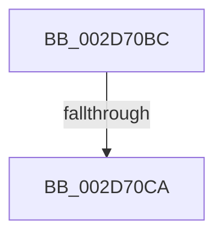

# sub_002D70BC

- RVA: `0x002D70BC`–`0x002D70D7` (길이 `27` bytes)
- VA: `0x00000001402D70BC`
- 실행 섹션: `.text`
- PDB 이름 있음: `아니요`; PDB Function 태그: `아니요`
- unwind 정보 RVA: `0x0006FF20`
- 디코드: `6`개 명령, `27/27` bytes 표시
- 미해석 바이트: `0` (있으면 어셈블리에 `.byte`로 보존)

> 이 문서는 커널 이미지의 기계어와 PDB 기호를 분석해 생성했습니다. 4번과 5번은 함수 원형과 자료형을 바이너리 사용 방식에서 추정한 C 해석이며 원본 소스 복구 결과는 아닙니다.

## 1. Dependencies

- 직접 호출 지점: **0**; 고유 호출 대상: **0**
- 직접 호출자로 확인된 함수: **0**
- RIP 상대 이미지 참조: **0**

### Outgoing calls
- 직접 디코드된 call 명령이 없습니다.

### Direct callers
- 이 함수 시작 RVA로 연결되는 직접 call은 확인되지 않았습니다. 간접 호출은 완전히 역산할 수 없습니다.

### Static image references
- 디코드된 RIP-relative 메모리 참조가 없습니다.

## 2. Other-region calls and transfers

- 다른 실행 섹션으로 향하는 call: **0**
- call이 아닌 외부 분기/꼬리 이동: **2**
  - `0x002D70C4` → [KiIntSteerDistributeInterrupts + 0x3C](KiIntSteerDistributeInterrupts_function_002D6F20.md) (`tail-transfer`)
  - `0x002D70D2` → [sub_002D6F9F + 0x38](Unknown_function_002D6F9F.md) (`tail-transfer`)

## 3. Assembly (complete function range)

```asm
002D70BC  66 FF C6                        inc si
002D70BF  0F B7 F6                        movzx esi, si
002D70C2  3B F1                           cmp esi, ecx
002D70C4  0F 83 92 FE FF FF               jae 0x1402d6f5c
002D70CA  48 8B 3C F5 08 00 00 00         mov rdi, qword ptr [rsi*8 + 8]
002D70D2  E9 00 FF FF FF                  jmp 0x1402d6fd7
```

## 4. C-style interpretation (structured pseudocode)

```c
void __fastcall sub_002D70BC(int a1)
{
    __int64 v_rsi;

    v_rsi = (unsigned __int16)((v_rsi) + 1);
}
```

## 5. (Beta) C Style

```c
void sub_002D70BC(int32_t Arg1)
{
    int64_t local_rsi;

    local_rsi = (uint16_t)((local_rsi) + 1);
}
```

## 6. Execution-region graph

[열기: 2D/3D 그래프와 함수 탐색 컨트롤 패널](../../../control-panel.html?section=text&rva=0x002D70BC&view=graph)

- 2D 그래프는 위에서 아래로 흐르고, 3D 그래프는 빈 공간을 드래그해 회전합니다. Shift+드래그는 이동, 휠은 확대·축소, 함수 노드 선택은 대상 보고서 이동입니다.

### Static fallback


