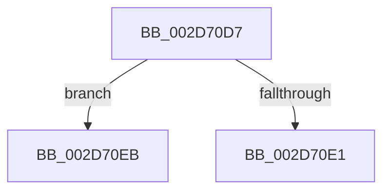

# sub_002D70D7

- RVA: `0x002D70D7`–`0x002D710C` (길이 `53` bytes)
- VA: `0x00000001402D70D7`
- 실행 섹션: `.text`
- PDB 이름 있음: `아니요`; PDB Function 태그: `아니요`
- unwind 정보 RVA: `0x0006FF30`
- 디코드: `11`개 명령, `53/53` bytes 표시
- 미해석 바이트: `0` (있으면 어셈블리에 `.byte`로 보존)

> 이 문서는 커널 이미지의 기계어와 PDB 기호를 분석해 생성했습니다. 4번과 5번은 함수 원형과 자료형을 바이너리 사용 방식에서 추정한 C 해석이며 원본 소스 복구 결과는 아닙니다.

## 1. Dependencies

- 직접 호출 지점: **0**; 고유 호출 대상: **0**
- 직접 호출자로 확인된 함수: **0**
- RIP 상대 이미지 참조: **0**

### Outgoing calls
- 직접 디코드된 call 명령이 없습니다.

### Direct callers
- 이 함수 시작 RVA로 연결되는 직접 call은 확인되지 않았습니다. 간접 호출은 완전히 역산할 수 없습니다.

### Static image references
- 디코드된 RIP-relative 메모리 참조가 없습니다.

## 2. Other-region calls and transfers

- 다른 실행 섹션으로 향하는 call: **0**
- call이 아닌 외부 분기/꼬리 이동: **2**
  - `0x002D70E9` → [sub_002D702E + 0x41](Unknown_function_002D702E.md) (`tail-transfer`)
  - `0x002D7107` → [sub_002D6F70 + 0x22](Unknown_function_002D6F70.md) (`tail-transfer`)

## 3. Assembly (complete function range)

```asm
002D70D7  66 FF C5                        inc bp
002D70DA  0F B7 ED                        movzx ebp, bp
002D70DD  3B E9                           cmp ebp, ecx
002D70DF  73 0A                           jae 0x1402d70eb
002D70E1  48 8B 34 ED 08 00 00 00         mov rsi, qword ptr [rbp*8 + 8]
002D70E9  EB 84                           jmp 0x1402d706f
002D70EB  0F B7 83 B8 00 00 00            movzx eax, word ptr [rbx + 0xb8]
002D70F2  66 89 83 A8 00 00 00            mov word ptr [rbx + 0xa8], ax
002D70F9  48 8B 83 B0 00 00 00            mov rax, qword ptr [rbx + 0xb0]
002D7100  48 89 83 A0 00 00 00            mov qword ptr [rbx + 0xa0], rax
002D7107  E9 86 FE FF FF                  jmp 0x1402d6f92
```

## 4. C-style interpretation (structured pseudocode)

```c
__int64 __fastcall sub_002D70D7(int a1)
{
    __int64 v_rbp;

    v_rbp = (unsigned __int16)((v_rbp) + 1);
    if (((unsigned int)((unsigned __int16)(v_rbp))) >= a1) goto loc_002D70EB;
loc_002D70EB:
    *(unsigned __int16 *)(v_rbx + 168) = (unsigned __int16)(*(unsigned __int16 *)(v_rbx + 184));
    *(unsigned __int64 *)(v_rbx + 160) = *(unsigned __int64 *)(v_rbx + 176);
}
```

## 5. (Beta) C Style

```c
int64_t sub_002D70D7(int32_t Arg1)
{
    int64_t local_rbp;

    local_rbp = (uint16_t)((local_rbp) + 1);
    if (((uint32_t)((uint16_t)(local_rbp))) >= Arg1) goto loc_002D70EB;
loc_002D70EB:
    *(uint16_t *)(local_rbx + 0xA8) = (uint16_t)(*(uint16_t *)(local_rbx + 0xB8));
    *(uint64_t *)(local_rbx + 0xA0) = *(uint64_t *)(local_rbx + 0xB0);
}
```

## 6. Execution-region graph

[열기: 2D/3D 그래프와 함수 탐색 컨트롤 패널](../../../control-panel.html?section=text&rva=0x002D70D7&view=graph)

- 2D 그래프는 위에서 아래로 흐르고, 3D 그래프는 빈 공간을 드래그해 회전합니다. Shift+드래그는 이동, 휠은 확대·축소, 함수 노드 선택은 대상 보고서 이동입니다.

### Static fallback


