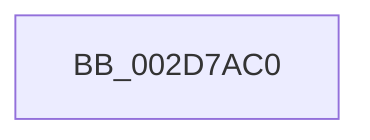

# sub_002D7AC0

- RVA: `0x002D7AC0`–`0x002D7ADD` (길이 `29` bytes)
- VA: `0x00000001402D7AC0`
- 실행 섹션: `.text`
- PDB 이름 있음: `아니요`; PDB Function 태그: `아니요`
- unwind 정보 RVA: `0x00070018`
- 디코드: `7`개 명령, `29/29` bytes 표시
- 미해석 바이트: `0` (있으면 어셈블리에 `.byte`로 보존)

> 이 문서는 커널 이미지의 기계어와 PDB 기호를 분석해 생성했습니다. 4번과 5번은 함수 원형과 자료형을 바이너리 사용 방식에서 추정한 C 해석이며 원본 소스 복구 결과는 아닙니다.

## 1. Dependencies

- 직접 호출 지점: **0**; 고유 호출 대상: **0**
- 직접 호출자로 확인된 함수: **0**
- RIP 상대 이미지 참조: **0**

### Outgoing calls
- 직접 디코드된 call 명령이 없습니다.

### Direct callers
- 이 함수 시작 RVA로 연결되는 직접 call은 확인되지 않았습니다. 간접 호출은 완전히 역산할 수 없습니다.

### Static image references
- 디코드된 RIP-relative 메모리 참조가 없습니다.

## 2. Other-region calls and transfers

- 다른 실행 섹션으로 향하는 call: **0**
- 별도 외부 분기/꼬리 이동을 확인하지 못했습니다.

## 3. Assembly (complete function range)

```asm
002D7AC0  49 89 5B 08                     mov qword ptr [r11 + 8], rbx
002D7AC4  48 8D 4C 24 48                  lea rcx, [rsp + 0x48]
002D7AC9  49 89 73 10                     mov qword ptr [r11 + 0x10], rsi
002D7ACD  33 D2                           xor edx, edx
002D7ACF  49 89 7B 18                     mov qword ptr [r11 + 0x18], rdi
002D7AD3  41 B8 00 01 00 00               mov r8d, 0x100
002D7AD9  4D 89 6B E8                     mov qword ptr [r11 - 0x18], r13
```

## 4. C-style interpretation (structured pseudocode)

```c
void __fastcall sub_002D7AC0(__int64 a1, int a2, __int64 a3, __int64 a4, __int64 a5, __int64 a6, __int64 a7, __int64 a8, __int64 a9)
{
    *(unsigned __int64 *)(v_r11 + 8) = v_rbx;
    *(unsigned __int64 *)(v_r11 + 16) = v_rsi;
    a2 = 0;
    *(unsigned __int64 *)(v_r11 + 24) = v_rdi;
    *(unsigned __int64 *)(v_r11 - 24) = v_r13;
    return;
}
```

## 5. (Beta) C Style

```c
void sub_002D7AC0(int64_t Arg1, int32_t Arg2, int64_t Arg3, int64_t Arg4, uint64_t Arg5, uint64_t Arg6, uint64_t Arg7, uint64_t Arg8, int64_t Arg9)
{
    *(uint64_t *)(local_r11 + 0x8) = local_rbx;
    *(uint64_t *)(local_r11 + 0x10) = local_rsi;
    Arg2 = 0;
    *(uint64_t *)(local_r11 + 0x18) = local_rdi;
    *(uint64_t *)(local_r11 - 0x18) = local_r13;
    return;
}
```

## 6. Execution-region graph

[열기: 2D/3D 그래프와 함수 탐색 컨트롤 패널](../../../control-panel.html?section=text&rva=0x002D7AC0&view=graph)

- 2D 그래프는 위에서 아래로 흐르고, 3D 그래프는 빈 공간을 드래그해 회전합니다. Shift+드래그는 이동, 휠은 확대·축소, 함수 노드 선택은 대상 보고서 이동입니다.

### Static fallback


