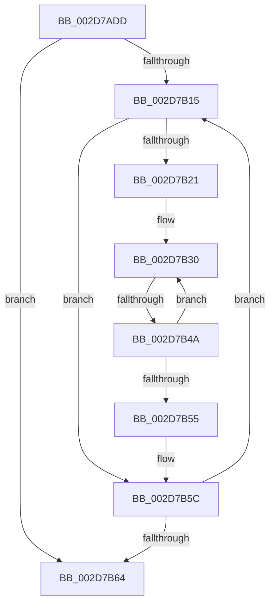

# sub_002D7ADD

- RVA: `0x002D7ADD`–`0x002D7BB3` (길이 `214` bytes)
- VA: `0x00000001402D7ADD`
- 실행 섹션: `.text`
- PDB 이름 있음: `아니요`; PDB Function 태그: `아니요`
- unwind 정보 RVA: `0x00070038`
- 디코드: `47`개 명령, `214/214` bytes 표시
- 미해석 바이트: `0` (있으면 어셈블리에 `.byte`로 보존)

> 이 문서는 커널 이미지의 기계어와 PDB 기호를 분석해 생성했습니다. 4번과 5번은 함수 원형과 자료형을 바이너리 사용 방식에서 추정한 C 해석이며 원본 소스 복구 결과는 아닙니다.

## 1. Dependencies

- 직접 호출 지점: **2**; 고유 호출 대상: **1**
- 직접 호출자로 확인된 함수: **0**
- RIP 상대 이미지 참조: **2**

### Outgoing calls
- `0x002D7AE5` → [memset](../6C/memset_function_006C6C40.md) (function, `0x006C6C40`)
- `0x002D7B7B` → [memset](../6C/memset_function_006C6C40.md) (function, `0x006C6C40`)

### Direct callers
- 이 함수 시작 RVA로 연결되는 직접 call은 확인되지 않았습니다. 간접 호출은 완전히 역산할 수 없습니다.

### Static image references
- `0x002D7AEA` → RVA `0x00FC6BA8` (`ALMOSTRO`; read)
- `0x002D7B89` → RVA `0x00E0B5A0` (`.data`; read)

## 2. Other-region calls and transfers

- 다른 실행 섹션으로 향하는 call: **0**
- call이 아닌 외부 분기/꼬리 이동: **2**
  - `0x002D7B44` → [sub_002D7E2F](Unknown_function_002D7E2F.md) (`tail-transfer`)
  - `0x002D7BAD` → [sub_002D7BB3 + 0x10F](Unknown_function_002D7BB3.md) (`tail-transfer`)

## 3. Assembly (complete function range)

```asm
002D7ADD  4D 89 73 E0                     mov qword ptr [r11 - 0x20], r14
002D7AE1  4D 89 7B D8                     mov qword ptr [r11 - 0x28], r15
002D7AE5  E8 56 F1 3E 00                  call 0x1406c6c40
002D7AEA  4C 8B 35 B7 F0 CE 00            mov r14, qword ptr [rip + 0xcef0b7]
002D7AF1  48 8D 0D B0 F0 CE 00            lea rcx, [rip + 0xcef0b0]
002D7AF8  33 C0                           xor eax, eax
002D7AFA  45 33 E4                        xor r12d, r12d
002D7AFD  45 32 FF                        xor r15b, r15b
002D7B00  48 89 44 24 30                  mov qword ptr [rsp + 0x30], rax
002D7B05  0F 57 C0                        xorps xmm0, xmm0
002D7B08  45 8B EC                        mov r13d, r12d
002D7B0B  0F 11 44 24 20                  movups xmmword ptr [rsp + 0x20], xmm0
002D7B10  4C 3B F1                        cmp r14, rcx
002D7B13  74 4F                           je 0x1402d7b64
002D7B15  41 8B DC                        mov ebx, r12d
002D7B18  41 39 9E 28 01 00 00            cmp dword ptr [r14 + 0x128], ebx
002D7B1F  76 3B                           jbe 0x1402d7b5c
002D7B21  0F 1F 40 00                     nop dword ptr [rax]
002D7B25  66 66 66 0F 1F 84 00 00 00 00 00  nop word ptr [rax + rax]
002D7B30  8B C3                           mov eax, ebx
002D7B32  48 69 F0 A8 04 00 00            imul rsi, rax, 0x4a8
002D7B39  49 03 B6 38 01 00 00            add rsi, qword ptr [r14 + 0x138]
002D7B40  83 7E 10 01                     cmp dword ptr [rsi + 0x10], 1
002D7B44  0F 84 E5 02 00 00               je 0x1402d7e2f
002D7B4A  FF C3                           inc ebx
002D7B4C  41 3B 9E 28 01 00 00            cmp ebx, dword ptr [r14 + 0x128]
002D7B53  72 DB                           jb 0x1402d7b30
002D7B55  48 8D 0D 4C F0 CE 00            lea rcx, [rip + 0xcef04c]
002D7B5C  4D 8B 36                        mov r14, qword ptr [r14]
002D7B5F  4C 3B F1                        cmp r14, rcx
002D7B62  75 B1                           jne 0x1402d7b15
002D7B64  B8 20 00 00 00                  mov eax, 0x20
002D7B69  48 8D 4C 24 48                  lea rcx, [rsp + 0x48]
002D7B6E  33 D2                           xor edx, edx
002D7B70  66 89 44 24 42                  mov word ptr [rsp + 0x42], ax
002D7B75  41 B8 00 01 00 00               mov r8d, 0x100
002D7B7B  E8 C0 F0 3E 00                  call 0x1406c6c40
002D7B80  0F B7 44 24 42                  movzx eax, word ptr [rsp + 0x42]
002D7B85  41 0F B7 CC                     movzx ecx, r12w
002D7B89  0F B7 1D 10 3A B3 00            movzx ebx, word ptr [rip + 0xb33a10]
002D7B90  4C 8B B4 24 68 01 00 00         mov r14, qword ptr [rsp + 0x168]
002D7B98  66 3B D8                        cmp bx, ax
002D7B9B  44 89 64 24 44                  mov dword ptr [rsp + 0x44], r12d
002D7BA0  66 0F 47 D8                     cmova bx, ax
002D7BA4  66 89 5C 24 40                  mov word ptr [rsp + 0x40], bx
002D7BA9  66 44 3B E3                     cmp r12w, bx
002D7BAD  0F 82 0F 01 00 00               jb 0x1402d7cc2
```

## 4. C-style interpretation (structured pseudocode)

```c
__int64 __fastcall sub_002D7ADD(__int64 a1, int a2, __int64 a3, __int64 a4, __int64 a5, __int64 a6, __int64 a7, __int64 a8, __int64 a9, __int64 a10, __int64 a11, __int64 a12, __int64 a13, __int64 a14, __int64 a15, __int64 a16, __int64 a17, __int64 a18, __int64 a19, __int64 a20, __int64 a21, __int64 a22, __int64 a23, __int64 a24, __int64 a25, __int64 a26, __int64 a27, __int64 a28, __int64 a29, __int64 a30, __int64 a31, __int64 a32, __int64 a33, __int64 a34, __int64 a35, __int64 a36, __int64 a37, __int64 a38, __int64 a39, __int64 a40, __int64 a41, __int64 a42, __int64 a43, __int64 a44, __int64 a45)
{
    __int64 result;
    __int64 v_r12;
    __int64 v_r15;
    __int64 v_rbx;
    __int64 v_rsi;
    unsigned __int64 v_stack_p20;
    unsigned __int64 v_stack_p30;
    unsigned __int16 v_stack_p40;
    unsigned __int16 v_stack_p42;
    unsigned int v_stack_p44;

    *(unsigned __int64 *)(v_r11 - 32) = v_r14;
    *(unsigned __int64 *)(v_r11 - 40) = v_r15;
    result = memset(a1, a2, a3, a4);
    result = 0;
    v_r12 = 0;
    v_r15 = 0;
    v_stack_p30 = 0;
    v_stack_p20 = v_xmm0;
    if ((*(unsigned __int64 *)(v_rip + 13562039)) == (v_rip + 13562032)) goto loc_002D7B64;
loc_002D7B15:
    if ((*(unsigned int *)(*(unsigned __int64 *)(v_rip + 13562039) + 296)) <= 0) goto loc_002D7B5C;
loc_002D7B30:
    v_rsi = (v_rsi) * (0);
    v_rsi = (v_rsi) + (*(unsigned __int64 *)(*(unsigned __int64 *)(v_rip + 13562039) + 312));
    v_rbx = (unsigned int)((0) + 1);
    if (((unsigned int)(v_rbx)) < (*(unsigned int *)(*(unsigned __int64 *)(v_rip + 13562039) + 296))) goto loc_002D7B30;
loc_002D7B5C:
    if ((*(unsigned __int64 *)(*(unsigned __int64 *)(v_rip + 13562039))) != (v_rip + 13561932)) goto loc_002D7B15;
loc_002D7B64:
    a2 = 0;
    v_stack_p42 = 32;
    result = memset(a9, a2, 256, a4);
    v_stack_p44 = 0;
    v_rbx = *(unsigned __int16 *)(v_rip + 11745808);
    if (((unsigned __int16)(*(unsigned __int16 *)(v_rip + 11745808))) > ((unsigned __int16)(v_stack_p42))) { v_rbx = (unsigned __int16)(v_stack_p42); }
    v_stack_p40 = (unsigned __int16)(v_rbx);
}
```

## 5. (Beta) C Style

```c
int64_t sub_002D7ADD(int64_t Arg1, int32_t Arg2, int64_t Arg3, int64_t Arg4, uint64_t Arg5, uint64_t Arg6, uint64_t Arg7, uint64_t Arg8, int64_t Arg9, uint64_t Arg10, uint64_t Arg11, uint64_t Arg12, uint64_t Arg13, uint64_t Arg14, uint64_t Arg15, uint64_t Arg16, uint64_t Arg17, uint64_t Arg18, uint64_t Arg19, uint64_t Arg20, uint64_t Arg21, uint64_t Arg22, uint64_t Arg23, uint64_t Arg24, uint64_t Arg25, uint64_t Arg26, uint64_t Arg27, uint64_t Arg28, uint64_t Arg29, uint64_t Arg30, uint64_t Arg31, uint64_t Arg32, uint64_t Arg33, uint64_t Arg34, uint64_t Arg35, uint64_t Arg36, uint64_t Arg37, uint64_t Arg38, uint64_t Arg39, uint64_t Arg40, uint64_t Arg41, uint64_t Arg42, uint64_t Arg43, uint64_t Arg44, int64_t Arg45)
{
    int64_t result;
    int64_t local_r12;
    int64_t local_r15;
    int64_t local_rbx;
    int64_t local_rsi;
    uint64_t v_stack_p20;
    uint64_t v_stack_p30;
    uint16_t v_stack_p40;
    uint16_t v_stack_p42;
    uint32_t v_stack_p44;

    *(uint64_t *)(local_r11 - 0x20) = local_r14;
    *(uint64_t *)(local_r11 - 0x28) = local_r15;
    result = memset(Arg1, Arg2, Arg3, Arg4);
    result = 0;
    local_r12 = 0;
    local_r15 = 0;
    v_stack_p30 = 0;
    v_stack_p20 = v_xmm0;
    if ((*(uint64_t *)(v_rip + 0xCEF0B7)) == (v_rip + 13562032)) goto loc_002D7B64;
loc_002D7B15:
    if ((*(uint32_t *)(*(uint64_t *)(v_rip + 0xCEF0B7) + 0x128)) <= 0) goto loc_002D7B5C;
loc_002D7B30:
    local_rsi = (local_rsi) * (0);
    local_rsi = (local_rsi) + (*(uint64_t *)(*(uint64_t *)(v_rip + 0xCEF0B7) + 0x138));
    local_rbx = (uint32_t)((0) + 1);
    if (((uint32_t)(local_rbx)) < (*(uint32_t *)(*(uint64_t *)(v_rip + 0xCEF0B7) + 0x128))) goto loc_002D7B30;
loc_002D7B5C:
    if ((*(uint64_t *)(*(uint64_t *)(v_rip + 0xCEF0B7))) != (v_rip + 13561932)) goto loc_002D7B15;
loc_002D7B64:
    Arg2 = 0;
    v_stack_p42 = 32;
    result = memset(Arg9, Arg2, 256, Arg4);
    v_stack_p44 = 0;
    local_rbx = *(uint16_t *)(v_rip + 0xB33A10);
    if (((uint16_t)(*(uint16_t *)(v_rip + 0xB33A10))) > ((uint16_t)(v_stack_p42))) { local_rbx = (uint16_t)(v_stack_p42); }
    v_stack_p40 = (uint16_t)(local_rbx);
}
```

## 6. Execution-region graph

[열기: 2D/3D 그래프와 함수 탐색 컨트롤 패널](../../../control-panel.html?section=text&rva=0x002D7ADD&view=graph)

- 2D 그래프는 위에서 아래로 흐르고, 3D 그래프는 빈 공간을 드래그해 회전합니다. Shift+드래그는 이동, 휠은 확대·축소, 함수 노드 선택은 대상 보고서 이동입니다.

### Static fallback


