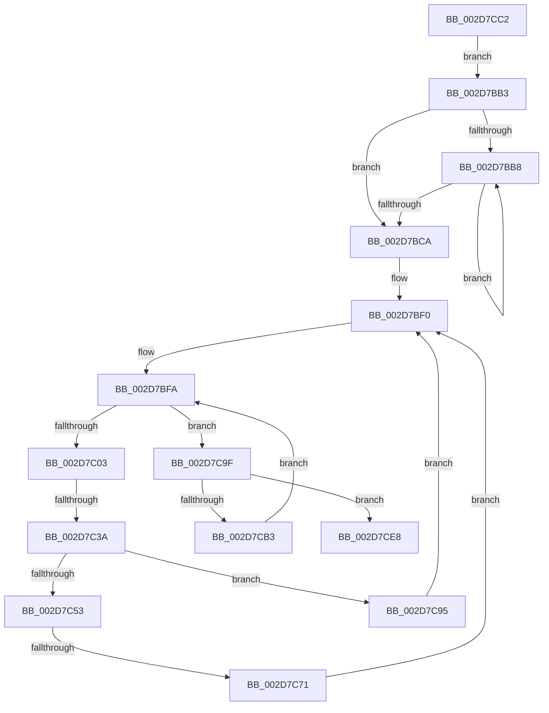

# sub_002D7BB3

- RVA: `0x002D7BB3`–`0x002D7CF9` (길이 `326` bytes)
- VA: `0x00000001402D7BB3`
- 실행 섹션: `.text`
- PDB 이름 있음: `아니요`; PDB Function 태그: `아니요`
- unwind 정보 RVA: `0x00070050`
- 디코드: `76`개 명령, `326/326` bytes 표시
- 미해석 바이트: `0` (있으면 어셈블리에 `.byte`로 보존)

> 이 문서는 커널 이미지의 기계어와 PDB 기호를 분석해 생성했습니다. 4번과 5번은 함수 원형과 자료형을 바이너리 사용 방식에서 추정한 C 해석이며 원본 소스 복구 결과는 아닙니다.

## 1. Dependencies

- 직접 호출 지점: **2**; 고유 호출 대상: **2**
- 직접 호출자로 확인된 함수: **0**
- RIP 상대 이미지 참조: **5**

### Outgoing calls
- `0x002D7C4A` → [PpmPerfSnapDeliveredPerformance](PpmPerfSnapDeliveredPerformance_function_002D7F30.md) (function, `0x002D7F30`)
- `0x002D7CD6` → [memcpy](../6C/memcpy_function_006C6840.md) (function, `0x006C6840`)

### Direct callers
- 이 함수 시작 RVA로 연결되는 직접 call은 확인되지 않았습니다. 간접 호출은 완전히 역산할 수 없습니다.

### Static image references
- `0x002D7BD9` → RVA `0x00FC8C40` (`ALMOSTRO`; read)
- `0x002D7C20` → RVA `0x00F231B8` (`.data`; read)
- `0x002D7C2A` → RVA `0x00FC6A80` (`ALMOSTRO`; read)
- `0x002D7C53` → RVA `0x00F231B0` (`.data`; read)
- `0x002D7CC6` → RVA `0x00E0B5A8` (`.data`; read)

## 2. Other-region calls and transfers

- 다른 실행 섹션으로 향하는 call: **0**
- call이 아닌 외부 분기/꼬리 이동: **3**
  - `0x002D7C34` → [sub_002D7E1D + 0xA](Unknown_function_002D7E1D.md) (`tail-transfer`)
  - `0x002D7C6B` → [sub_002D7E1D](Unknown_function_002D7E1D.md) (`tail-transfer`)
  - `0x002D7CF3` → [sub_002D7E45](Unknown_function_002D7E45.md) (`tail-transfer`)

## 3. Assembly (complete function range)

```asm
002D7BB3  66 3B C8                        cmp cx, ax
002D7BB6  73 12                           jae 0x1402d7bca
002D7BB8  0F B7 C1                        movzx eax, cx
002D7BBB  66 FF C1                        inc cx
002D7BBE  4C 89 64 C4 48                  mov qword ptr [rsp + rax*8 + 0x48], r12
002D7BC3  66 3B 4C 24 42                  cmp cx, word ptr [rsp + 0x42]
002D7BC8  72 EE                           jb 0x1402d7bb8
002D7BCA  48 8B 4C 24 48                  mov rcx, qword ptr [rsp + 0x48]
002D7BCF  48 8D 44 24 40                  lea rax, [rsp + 0x40]
002D7BD4  48 89 4C 24 28                  mov qword ptr [rsp + 0x28], rcx
002D7BD9  48 8D 3D 60 10 CF 00            lea rdi, [rip + 0xcf1060]
002D7BE0  48 89 44 24 20                  mov qword ptr [rsp + 0x20], rax
002D7BE5  66 66 66 0F 1F 84 00 00 00 00 00  nop word ptr [rax + rax]
002D7BF0  0F B7 54 24 40                  movzx edx, word ptr [rsp + 0x40]
002D7BF5  44 89 64 24 3C                  mov dword ptr [rsp + 0x3c], r12d
002D7BFA  48 85 C9                        test rcx, rcx
002D7BFD  0F 84 9C 00 00 00               je 0x1402d7c9f
002D7C03  48 0F BC D1                     bsf rdx, rcx
002D7C07  0F B6 C2                        movzx eax, dl
002D7C0A  48 0F B3 C1                     btr rcx, rax
002D7C0E  0F B6 C2                        movzx eax, dl
002D7C11  48 89 4C 24 28                  mov qword ptr [rsp + 0x28], rcx
002D7C16  0F B7 4C 24 30                  movzx ecx, word ptr [rsp + 0x30]
002D7C1B  C1 E1 06                        shl ecx, 6
002D7C1E  03 C8                           add ecx, eax
002D7C20  48 8B 05 91 B5 C4 00            mov rax, qword ptr [rip + 0xc4b591]
002D7C27  8B 14 88                        mov edx, dword ptr [rax + rcx*4]
002D7C2A  8B 05 50 EE CE 00               mov eax, dword ptr [rip + 0xceee50]
002D7C30  8B DA                           mov ebx, edx
002D7C32  3B D0                           cmp edx, eax
002D7C34  0F 83 ED 01 00 00               jae 0x1402d7e27
002D7C3A  48 8B 0C D7                     mov rcx, qword ptr [rdi + rdx*8]
002D7C3E  48 81 C1 B0 89 00 00            add rcx, 0x89b0
002D7C45  45 33 C0                        xor r8d, r8d
002D7C48  33 D2                           xor edx, edx
002D7C4A  E8 E1 02 00 00                  call 0x1402d7f30
002D7C4F  84 C0                           test al, al
002D7C51  74 42                           je 0x1402d7c95
002D7C53  48 8B 05 56 B5 C4 00            mov rax, qword ptr [rip + 0xc4b556]
002D7C5A  44 8B 04 98                     mov r8d, dword ptr [rax + rbx*4]
002D7C5E  41 8B C8                        mov ecx, r8d
002D7C61  0F B7 44 24 40                  movzx eax, word ptr [rsp + 0x40]
002D7C66  C1 E9 06                        shr ecx, 6
002D7C69  3B C1                           cmp eax, ecx
002D7C6B  0F 86 AC 01 00 00               jbe 0x1402d7e1d
002D7C71  48 8D 54 24 48                  lea rdx, [rsp + 0x48]
002D7C76  48 8B 04 CA                     mov rax, qword ptr [rdx + rcx*8]
002D7C7A  48 8D 14 CA                     lea rdx, [rdx + rcx*8]
002D7C7E  41 8B C8                        mov ecx, r8d
002D7C81  83 E1 3F                        and ecx, 0x3f
002D7C84  48 0F B3 C8                     btr rax, rcx
002D7C88  48 8B 4C 24 28                  mov rcx, qword ptr [rsp + 0x28]
002D7C8D  48 89 02                        mov qword ptr [rdx], rax
002D7C90  E9 5B FF FF FF                  jmp 0x1402d7bf0
002D7C95  48 8B 4C 24 28                  mov rcx, qword ptr [rsp + 0x28]
002D7C9A  E9 51 FF FF FF                  jmp 0x1402d7bf0
002D7C9F  0F B7 44 24 30                  movzx eax, word ptr [rsp + 0x30]
002D7CA4  66 FF C0                        inc ax
002D7CA7  0F B7 C8                        movzx ecx, ax
002D7CAA  66 89 4C 24 30                  mov word ptr [rsp + 0x30], cx
002D7CAF  3B CA                           cmp ecx, edx
002D7CB1  73 35                           jae 0x1402d7ce8
002D7CB3  48 8B 4C CC 48                  mov rcx, qword ptr [rsp + rcx*8 + 0x48]
002D7CB8  48 89 4C 24 28                  mov qword ptr [rsp + 0x28], rcx
002D7CBD  E9 38 FF FF FF                  jmp 0x1402d7bfa
002D7CC2  44 0F B7 C3                     movzx r8d, bx
002D7CC6  48 8D 15 DB 38 B3 00            lea rdx, [rip + 0xb338db]
002D7CCD  49 C1 E0 03                     shl r8, 3
002D7CD1  48 8D 4C 24 48                  lea rcx, [rsp + 0x48]
002D7CD6  E8 65 EB 3E 00                  call 0x1406c6840
002D7CDB  0F B7 44 24 42                  movzx eax, word ptr [rsp + 0x42]
002D7CE0  0F B7 CB                        movzx ecx, bx
002D7CE3  E9 CB FE FF FF                  jmp 0x1402d7bb3
002D7CE8  45 84 FF                        test r15b, r15b
002D7CEB  4C 8B BC 24 60 01 00 00         mov r15, qword ptr [rsp + 0x160]
002D7CF3  0F 85 4C 01 00 00               jne 0x1402d7e45
```

## 4. C-style interpretation (structured pseudocode)

```c
__int64 __fastcall sub_002D7BB3(unsigned __int16 a1, __int64 a2, int a3, __int64 a4, __int64 a5, unsigned __int16 a6, __int64 a7, unsigned __int16 a8, __int64 a9, __int64 a10, __int64 a11, __int64 a12, __int64 a13, __int64 a14, __int64 a15, __int64 a16, __int64 a17, __int64 a18, __int64 a19, __int64 a20, __int64 a21, __int64 a22, __int64 a23, __int64 a24, __int64 a25, __int64 a26, __int64 a27, __int64 a28, __int64 a29, __int64 a30, __int64 a31, __int64 a32, __int64 a33, __int64 a34, __int64 a35, __int64 a36, __int64 a37, __int64 a38, __int64 a39, __int64 a40, __int64 a41, __int64 a42, __int64 a43, __int64 a44)
{
    __int64 result;
    unsigned __int64 v_stack_p20;
    unsigned __int64 v_stack_p28;
    unsigned __int16 v_stack_p30;
    unsigned int v_stack_p3C;
    unsigned __int16 v_stack_p42;
    unsigned __int64 v_stack_p48;

    if (a1 >= ((unsigned __int16)(result))) goto loc_002D7BCA;
loc_002D7BB8:
    a1 = (unsigned __int16)((a1) + 1);
    *(unsigned __int64 *)(v_rsp + a1 * 8 + 72) = v_r12;
    if (a1 < v_stack_p42) goto loc_002D7BB8;
loc_002D7BCA:
    v_stack_p28 = a9;
    v_stack_p20 = a8;
loc_002D7BF0:
    v_stack_p3C = (unsigned int)(v_r12);
loc_002D7BFA:
    if (a9 == 0) goto loc_002D7C9F;
    v_stack_p28 = a9;
    a1 = (unsigned int)((a6) << (6));
    a1 = (unsigned int)((a1) + ((unsigned int)((unsigned __int8)(a8))));
    a1 = (*(unsigned __int64 *)(v_rip + 13570144 + (unsigned int)(*(unsigned int *)(*(unsigned __int64 *)(v_rip + 12891537) + a1 * 4)) * 8)) + (0x89B0ULL);
    a3 = 0;
    a2 = 0;
    result = PpmPerfSnapDeliveredPerformance(a1, a2, a3, a4);
    if ((unsigned __int8)(result) == 0) goto loc_002D7C95;
    a1 = (unsigned int)(((unsigned int)((unsigned int)((unsigned int)(*(unsigned int *)(*(unsigned __int64 *)(v_rip + 12891478) + (unsigned int)((unsigned int)((unsigned int)(*(unsigned int *)(*(unsigned __int64 *)(v_rip + 12891537) + a1 * 4)))) * 4))))) >> (6));
    a1 = (unsigned int)(((unsigned int)((unsigned int)((unsigned int)(*(unsigned int *)(*(unsigned __int64 *)(v_rip + 12891478) + (unsigned int)((unsigned int)((unsigned int)(*(unsigned int *)(*(unsigned __int64 *)(v_rip + 12891537) + a1 * 4)))) * 4))))) & (63));
    *(unsigned __int64 *)(a9 + a1 * 8) = *(unsigned __int64 *)(a9 + a1 * 8);
    goto loc_002D7BF0;
loc_002D7C95:
    goto loc_002D7BF0;
loc_002D7C9F:
    result = (unsigned __int16)((a6) + 1);
    v_stack_p30 = (unsigned __int16)((unsigned __int16)(result));
    if (((unsigned int)((unsigned __int16)(result))) >= ((unsigned int)(a9 + a1 * 8))) goto loc_002D7CE8;
    v_stack_p28 = *(unsigned __int64 *)(v_rsp + (unsigned __int16)(result) * 8 + 72);
    goto loc_002D7BFA;
loc_002D7CE8:
}
```

## 5. (Beta) C Style

```c
int64_t sub_002D7BB3(uint16_t Arg1, int64_t Arg2, int32_t Arg3, int64_t Arg4, int64_t Arg5, uint16_t Arg6, uint64_t Arg7, uint16_t Arg8, int64_t Arg9, uint64_t Arg10, uint64_t Arg11, uint64_t Arg12, uint64_t Arg13, uint64_t Arg14, uint64_t Arg15, uint64_t Arg16, uint64_t Arg17, uint64_t Arg18, uint64_t Arg19, uint64_t Arg20, uint64_t Arg21, uint64_t Arg22, uint64_t Arg23, uint64_t Arg24, uint64_t Arg25, uint64_t Arg26, uint64_t Arg27, uint64_t Arg28, uint64_t Arg29, uint64_t Arg30, uint64_t Arg31, uint64_t Arg32, uint64_t Arg33, uint64_t Arg34, uint64_t Arg35, uint64_t Arg36, uint64_t Arg37, uint64_t Arg38, uint64_t Arg39, uint64_t Arg40, uint64_t Arg41, uint64_t Arg42, uint64_t Arg43, int64_t Arg44)
{
    int64_t result;
    uint64_t v_stack_p20;
    uint64_t v_stack_p28;
    uint16_t v_stack_p30;
    uint32_t v_stack_p3C;
    uint16_t v_stack_p42;
    uint64_t v_stack_p48;

    if (Arg1 >= ((uint16_t)(result))) goto loc_002D7BCA;
loc_002D7BB8:
    Arg1 = (uint16_t)((Arg1) + 1);
    *(uint64_t *)(local_rsp + Arg1 * 8 + 0x48) = local_r12;
    if (Arg1 < v_stack_p42) goto loc_002D7BB8;
loc_002D7BCA:
    v_stack_p28 = Arg9;
    v_stack_p20 = Arg8;
loc_002D7BF0:
    v_stack_p3C = (uint32_t)(local_r12);
loc_002D7BFA:
    if (Arg9 == 0) goto loc_002D7C9F;
    v_stack_p28 = Arg9;
    Arg1 = (uint32_t)((Arg6) << (6));
    Arg1 = (uint32_t)((Arg1) + ((uint32_t)((uint8_t)(Arg8))));
    Arg1 = (*(uint64_t *)(v_rip + 0xCF1060 + (uint32_t)(*(uint32_t *)(*(uint64_t *)(v_rip + 0xC4B591) + Arg1 * 4)) * 8)) + (0x89B0ULL);
    Arg3 = 0;
    Arg2 = 0;
    result = PpmPerfSnapDeliveredPerformance(Arg1, Arg2, Arg3, Arg4);
    if ((uint8_t)(result) == 0) goto loc_002D7C95;
    Arg1 = (uint32_t)(((uint32_t)((uint32_t)((uint32_t)(*(uint32_t *)(*(uint64_t *)(v_rip + 0xC4B556) + (uint32_t)((uint32_t)((uint32_t)(*(uint32_t *)(*(uint64_t *)(v_rip + 0xC4B591) + Arg1 * 4)))) * 4))))) >> (6));
    Arg1 = (uint32_t)(((uint32_t)((uint32_t)((uint32_t)(*(uint32_t *)(*(uint64_t *)(v_rip + 0xC4B556) + (uint32_t)((uint32_t)((uint32_t)(*(uint32_t *)(*(uint64_t *)(v_rip + 0xC4B591) + Arg1 * 4)))) * 4))))) & (63));
    *(uint64_t *)(Arg9 + Arg1 * 8) = *(uint64_t *)(Arg9 + Arg1 * 8);
    goto loc_002D7BF0;
loc_002D7C95:
    goto loc_002D7BF0;
loc_002D7C9F:
    result = (uint16_t)((Arg6) + 1);
    v_stack_p30 = (uint16_t)((uint16_t)(result));
    if (((uint32_t)((uint16_t)(result))) >= ((uint32_t)(Arg9 + Arg1 * 8))) goto loc_002D7CE8;
    v_stack_p28 = *(uint64_t *)(local_rsp + (uint16_t)(result) * 8 + 0x48);
    goto loc_002D7BFA;
loc_002D7CE8:
}
```

## 6. Execution-region graph

[열기: 2D/3D 그래프와 함수 탐색 컨트롤 패널](../../../control-panel.html?section=text&rva=0x002D7BB3&view=graph)

- 2D 그래프는 위에서 아래로 흐르고, 3D 그래프는 빈 공간을 드래그해 회전합니다. Shift+드래그는 이동, 휠은 확대·축소, 함수 노드 선택은 대상 보고서 이동입니다.

### Static fallback


