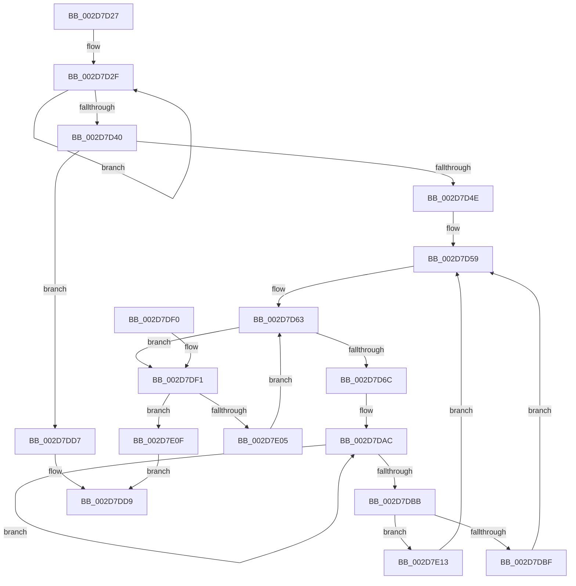

# sub_002D7D27

- RVA: `0x002D7D27`–`0x002D7E1D` (길이 `246` bytes)
- VA: `0x00000001402D7D27`
- 실행 섹션: `.text`
- PDB 이름 있음: `아니요`; PDB Function 태그: `아니요`
- unwind 정보 RVA: `0x00070074`
- 디코드: `64`개 명령, `246/246` bytes 표시
- 미해석 바이트: `0` (있으면 어셈블리에 `.byte`로 보존)

> 이 문서는 커널 이미지의 기계어와 PDB 기호를 분석해 생성했습니다. 4번과 5번은 함수 원형과 자료형을 바이너리 사용 방식에서 추정한 C 해석이며 원본 소스 복구 결과는 아닙니다.

## 1. Dependencies

- 직접 호출 지점: **3**; 고유 호출 대상: **3**
- 직접 호출자로 확인된 함수: **0**
- RIP 상대 이미지 참조: **2**

### Outgoing calls
- `0x002D7D97` → [KeGetPrcb](KeGetPrcb_function_002D85D0.md) (function, `0x002D85D0`)
- `0x002D7DCB` → [KeInsertQueueDpc](../20/KeInsertQueueDpc_function_00207C50.md) (function, `0x00207C50`)
- `0x002D7DE0` → [_security_check_cookie](../6A/_security_check_cookie_function_006AC640.md) (function, `0x006AC640`)

### Direct callers
- 이 함수 시작 RVA로 연결되는 직접 call은 확인되지 않았습니다. 간접 호출은 완전히 역산할 수 없습니다.

### Static image references
- `0x002D7D40` → RVA `0x00F0B278` (`.data`; write)
- `0x002D7D8D` → RVA `0x00F231B8` (`.data`; read)

## 2. Other-region calls and transfers

- 다른 실행 섹션으로 향하는 call: **0**
- 별도 외부 분기/꼬리 이동을 확인하지 못했습니다.

## 3. Assembly (complete function range)

```asm
002D7D27  48 8D 54 24 48                  lea rdx, [rsp + 0x48]
002D7D2C  44 8B C0                        mov r8d, eax
002D7D2F  F3 48 0F B8 02                  popcnt rax, qword ptr [rdx]
002D7D34  03 C8                           add ecx, eax
002D7D36  48 8D 52 08                     lea rdx, [rdx + 8]
002D7D3A  49 83 E8 01                     sub r8, 1
002D7D3E  75 EF                           jne 0x1402d7d2f
002D7D40  89 0D 32 35 C3 00               mov dword ptr [rip + 0xc33532], ecx
002D7D46  85 C9                           test ecx, ecx
002D7D48  0F 84 89 00 00 00               je 0x1402d7dd7
002D7D4E  48 8B 4C 24 48                  mov rcx, qword ptr [rsp + 0x48]
002D7D53  66 44 89 64 24 30               mov word ptr [rsp + 0x30], r12w
002D7D59  0F B7 54 24 40                  movzx edx, word ptr [rsp + 0x40]
002D7D5E  44 89 64 24 38                  mov dword ptr [rsp + 0x38], r12d
002D7D63  48 85 C9                        test rcx, rcx
002D7D66  0F 84 85 00 00 00               je 0x1402d7df1
002D7D6C  48 0F BC D1                     bsf rdx, rcx
002D7D70  0F B6 C2                        movzx eax, dl
002D7D73  48 0F B3 C1                     btr rcx, rax
002D7D77  89 54 24 38                     mov dword ptr [rsp + 0x38], edx
002D7D7B  48 89 4C 24 28                  mov qword ptr [rsp + 0x28], rcx
002D7D80  0F B7 4C 24 30                  movzx ecx, word ptr [rsp + 0x30]
002D7D85  C1 E1 06                        shl ecx, 6
002D7D88  0F B6 C2                        movzx eax, dl
002D7D8B  03 C8                           add ecx, eax
002D7D8D  48 8B 05 24 B4 C4 00            mov rax, qword ptr [rip + 0xc4b424]
002D7D94  8B 0C 88                        mov ecx, dword ptr [rax + rcx*4]
002D7D97  E8 34 08 00 00                  call 0x1402d85d0
002D7D9C  48 8B D0                        mov rdx, rax
002D7D9F  0F 0D 88 98 89 00 00            prefetchw byte ptr [rax + 0x8998]
002D7DA6  8B 80 98 89 00 00               mov eax, dword ptr [rax + 0x8998]
002D7DAC  8B C8                           mov ecx, eax
002D7DAE  83 C9 01                        or ecx, 1
002D7DB1  F0 0F B1 8A 98 89 00 00         lock cmpxchg dword ptr [rdx + 0x8998], ecx
002D7DB9  75 F1                           jne 0x1402d7dac
002D7DBB  85 C0                           test eax, eax
002D7DBD  75 54                           jne 0x1402d7e13
002D7DBF  48 8D 8A 58 89 00 00            lea rcx, [rdx + 0x8958]
002D7DC6  45 33 C0                        xor r8d, r8d
002D7DC9  33 D2                           xor edx, edx
002D7DCB  E8 80 FE F2 FF                  call 0x140207c50
002D7DD0  48 8B 4C 24 28                  mov rcx, qword ptr [rsp + 0x28]
002D7DD5  EB 82                           jmp 0x1402d7d59
002D7DD7  B0 01                           mov al, 1
002D7DD9  48 8B 4D 50                     mov rcx, qword ptr [rbp + 0x50]
002D7DDD  48 33 CC                        xor rcx, rsp
002D7DE0  E8 5B 48 3D 00                  call 0x1406ac640
002D7DE5  48 81 C4 78 01 00 00            add rsp, 0x178
002D7DEC  41 5C                           pop r12
002D7DEE  5D                              pop rbp
002D7DEF  C3                              ret
002D7DF0  CC                              int3
002D7DF1  0F B7 44 24 30                  movzx eax, word ptr [rsp + 0x30]
002D7DF6  66 FF C0                        inc ax
002D7DF9  0F B7 C8                        movzx ecx, ax
002D7DFC  66 89 4C 24 30                  mov word ptr [rsp + 0x30], cx
002D7E01  3B CA                           cmp ecx, edx
002D7E03  73 0A                           jae 0x1402d7e0f
002D7E05  48 8B 4C CC 48                  mov rcx, qword ptr [rsp + rcx*8 + 0x48]
002D7E0A  E9 54 FF FF FF                  jmp 0x1402d7d63
002D7E0F  32 C0                           xor al, al
002D7E11  EB C6                           jmp 0x1402d7dd9
002D7E13  48 8B 4C 24 28                  mov rcx, qword ptr [rsp + 0x28]
002D7E18  E9 3C FF FF FF                  jmp 0x1402d7d59
```

## 4. C-style interpretation (structured pseudocode)

```c
__int64 __fastcall sub_002D7D27(int a1, __int64 a2, __int64 a3, __int64 a4, __int64 a5, unsigned __int16 a6, __int64 a7, unsigned __int16 a8, __int64 a9)
{
    __int64 result;
    __int64 v_rsp;
    unsigned __int16 v_stack_p1B8;
    unsigned __int64 v_stack_p28;
    unsigned __int16 v_stack_p30;
    unsigned int v_stack_p38;

loc_002D7D2F:
    a1 = (unsigned int)((a1) + ((unsigned int)(result)));
    a3 = ((unsigned int)((unsigned int)(result))) - (1);
    if (condition_is_not_equal) goto loc_002D7D2F;
    *(unsigned int *)(v_rip + 12793138) = a1;
    if (a1 == 0) goto loc_002D7DD7;
    v_stack_p30 = (unsigned __int16)(v_r12);
loc_002D7D59:
    v_stack_p38 = (unsigned int)(v_r12);
loc_002D7D63:
    if (a9 == 0) goto loc_002D7DF1;
    v_stack_p38 = a8;
    v_stack_p28 = a9;
    a1 = (unsigned int)((a6) << (6));
    a1 = (unsigned int)((a1) + ((unsigned int)((unsigned __int8)(a8))));
    result = KeGetPrcb((unsigned int)(*(unsigned int *)(*(unsigned __int64 *)(v_rip + 12891172) + a1 * 4)), a8, a3, a4);
loc_002D7DAC:
    a1 = (unsigned int)(((unsigned int)((unsigned int)((unsigned int)(*(unsigned int *)(result + 35224))))) | (1));
    if (condition_is_not_equal) goto loc_002D7DAC;
    if ((unsigned int)((unsigned int)(*(unsigned int *)(result + 35224))) != 0) goto loc_002D7E13;
    a3 = 0;
    a2 = 0;
    result = KeInsertQueueDpc(result + 35160, a2, a3, a4);
    goto loc_002D7D59;
loc_002D7DD7:
loc_002D7DD9:
    a1 = (*(unsigned __int64 *)(v_rbp + 80)) ^ (v_rsp);
    result = _security_check_cookie(a1, a2, a3, a4);
    v_rsp = (v_rsp) + (376);
    return result;
loc_002D7DF1:
    result = (unsigned __int16)((a6) + 1);
    v_stack_p1B8 = (unsigned __int16)((unsigned __int16)(result));
    if (((unsigned int)((unsigned __int16)(result))) >= 0) goto loc_002D7E0F;
    goto loc_002D7D63;
loc_002D7E0F:
    result = 0;
    goto loc_002D7DD9;
loc_002D7E13:
    goto loc_002D7D59;
}
```

## 5. (Beta) C Style

```c
int64_t sub_002D7D27(int32_t Arg1, int64_t Arg2, int64_t Arg3, int64_t Arg4, int64_t Arg5, uint16_t Arg6, uint64_t Arg7, uint16_t Arg8, int64_t Arg9)
{
    int64_t result;
    int64_t local_rsp;
    uint16_t v_stack_p1B8;
    uint64_t v_stack_p28;
    uint16_t v_stack_p30;
    uint32_t v_stack_p38;

loc_002D7D2F:
    Arg1 = (uint32_t)((Arg1) + ((uint32_t)(result)));
    Arg3 = ((uint32_t)((uint32_t)(result))) - (1);
    if (condition_is_not_equal) goto loc_002D7D2F;
    *(uint32_t *)(v_rip + 0xC33532) = Arg1;
    if (Arg1 == 0) goto loc_002D7DD7;
    v_stack_p30 = (uint16_t)(local_r12);
loc_002D7D59:
    v_stack_p38 = (uint32_t)(local_r12);
loc_002D7D63:
    if (Arg9 == 0) goto loc_002D7DF1;
    v_stack_p38 = Arg8;
    v_stack_p28 = Arg9;
    Arg1 = (uint32_t)((Arg6) << (6));
    Arg1 = (uint32_t)((Arg1) + ((uint32_t)((uint8_t)(Arg8))));
    result = KeGetPrcb((uint32_t)(*(uint32_t *)(*(uint64_t *)(v_rip + 0xC4B424) + Arg1 * 4)), Arg8, Arg3, Arg4);
loc_002D7DAC:
    Arg1 = (uint32_t)(((uint32_t)((uint32_t)((uint32_t)(*(uint32_t *)(result + 0x8998))))) | (1));
    if (condition_is_not_equal) goto loc_002D7DAC;
    if ((uint32_t)((uint32_t)(*(uint32_t *)(result + 0x8998))) != 0) goto loc_002D7E13;
    Arg3 = 0;
    Arg2 = 0;
    result = KeInsertQueueDpc(result + 35160, Arg2, Arg3, Arg4);
    goto loc_002D7D59;
loc_002D7DD7:
loc_002D7DD9:
    Arg1 = (*(uint64_t *)(local_rbp + 0x50)) ^ (local_rsp);
    result = _security_check_cookie(Arg1, Arg2, Arg3, Arg4);
    local_rsp = (local_rsp) + (376);
    return result;
loc_002D7DF1:
    result = (uint16_t)((Arg6) + 1);
    v_stack_p1B8 = (uint16_t)((uint16_t)(result));
    if (((uint32_t)((uint16_t)(result))) >= 0) goto loc_002D7E0F;
    goto loc_002D7D63;
loc_002D7E0F:
    result = 0;
    goto loc_002D7DD9;
loc_002D7E13:
    goto loc_002D7D59;
}
```

## 6. Execution-region graph

[열기: 2D/3D 그래프와 함수 탐색 컨트롤 패널](../../../control-panel.html?section=text&rva=0x002D7D27&view=graph)

- 2D 그래프는 위에서 아래로 흐르고, 3D 그래프는 빈 공간을 드래그해 회전합니다. Shift+드래그는 이동, 휠은 확대·축소, 함수 노드 선택은 대상 보고서 이동입니다.

### Static fallback


