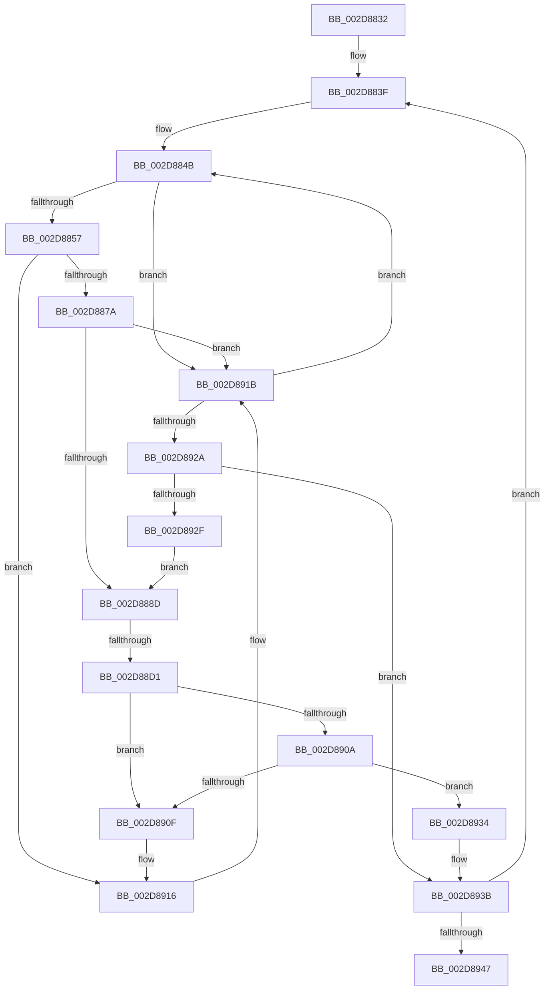

# sub_002D8832

- RVA: `0x002D8832`–`0x002D8954` (길이 `290` bytes)
- VA: `0x00000001402D8832`
- 실행 섹션: `.text`
- PDB 이름 있음: `아니요`; PDB Function 태그: `아니요`
- unwind 정보 RVA: `0x00070208`
- 디코드: `67`개 명령, `290/290` bytes 표시
- 미해석 바이트: `0` (있으면 어셈블리에 `.byte`로 보존)

> 이 문서는 커널 이미지의 기계어와 PDB 기호를 분석해 생성했습니다. 4번과 5번은 함수 원형과 자료형을 바이너리 사용 방식에서 추정한 C 해석이며 원본 소스 복구 결과는 아닙니다.

## 1. Dependencies

- 직접 호출 지점: **1**; 고유 호출 대상: **1**
- 직접 호출자로 확인된 함수: **0**
- RIP 상대 이미지 참조: **3**

### Outgoing calls
- `0x002D887F` → [KiIntPartGetLowestClassProcessorInMask](KiIntPartGetLowestClassProcessorInMask_function_002D89D4.md) (function, `0x002D89D4`)

### Direct callers
- 이 함수 시작 RVA로 연결되는 직접 call은 확인되지 않았습니다. 간접 호출은 완전히 역산할 수 없습니다.

### Static image references
- `0x002D8892` → RVA `0x00FC8C40` (`ALMOSTRO`; read)
- `0x002D88A0` → RVA `0x00F10BC8` (`.data`; read)
- `0x002D88D1` → RVA `0x00F231B0` (`.data`; read)

## 2. Other-region calls and transfers

- 다른 실행 섹션으로 향하는 call: **0**
- call이 아닌 외부 분기/꼬리 이동: **1**
  - `0x002D88CB` → [sub_002D8971](Unknown_function_002D8971.md) (`tail-transfer`)

## 3. Assembly (complete function range)

```asm
002D8832  48 89 B4 24 C0 00 00 00         mov qword ptr [rsp + 0xc0], rsi
002D883A  48 89 7C 24 70                  mov qword ptr [rsp + 0x70], rdi
002D883F  B8 FF FF FF FF                  mov eax, 0xffffffff
002D8844  48 8D 7C 24 30                  lea rdi, [rsp + 0x30]
002D8849  33 F6                           xor esi, esi
002D884B  48 8B 0F                        mov rcx, qword ptr [rdi]
002D884E  48 85 C9                        test rcx, rcx
002D8851  0F 84 C4 00 00 00               je 0x1402d891b
002D8857  0F B7 47 08                     movzx eax, word ptr [rdi + 8]
002D885B  0F 57 C0                        xorps xmm0, xmm0
002D885E  48 23 8B 70 FF FF FF            and rcx, qword ptr [rbx - 0x90]
002D8865  0F 11 44 24 20                  movups xmmword ptr [rsp + 0x20], xmm0
002D886A  66 89 44 24 28                  mov word ptr [rsp + 0x28], ax
002D886F  48 89 4C 24 20                  mov qword ptr [rsp + 0x20], rcx
002D8874  0F 84 9C 00 00 00               je 0x1402d8916
002D887A  48 8D 4C 24 20                  lea rcx, [rsp + 0x20]
002D887F  E8 50 01 00 00                  call 0x1402d89d4
002D8884  83 F8 FF                        cmp eax, -1
002D8887  0F 84 8E 00 00 00               je 0x1402d891b
002D888D  44 8B C0                        mov r8d, eax
002D8890  33 D2                           xor edx, edx
002D8892  48 8D 05 A7 03 CF 00            lea rax, [rip + 0xcf03a7]
002D8899  4A 8B 04 C0                     mov rax, qword ptr [rax + r8*8]
002D889D  8B 48 44                        mov ecx, dword ptr [rax + 0x44]
002D88A0  48 0F AF 0D 20 83 C3 00         imul rcx, qword ptr [rip + 0xc38320]
002D88A8  48 69 43 F0 10 27 00 00         imul rax, qword ptr [rbx - 0x10], 0x2710
002D88B0  48 F7 F1                        div rcx
002D88B3  43 01 84 86 04 01 00 00         add dword ptr [r14 + r8*4 + 0x104], eax
002D88BB  43 8B 8C 86 04 01 00 00         mov ecx, dword ptr [r14 + r8*4 + 0x104]
002D88C3  43 03 4C 86 04                  add ecx, dword ptr [r14 + r8*4 + 4]
002D88C8  41 39 0E                        cmp dword ptr [r14], ecx
002D88CB  0F 86 A0 00 00 00               jbe 0x1402d8971
002D88D1  48 8B 05 D8 A8 C4 00            mov rax, qword ptr [rip + 0xc4a8d8]
002D88D8  42 8B 0C 80                     mov ecx, dword ptr [rax + r8*4]
002D88DC  33 C0                           xor eax, eax
002D88DE  89 43 EA                        mov dword ptr [rbx - 0x16], eax
002D88E1  66 89 43 EE                     mov word ptr [rbx - 0x12], ax
002D88E5  8B C1                           mov eax, ecx
002D88E7  C1 E8 06                        shr eax, 6
002D88EA  83 E1 3F                        and ecx, 0x3f
002D88ED  66 89 43 E8                     mov word ptr [rbx - 0x18], ax
002D88F1  B8 01 00 00 00                  mov eax, 1
002D88F6  48 D3 E0                        shl rax, cl
002D88F9  48 89 43 E0                     mov qword ptr [rbx - 0x20], rax
002D88FD  48 8B 0B                        mov rcx, qword ptr [rbx]
002D8900  48 8B 43 08                     mov rax, qword ptr [rbx + 8]
002D8904  48 39 59 08                     cmp qword ptr [rcx + 8], rbx
002D8908  75 05                           jne 0x1402d890f
002D890A  48 39 18                        cmp qword ptr [rax], rbx
002D890D  74 25                           je 0x1402d8934
002D890F  B9 03 00 00 00                  mov ecx, 3
002D8914  CD 29                           int 0x29
002D8916  B8 FF FF FF FF                  mov eax, 0xffffffff
002D891B  FF C6                           inc esi
002D891D  48 83 C7 10                     add rdi, 0x10
002D8921  83 FE 03                        cmp esi, 3
002D8924  0F 82 21 FF FF FF               jb 0x1402d884b
002D892A  83 F8 FF                        cmp eax, -1
002D892D  74 0C                           je 0x1402d893b
002D892F  E9 59 FF FF FF                  jmp 0x1402d888d
002D8934  48 89 08                        mov qword ptr [rax], rcx
002D8937  48 89 41 08                     mov qword ptr [rcx + 8], rax
002D893B  48 8B 1B                        mov rbx, qword ptr [rbx]
002D893E  49 3B DF                        cmp rbx, r15
002D8941  0F 85 F8 FE FF FF               jne 0x1402d883f
002D8947  48 8B B4 24 C0 00 00 00         mov rsi, qword ptr [rsp + 0xc0]
002D894F  48 8B 7C 24 70                  mov rdi, qword ptr [rsp + 0x70]
```

## 4. C-style interpretation (structured pseudocode)

```c
__int64 __fastcall sub_002D8832(__int64 a1, int a2, __int64 a3, __int64 a4, __int64 a5, __int64 a6, __int64 a7, __int64 a8, __int64 a9, __int64 a10, __int64 a11, __int64 a12, __int64 a13, __int64 a14, __int64 a15, __int64 a16, __int64 a17, __int64 a18, __int64 a19, __int64 a20, __int64 a21, __int64 a22, __int64 a23, __int64 a24)
{
    __int64 result;
    __int64 v_rdi;
    __int64 v_rsi;
    unsigned __int64 v_stack_p20;
    unsigned __int16 v_stack_p28;
    unsigned __int64 v_stack_p70;
    unsigned __int64 v_stack_pC0;

    v_stack_pC0 = v_rsi;
    v_stack_p70 = v_rdi;
loc_002D883F:
    v_rsi = 0;
loc_002D884B:
    if (*(unsigned __int64 *)(a6) == 0) goto loc_002D891B;
    a1 = (*(unsigned __int64 *)(a6)) & (*(unsigned __int64 *)(v_rbx - 144));
    v_stack_p20 = v_xmm0;
    v_stack_p28 = (unsigned __int16)(*(unsigned __int16 *)(a6 + 8));
    v_stack_p20 = a1;
    if (condition_is_equal) goto loc_002D8916;
    result = KiIntPartGetLowestClassProcessorInMask(v_stack_p20, a2, a3, a4);
    if (((unsigned int)(result)) == -1) goto loc_002D891B;
loc_002D888D:
    a2 = 0;
    a1 = ((unsigned int)(*(unsigned int *)(*(unsigned __int64 *)(v_rip + 13566887 + (unsigned int)((unsigned int)(result)) * 8) + 68))) * (*(unsigned __int64 *)(v_rip + 12813088));
    result = (*(unsigned __int64 *)(v_rip + 13566887 + (unsigned int)((unsigned int)(result)) * 8)) * (*(unsigned __int64 *)(v_rbx - 16));
    a1 = (unsigned int)(((unsigned int)(*(unsigned int *)(v_r14 + (unsigned int)((unsigned int)(result)) * 4 + 260))) + (*(unsigned int *)(v_r14 + (unsigned int)((unsigned int)(result)) * 4 + 4)));
    result = 0;
    *(unsigned int *)(v_rbx - 22) = 0;
    *(unsigned __int16 *)(v_rbx - 18) = 0;
    result = (unsigned int)(((unsigned int)((unsigned int)((unsigned int)(*(unsigned int *)(*(unsigned __int64 *)(v_rip + 12888280) + (unsigned int)((unsigned int)(result)) * 4))))) >> (6));
    a1 = (unsigned int)(((unsigned int)(*(unsigned int *)(*(unsigned __int64 *)(v_rip + 12888280) + (unsigned int)((unsigned int)(result)) * 4))) & (63));
    *(unsigned __int16 *)(v_rbx - 24) = (unsigned __int16)(result);
    result = (1) << ((unsigned __int8)(a1));
    *(unsigned __int64 *)(v_rbx - 32) = result;
    if ((*(unsigned __int64 *)(*(unsigned __int64 *)(v_rbx) + 8)) != v_rbx) goto loc_002D890F;
    if ((*(unsigned __int64 *)(*(unsigned __int64 *)(v_rbx + 8))) == v_rbx) goto loc_002D8934;
loc_002D890F:
loc_002D8916:
loc_002D891B:
    v_rsi = (unsigned int)((v_rsi) + 1);
    v_rdi = (a6) + (16);
    if (((unsigned int)(v_rsi)) < 3) goto loc_002D884B;
    if (((unsigned int)((unsigned int)(0xFFFFFFFFULL))) == -1) goto loc_002D893B;
    goto loc_002D888D;
loc_002D8934:
    *(unsigned __int64 *)((unsigned int)(0xFFFFFFFFULL)) = 3;
    *(unsigned __int64 *)(3 + 8) = (unsigned int)(0xFFFFFFFFULL);
loc_002D893B:
    if ((*(unsigned __int64 *)(v_rbx)) != v_r15) goto loc_002D883F;
    return (unsigned int)(0xFFFFFFFFULL);
}
```

## 5. (Beta) C Style

```c
int64_t sub_002D8832(int64_t Arg1, int32_t Arg2, int64_t Arg3, int64_t Arg4, uint64_t Arg5, int64_t Arg6, uint64_t Arg7, uint64_t Arg8, uint64_t Arg9, uint64_t Arg10, uint64_t Arg11, uint64_t Arg12, uint64_t Arg13, int64_t Arg14, uint64_t Arg15, uint64_t Arg16, uint64_t Arg17, uint64_t Arg18, uint64_t Arg19, uint64_t Arg20, uint64_t Arg21, uint64_t Arg22, uint64_t Arg23, int64_t Arg24)
{
    int64_t result;
    int64_t local_rdi;
    int64_t local_rsi;
    uint64_t v_stack_p20;
    uint16_t v_stack_p28;
    uint64_t v_stack_p70;
    uint64_t v_stack_pC0;

    v_stack_pC0 = local_rsi;
    v_stack_p70 = local_rdi;
loc_002D883F:
    local_rsi = 0;
loc_002D884B:
    if (*(uint64_t *)(Arg6) == 0) goto loc_002D891B;
    Arg1 = (*(uint64_t *)(Arg6)) & (*(uint64_t *)(local_rbx - 0x90));
    v_stack_p20 = v_xmm0;
    v_stack_p28 = (uint16_t)(*(uint16_t *)(Arg6 + 0x8));
    v_stack_p20 = Arg1;
    if (condition_is_equal) goto loc_002D8916;
    result = KiIntPartGetLowestClassProcessorInMask(v_stack_p20, Arg2, Arg3, Arg4);
    if (((uint32_t)(result)) == -1) goto loc_002D891B;
loc_002D888D:
    Arg2 = 0;
    Arg1 = ((uint32_t)(*(uint32_t *)(*(uint64_t *)(v_rip + 0xCF03A7 + (uint32_t)((uint32_t)(result)) * 8) + 0x44))) * (*(uint64_t *)(v_rip + 0xC38320));
    result = (*(uint64_t *)(v_rip + 0xCF03A7 + (uint32_t)((uint32_t)(result)) * 8)) * (*(uint64_t *)(local_rbx - 0x10));
    Arg1 = (uint32_t)(((uint32_t)(*(uint32_t *)(local_r14 + (uint32_t)((uint32_t)(result)) * 4 + 0x104))) + (*(uint32_t *)(local_r14 + (uint32_t)((uint32_t)(result)) * 4 + 0x4)));
    result = 0;
    *(uint32_t *)(local_rbx - 0x16) = 0;
    *(uint16_t *)(local_rbx - 0x12) = 0;
    result = (uint32_t)(((uint32_t)((uint32_t)((uint32_t)(*(uint32_t *)(*(uint64_t *)(v_rip + 0xC4A8D8) + (uint32_t)((uint32_t)(result)) * 4))))) >> (6));
    Arg1 = (uint32_t)(((uint32_t)(*(uint32_t *)(*(uint64_t *)(v_rip + 0xC4A8D8) + (uint32_t)((uint32_t)(result)) * 4))) & (63));
    *(uint16_t *)(local_rbx - 0x18) = (uint16_t)(result);
    result = (1) << ((uint8_t)(Arg1));
    *(uint64_t *)(local_rbx - 0x20) = result;
    if ((*(uint64_t *)(*(uint64_t *)(local_rbx) + 0x8)) != local_rbx) goto loc_002D890F;
    if ((*(uint64_t *)(*(uint64_t *)(local_rbx + 0x8))) == local_rbx) goto loc_002D8934;
loc_002D890F:
loc_002D8916:
loc_002D891B:
    local_rsi = (uint32_t)((local_rsi) + 1);
    local_rdi = (Arg6) + (16);
    if (((uint32_t)(local_rsi)) < 3) goto loc_002D884B;
    if (((uint32_t)((uint32_t)(0xFFFFFFFFULL))) == -1) goto loc_002D893B;
    goto loc_002D888D;
loc_002D8934:
    *(uint64_t *)((uint32_t)(0xFFFFFFFFULL)) = 3;
    *(uint64_t *)(3 + 0x8) = (uint32_t)(0xFFFFFFFFULL);
loc_002D893B:
    if ((*(uint64_t *)(local_rbx)) != local_r15) goto loc_002D883F;
    return (uint32_t)(0xFFFFFFFFULL);
}
```

## 6. Execution-region graph

[열기: 2D/3D 그래프와 함수 탐색 컨트롤 패널](../../../control-panel.html?section=text&rva=0x002D8832&view=graph)

- 2D 그래프는 위에서 아래로 흐르고, 3D 그래프는 빈 공간을 드래그해 회전합니다. Shift+드래그는 이동, 휠은 확대·축소, 함수 노드 선택은 대상 보고서 이동입니다.

### Static fallback


