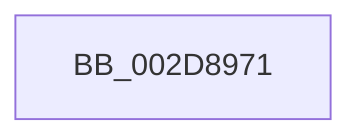

# sub_002D8971

- RVA: `0x002D8971`–`0x002D899F` (길이 `46` bytes)
- VA: `0x00000001402D8971`
- 실행 섹션: `.text`
- PDB 이름 있음: `아니요`; PDB Function 태그: `아니요`
- unwind 정보 RVA: `0x00070234`
- 디코드: `10`개 명령, `46/46` bytes 표시
- 미해석 바이트: `0` (있으면 어셈블리에 `.byte`로 보존)

> 이 문서는 커널 이미지의 기계어와 PDB 기호를 분석해 생성했습니다. 4번과 5번은 함수 원형과 자료형을 바이너리 사용 방식에서 추정한 C 해석이며 원본 소스 복구 결과는 아닙니다.

## 1. Dependencies

- 직접 호출 지점: **0**; 고유 호출 대상: **0**
- 직접 호출자로 확인된 함수: **0**
- RIP 상대 이미지 참조: **1**

### Outgoing calls
- 직접 디코드된 call 명령이 없습니다.

### Direct callers
- 이 함수 시작 RVA로 연결되는 직접 call은 확인되지 않았습니다. 간접 호출은 완전히 역산할 수 없습니다.

### Static image references
- `0x002D8971` → RVA `0x00F231B0` (`.data`; read)

## 2. Other-region calls and transfers

- 다른 실행 섹션으로 향하는 call: **0**
- call이 아닌 외부 분기/꼬리 이동: **1**
  - `0x002D899A` → [sub_002D8832 + 0x9F](Unknown_function_002D8832.md) (`tail-transfer`)

## 3. Assembly (complete function range)

```asm
002D8971  48 8B 05 38 A8 C4 00            mov rax, qword ptr [rip + 0xc4a838]
002D8978  42 8B 0C 80                     mov ecx, dword ptr [rax + r8*4]
002D897C  83 E1 3F                        and ecx, 0x3f
002D897F  48 0F B3 CD                     btr rbp, rcx
002D8983  49 0F B3 CC                     btr r12, rcx
002D8987  48 89 6C 24 30                  mov qword ptr [rsp + 0x30], rbp
002D898C  49 0F B3 CD                     btr r13, rcx
002D8990  4C 89 64 24 40                  mov qword ptr [rsp + 0x40], r12
002D8995  4C 89 6C 24 50                  mov qword ptr [rsp + 0x50], r13
002D899A  E9 32 FF FF FF                  jmp 0x1402d88d1
```

## 4. C-style interpretation (structured pseudocode)

```c
__int64 __fastcall sub_002D8971(__int64 a1, __int64 a2, __int64 a3)
{
    unsigned __int64 v_stack_p30;
    unsigned __int64 v_stack_p40;
    unsigned __int64 v_stack_p50;

    a1 = (unsigned int)(((unsigned int)(*(unsigned int *)(*(unsigned __int64 *)(v_rip + 12888120) + a3 * 4))) & (63));
    v_stack_p30 = v_rbp;
    v_stack_p40 = v_r12;
    v_stack_p50 = v_r13;
}
```

## 5. (Beta) C Style

```c
int64_t sub_002D8971(int64_t Arg1, int64_t Arg2, int64_t Arg3)
{
    uint64_t v_stack_p30;
    uint64_t v_stack_p40;
    uint64_t v_stack_p50;

    Arg1 = (uint32_t)(((uint32_t)(*(uint32_t *)(*(uint64_t *)(v_rip + 0xC4A838) + Arg3 * 4))) & (63));
    v_stack_p30 = local_rbp;
    v_stack_p40 = local_r12;
    v_stack_p50 = local_r13;
}
```

## 6. Execution-region graph

[열기: 2D/3D 그래프와 함수 탐색 컨트롤 패널](../../../control-panel.html?section=text&rva=0x002D8971&view=graph)

- 2D 그래프는 위에서 아래로 흐르고, 3D 그래프는 빈 공간을 드래그해 회전합니다. Shift+드래그는 이동, 휠은 확대·축소, 함수 노드 선택은 대상 보고서 이동입니다.

### Static fallback


