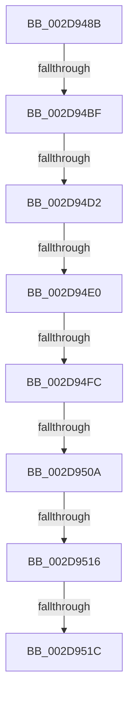

# sub_002D948B

- RVA: `0x002D948B`–`0x002D9525` (길이 `154` bytes)
- VA: `0x00000001402D948B`
- 실행 섹션: `.text`
- PDB 이름 있음: `아니요`; PDB Function 태그: `아니요`
- unwind 정보 RVA: `0x00070334`
- 디코드: `33`개 명령, `154/154` bytes 표시
- 미해석 바이트: `0` (있으면 어셈블리에 `.byte`로 보존)

> 이 문서는 커널 이미지의 기계어와 PDB 기호를 분석해 생성했습니다. 4번과 5번은 함수 원형과 자료형을 바이너리 사용 방식에서 추정한 C 해석이며 원본 소스 복구 결과는 아닙니다.

## 1. Dependencies

- 직접 호출 지점: **1**; 고유 호출 대상: **1**
- 직접 호출자로 확인된 함수: **0**
- RIP 상대 이미지 참조: **2**

### Outgoing calls
- `0x002D94E5` → [PpmEventTraceProcessorLatencyLimitChange](PpmEventTraceProcessorLatencyLimitChange_function_002D974C.md) (function, `0x002D974C`)

### Direct callers
- 이 함수 시작 RVA로 연결되는 직접 call은 확인되지 않았습니다. 간접 호출은 완전히 역산할 수 없습니다.

### Static image references
- `0x002D94B2` → RVA `0x00FC6D20` (`ALMOSTRO`; read)
- `0x002D94C6` → RVA `0x00E0B3AC` (`.data`; read)

## 2. Other-region calls and transfers

- 다른 실행 섹션으로 향하는 call: **0**
- call이 아닌 외부 분기/꼬리 이동: **7**
  - `0x002D94B9` → [sub_002D95CF + 0x1E](Unknown_function_002D95CF.md) (`tail-transfer`)
  - `0x002D94CC` → [sub_002D95CF](Unknown_function_002D95CF.md) (`tail-transfer`)
  - `0x002D94DA` → [sub_002D958F](Unknown_function_002D958F.md) (`tail-transfer`)
  - `0x002D94F6` → [sub_002D958F](Unknown_function_002D958F.md) (`tail-transfer`)
  - `0x002D9504` → [sub_002D958F](Unknown_function_002D958F.md) (`tail-transfer`)
  - `0x002D9514` → [sub_002D958F](Unknown_function_002D958F.md) (`tail-transfer`)
  - `0x002D951A` → [sub_002D958F](Unknown_function_002D958F.md) (`tail-transfer`)

## 3. Assembly (complete function range)

```asm
002D948B  48 89 6C 24 48                  mov qword ptr [rsp + 0x48], rbp
002D9490  48 89 74 24 40                  mov qword ptr [rsp + 0x40], rsi
002D9495  48 8B F1                        mov rsi, rcx
002D9498  48 89 7C 24 38                  mov qword ptr [rsp + 0x38], rdi
002D949D  4C 89 6C 24 28                  mov qword ptr [rsp + 0x28], r13
002D94A2  4C 8B EA                        mov r13, rdx
002D94A5  45 0F 20 C6                     mov r14, cr8
002D94A9  B8 02 00 00 00                  mov eax, 2
002D94AE  44 0F 22 C0                     mov cr8, rax
002D94B2  83 3D 67 D8 CE 00 00            cmp dword ptr [rip + 0xced867], 0
002D94B9  0F 85 2E 01 00 00               jne 0x1402d95ed
002D94BF  80 BE 0C 8A 00 00 00            cmp byte ptr [rsi + 0x8a0c], 0
002D94C6  8B 3D E0 1E B3 00               mov edi, dword ptr [rip + 0xb31ee0]
002D94CC  0F 85 FD 00 00 00               jne 0x1402d95cf
002D94D2  8B AE 78 88 00 00               mov ebp, dword ptr [rsi + 0x8878]
002D94D8  3B EF                           cmp ebp, edi
002D94DA  0F 84 AF 00 00 00               je 0x1402d958f
002D94E0  8B D7                           mov edx, edi
002D94E2  48 8B CE                        mov rcx, rsi
002D94E5  E8 62 02 00 00                  call 0x1402d974c
002D94EA  65 48 8B 04 25 20 00 00 00      mov rax, qword ptr gs:[0x20]
002D94F3  48 3B F0                        cmp rsi, rax
002D94F6  0F 84 93 00 00 00               je 0x1402d958f
002D94FC  48 8B 46 18                     mov rax, qword ptr [rsi + 0x18]
002D9500  48 39 46 08                     cmp qword ptr [rsi + 8], rax
002D9504  0F 85 85 00 00 00               jne 0x1402d958f
002D950A  4C 8B 9E 40 88 00 00            mov r11, qword ptr [rsi + 0x8840]
002D9511  4D 85 DB                        test r11, r11
002D9514  74 79                           je 0x1402d958f
002D9516  41 80 3B 00                     cmp byte ptr [r11], 0
002D951A  74 73                           je 0x1402d958f
002D951C  45 8B 53 28                     mov r10d, dword ptr [r11 + 0x28]
002D9520  B8 01 00 00 00                  mov eax, 1
```

## 4. C-style interpretation (structured pseudocode)

```c
__int64 __fastcall sub_002D948B(__int64 a1, __int64 a2)
{
    __int64 result;
    unsigned __int64 v_stack_p28;
    unsigned __int64 v_stack_p38;
    unsigned __int64 v_stack_p40;
    unsigned __int64 v_stack_p48;

    v_stack_p48 = v_rbp;
    v_stack_p40 = v_rsi;
    v_stack_p38 = v_rdi;
    v_stack_p28 = v_r13;
    result = PpmEventTraceProcessorLatencyLimitChange(a1, (unsigned int)((unsigned int)((unsigned int)(*(unsigned int *)(v_rip + 11738848)))), a3, a4);
    return 1;
}
```

## 5. (Beta) C Style

```c
int64_t sub_002D948B(void *Arg1, int64_t Arg2)
{
    uint8_t *arg1 = (uint8_t *)Arg1;

    int64_t result;
    uint64_t v_stack_p28;
    uint64_t v_stack_p38;
    uint64_t v_stack_p40;
    uint64_t v_stack_p48;

    v_stack_p48 = local_rbp;
    v_stack_p40 = local_rsi;
    v_stack_p38 = local_rdi;
    v_stack_p28 = local_r13;
    result = PpmEventTraceProcessorLatencyLimitChange(Arg1, (uint32_t)((uint32_t)((uint32_t)(*(uint32_t *)(v_rip + 0xB31EE0)))), a3, a4);
    return 1;
}
```

### 관측된 메모리 오프셋

구조체 형식이 확인되지 않은 접근은 인자 기준의 오프셋으로만 기록했습니다.

| 기준 인자 | 오프셋 표현 | 폭 (bit) | 접근 |
|---|---:|---:|---|
| `Arg1` | `+ 0x8878` | `32` | `R` |
| `Arg1` | `+ 0x8A0C` | `8` | `R` |

## 6. Execution-region graph

[열기: 2D/3D 그래프와 함수 탐색 컨트롤 패널](../../../control-panel.html?section=text&rva=0x002D948B&view=graph)

- 2D 그래프는 위에서 아래로 흐르고, 3D 그래프는 빈 공간을 드래그해 회전합니다. Shift+드래그는 이동, 휠은 확대·축소, 함수 노드 선택은 대상 보고서 이동입니다.

### Static fallback


