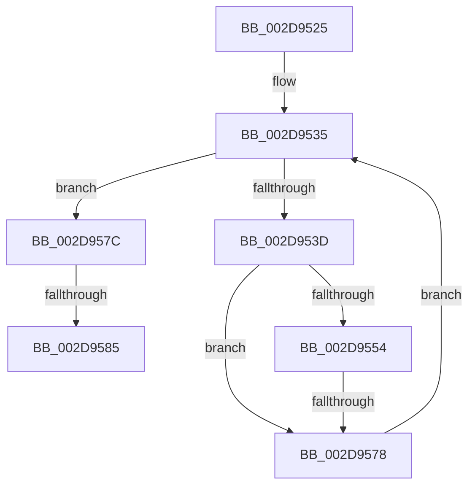

# sub_002D9525

- RVA: `0x002D9525`–`0x002D958F` (길이 `106` bytes)
- VA: `0x00000001402D9525`
- 실행 섹션: `.text`
- PDB 이름 있음: `아니요`; PDB Function 태그: `아니요`
- unwind 정보 RVA: `0x00070354`
- 디코드: `29`개 명령, `106/106` bytes 표시
- 미해석 바이트: `0` (있으면 어셈블리에 `.byte`로 보존)

> 이 문서는 커널 이미지의 기계어와 PDB 기호를 분석해 생성했습니다. 4번과 5번은 함수 원형과 자료형을 바이너리 사용 방식에서 추정한 C 해석이며 원본 소스 복구 결과는 아닙니다.

## 1. Dependencies

- 직접 호출 지점: **0**; 고유 호출 대상: **0**
- 직접 호출자로 확인된 함수: **0**
- RIP 상대 이미지 참조: **1**

### Outgoing calls
- 직접 디코드된 call 명령이 없습니다.

### Direct callers
- 이 함수 시작 RVA로 연결되는 직접 call은 확인되지 않았습니다. 간접 호출은 완전히 역산할 수 없습니다.

### Static image references
- `0x002D957C` → RVA `0x00FC6AD0` (`ALMOSTRO`; read)

## 2. Other-region calls and transfers

- 다른 실행 섹션으로 향하는 call: **0**
- call이 아닌 외부 분기/꼬리 이동: **2**
  - `0x002D9572` → [sub_002D9674](Unknown_function_002D9674.md) (`tail-transfer`)
  - `0x002D9583` → [sub_002D95FE](Unknown_function_002D95FE.md) (`tail-transfer`)

## 3. Assembly (complete function range)

```asm
002D9525  48 89 5C 24 78                  mov qword ptr [rsp + 0x78], rbx
002D952A  4C 89 7C 24 20                  mov qword ptr [rsp + 0x20], r15
002D952F  45 33 FF                        xor r15d, r15d
002D9532  41 8B DF                        mov ebx, r15d
002D9535  44 8B CB                        mov r9d, ebx
002D9538  41 3B C2                        cmp eax, r10d
002D953B  73 3F                           jae 0x1402d957c
002D953D  8B C8                           mov ecx, eax
002D953F  48 69 D1 58 01 00 00            imul rdx, rcx, 0x158
002D9546  46 8B 84 1A 38 05 00 00         mov r8d, dword ptr [rdx + r11 + 0x538]
002D954E  41 83 F8 FF                     cmp r8d, -1
002D9552  74 24                           je 0x1402d9578
002D9554  45 3B C8                        cmp r9d, r8d
002D9557  41 8B D7                        mov edx, r15d
002D955A  41 8B CF                        mov ecx, r15d
002D955D  41 8B D8                        mov ebx, r8d
002D9560  41 0F 47 D9                     cmova ebx, r9d
002D9564  41 3B F8                        cmp edi, r8d
002D9567  0F 97 C2                        seta dl
002D956A  41 3B E8                        cmp ebp, r8d
002D956D  0F 97 C1                        seta cl
002D9570  3B CA                           cmp ecx, edx
002D9572  0F 85 FC 00 00 00               jne 0x1402d9674
002D9578  FF C0                           inc eax
002D957A  EB B9                           jmp 0x1402d9535
002D957C  4C 39 3D 4D D5 CE 00            cmp qword ptr [rip + 0xced54d], r15
002D9583  75 79                           jne 0x1402d95fe
002D9585  48 8B 5C 24 78                  mov rbx, qword ptr [rsp + 0x78]
002D958A  4C 8B 7C 24 20                  mov r15, qword ptr [rsp + 0x20]
```

## 4. C-style interpretation (structured pseudocode)

```c
__int64 __fastcall sub_002D9525(__int64 a1, __int64 a2, __int64 a3, __int64 a4, __int64 a5, __int64 a6, __int64 a7, __int64 a8, __int64 a9, __int64 a10, __int64 a11, __int64 a12, __int64 a13, __int64 a14, __int64 a15)
{
    __int64 result;
    __int64 v_r15;
    __int64 v_rbx;
    unsigned __int64 v_stack_p20;
    unsigned __int64 v_stack_p78;

    v_stack_p78 = v_rbx;
    v_stack_p20 = v_r15;
    v_r15 = 0;
loc_002D9535:
    if (((unsigned int)(result)) >= ((unsigned int)(v_r10))) goto loc_002D957C;
    a2 = (a2) * ((unsigned int)((unsigned int)(result)));
    if (((unsigned int)((unsigned int)(*(unsigned int *)(a2 + v_r11 * 1 + 1336)))) == -1) goto loc_002D9578;
    v_rbx = (unsigned int)((unsigned int)((unsigned int)(*(unsigned int *)(a2 + v_r11 * 1 + 1336))));
    if (0 > ((unsigned int)((unsigned int)(*(unsigned int *)(a2 + v_r11 * 1 + 1336))))) { v_rbx = 0; }
    a2 = (((unsigned int)(v_rdi)) > ((unsigned int)((unsigned int)(*(unsigned int *)(a2 + v_r11 * 1 + 1336))))) ? 1 : 0;
    a1 = (((unsigned int)(v_rbp)) > ((unsigned int)((unsigned int)(*(unsigned int *)(a2 + v_r11 * 1 + 1336))))) ? 1 : 0;
loc_002D9578:
    result = (unsigned int)((result) + 1);
    goto loc_002D9535;
loc_002D957C:
    return result;
}
```

## 5. (Beta) C Style

```c
int64_t sub_002D9525(int64_t Arg1, int64_t Arg2, int64_t Arg3, int64_t Arg4, uint64_t Arg5, uint64_t Arg6, uint64_t Arg7, uint64_t Arg8, uint64_t Arg9, uint64_t Arg10, uint64_t Arg11, uint64_t Arg12, uint64_t Arg13, uint64_t Arg14, int64_t Arg15)
{
    int64_t result;
    int64_t local_r15;
    int64_t local_rbx;
    uint64_t v_stack_p20;
    uint64_t v_stack_p78;

    v_stack_p78 = local_rbx;
    v_stack_p20 = local_r15;
    local_r15 = 0;
loc_002D9535:
    if (((uint32_t)(result)) >= ((uint32_t)(local_r10))) goto loc_002D957C;
    Arg2 = (Arg2) * ((uint32_t)((uint32_t)(result)));
    if (((uint32_t)((uint32_t)(*(uint32_t *)(Arg2 + local_r11 * 1 + 0x538)))) == -1) goto loc_002D9578;
    local_rbx = (uint32_t)((uint32_t)((uint32_t)(*(uint32_t *)(Arg2 + local_r11 * 1 + 0x538))));
    if (0 > ((uint32_t)((uint32_t)(*(uint32_t *)(Arg2 + local_r11 * 1 + 0x538))))) { local_rbx = 0; }
    Arg2 = (((uint32_t)(local_rdi)) > ((uint32_t)((uint32_t)(*(uint32_t *)(Arg2 + local_r11 * 1 + 0x538))))) ? 1 : 0;
    Arg1 = (((uint32_t)(local_rbp)) > ((uint32_t)((uint32_t)(*(uint32_t *)(Arg2 + local_r11 * 1 + 0x538))))) ? 1 : 0;
loc_002D9578:
    result = (uint32_t)((result) + 1);
    goto loc_002D9535;
loc_002D957C:
    return result;
}
```

## 6. Execution-region graph

[열기: 2D/3D 그래프와 함수 탐색 컨트롤 패널](../../../control-panel.html?section=text&rva=0x002D9525&view=graph)

- 2D 그래프는 위에서 아래로 흐르고, 3D 그래프는 빈 공간을 드래그해 회전합니다. Shift+드래그는 이동, 휠은 확대·축소, 함수 노드 선택은 대상 보고서 이동입니다.

### Static fallback


