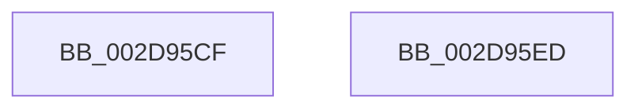

# sub_002D95CF

- RVA: `0x002D95CF`–`0x002D95FE` (길이 `47` bytes)
- VA: `0x00000001402D95CF`
- 실행 섹션: `.text`
- PDB 이름 있음: `아니요`; PDB Function 태그: `아니요`
- unwind 정보 RVA: `0x00070390`
- 디코드: `10`개 명령, `47/47` bytes 표시
- 미해석 바이트: `0` (있으면 어셈블리에 `.byte`로 보존)

> 이 문서는 커널 이미지의 기계어와 PDB 기호를 분석해 생성했습니다. 4번과 5번은 함수 원형과 자료형을 바이너리 사용 방식에서 추정한 C 해석이며 원본 소스 복구 결과는 아닙니다.

## 1. Dependencies

- 직접 호출 지점: **1**; 고유 호출 대상: **1**
- 직접 호출자로 확인된 함수: **0**
- RIP 상대 이미지 참조: **2**

### Outgoing calls
- `0x002D95F4` → [KiRaiseIrqlProcessIrqlFlags](../4F/KiRaiseIrqlProcessIrqlFlags_function_004F56FC.md) (function, `0x004F56FC`)

### Direct callers
- 이 함수 시작 RVA로 연결되는 직접 call은 확인되지 않았습니다. 간접 호출은 완전히 역산할 수 없습니다.

### Static image references
- `0x002D95D6` → RVA `0x00E6766C` (`.data`; read)
- `0x002D95DC` → RVA `0x00E67670` (`.data`; read)

## 2. Other-region calls and transfers

- 다른 실행 섹션으로 향하는 call: **0**
- call이 아닌 외부 분기/꼬리 이동: **2**
  - `0x002D95E8` → [sub_002D948B + 0x47](Unknown_function_002D948B.md) (`tail-transfer`)
  - `0x002D95F9` → [sub_002D948B + 0x34](Unknown_function_002D948B.md) (`tail-transfer`)

## 3. Assembly (complete function range)

```asm
002D95CF  80 BE 0D 8A 00 00 00            cmp byte ptr [rsi + 0x8a0d], 0
002D95D6  8B 0D 90 E0 B8 00               mov ecx, dword ptr [rip + 0xb8e090]
002D95DC  0F 45 0D 8D E0 B8 00            cmovne ecx, dword ptr [rip + 0xb8e08d]
002D95E3  3B CF                           cmp ecx, edi
002D95E5  0F 47 F9                        cmova edi, ecx
002D95E8  E9 E5 FE FF FF                  jmp 0x1402d94d2
002D95ED  0F B6 D0                        movzx edx, al
002D95F0  41 0F B6 CE                     movzx ecx, r14b
002D95F4  E8 03 C1 21 00                  call 0x1404f56fc
002D95F9  E9 C1 FE FF FF                  jmp 0x1402d94bf
```

## 4. C-style interpretation (structured pseudocode)

```c
__int64 __fastcall sub_002D95CF(void)
{
    __int64 v_rdi;

    a1 = (unsigned int)(*(unsigned int *)(v_rip + 12116112));
    if ((*(unsigned __int8 *)(v_rsi + 35341)) != 0) { a1 = *(unsigned int *)(v_rip + 12116109); }
    if (((unsigned int)(a1)) > ((unsigned int)(v_rdi))) { v_rdi = (unsigned int)(a1); }
}
```

## 5. (Beta) C Style

```c
void sub_002D95CF(void)
{
    int64_t local_rdi;

    a1 = (uint32_t)(*(uint32_t *)(v_rip + 0xB8E090));
    if ((*(uint8_t *)(local_rsi + 0x8A0D)) != 0) { a1 = *(uint32_t *)(v_rip + 0xB8E08D); }
    if (((uint32_t)(a1)) > ((uint32_t)(local_rdi))) { local_rdi = (uint32_t)(a1); }
}
```

## 6. Execution-region graph

[열기: 2D/3D 그래프와 함수 탐색 컨트롤 패널](../../../control-panel.html?section=text&rva=0x002D95CF&view=graph)

- 2D 그래프는 위에서 아래로 흐르고, 3D 그래프는 빈 공간을 드래그해 회전합니다. Shift+드래그는 이동, 휠은 확대·축소, 함수 노드 선택은 대상 보고서 이동입니다.

### Static fallback


