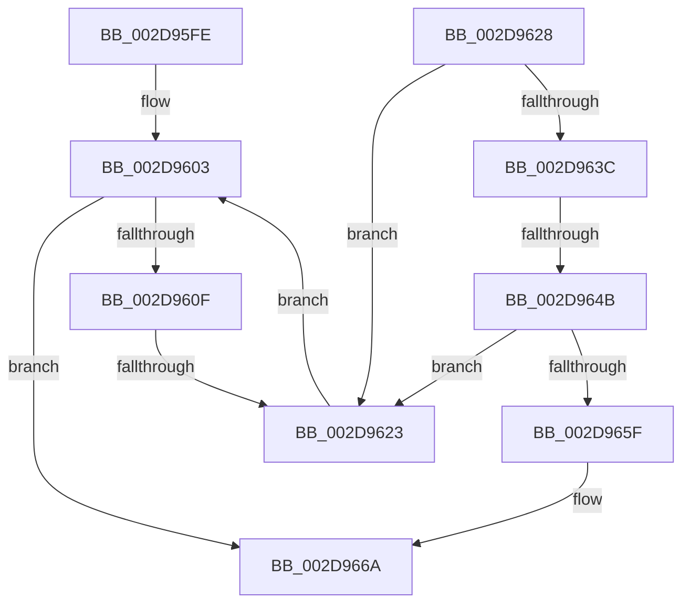

# sub_002D95FE

- RVA: `0x002D95FE`–`0x002D9674` (길이 `118` bytes)
- VA: `0x00000001402D95FE`
- 실행 섹션: `.text`
- PDB 이름 있음: `아니요`; PDB Function 태그: `아니요`
- unwind 정보 RVA: `0x000703B0`
- 디코드: `30`개 명령, `118/118` bytes 표시
- 미해석 바이트: `0` (있으면 어셈블리에 `.byte`로 보존)

> 이 문서는 커널 이미지의 기계어와 PDB 기호를 분석해 생성했습니다. 4번과 5번은 함수 원형과 자료형을 바이너리 사용 방식에서 추정한 C 해석이며 원본 소스 복구 결과는 아닙니다.

## 1. Dependencies

- 직접 호출 지점: **3**; 고유 호출 대상: **3**
- 직접 호출자로 확인된 함수: **0**
- RIP 상대 이미지 참조: **1**

### Outgoing calls
- `0x002D9633` → [KeCheckProcessorAffinityEx](../30/KeCheckProcessorAffinityEx_function_00305150.md) (function, `0x00305150`)
- `0x002D9656` → [KiAndAffinityExNoResult](../2C/KiAndAffinityExNoResult_function_002CF84C.md) (function, `0x002CF84C`)
- `0x002D9665` → [KeAddProcessorAffinityEx](../25/KeAddProcessorAffinityEx_function_0025B6F0.md) (function, `0x0025B6F0`)

### Direct callers
- 이 함수 시작 RVA로 연결되는 직접 call은 확인되지 않았습니다. 간접 호출은 완전히 역산할 수 없습니다.

### Static image references
- `0x002D9603` → RVA `0x00FC6AD0` (`ALMOSTRO`; read)

## 2. Other-region calls and transfers

- 다른 실행 섹션으로 향하는 call: **0**
- call이 아닌 외부 분기/꼬리 이동: **3**
  - `0x002D9621` → [sub_002D9684](Unknown_function_002D9684.md) (`tail-transfer`)
  - `0x002D9645` → [sub_002D9684 + 0xA9](Unknown_function_002D9684.md) (`tail-transfer`)
  - `0x002D966F` → [sub_002D9525 + 0x60](Unknown_function_002D9525.md) (`tail-transfer`)

## 3. Assembly (complete function range)

```asm
002D95FE  4C 89 64 24 30                  mov qword ptr [rsp + 0x30], r12
002D9603  48 8B 0D C6 D4 CE 00            mov rcx, qword ptr [rip + 0xced4c6]
002D960A  44 3B 39                        cmp r15d, dword ptr [rcx]
002D960D  73 5B                           jae 0x1402d966a
002D960F  41 8B C7                        mov eax, r15d
002D9612  4C 69 E8 C0 01 00 00            imul r13, rax, 0x1c0
002D9619  4C 03 E9                        add r13, rcx
002D961C  41 80 7D 79 00                  cmp byte ptr [r13 + 0x79], 0
002D9621  74 61                           je 0x1402d9684
002D9623  41 FF C7                        inc r15d
002D9626  EB DB                           jmp 0x1402d9603
002D9628  65 8B 14 25 A4 01 00 00         mov edx, dword ptr gs:[0x1a4]
002D9630  49 8B CC                        mov rcx, r12
002D9633  E8 18 BB 02 00                  call 0x140305150
002D9638  85 C0                           test eax, eax
002D963A  75 E7                           jne 0x1402d9623
002D963C  41 80 7D 7B 00                  cmp byte ptr [r13 + 0x7b], 0
002D9641  41 8B 45 48                     mov eax, dword ptr [r13 + 0x48]
002D9645  0F 84 E2 00 00 00               je 0x1402d972d
002D964B  4C 8B 6C 24 68                  mov r13, qword ptr [rsp + 0x68]
002D9650  49 8B CC                        mov rcx, r12
002D9653  49 8B D5                        mov rdx, r13
002D9656  E8 F1 61 FF FF                  call 0x1402cf84c
002D965B  85 C0                           test eax, eax
002D965D  75 C4                           jne 0x1402d9623
002D965F  8B 56 24                        mov edx, dword ptr [rsi + 0x24]
002D9662  49 8B CD                        mov rcx, r13
002D9665  E8 86 20 F8 FF                  call 0x14025b6f0
002D966A  4C 8B 64 24 30                  mov r12, qword ptr [rsp + 0x30]
002D966F  E9 11 FF FF FF                  jmp 0x1402d9585
```

## 4. C-style interpretation (structured pseudocode)

```c
__int64 __fastcall sub_002D95FE(__int64 a1, __int64 a2, __int64 a3, __int64 a4, __int64 a5, __int64 a6)
{
    __int64 v_r13;
    __int64 v_r15;
    unsigned __int64 v_stack_p30;
    unsigned __int64 v_stack_p68;

    v_stack_p30 = v_r12;
loc_002D9603:
    if (((unsigned int)(v_r15)) >= (*(unsigned int *)(*(unsigned __int64 *)(v_rip + 13554886)))) goto loc_002D966A;
    v_r13 = (v_r13) * ((unsigned int)((unsigned int)(v_r15)));
    v_r13 = (v_r13) + (*(unsigned __int64 *)(v_rip + 13554886));
loc_002D9623:
    v_r15 = (unsigned int)((v_r15) + 1);
    goto loc_002D9603;
loc_002D966A:
}
```

## 5. (Beta) C Style

```c
int64_t sub_002D95FE(int64_t Arg1, int64_t Arg2, int64_t Arg3, int64_t Arg4, uint64_t Arg5, int64_t Arg6)
{
    int64_t local_r13;
    int64_t local_r15;
    uint64_t v_stack_p30;
    uint64_t v_stack_p68;

    v_stack_p30 = local_r12;
loc_002D9603:
    if (((uint32_t)(local_r15)) >= (*(uint32_t *)(*(uint64_t *)(v_rip + 0xCED4C6)))) goto loc_002D966A;
    local_r13 = (local_r13) * ((uint32_t)((uint32_t)(local_r15)));
    local_r13 = (local_r13) + (*(uint64_t *)(v_rip + 0xCED4C6));
loc_002D9623:
    local_r15 = (uint32_t)((local_r15) + 1);
    goto loc_002D9603;
loc_002D966A:
}
```

## 6. Execution-region graph

[열기: 2D/3D 그래프와 함수 탐색 컨트롤 패널](../../../control-panel.html?section=text&rva=0x002D95FE&view=graph)

- 2D 그래프는 위에서 아래로 흐르고, 3D 그래프는 빈 공간을 드래그해 회전합니다. Shift+드래그는 이동, 휠은 확대·축소, 함수 노드 선택은 대상 보고서 이동입니다.

### Static fallback


