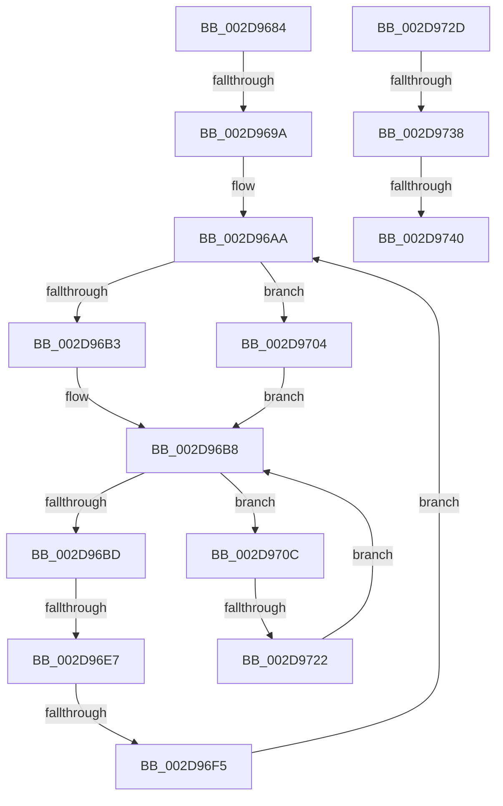

# sub_002D9684

- RVA: `0x002D9684`–`0x002D9745` (길이 `193` bytes)
- VA: `0x00000001402D9684`
- 실행 섹션: `.text`
- PDB 이름 있음: `아니요`; PDB Function 태그: `아니요`
- unwind 정보 RVA: `0x000703EC`
- 디코드: `49`개 명령, `193/193` bytes 표시
- 미해석 바이트: `0` (있으면 어셈블리에 `.byte`로 보존)

> 이 문서는 커널 이미지의 기계어와 PDB 기호를 분석해 생성했습니다. 4번과 5번은 함수 원형과 자료형을 바이너리 사용 방식에서 추정한 C 해석이며 원본 소스 복구 결과는 아닙니다.

## 1. Dependencies

- 직접 호출 지점: **2**; 고유 호출 대상: **2**
- 직접 호출자로 확인된 함수: **0**
- RIP 상대 이미지 참조: **0**

### Outgoing calls
- `0x002D9691` → [KeCheckProcessorAffinityEx](../30/KeCheckProcessorAffinityEx_function_00305150.md) (function, `0x00305150`)
- `0x002D96D0` → [KeGetPrcb](KeGetPrcb_function_002D85D0.md) (function, `0x002D85D0`)

### Direct callers
- 이 함수 시작 RVA로 연결되는 직접 call은 확인되지 않았습니다. 간접 호출은 완전히 역산할 수 없습니다.

### Static image references
- 디코드된 RIP-relative 메모리 참조가 없습니다.

## 2. Other-region calls and transfers

- 다른 실행 섹션으로 향하는 call: **0**
- call이 아닌 외부 분기/꼬리 이동: **7**
  - `0x002D9698` → [sub_002D95FE + 0x25](Unknown_function_002D95FE.md) (`tail-transfer`)
  - `0x002D96E1` → [sub_002D95FE + 0x25](Unknown_function_002D95FE.md) (`tail-transfer`)
  - `0x002D96EF` → [sub_002D95FE + 0x25](Unknown_function_002D95FE.md) (`tail-transfer`)
  - `0x002D971C` → [sub_002D95FE + 0x2A](Unknown_function_002D95FE.md) (`tail-transfer`)
  - `0x002D9732` → [sub_002D95FE + 0x4D](Unknown_function_002D95FE.md) (`tail-transfer`)
  - `0x002D973A` → [sub_002D95FE + 0x25](Unknown_function_002D95FE.md) (`tail-transfer`)
  - `0x002D9740` → [sub_002D95FE + 0x4D](Unknown_function_002D95FE.md) (`tail-transfer`)

## 3. Assembly (complete function range)

```asm
002D9684  8B 56 24                        mov edx, dword ptr [rsi + 0x24]
002D9687  4D 8D A5 80 00 00 00            lea r12, [r13 + 0x80]
002D968E  49 8B CC                        mov rcx, r12
002D9691  E8 BA BA 02 00                  call 0x140305150
002D9696  85 C0                           test eax, eax
002D9698  74 89                           je 0x1402d9623
002D969A  49 8B 54 24 08                  mov rdx, qword ptr [r12 + 8]
002D969F  33 C0                           xor eax, eax
002D96A1  44 0F B7 C0                     movzx r8d, ax
002D96A5  66 89 44 24 60                  mov word ptr [rsp + 0x60], ax
002D96AA  89 44 24 70                     mov dword ptr [rsp + 0x70], eax
002D96AE  4D 85 E4                        test r12, r12
002D96B1  74 51                           je 0x1402d9704
002D96B3  41 0F B7 0C 24                  movzx ecx, word ptr [r12]
002D96B8  48 85 D2                        test rdx, rdx
002D96BB  74 4F                           je 0x1402d970c
002D96BD  48 0F BC C2                     bsf rax, rdx
002D96C1  0F B6 C8                        movzx ecx, al
002D96C4  48 0F B3 CA                     btr rdx, rcx
002D96C8  41 8B CF                        mov ecx, r15d
002D96CB  48 89 54 24 70                  mov qword ptr [rsp + 0x70], rdx
002D96D0  E8 FB EE FF FF                  call 0x1402d85d0
002D96D5  65 48 8B 0C 25 20 00 00 00      mov rcx, qword ptr gs:[0x20]
002D96DE  48 3B C1                        cmp rax, rcx
002D96E1  0F 84 3C FF FF FF               je 0x1402d9623
002D96E7  48 8B 48 18                     mov rcx, qword ptr [rax + 0x18]
002D96EB  48 39 48 08                     cmp qword ptr [rax + 8], rcx
002D96EF  0F 85 2E FF FF FF               jne 0x1402d9623
002D96F5  48 8B 54 24 70                  mov rdx, qword ptr [rsp + 0x70]
002D96FA  33 C0                           xor eax, eax
002D96FC  44 0F B7 44 24 60               movzx r8d, word ptr [rsp + 0x60]
002D9702  EB A6                           jmp 0x1402d96aa
002D9704  41 0F B7 C8                     movzx ecx, r8w
002D9708  FF C1                           inc ecx
002D970A  EB AC                           jmp 0x1402d96b8
002D970C  66 41 FF C0                     inc r8w
002D9710  41 0F B7 C0                     movzx eax, r8w
002D9714  66 44 89 44 24 60               mov word ptr [rsp + 0x60], r8w
002D971A  3B C1                           cmp eax, ecx
002D971C  0F 83 06 FF FF FF               jae 0x1402d9628
002D9722  41 0F B7 C0                     movzx eax, r8w
002D9726  49 8B 54 C4 08                  mov rdx, qword ptr [r12 + rax*8 + 8]
002D972B  EB 8B                           jmp 0x1402d96b8
002D972D  8D 0C 03                        lea ecx, [rbx + rax]
002D9730  3B E9                           cmp ebp, ecx
002D9732  0F 82 13 FF FF FF               jb 0x1402d964b
002D9738  3B F9                           cmp edi, ecx
002D973A  0F 83 E3 FE FF FF               jae 0x1402d9623
002D9740  E9 06 FF FF FF                  jmp 0x1402d964b
```

## 4. C-style interpretation (structured pseudocode)

```c
__int64 __fastcall sub_002D9684(__int64 a1, __int64 a2, __int64 a3, __int64 a4, __int64 a5, __int64 a6, __int64 a7, __int64 a8, __int64 a9, __int64 a10, __int64 a11, unsigned __int16 a12, __int64 a13, __int64 a14)
{
    __int64 result;
    unsigned __int16 v_stack_p60;
    unsigned int v_stack_p70;

    result = KeCheckProcessorAffinityEx(v_r13 + 128, (unsigned int)(*(unsigned int *)(v_rsi + 36)), a3, a4);
    result = 0;
    v_stack_p60 = 0;
loc_002D96AA:
    v_stack_p70 = 0;
    if (v_r13 + 128 == 0) goto loc_002D9704;
loc_002D96B8:
    if (*(unsigned __int64 *)(v_r13 + 128 + 8) == 0) goto loc_002D970C;
    v_stack_p70 = *(unsigned __int64 *)(v_r13 + 128 + 8);
    result = KeGetPrcb((unsigned int)((unsigned int)(v_r15)), *(unsigned __int64 *)(v_r13 + 128 + 8), 0, a4);
    result = 0;
    goto loc_002D96AA;
loc_002D9704:
    a1 = (unsigned int)((a12) + 1);
    goto loc_002D96B8;
loc_002D970C:
    a3 = (unsigned __int16)((a12) + 1);
    v_stack_p60 = (unsigned __int16)(a3);
    goto loc_002D96B8;
}
```

## 5. (Beta) C Style

```c
int64_t sub_002D9684(int64_t Arg1, int64_t Arg2, int64_t Arg3, int64_t Arg4, uint64_t Arg5, uint64_t Arg6, uint64_t Arg7, uint64_t Arg8, uint64_t Arg9, uint64_t Arg10, uint64_t Arg11, uint16_t Arg12, uint64_t Arg13, int64_t Arg14)
{
    int64_t result;
    uint16_t v_stack_p60;
    uint32_t v_stack_p70;

    result = KeCheckProcessorAffinityEx(local_r13 + 128, (uint32_t)(*(uint32_t *)(local_rsi + 0x24)), Arg3, Arg4);
    result = 0;
    v_stack_p60 = 0;
loc_002D96AA:
    v_stack_p70 = 0;
    if (local_r13 + 128 == 0) goto loc_002D9704;
loc_002D96B8:
    if (*(uint64_t *)(local_r13 + 0x80 + 0x8) == 0) goto loc_002D970C;
    v_stack_p70 = *(uint64_t *)(local_r13 + 0x80 + 0x8);
    result = KeGetPrcb((uint32_t)((uint32_t)(local_r15)), *(uint64_t *)(local_r13 + 0x80 + 0x8), 0, Arg4);
    result = 0;
    goto loc_002D96AA;
loc_002D9704:
    Arg1 = (uint32_t)((Arg12) + 1);
    goto loc_002D96B8;
loc_002D970C:
    Arg3 = (uint16_t)((Arg12) + 1);
    v_stack_p60 = (uint16_t)(Arg3);
    goto loc_002D96B8;
}
```

## 6. Execution-region graph

[열기: 2D/3D 그래프와 함수 탐색 컨트롤 패널](../../../control-panel.html?section=text&rva=0x002D9684&view=graph)

- 2D 그래프는 위에서 아래로 흐르고, 3D 그래프는 빈 공간을 드래그해 회전합니다. Shift+드래그는 이동, 휠은 확대·축소, 함수 노드 선택은 대상 보고서 이동입니다.

### Static fallback


