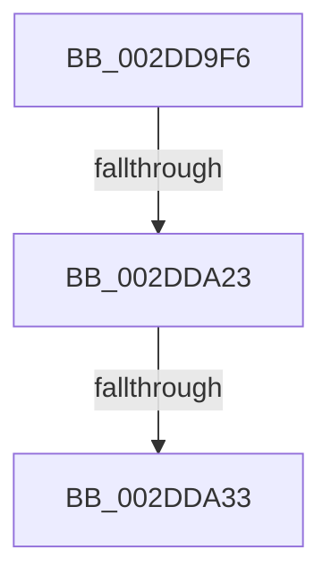

# sub_002DD9F6

- RVA: `0x002DD9F6`–`0x002DDA53` (길이 `93` bytes)
- VA: `0x00000001402DD9F6`
- 실행 섹션: `.text`
- PDB 이름 있음: `아니요`; PDB Function 태그: `아니요`
- unwind 정보 RVA: `0x00070860`
- 디코드: `21`개 명령, `93/93` bytes 표시
- 미해석 바이트: `0` (있으면 어셈블리에 `.byte`로 보존)

> 이 문서는 커널 이미지의 기계어와 PDB 기호를 분석해 생성했습니다. 4번과 5번은 함수 원형과 자료형을 바이너리 사용 방식에서 추정한 C 해석이며 원본 소스 복구 결과는 아닙니다.

## 1. Dependencies

- 직접 호출 지점: **0**; 고유 호출 대상: **0**
- 직접 호출자로 확인된 함수: **0**
- RIP 상대 이미지 참조: **0**

### Outgoing calls
- 직접 디코드된 call 명령이 없습니다.

### Direct callers
- 이 함수 시작 RVA로 연결되는 직접 call은 확인되지 않았습니다. 간접 호출은 완전히 역산할 수 없습니다.

### Static image references
- 디코드된 RIP-relative 메모리 참조가 없습니다.

## 2. Other-region calls and transfers

- 다른 실행 섹션으로 향하는 call: **0**
- call이 아닌 외부 분기/꼬리 이동: **3**
  - `0x002DDA1D` → [sub_002DDB07](Unknown_function_002DDB07.md) (`tail-transfer`)
  - `0x002DDA2D` → [sub_002DDAB8](Unknown_function_002DDAB8.md) (`tail-transfer`)
  - `0x002DDA51` → [sub_002DDAB8](Unknown_function_002DDAB8.md) (`tail-transfer`)

## 3. Assembly (complete function range)

```asm
002DD9F6  48 89 5C 24 28                  mov qword ptr [rsp + 0x28], rbx
002DD9FB  4C 8B C9                        mov r9, rcx
002DD9FE  4C 89 3C 24                     mov qword ptr [rsp], r15
002DDA02  48 8B DA                        mov rbx, rdx
002DDA05  0F 31                           rdtsc
002DDA07  4C 8B 91 A0 8F 00 00            mov r10, qword ptr [rcx + 0x8fa0]
002DDA0E  48 C1 E2 20                     shl rdx, 0x20
002DDA12  48 0B C2                        or rax, rdx
002DDA15  49 0F BA E2 27                  bt r10, 0x27
002DDA1A  4C 8B D8                        mov r11, rax
002DDA1D  0F 82 E4 00 00 00               jb 0x1402ddb07
002DDA23  33 FF                           xor edi, edi
002DDA25  48 89 6C 24 30                  mov qword ptr [rsp + 0x30], rbp
002DDA2A  45 84 C0                        test r8b, r8b
002DDA2D  0F 84 85 00 00 00               je 0x1402ddab8
002DDA33  48 8B EB                        mov rbp, rbx
002DDA36  49 2B A9 B8 88 00 00            sub rbp, qword ptr [r9 + 0x88b8]
002DDA3D  F0 49 01 A9 C8 88 00 00         lock add qword ptr [r9 + 0x88c8], rbp
002DDA45  4D 8B 91 A0 8F 00 00            mov r10, qword ptr [r9 + 0x8fa0]
002DDA4C  49 0F BA E2 27                  bt r10, 0x27
002DDA51  73 65                           jae 0x1402ddab8
```

## 4. C-style interpretation (structured pseudocode)

```c
__int64 __fastcall sub_002DD9F6(__int64 a1, __int64 a2, unsigned __int8 a3)
{
    __int64 result;
    __int64 v_rbp;
    __int64 v_rdi;
    unsigned __int64 v_stack_p0;
    unsigned __int64 v_stack_p28;
    unsigned __int64 v_stack_p30;

    v_stack_p28 = v_rbx;
    v_stack_p0 = v_r15;
    a2 = (a2) << (32);
    result = (result) | (a2);
    v_rdi = 0;
    v_stack_p30 = v_rbp;
    v_rbp = (a2) - (*(unsigned __int64 *)(a1 + 35000));
}
```

## 5. (Beta) C Style

```c
int64_t sub_002DD9F6(void *Arg1, int64_t Arg2, uint8_t Arg3)
{
    uint8_t *arg1 = (uint8_t *)Arg1;

    int64_t result;
    int64_t local_rbp;
    int64_t local_rdi;
    uint64_t v_stack_p0;
    uint64_t v_stack_p28;
    uint64_t v_stack_p30;

    v_stack_p28 = local_rbx;
    v_stack_p0 = local_r15;
    Arg2 = (Arg2) << (32);
    result = (result) | (Arg2);
    local_rdi = 0;
    v_stack_p30 = local_rbp;
    local_rbp = (Arg2) - (*(uint64_t *)(arg1 + 0x88B8));
}
```

### 관측된 메모리 오프셋

구조체 형식이 확인되지 않은 접근은 인자 기준의 오프셋으로만 기록했습니다.

| 기준 인자 | 오프셋 표현 | 폭 (bit) | 접근 |
|---|---:|---:|---|
| `Arg1` | `+ 0x88B8` | `64` | `R` |
| `Arg1` | `+ 0x88C8` | `64` | `R/W` |
| `Arg1` | `+ 0x8FA0` | `64` | `R` |

## 6. Execution-region graph

[열기: 2D/3D 그래프와 함수 탐색 컨트롤 패널](../../../control-panel.html?section=text&rva=0x002DD9F6&view=graph)

- 2D 그래프는 위에서 아래로 흐르고, 3D 그래프는 빈 공간을 드래그해 회전합니다. Shift+드래그는 이동, 휠은 확대·축소, 함수 노드 선택은 대상 보고서 이동입니다.

### Static fallback


