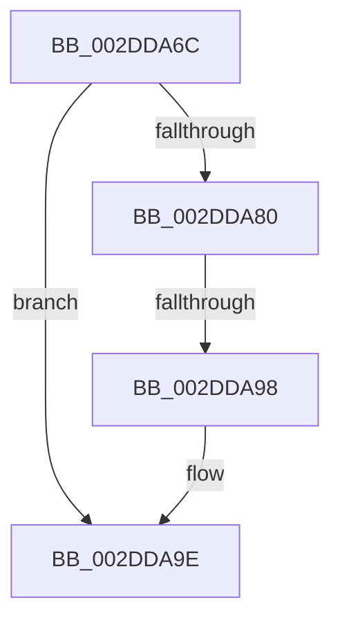

# sub_002DDA6C

- RVA: `0x002DDA6C`–`0x002DDAA3` (길이 `55` bytes)
- VA: `0x00000001402DDA6C`
- 실행 섹션: `.text`
- PDB 이름 있음: `아니요`; PDB Function 태그: `아니요`
- unwind 정보 RVA: `0x00070890`
- 디코드: `13`개 명령, `55/55` bytes 표시
- 미해석 바이트: `0` (있으면 어셈블리에 `.byte`로 보존)

> 이 문서는 커널 이미지의 기계어와 PDB 기호를 분석해 생성했습니다. 4번과 5번은 함수 원형과 자료형을 바이너리 사용 방식에서 추정한 C 해석이며 원본 소스 복구 결과는 아닙니다.

## 1. Dependencies

- 직접 호출 지점: **0**; 고유 호출 대상: **0**
- 직접 호출자로 확인된 함수: **0**
- RIP 상대 이미지 참조: **0**

### Outgoing calls
- 직접 디코드된 call 명령이 없습니다.

### Direct callers
- 이 함수 시작 RVA로 연결되는 직접 call은 확인되지 않았습니다. 간접 호출은 완전히 역산할 수 없습니다.

### Static image references
- 디코드된 RIP-relative 메모리 참조가 없습니다.

## 2. Other-region calls and transfers

- 다른 실행 섹션으로 향하는 call: **0**
- call이 아닌 외부 분기/꼬리 이동: **1**
  - `0x002DDA92` → [sub_002DDB1D](Unknown_function_002DDB1D.md) (`tail-transfer`)

## 3. Assembly (complete function range)

```asm
002DDA6C  4C 89 74 24 08                  mov qword ptr [rsp + 8], r14
002DDA71  4C 8B F7                        mov r14, rdi
002DDA74  4D 2B B1 08 89 00 00            sub r14, qword ptr [r9 + 0x8908]
002DDA7B  49 3B F6                        cmp rsi, r14
002DDA7E  74 1E                           je 0x1402dda9e
002DDA80  49 8B C6                        mov rax, r14
002DDA83  48 C7 44 24 20 00 00 00 00      mov qword ptr [rsp + 0x20], 0
002DDA8C  48 F7 E5                        mul rbp
002DDA8F  48 85 D2                        test rdx, rdx
002DDA92  0F 85 85 00 00 00               jne 0x1402ddb1d
002DDA98  48 F7 F6                        div rsi
002DDA9B  48 8B E8                        mov rbp, rax
002DDA9E  4C 8B 74 24 08                  mov r14, qword ptr [rsp + 8]
```

## 4. C-style interpretation (structured pseudocode)

```c
__int64 __fastcall sub_002DDA6C(__int64 a1, __int64 a2, __int64 a3, __int64 a4)
{
    __int64 v_r14;
    unsigned __int64 v_stack_p20;
    unsigned __int64 v_stack_p8;

    v_stack_p8 = v_r14;
    v_r14 = (v_rdi) - (*(unsigned __int64 *)(a4 + 35080));
    if (v_rsi == v_r14) goto loc_002DDA9E;
    v_stack_p20 = 0;
loc_002DDA9E:
    return v_r14;
}
```

## 5. (Beta) C Style

```c
int64_t sub_002DDA6C(int64_t Arg1, int64_t Arg2, int64_t Arg3, void *Arg4)
{
    uint8_t *arg4 = (uint8_t *)Arg4;

    int64_t local_r14;
    uint64_t v_stack_p20;
    uint64_t v_stack_p8;

    v_stack_p8 = local_r14;
    local_r14 = (local_rdi) - (*(uint64_t *)(arg4 + 0x8908));
    if (local_rsi == local_r14) goto loc_002DDA9E;
    v_stack_p20 = 0;
loc_002DDA9E:
    return local_r14;
}
```

### 관측된 메모리 오프셋

구조체 형식이 확인되지 않은 접근은 인자 기준의 오프셋으로만 기록했습니다.

| 기준 인자 | 오프셋 표현 | 폭 (bit) | 접근 |
|---|---:|---:|---|
| `Arg4` | `+ 0x8908` | `64` | `R` |

## 6. Execution-region graph

[열기: 2D/3D 그래프와 함수 탐색 컨트롤 패널](../../../control-panel.html?section=text&rva=0x002DDA6C&view=graph)

- 2D 그래프는 위에서 아래로 흐르고, 3D 그래프는 빈 공간을 드래그해 회전합니다. Shift+드래그는 이동, 휠은 확대·축소, 함수 노드 선택은 대상 보고서 이동입니다.

### Static fallback


