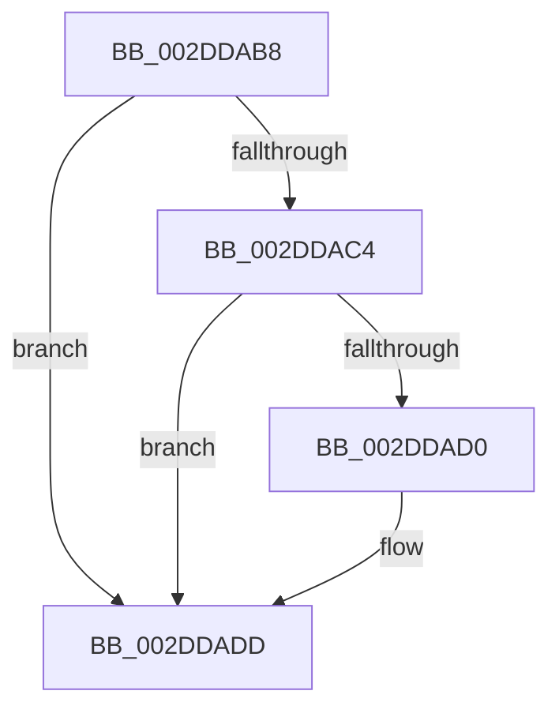

# sub_002DDAB8

- RVA: `0x002DDAB8`–`0x002DDAF9` (길이 `65` bytes)
- VA: `0x00000001402DDAB8`
- 실행 섹션: `.text`
- PDB 이름 있음: `아니요`; PDB Function 태그: `아니요`
- unwind 정보 RVA: `0x000708B4`
- 디코드: `15`개 명령, `65/65` bytes 표시
- 미해석 바이트: `0` (있으면 어셈블리에 `.byte`로 보존)

> 이 문서는 커널 이미지의 기계어와 PDB 기호를 분석해 생성했습니다. 4번과 5번은 함수 원형과 자료형을 바이너리 사용 방식에서 추정한 C 해석이며 원본 소스 복구 결과는 아닙니다.

## 1. Dependencies

- 직접 호출 지점: **0**; 고유 호출 대상: **0**
- 직접 호출자로 확인된 함수: **0**
- RIP 상대 이미지 참조: **0**

### Outgoing calls
- 직접 디코드된 call 명령이 없습니다.

### Direct callers
- 이 함수 시작 RVA로 연결되는 직접 call은 확인되지 않았습니다. 간접 호출은 완전히 역산할 수 없습니다.

### Static image references
- 디코드된 RIP-relative 메모리 참조가 없습니다.

## 2. Other-region calls and transfers

- 다른 실행 섹션으로 향하는 call: **0**
- call이 아닌 외부 분기/꼬리 이동: **1**
  - `0x002DDAF7` → [sub_002DDAF9 + 0x7](Unknown_function_002DDAF9.md) (`tail-transfer`)

## 3. Assembly (complete function range)

```asm
002DDAB8  49 89 99 B8 88 00 00            mov qword ptr [r9 + 0x88b8], rbx
002DDABF  45 84 C0                        test r8b, r8b
002DDAC2  74 19                           je 0x1402ddadd
002DDAC4  49 8B 89 98 88 00 00            mov rcx, qword ptr [r9 + 0x8898]
002DDACB  4C 3B D9                        cmp r11, rcx
002DDACE  76 0D                           jbe 0x1402ddadd
002DDAD0  49 8B C3                        mov rax, r11
002DDAD3  48 2B C1                        sub rax, rcx
002DDAD6  49 01 81 A0 88 00 00            add qword ptr [r9 + 0x88a0], rax
002DDADD  49 0F BA E2 27                  bt r10, 0x27
002DDAE2  48 8B 6C 24 30                  mov rbp, qword ptr [rsp + 0x30]
002DDAE7  48 8B 5C 24 28                  mov rbx, qword ptr [rsp + 0x28]
002DDAEC  4C 8B 3C 24                     mov r15, qword ptr [rsp]
002DDAF0  4D 89 99 98 88 00 00            mov qword ptr [r9 + 0x8898], r11
002DDAF7  73 07                           jae 0x1402ddb00
```

## 4. C-style interpretation (structured pseudocode)

```c
__int64 __fastcall sub_002DDAB8(__int64 a1, __int64 a2, unsigned __int8 a3, __int64 a4, __int64 a5, __int64 a6)
{
    __int64 result;
    unsigned __int64 v_stack_p0;

    *(unsigned __int64 *)(a4 + 35000) = v_rbx;
    if (a3 == 0) goto loc_002DDADD;
    if (v_r11 >= = (*(unsigned __int64 *)(a4 + 34968))) {
        result = v_r11;
        result = (result) - (*(unsigned __int64 *)(a4 + 34968));
    }
    *(unsigned __int64 *)(a4 + 34968) = v_r11;
}
```

## 5. (Beta) C Style

```c
int64_t sub_002DDAB8(int64_t Arg1, int64_t Arg2, uint8_t Arg3, void *Arg4, int64_t Arg5, int64_t Arg6)
{
    uint8_t *arg4 = (uint8_t *)Arg4;

    int64_t result;
    uint64_t v_stack_p0;

    *(uint64_t *)(arg4 + 0x88B8) = local_rbx;
    if (Arg3 == 0) goto loc_002DDADD;
    if (local_r11 >= = (*(uint64_t *)(arg4 + 0x8898))) {
        result = local_r11;
        result = (result) - (*(uint64_t *)(arg4 + 0x8898));
    }
    *(uint64_t *)(arg4 + 0x8898) = local_r11;
}
```

### 관측된 메모리 오프셋

구조체 형식이 확인되지 않은 접근은 인자 기준의 오프셋으로만 기록했습니다.

| 기준 인자 | 오프셋 표현 | 폭 (bit) | 접근 |
|---|---:|---:|---|
| `Arg4` | `+ 0x8898` | `64` | `R` |
| `Arg4` | `+ 0x8898` | `64` | `W` |
| `Arg4` | `+ 0x88A0` | `64` | `R/W` |
| `Arg4` | `+ 0x88B8` | `64` | `W` |

## 6. Execution-region graph

[열기: 2D/3D 그래프와 함수 탐색 컨트롤 패널](../../../control-panel.html?section=text&rva=0x002DDAB8&view=graph)

- 2D 그래프는 위에서 아래로 흐르고, 3D 그래프는 빈 공간을 드래그해 회전합니다. Shift+드래그는 이동, 휠은 확대·축소, 함수 노드 선택은 대상 보고서 이동입니다.

### Static fallback


