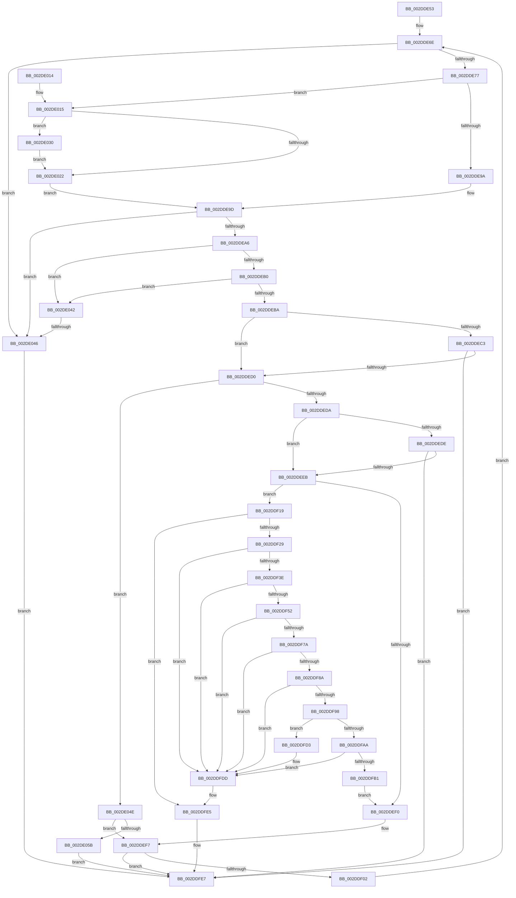

# sub_002DDE53

- RVA: `0x002DDE53`–`0x002DE05D` (길이 `522` bytes)
- VA: `0x00000001402DDE53`
- 실행 섹션: `.text`
- PDB 이름 있음: `아니요`; PDB Function 태그: `아니요`
- unwind 정보 RVA: `0x0007093C`
- 디코드: `131`개 명령, `522/522` bytes 표시
- 미해석 바이트: `0` (있으면 어셈블리에 `.byte`로 보존)

> 이 문서는 커널 이미지의 기계어와 PDB 기호를 분석해 생성했습니다. 4번과 5번은 함수 원형과 자료형을 바이너리 사용 방식에서 추정한 C 해석이며 원본 소스 복구 결과는 아닙니다.

## 1. Dependencies

- 직접 호출 지점: **2**; 고유 호출 대상: **2**
- 직접 호출자로 확인된 함수: **0**
- RIP 상대 이미지 참조: **0**

### Outgoing calls
- `0x002DDF8F` → [ExAcquireRundownProtection](../21/ExAcquireRundownProtection_function_00216620.md) (function, `0x00216620`)
- `0x002DDFD8` → [ExReleaseRundownProtection](../34/ExReleaseRundownProtection_function_00349E80.md) (function, `0x00349E80`)

### Direct callers
- 이 함수 시작 RVA로 연결되는 직접 call은 확인되지 않았습니다. 간접 호출은 완전히 역산할 수 없습니다.

### Static image references
- 디코드된 RIP-relative 메모리 참조가 없습니다.

## 2. Other-region calls and transfers

- 다른 실행 섹션으로 향하는 call: **0**
- call이 아닌 외부 분기/꼬리 이동: **1**
  - `0x002DE044` → [sub_002DE066](Unknown_function_002DE066.md) (`tail-transfer`)

## 3. Assembly (complete function range)

```asm
002DDE53  48 89 74 24 48                  mov qword ptr [rsp + 0x48], rsi
002DDE58  48 83 EA 08                     sub rdx, 8
002DDE5C  4C 89 6C 24 40                  mov qword ptr [rsp + 0x40], r13
002DDE61  4C 89 8C 24 90 00 00 00         mov qword ptr [rsp + 0x90], r9
002DDE69  4C 89 7C 24 38                  mov qword ptr [rsp + 0x38], r15
002DDE6E  4D 85 C9                        test r9, r9
002DDE71  0F 84 CF 01 00 00               je 0x1402de046
002DDE77  41 8B 01                        mov eax, dword ptr [r9]
002DDE7A  48 83 C2 08                     add rdx, 8
002DDE7E  0F B7 C0                        movzx eax, ax
002DDE81  48 83 C0 02                     add rax, 2
002DDE85  48 89 94 24 A0 00 00 00         mov qword ptr [rsp + 0xa0], rdx
002DDE8D  49 8D 04 C1                     lea rax, [r9 + rax*8]
002DDE91  48 3B D0                        cmp rdx, rax
002DDE94  0F 83 7B 01 00 00               jae 0x1402de015
002DDE9A  48 8B F2                        mov rsi, rdx
002DDE9D  48 85 F6                        test rsi, rsi
002DDEA0  0F 84 A0 01 00 00               je 0x1402de046
002DDEA6  8B 06                           mov eax, dword ptr [rsi]
002DDEA8  3B D8                           cmp ebx, eax
002DDEAA  0F 82 92 01 00 00               jb 0x1402de042
002DDEB0  F6 46 07 01                     test byte ptr [rsi + 7], 1
002DDEB4  0F 85 88 01 00 00               jne 0x1402de042
002DDEBA  41 81 F8 00 04 00 00            cmp r8d, 0x400
002DDEC1  74 0D                           je 0x1402dded0
002DDEC3  0F B7 46 04                     movzx eax, word ptr [rsi + 4]
002DDEC7  44 3B C0                        cmp r8d, eax
002DDECA  0F 85 17 01 00 00               jne 0x1402ddfe7
002DDED0  80 7E 06 02                     cmp byte ptr [rsi + 6], 2
002DDED4  0F 84 74 01 00 00               je 0x1402de04e
002DDEDA  85 ED                           test ebp, ebp
002DDEDC  74 0D                           je 0x1402ddeeb
002DDEDE  41 81 F8 00 04 00 00            cmp r8d, 0x400
002DDEE5  0F 84 FC 00 00 00               je 0x1402ddfe7
002DDEEB  45 85 F6                        test r14d, r14d
002DDEEE  74 29                           je 0x1402ddf19
002DDEF0  C6 46 06 02                     mov byte ptr [rsi + 6], 2
002DDEF4  41 FF C6                        inc r14d
002DDEF7  FF C5                           inc ebp
002DDEF9  41 3B EA                        cmp ebp, r10d
002DDEFC  0F 84 E5 00 00 00               je 0x1402ddfe7
002DDF02  48 8B 94 24 A0 00 00 00         mov rdx, qword ptr [rsp + 0xa0]
002DDF0A  FF C3                           inc ebx
002DDF0C  4C 8B 8C 24 90 00 00 00         mov r9, qword ptr [rsp + 0x90]
002DDF14  E9 55 FF FF FF                  jmp 0x1402dde6e
002DDF19  0F B7 56 04                     movzx edx, word ptr [rsi + 4]
002DDF1D  81 FA 00 04 00 00               cmp edx, 0x400
002DDF23  0F 83 BC 00 00 00               jae 0x1402ddfe5
002DDF29  8B C2                           mov eax, edx
002DDF2B  8B CA                           mov ecx, edx
002DDF2D  48 C1 E8 05                     shr rax, 5
002DDF31  4D 8B 04 C4                     mov r8, qword ptr [r12 + rax*8]
002DDF35  4D 85 C0                        test r8, r8
002DDF38  0F 84 9F 00 00 00               je 0x1402ddfdd
002DDF3E  83 E1 1F                        and ecx, 0x1f
002DDF41  48 8D 04 89                     lea rax, [rcx + rcx*4]
002DDF45  49 8D 0C C0                     lea rcx, [r8 + rax*8]
002DDF49  48 85 C9                        test rcx, rcx
002DDF4C  0F 84 8B 00 00 00               je 0x1402ddfdd
002DDF52  44 0F B7 79 20                  movzx r15d, word ptr [rcx + 0x20]
002DDF57  41 83 E7 3F                     and r15d, 0x3f
002DDF5B  41 C1 E7 0A                     shl r15d, 0xa
002DDF5F  44 0B FA                        or r15d, edx
002DDF62  41 8B CF                        mov ecx, r15d
002DDF65  81 E1 FF 03 00 00               and ecx, 0x3ff
002DDF6B  8B C1                           mov eax, ecx
002DDF6D  48 C1 E8 05                     shr rax, 5
002DDF71  49 8B 14 C4                     mov rdx, qword ptr [r12 + rax*8]
002DDF75  48 85 D2                        test rdx, rdx
002DDF78  74 63                           je 0x1402ddfdd
002DDF7A  83 E1 1F                        and ecx, 0x1f
002DDF7D  48 8D 04 89                     lea rax, [rcx + rcx*4]
002DDF81  4C 8D 24 C2                     lea r12, [rdx + rax*8]
002DDF85  4D 85 E4                        test r12, r12
002DDF88  74 53                           je 0x1402ddfdd
002DDF8A  49 8D 4C 24 08                  lea rcx, [r12 + 8]
002DDF8F  E8 8C 86 F3 FF                  call 0x140216620
002DDF94  84 C0                           test al, al
002DDF96  74 45                           je 0x1402ddfdd
002DDF98  41 0F B7 44 24 20               movzx eax, word ptr [r12 + 0x20]
002DDF9E  83 E0 3F                        and eax, 0x3f
002DDFA1  41 C1 EF 0A                     shr r15d, 0xa
002DDFA5  41 3B C7                        cmp eax, r15d
002DDFA8  75 29                           jne 0x1402ddfd3
002DDFAA  49 83 3C 24 00                  cmp qword ptr [r12], 0
002DDFAF  74 2C                           je 0x1402ddfdd
002DDFB1  44 0F B7 46 04                  movzx r8d, word ptr [rsi + 4]
002DDFB6  44 8B 94 24 88 00 00 00         mov r10d, dword ptr [rsp + 0x88]
002DDFBE  4C 8B A4 24 98 00 00 00         mov r12, qword ptr [rsp + 0x98]
002DDFC6  44 89 84 24 80 00 00 00         mov dword ptr [rsp + 0x80], r8d
002DDFCE  E9 1D FF FF FF                  jmp 0x1402ddef0
002DDFD3  49 8D 4C 24 08                  lea rcx, [r12 + 8]
002DDFD8  E8 A3 BE 06 00                  call 0x140349e80
002DDFDD  44 8B 84 24 80 00 00 00         mov r8d, dword ptr [rsp + 0x80]
002DDFE5  FF C5                           inc ebp
002DDFE7  48 8B 44 24 20                  mov rax, qword ptr [rsp + 0x20]
002DDFEC  4C 8B 7C 24 38                  mov r15, qword ptr [rsp + 0x38]
002DDFF1  4C 8B 6C 24 40                  mov r13, qword ptr [rsp + 0x40]
002DDFF6  48 8B 74 24 48                  mov rsi, qword ptr [rsp + 0x48]
002DDFFB  44 89 30                        mov dword ptr [rax], r14d
002DDFFE  48 8B 44 24 28                  mov rax, qword ptr [rsp + 0x28]
002DE003  89 28                           mov dword ptr [rax], ebp
002DE005  41 8B C0                        mov eax, r8d
002DE008  48 83 C4 50                     add rsp, 0x50
002DE00C  41 5E                           pop r14
002DE00E  41 5C                           pop r12
002DE010  5F                              pop rdi
002DE011  5D                              pop rbp
002DE012  5B                              pop rbx
002DE013  C3                              ret
002DE014  CC                              int3
002DE015  49 8B 49 08                     mov rcx, qword ptr [r9 + 8]
002DE019  48 8D 41 10                     lea rax, [rcx + 0x10]
002DE01D  48 85 C9                        test rcx, rcx
002DE020  75 0E                           jne 0x1402de030
002DE022  33 F6                           xor esi, esi
002DE024  48 85 C9                        test rcx, rcx
002DE027  48 0F 45 F0                     cmovne rsi, rax
002DE02B  E9 6D FE FF FF                  jmp 0x1402dde9d
002DE030  48 89 8C 24 90 00 00 00         mov qword ptr [rsp + 0x90], rcx
002DE038  48 89 84 24 A0 00 00 00         mov qword ptr [rsp + 0xa0], rax
002DE040  EB E0                           jmp 0x1402de022
002DE042  3B F8                           cmp edi, eax
002DE044  73 20                           jae 0x1402de066
002DE046  2B EB                           sub ebp, ebx
002DE048  FF C5                           inc ebp
002DE04A  03 EF                           add ebp, edi
002DE04C  EB 99                           jmp 0x1402ddfe7
002DE04E  41 81 F8 00 04 00 00            cmp r8d, 0x400
002DE055  0F 84 9C FE FF FF               je 0x1402ddef7
002DE05B  EB 8A                           jmp 0x1402ddfe7
```

## 4. C-style interpretation (structured pseudocode)

```c
__int64 __fastcall sub_002DDE53(__int64 a1, __int64 a2, int a3, __int64 a4, __int64 a5, __int64 a6, __int64 a7, __int64 a8, __int64 a9, __int64 a10, __int64 a11, __int64 a12, __int64 a13, __int64 a14, __int64 a15, unsigned int a16, unsigned int a17, __int64 a18, __int64 a19, __int64 a20)
{
    __int64 result;
    __int64 v_r14;
    __int64 v_r15;
    __int64 v_rbp;
    __int64 v_rbx;
    __int64 v_rsi;
    __int64 v_rsp;
    unsigned __int64 v_stack_p108;
    unsigned __int64 v_stack_p118;
    unsigned __int64 v_stack_p20;
    unsigned __int64 v_stack_p38;
    unsigned __int64 v_stack_p40;
    unsigned __int64 v_stack_p48;
    unsigned int v_stack_p80;
    unsigned __int64 v_stack_p90;
    unsigned __int64 v_stack_pA0;

    v_stack_p48 = v_rsi;
    a2 = (a2) - (8);
    v_stack_p40 = v_r13;
    v_stack_p90 = a4;
    v_stack_p38 = v_r15;
loc_002DDE6E:
    if (a4 == 0) goto loc_002DE046;
    a2 = (a2) + (8);
    result = ((unsigned __int16)((unsigned int)(*(unsigned int *)(a4)))) + (2);
    v_stack_pA0 = a2;
    if (a2 >= (a4 + result * 8)) goto loc_002DE015;
loc_002DDE9D:
    if (a2 == 0) goto loc_002DE046;
    if (((unsigned int)(v_rbx)) < ((unsigned int)((unsigned int)(*(unsigned int *)(a2))))) goto loc_002DE042;
    if (((*(unsigned __int8 *)(a2 + 7)) & (1)) != 0) goto loc_002DE042;
    if (a3 == 0x400ULL) goto loc_002DDED0;
    if (a3 != ((unsigned int)(*(unsigned __int16 *)(a2 + 4)))) goto loc_002DDFE7;
loc_002DDED0:
    if ((*(unsigned __int8 *)(a2 + 6)) == 2) goto loc_002DE04E;
    if ((unsigned int)(v_rbp) == 0) goto loc_002DDEEB;
    if (a3 == 0x400ULL) goto loc_002DDFE7;
loc_002DDEEB:
    if ((unsigned int)(v_r14) == 0) goto loc_002DDF19;
loc_002DDEF0:
    *(unsigned __int8 *)(a2 + 6) = 2;
    v_r14 = (unsigned int)((v_r14) + 1);
loc_002DDEF7:
    v_rbp = (unsigned int)((v_rbp) + 1);
    if (((unsigned int)(v_rbp)) == ((unsigned int)(v_r10))) goto loc_002DDFE7;
    v_rbx = (unsigned int)((v_rbx) + 1);
    goto loc_002DDE6E;
loc_002DDF19:
    if (((unsigned int)(*(unsigned __int16 *)(a2 + 4))) >= 0x400ULL) goto loc_002DDFE5;
    result = ((unsigned int)((unsigned int)(*(unsigned __int16 *)(a2 + 4)))) >> (5);
    if (*(unsigned __int64 *)(v_r12 + result * 8) == 0) goto loc_002DDFDD;
    a1 = (unsigned int)(((unsigned int)((unsigned int)(*(unsigned __int16 *)(a2 + 4)))) & (31));
    if (*(unsigned __int64 *)(v_r12 + result * 8) + a1 + a1 * 4 * 8 == 0) goto loc_002DDFDD;
    v_r15 = (unsigned int)((*(unsigned __int16 *)(*(unsigned __int64 *)(v_r12 + result * 8) + a1 + a1 * 4 * 8 + 32)) & (63));
    v_r15 = (unsigned int)((v_r15) << (10));
    v_r15 = (unsigned int)((v_r15) | ((unsigned int)(*(unsigned __int16 *)(a2 + 4))));
    a1 = (unsigned int)(((unsigned int)((unsigned int)(v_r15))) & (0x3FFULL));
    result = ((unsigned int)((unsigned int)(a1))) >> (5);
    if (*(unsigned __int64 *)(v_r12 + result * 8) == 0) goto loc_002DDFDD;
    a1 = (unsigned int)((a1) & (31));
    if (*(unsigned __int64 *)(v_r12 + result * 8) + a1 + a1 * 4 * 8 == 0) goto loc_002DDFDD;
    result = ExAcquireRundownProtection(*(unsigned __int64 *)(v_r12 + result * 8) + a1 + a1 * 4 * 8 + 8, *(unsigned __int64 *)(v_r12 + result * 8), *(unsigned __int64 *)(v_r12 + result * 8), a18);
    if ((unsigned __int8)(result) == 0) goto loc_002DDFDD;
    result = (unsigned int)((*(unsigned __int16 *)(*(unsigned __int64 *)(v_r12 + result * 8) + a1 + a1 * 4 * 8 + 32)) & (63));
    v_r15 = (unsigned int)((v_r15) >> (10));
    if (((unsigned int)(result)) != ((unsigned int)(v_r15))) goto loc_002DDFD3;
    if ((*(unsigned __int64 *)(*(unsigned __int64 *)(v_r12 + result * 8) + a1 + a1 * 4 * 8)) == 0) goto loc_002DDFDD;
    v_stack_p80 = (unsigned int)(*(unsigned __int16 *)(a2 + 4));
    goto loc_002DDEF0;
loc_002DDFD3:
    result = ExReleaseRundownProtection(a19 + 8, *(unsigned __int64 *)(v_r12 + result * 8), *(unsigned __int16 *)(a2 + 4), a18);
loc_002DDFDD:
loc_002DDFE5:
    v_rbp = (unsigned int)((v_rbp) + 1);
loc_002DDFE7:
    *(unsigned int *)(v_stack_p20) = (unsigned int)(v_r14);
    *(unsigned int *)(a5) = (unsigned int)(v_rbp);
    v_rsp = (v_rsp) + (80);
    return (unsigned int)((unsigned int)((unsigned int)(a16)));
loc_002DE015:
    if (*(unsigned __int64 *)(a18 + 8) != 0) goto loc_002DE030;
loc_002DE022:
    v_rsi = 0;
    if (*(unsigned __int64 *)(a18 + 8) != 0) { v_rsi = *(unsigned __int64 *)(a18 + 8) + 16; }
    goto loc_002DDE9D;
loc_002DE030:
    v_stack_p108 = *(unsigned __int64 *)(a18 + 8);
    v_stack_p118 = *(unsigned __int64 *)(a18 + 8) + 16;
    goto loc_002DE022;
loc_002DE042:
loc_002DE046:
    v_rbp = (unsigned int)((v_rbp) - ((unsigned int)(v_rbx)));
    v_rbp = (unsigned int)((v_rbp) + 1);
    v_rbp = (unsigned int)((v_rbp) + ((unsigned int)(v_rdi)));
    goto loc_002DDFE7;
loc_002DE04E:
    if (((unsigned int)((unsigned int)(a16))) == 0x400ULL) goto loc_002DDEF7;
    goto loc_002DDFE7;
}
```

## 5. (Beta) C Style

```c
int64_t sub_002DDE53(int64_t Arg1, int64_t Arg2, int32_t Arg3, int64_t Arg4, void *Arg5, uint64_t Arg6, int64_t Arg7, int64_t Arg8, int64_t Arg9, uint64_t Arg10, uint64_t Arg11, uint64_t Arg12, uint64_t Arg13, uint64_t Arg14, uint64_t Arg15, uint32_t Arg16, uint32_t Arg17, int64_t Arg18, int64_t Arg19, int64_t Arg20)
{
    uint8_t *arg5 = (uint8_t *)Arg5;

    int64_t result;
    int64_t local_r14;
    int64_t local_r15;
    int64_t local_rbp;
    int64_t local_rbx;
    int64_t local_rsi;
    int64_t local_rsp;
    uint64_t v_stack_p108;
    uint64_t v_stack_p118;
    uint64_t v_stack_p20;
    uint64_t v_stack_p38;
    uint64_t v_stack_p40;
    uint64_t v_stack_p48;
    uint32_t v_stack_p80;
    uint64_t v_stack_p90;
    uint64_t v_stack_pA0;

    v_stack_p48 = local_rsi;
    Arg2 = (Arg2) - (8);
    v_stack_p40 = local_r13;
    v_stack_p90 = Arg4;
    v_stack_p38 = local_r15;
loc_002DDE6E:
    if (Arg4 == 0) goto loc_002DE046;
    Arg2 = (Arg2) + (8);
    result = ((uint16_t)((uint32_t)(*(uint32_t *)(Arg4)))) + (2);
    v_stack_pA0 = Arg2;
    if (Arg2 >= (Arg4 + result * 8)) goto loc_002DE015;
loc_002DDE9D:
    if (Arg2 == 0) goto loc_002DE046;
    if (((uint32_t)(local_rbx)) < ((uint32_t)((uint32_t)(*(uint32_t *)(Arg2))))) goto loc_002DE042;
    if (((*(uint8_t *)(Arg2 + 0x7)) & (1)) != 0) goto loc_002DE042;
    if (Arg3 == 0x400ULL) goto loc_002DDED0;
    if (Arg3 != ((uint32_t)(*(uint16_t *)(Arg2 + 0x4)))) goto loc_002DDFE7;
loc_002DDED0:
    if ((*(uint8_t *)(Arg2 + 0x6)) == 2) goto loc_002DE04E;
    if ((uint32_t)(local_rbp) == 0) goto loc_002DDEEB;
    if (Arg3 == 0x400ULL) goto loc_002DDFE7;
loc_002DDEEB:
    if ((uint32_t)(local_r14) == 0) goto loc_002DDF19;
loc_002DDEF0:
    *(uint8_t *)(Arg2 + 0x6) = 2;
    local_r14 = (uint32_t)((local_r14) + 1);
loc_002DDEF7:
    local_rbp = (uint32_t)((local_rbp) + 1);
    if (((uint32_t)(local_rbp)) == ((uint32_t)(local_r10))) goto loc_002DDFE7;
    local_rbx = (uint32_t)((local_rbx) + 1);
    goto loc_002DDE6E;
loc_002DDF19:
    if (((uint32_t)(*(uint16_t *)(Arg2 + 0x4))) >= 0x400ULL) goto loc_002DDFE5;
    result = ((uint32_t)((uint32_t)(*(uint16_t *)(Arg2 + 0x4)))) >> (5);
    if (*(uint64_t *)(local_r12 + result * 8) == 0) goto loc_002DDFDD;
    Arg1 = (uint32_t)(((uint32_t)((uint32_t)(*(uint16_t *)(Arg2 + 0x4)))) & (31));
    if (*(uint64_t *)(local_r12 + result * 8) + Arg1 + Arg1 * 4 * 8 == 0) goto loc_002DDFDD;
    local_r15 = (uint32_t)((*(uint16_t *)(*(uint64_t *)(local_r12 + result * 8) + Arg1 + Arg1 * 4 * 8 + 0x20)) & (63));
    local_r15 = (uint32_t)((local_r15) << (10));
    local_r15 = (uint32_t)((local_r15) | ((uint32_t)(*(uint16_t *)(Arg2 + 0x4))));
    Arg1 = (uint32_t)(((uint32_t)((uint32_t)(local_r15))) & (0x3FFULL));
    result = ((uint32_t)((uint32_t)(Arg1))) >> (5);
    if (*(uint64_t *)(local_r12 + result * 8) == 0) goto loc_002DDFDD;
    Arg1 = (uint32_t)((Arg1) & (31));
    if (*(uint64_t *)(local_r12 + result * 8) + Arg1 + Arg1 * 4 * 8 == 0) goto loc_002DDFDD;
    result = ExAcquireRundownProtection(*(uint64_t *)(local_r12 + result * 8) + Arg1 + Arg1 * 4 * 8 + 8, *(uint64_t *)(local_r12 + result * 8), *(uint64_t *)(local_r12 + result * 8), Arg18);
    if ((uint8_t)(result) == 0) goto loc_002DDFDD;
    result = (uint32_t)((*(uint16_t *)(*(uint64_t *)(local_r12 + result * 8) + Arg1 + Arg1 * 4 * 8 + 0x20)) & (63));
    local_r15 = (uint32_t)((local_r15) >> (10));
    if (((uint32_t)(result)) != ((uint32_t)(local_r15))) goto loc_002DDFD3;
    if ((*(uint64_t *)(*(uint64_t *)(local_r12 + result * 8) + Arg1 + Arg1 * 4 * 8)) == 0) goto loc_002DDFDD;
    v_stack_p80 = (uint32_t)(*(uint16_t *)(Arg2 + 0x4));
    goto loc_002DDEF0;
loc_002DDFD3:
    result = ExReleaseRundownProtection(Arg19 + 8, *(uint64_t *)(local_r12 + result * 8), *(uint16_t *)(Arg2 + 0x4), Arg18);
loc_002DDFDD:
loc_002DDFE5:
    local_rbp = (uint32_t)((local_rbp) + 1);
loc_002DDFE7:
    *(uint32_t *)(v_stack_p20) = (uint32_t)(local_r14);
    *(uint32_t *)(arg5) = (uint32_t)(local_rbp);
    local_rsp = (local_rsp) + (80);
    return (uint32_t)((uint32_t)((uint32_t)(Arg16)));
loc_002DE015:
    if (*(uint64_t *)(Arg18 + 0x8) != 0) goto loc_002DE030;
loc_002DE022:
    local_rsi = 0;
    if (*(uint64_t *)(Arg18 + 0x8) != 0) { local_rsi = *(uint64_t *)(Arg18 + 0x8) + 16; }
    goto loc_002DDE9D;
loc_002DE030:
    v_stack_p108 = *(uint64_t *)(Arg18 + 0x8);
    v_stack_p118 = *(uint64_t *)(Arg18 + 0x8) + 16;
    goto loc_002DE022;
loc_002DE042:
loc_002DE046:
    local_rbp = (uint32_t)((local_rbp) - ((uint32_t)(local_rbx)));
    local_rbp = (uint32_t)((local_rbp) + 1);
    local_rbp = (uint32_t)((local_rbp) + ((uint32_t)(local_rdi)));
    goto loc_002DDFE7;
loc_002DE04E:
    if (((uint32_t)((uint32_t)(Arg16))) == 0x400ULL) goto loc_002DDEF7;
    goto loc_002DDFE7;
}
```

### 관측된 메모리 오프셋

구조체 형식이 확인되지 않은 접근은 인자 기준의 오프셋으로만 기록했습니다.

| 기준 인자 | 오프셋 표현 | 폭 (bit) | 접근 |
|---|---:|---:|---|
| `Arg5` | `+ 0x0` | `32` | `W` |

## 6. Execution-region graph

[열기: 2D/3D 그래프와 함수 탐색 컨트롤 패널](../../../control-panel.html?section=text&rva=0x002DDE53&view=graph)

- 2D 그래프는 위에서 아래로 흐르고, 3D 그래프는 빈 공간을 드래그해 회전합니다. Shift+드래그는 이동, 휠은 확대·축소, 함수 노드 선택은 대상 보고서 이동입니다.

### Static fallback


