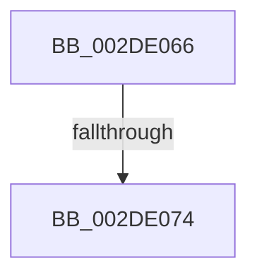

# sub_002DE066

- RVA: `0x002DE066`–`0x002DE07B` (길이 `21` bytes)
- VA: `0x00000001402DE066`
- 실행 섹션: `.text`
- PDB 이름 있음: `아니요`; PDB Function 태그: `아니요`
- unwind 정보 RVA: `0x0007096C`
- 디코드: `6`개 명령, `21/21` bytes 표시
- 미해석 바이트: `0` (있으면 어셈블리에 `.byte`로 보존)

> 이 문서는 커널 이미지의 기계어와 PDB 기호를 분석해 생성했습니다. 4번과 5번은 함수 원형과 자료형을 바이너리 사용 방식에서 추정한 C 해석이며 원본 소스 복구 결과는 아닙니다.

## 1. Dependencies

- 직접 호출 지점: **0**; 고유 호출 대상: **0**
- 직접 호출자로 확인된 함수: **0**
- RIP 상대 이미지 참조: **0**

### Outgoing calls
- 직접 디코드된 call 명령이 없습니다.

### Direct callers
- 이 함수 시작 RVA로 연결되는 직접 call은 확인되지 않았습니다. 간접 호출은 완전히 역산할 수 없습니다.

### Static image references
- 디코드된 RIP-relative 메모리 참조가 없습니다.

## 2. Other-region calls and transfers

- 다른 실행 섹션으로 향하는 call: **0**
- call이 아닌 외부 분기/꼬리 이동: **2**
  - `0x002DE06E` → [sub_002DDE53 + 0x194](Unknown_function_002DDE53.md) (`tail-transfer`)
  - `0x002DE076` → [sub_002DDE53 + 0x194](Unknown_function_002DDE53.md) (`tail-transfer`)

## 3. Assembly (complete function range)

```asm
002DE066  2B EB                           sub ebp, ebx
002DE068  03 E8                           add ebp, eax
002DE06A  F6 46 07 01                     test byte ptr [rsi + 7], 1
002DE06E  0F 84 73 FF FF FF               je 0x1402ddfe7
002DE074  FF C5                           inc ebp
002DE076  E9 6C FF FF FF                  jmp 0x1402ddfe7
```

## 4. C-style interpretation (structured pseudocode)

```c
void __fastcall sub_002DE066(void)
{
    __int64 v_rbp;

    v_rbp = (unsigned int)((v_rbp) - ((unsigned int)(v_rbx)));
    v_rbp = (unsigned int)((v_rbp) + ((unsigned int)(result)));
    v_rbp = (unsigned int)((v_rbp) + 1);
}
```

## 5. (Beta) C Style

```c
void sub_002DE066(void)
{
    int64_t local_rbp;

    local_rbp = (uint32_t)((local_rbp) - ((uint32_t)(local_rbx)));
    local_rbp = (uint32_t)((local_rbp) + ((uint32_t)(result)));
    local_rbp = (uint32_t)((local_rbp) + 1);
}
```

## 6. Execution-region graph

[열기: 2D/3D 그래프와 함수 탐색 컨트롤 패널](../../../control-panel.html?section=text&rva=0x002DE066&view=graph)

- 2D 그래프는 위에서 아래로 흐르고, 3D 그래프는 빈 공간을 드래그해 회전합니다. Shift+드래그는 이동, 휠은 확대·축소, 함수 노드 선택은 대상 보고서 이동입니다.

### Static fallback


