# sub_002DF06B

- RVA: `0x002DF06B`–`0x002DF292` (길이 `551` bytes)
- VA: `0x00000001402DF06B`
- 실행 섹션: `.text`
- PDB 이름 있음: `아니요`; PDB Function 태그: `아니요`
- unwind 정보 RVA: `0x000709E8`
- 디코드: `128`개 명령, `551/551` bytes 표시
- 미해석 바이트: `0` (있으면 어셈블리에 `.byte`로 보존)

> 이 문서는 커널 이미지의 기계어와 PDB 기호를 분석해 생성했습니다. 4번과 5번은 함수 원형과 자료형을 바이너리 사용 방식에서 추정한 C 해석이며 원본 소스 복구 결과는 아닙니다.

## 1. Dependencies

- 직접 호출 지점: **2**; 고유 호출 대상: **2**
- 직접 호출자로 확인된 함수: **0**
- RIP 상대 이미지 참조: **2**

### Outgoing calls
- `0x002DF073` → [KeQueryPerformanceCounter](../37/KeQueryPerformanceCounter_function_0037E7E0.md) (function, `0x0037E7E0`)
- `0x002DF18A` → [PpmUpdatePerformanceFeedback](PpmUpdatePerformanceFeedback_function_002DE580.md) (function, `0x002DE580`)

### Direct callers
- 이 함수 시작 RVA로 연결되는 직접 call은 확인되지 않았습니다. 간접 호출은 완전히 역산할 수 없습니다.

### Static image references
- `0x002DF19B` → RVA `0x00FC6BE0` (`ALMOSTRO`; read)
- `0x002DF244` → RVA `0x00FC6AA0` (`ALMOSTRO`; read)

## 2. Other-region calls and transfers

- 다른 실행 섹션으로 향하는 call: **0**
- call이 아닌 외부 분기/꼬리 이동: **10**
  - `0x002DF09C` → [sub_002DF2AD + 0x2F](Unknown_function_002DF2AD.md) (`tail-transfer`)
  - `0x002DF0D1` → [sub_002DF2AD + 0x7](Unknown_function_002DF2AD.md) (`tail-transfer`)
  - `0x002DF126` → [sub_002DF2AD + 0x1F9](Unknown_function_002DF2AD.md) (`tail-transfer`)
  - `0x002DF1C5` → [sub_002DF2AD + 0x181](Unknown_function_002DF2AD.md) (`tail-transfer`)
  - `0x002DF1D8` → [sub_002DF2AD + 0x1D](Unknown_function_002DF2AD.md) (`tail-transfer`)
  - `0x002DF1F1` → [sub_002DF2AD](Unknown_function_002DF2AD.md) (`tail-transfer`)
  - `0x002DF1FF` → [sub_002DF2AD + 0x1D](Unknown_function_002DF2AD.md) (`tail-transfer`)
  - `0x002DF22A` → [sub_002DF2AD + 0x1B1](Unknown_function_002DF2AD.md) (`tail-transfer`)
  - `0x002DF23E` → [sub_002DF2AD + 0x169](Unknown_function_002DF2AD.md) (`tail-transfer`)
  - `0x002DF276` → [sub_002DF2AD + 0x13D](Unknown_function_002DF2AD.md) (`tail-transfer`)

## 3. Assembly (complete function range)

```asm
002DF06B  48 89 AC 24 C8 00 00 00         mov qword ptr [rsp + 0xc8], rbp
002DF073  E8 68 F7 09 00                  call 0x14037e7e0
002DF078  48 8B E8                        mov rbp, rax
002DF07B  48 8B 43 18                     mov rax, qword ptr [rbx + 0x18]
002DF07F  8B 88 8C 02 00 00               mov ecx, dword ptr [rax + 0x28c]
002DF085  8B 83 44 86 00 00               mov eax, dword ptr [rbx + 0x8644]
002DF08B  89 84 24 D8 00 00 00            mov dword ptr [rsp + 0xd8], eax
002DF092  89 8C 24 C0 00 00 00            mov dword ptr [rsp + 0xc0], ecx
002DF099  4D 85 FF                        test r15, r15
002DF09C  0F 85 3A 02 00 00               jne 0x1402df2dc
002DF0A2  4D 85 F6                        test r14, r14
002DF0A5  0F 84 2A 01 00 00               je 0x1402df1d5
002DF0AB  45 85 E4                        test r12d, r12d
002DF0AE  0F 85 E0 00 00 00               jne 0x1402df194
002DF0B4  0F 31                           rdtsc
002DF0B6  48 C1 E2 20                     shl rdx, 0x20
002DF0BA  49 BA 00 00 00 00 80 00 00 00   movabs r10, 0x8000000000
002DF0C4  48 0B C2                        or rax, rdx
002DF0C7  4C 8B C8                        mov r9, rax
002DF0CA  4C 85 93 A0 8F 00 00            test qword ptr [rbx + 0x8fa0], r10
002DF0D1  0F 85 DD 01 00 00               jne 0x1402df2b4
002DF0D7  4C 8B EE                        mov r13, rsi
002DF0DA  4C 8B C5                        mov r8, rbp
002DF0DD  4C 2B 83 B8 88 00 00            sub r8, qword ptr [rbx + 0x88b8]
002DF0E4  F0 4C 01 83 C8 88 00 00         lock add qword ptr [rbx + 0x88c8], r8
002DF0EC  4C 85 93 A0 8F 00 00            test qword ptr [rbx + 0x8fa0], r10
002DF0F3  74 4E                           je 0x1402df143
002DF0F5  4D 8B DD                        mov r11, r13
002DF0F8  4D 8B D1                        mov r10, r9
002DF0FB  4C 2B 9B 08 89 00 00            sub r11, qword ptr [rbx + 0x8908]
002DF102  4C 2B 93 98 88 00 00            sub r10, qword ptr [rbx + 0x8898]
002DF109  4D 85 C0                        test r8, r8
002DF10C  74 24                           je 0x1402df132
002DF10E  4D 85 D2                        test r10, r10
002DF111  74 1F                           je 0x1402df132
002DF113  4D 3B D3                        cmp r10, r11
002DF116  74 1A                           je 0x1402df132
002DF118  49 8B C3                        mov rax, r11
002DF11B  49 F7 E0                        mul r8
002DF11E  48 89 54 24 68                  mov qword ptr [rsp + 0x68], rdx
002DF123  48 85 D2                        test rdx, rdx
002DF126  0F 85 7A 03 00 00               jne 0x1402df4a6
002DF12C  49 F7 F2                        div r10
002DF12F  4C 8B C0                        mov r8, rax
002DF132  4C 01 83 10 89 00 00            add qword ptr [rbx + 0x8910], r8
002DF139  49 BA 00 00 00 00 80 00 00 00   movabs r10, 0x8000000000
002DF143  48 8B 8B 98 88 00 00            mov rcx, qword ptr [rbx + 0x8898]
002DF14A  48 89 AB B8 88 00 00            mov qword ptr [rbx + 0x88b8], rbp
002DF151  4C 3B C9                        cmp r9, rcx
002DF154  76 0D                           jbe 0x1402df163
002DF156  49 8B C1                        mov rax, r9
002DF159  48 2B C1                        sub rax, rcx
002DF15C  48 01 83 A0 88 00 00            add qword ptr [rbx + 0x88a0], rax
002DF163  4C 89 8B 98 88 00 00            mov qword ptr [rbx + 0x8898], r9
002DF16A  4C 85 93 A0 8F 00 00            test qword ptr [rbx + 0x8fa0], r10
002DF171  74 07                           je 0x1402df17a
002DF173  4C 89 AB 08 89 00 00            mov qword ptr [rbx + 0x8908], r13
002DF17A  45 33 C9                        xor r9d, r9d
002DF17D  48 89 74 24 20                  mov qword ptr [rsp + 0x20], rsi
002DF182  45 33 C0                        xor r8d, r8d
002DF185  33 D2                           xor edx, edx
002DF187  48 8B CB                        mov rcx, rbx
002DF18A  E8 F1 F3 FF FF                  call 0x1402de580
002DF18F  4C 8B 6C 24 30                  mov r13, qword ptr [rsp + 0x30]
002DF194  4C 8B 83 10 89 00 00            mov r8, qword ptr [rbx + 0x8910]
002DF19B  4C 8B 0D 3E 7A CE 00            mov r9, qword ptr [rip + 0xce7a3e]
002DF1A2  4D 85 C0                        test r8, r8
002DF1A5  74 2A                           je 0x1402df1d1
002DF1A7  4D 85 C9                        test r9, r9
002DF1AA  74 25                           je 0x1402df1d1
002DF1AC  49 81 F9 80 96 98 00            cmp r9, 0x989680
002DF1B3  74 1C                           je 0x1402df1d1
002DF1B5  B8 80 96 98 00                  mov eax, 0x989680
002DF1BA  49 F7 E0                        mul r8
002DF1BD  48 89 54 24 70                  mov qword ptr [rsp + 0x70], rdx
002DF1C2  48 85 D2                        test rdx, rdx
002DF1C5  0F 85 63 02 00 00               jne 0x1402df42e
002DF1CB  49 F7 F1                        div r9
002DF1CE  4C 8B C0                        mov r8, rax
002DF1D1  4D 89 46 08                     mov qword ptr [r14 + 8], r8
002DF1D5  45 85 E4                        test r12d, r12d
002DF1D8  0F 84 EC 00 00 00               je 0x1402df2ca
002DF1DE  0F 0D 0F                        prefetchw byte ptr [rdi]
002DF1E1  48 8B 07                        mov rax, qword ptr [rdi]
002DF1E4  48 8B C8                        mov rcx, rax
002DF1E7  F0 48 0F B1 0F                  lock cmpxchg qword ptr [rdi], rcx
002DF1EC  75 F6                           jne 0x1402df1e4
002DF1EE  4C 3B E8                        cmp r13, rax
002DF1F1  0F 85 B6 00 00 00               jne 0x1402df2ad
002DF1F7  48 8B 44 24 58                  mov rax, qword ptr [rsp + 0x58]
002DF1FC  48 3B E8                        cmp rbp, rax
002DF1FF  0F 86 C5 00 00 00               jbe 0x1402df2ca
002DF205  4C 8B 0D D4 79 CE 00            mov r9, qword ptr [rip + 0xce79d4]
002DF20C  48 2B E8                        sub rbp, rax
002DF20F  74 25                           je 0x1402df236
002DF211  4D 85 C9                        test r9, r9
002DF214  74 20                           je 0x1402df236
002DF216  49 81 F9 80 96 98 00            cmp r9, 0x989680
002DF21D  74 17                           je 0x1402df236
002DF21F  B8 80 96 98 00                  mov eax, 0x989680
002DF224  48 F7 E5                        mul rbp
002DF227  48 85 D2                        test rdx, rdx
002DF22A  0F 85 2E 02 00 00               jne 0x1402df45e
002DF230  49 F7 F1                        div r9
002DF233  48 8B E8                        mov rbp, rax
002DF236  48 8B 44 24 38                  mov rax, qword ptr [rsp + 0x38]
002DF23B  48 85 C0                        test rax, rax
002DF23E  0F 85 D2 01 00 00               jne 0x1402df416
002DF244  8B 0D 56 78 CE 00               mov ecx, dword ptr [rip + 0xce7856]
002DF24A  44 8B 84 24 C0 00 00 00         mov r8d, dword ptr [rsp + 0xc0]
002DF252  44 8B 8C 24 D8 00 00 00         mov r9d, dword ptr [rsp + 0xd8]
002DF25A  48 3B E9                        cmp rbp, rcx
002DF25D  76 14                           jbe 0x1402df273
002DF25F  33 D2                           xor edx, edx
002DF261  48 8B C5                        mov rax, rbp
002DF264  48 F7 F1                        div rcx
002DF267  41 FF C8                        dec r8d
002DF26A  41 FF C9                        dec r9d
002DF26D  44 03 C0                        add r8d, eax
002DF270  44 03 C8                        add r9d, eax
002DF273  4D 85 FF                        test r15, r15
002DF276  0F 85 6E 01 00 00               jne 0x1402df3ea
002DF27C  4D 85 F6                        test r14, r14
002DF27F  74 07                           je 0x1402df288
002DF281  45 89 06                        mov dword ptr [r14], r8d
002DF284  45 89 4E 04                     mov dword ptr [r14 + 4], r9d
002DF288  8B C6                           mov eax, esi
002DF28A  48 8B AC 24 C8 00 00 00         mov rbp, qword ptr [rsp + 0xc8]
```

## 4. C-style interpretation (structured pseudocode)

```c
__int64 __fastcall sub_002DF06B(__int64 a1, __int64 a2, __int64 a3, __int64 a4, __int64 a5, __int64 a6, __int64 a7, __int64 a8, __int64 a9, __int64 a10, __int64 a11, __int64 a12, __int64 a13, __int64 a14, __int64 a15, __int64 a16, __int64 a17, __int64 a18, __int64 a19, __int64 a20, __int64 a21, __int64 a22, __int64 a23, unsigned int a24, __int64 a25, __int64 a26, unsigned int a27)
{
    __int64 result;
    __int64 v_r10;
    __int64 v_r11;
    __int64 v_rbp;
    unsigned __int64 v_stack_p20;
    unsigned __int64 v_stack_p68;
    unsigned __int64 v_stack_p70;
    unsigned int v_stack_pC0;
    unsigned __int64 v_stack_pC8;
    unsigned int v_stack_pD8;

    v_stack_pC8 = v_rbp;
    result = KeQueryPerformanceCounter(a1, a2, a3, a4);
    v_stack_pD8 = (unsigned int)((unsigned int)(*(unsigned int *)(v_rbx + 34372)));
    v_stack_pC0 = (unsigned int)((unsigned int)(*(unsigned int *)(*(unsigned __int64 *)(v_rbx + 24) + 652)));
    if (v_r14 == 0) goto loc_002DF1D5;
    if ((unsigned int)(v_r12) != 0) goto loc_002DF194;
    a2 = (a2) << (32);
    result = ((unsigned int)(*(unsigned int *)(v_rbx + 34372))) | (a2);
    a3 = (result) - (*(unsigned __int64 *)(v_rbx + 35000));
    if (((*(unsigned __int64 *)(v_rbx + 36768)) & (v_r10)) == 0) goto loc_002DF143;
    v_r11 = (v_rsi) - (*(unsigned __int64 *)(v_rbx + 35080));
    v_r10 = (result) - (*(unsigned __int64 *)(v_rbx + 34968));
    if (a3 == 0) goto loc_002DF132;
    if (v_r10 == 0) goto loc_002DF132;
    if (v_r10 == v_r11) goto loc_002DF132;
    v_stack_p68 = a2;
loc_002DF132:
loc_002DF143:
    *(unsigned __int64 *)(v_rbx + 35000) = result;
    result = v_r11;
    if (result >= = (*(unsigned __int64 *)(v_rbx + 34968))) {
        result = result;
        result = (result) - (*(unsigned __int64 *)(v_rbx + 34968));
    }
    *(unsigned __int64 *)(v_rbx + 34968) = result;
    if (((*(unsigned __int64 *)(v_rbx + 36768)) & (v_r10)) != 0) {
        *(unsigned __int64 *)(v_rbx + 35080) = v_rsi;
    }
    a4 = 0;
    v_stack_p20 = v_rsi;
    a3 = 0;
    a2 = 0;
    result = PpmUpdatePerformanceFeedback(v_rbx, a2, a3, a4);
loc_002DF194:
    if (*(unsigned __int64 *)(v_rbx + 35088) == 0) goto loc_002DF1D1;
    if (*(unsigned __int64 *)(v_rip + 13531710) == 0) goto loc_002DF1D1;
    if ((*(unsigned __int64 *)(v_rip + 13531710)) == 0x989680ULL) goto loc_002DF1D1;
    v_stack_p70 = 0;
loc_002DF1D1:
    *(unsigned __int64 *)(v_r14 + 8) = (unsigned int)(0x989680ULL);
loc_002DF1D5:
loc_002DF1E4:
    if ((unsigned int)(v_r12) != 0) goto loc_002DF1E4;
    v_rbp = (result) - (a11);
    if (condition_is_equal) goto loc_002DF236;
    if (*(unsigned __int64 *)(v_rip + 13531604) == 0) goto loc_002DF236;
    if ((*(unsigned __int64 *)(v_rip + 13531604)) == 0x989680ULL) goto loc_002DF236;
loc_002DF236:
    result = a7;
    if (((unsigned int)(0x989680ULL)) >= = ((unsigned int)(*(unsigned int *)(v_rip + 13531222)))) {
        a2 = 0;
        result = (unsigned int)(0x989680ULL);
        a3 = (unsigned int)(((unsigned int)(a24)) - 1);
        a4 = (unsigned int)(((unsigned int)(a27)) - 1);
        a3 = (unsigned int)((a3) + ((unsigned int)(result)));
        a4 = (unsigned int)((a4) + ((unsigned int)(result)));
    }
    if (v_r14 != 0) {
        *(unsigned int *)(v_r14) = (unsigned int)(a3);
        *(unsigned int *)(v_r14 + 4) = (unsigned int)(a4);
    }
    return (unsigned int)((unsigned int)(v_rsi));
}
```

## 5. (Beta) C Style

```c
int64_t sub_002DF06B(int64_t Arg1, int64_t Arg2, int64_t Arg3, int64_t Arg4, uint64_t Arg5, int64_t Arg6, int64_t Arg7, uint64_t Arg8, uint64_t Arg9, uint64_t Arg10, int64_t Arg11, uint64_t Arg12, uint64_t Arg13, uint64_t Arg14, uint64_t Arg15, uint64_t Arg16, uint64_t Arg17, uint64_t Arg18, uint64_t Arg19, uint64_t Arg20, uint64_t Arg21, uint64_t Arg22, uint64_t Arg23, uint32_t Arg24, int64_t Arg25, uint64_t Arg26, uint32_t Arg27)
{
    int64_t result;
    int64_t local_r10;
    int64_t local_r11;
    int64_t local_rbp;
    uint64_t v_stack_p20;
    uint64_t v_stack_p68;
    uint64_t v_stack_p70;
    uint32_t v_stack_pC0;
    uint64_t v_stack_pC8;
    uint32_t v_stack_pD8;

    v_stack_pC8 = local_rbp;
    result = KeQueryPerformanceCounter(Arg1, Arg2, Arg3, Arg4);
    v_stack_pD8 = (uint32_t)((uint32_t)(*(uint32_t *)(local_rbx + 0x8644)));
    v_stack_pC0 = (uint32_t)((uint32_t)(*(uint32_t *)(*(uint64_t *)(local_rbx + 0x18) + 0x28C)));
    if (local_r14 == 0) goto loc_002DF1D5;
    if ((uint32_t)(local_r12) != 0) goto loc_002DF194;
    Arg2 = (Arg2) << (32);
    result = ((uint32_t)(*(uint32_t *)(local_rbx + 0x8644))) | (Arg2);
    Arg3 = (result) - (*(uint64_t *)(local_rbx + 0x88B8));
    if (((*(uint64_t *)(local_rbx + 0x8FA0)) & (local_r10)) == 0) goto loc_002DF143;
    local_r11 = (local_rsi) - (*(uint64_t *)(local_rbx + 0x8908));
    local_r10 = (result) - (*(uint64_t *)(local_rbx + 0x8898));
    if (Arg3 == 0) goto loc_002DF132;
    if (local_r10 == 0) goto loc_002DF132;
    if (local_r10 == local_r11) goto loc_002DF132;
    v_stack_p68 = Arg2;
loc_002DF132:
loc_002DF143:
    *(uint64_t *)(local_rbx + 0x88B8) = result;
    result = local_r11;
    if (result >= = (*(uint64_t *)(local_rbx + 0x8898))) {
        result = result;
        result = (result) - (*(uint64_t *)(local_rbx + 0x8898));
    }
    *(uint64_t *)(local_rbx + 0x8898) = result;
    if (((*(uint64_t *)(local_rbx + 0x8FA0)) & (local_r10)) != 0) {
        *(uint64_t *)(local_rbx + 0x8908) = local_rsi;
    }
    Arg4 = 0;
    v_stack_p20 = local_rsi;
    Arg3 = 0;
    Arg2 = 0;
    result = PpmUpdatePerformanceFeedback(local_rbx, Arg2, Arg3, Arg4);
loc_002DF194:
    if (*(uint64_t *)(local_rbx + 0x8910) == 0) goto loc_002DF1D1;
    if (*(uint64_t *)(v_rip + 0xCE7A3E) == 0) goto loc_002DF1D1;
    if ((*(uint64_t *)(v_rip + 0xCE7A3E)) == 0x989680ULL) goto loc_002DF1D1;
    v_stack_p70 = 0;
loc_002DF1D1:
    *(uint64_t *)(local_r14 + 0x8) = (uint32_t)(0x989680ULL);
loc_002DF1D5:
loc_002DF1E4:
    if ((uint32_t)(local_r12) != 0) goto loc_002DF1E4;
    local_rbp = (result) - (Arg11);
    if (condition_is_equal) goto loc_002DF236;
    if (*(uint64_t *)(v_rip + 0xCE79D4) == 0) goto loc_002DF236;
    if ((*(uint64_t *)(v_rip + 0xCE79D4)) == 0x989680ULL) goto loc_002DF236;
loc_002DF236:
    result = Arg7;
    if (((uint32_t)(0x989680ULL)) >= = ((uint32_t)(*(uint32_t *)(v_rip + 0xCE7856)))) {
        Arg2 = 0;
        result = (uint32_t)(0x989680ULL);
        Arg3 = (uint32_t)(((uint32_t)(Arg24)) - 1);
        Arg4 = (uint32_t)(((uint32_t)(Arg27)) - 1);
        Arg3 = (uint32_t)((Arg3) + ((uint32_t)(result)));
        Arg4 = (uint32_t)((Arg4) + ((uint32_t)(result)));
    }
    if (local_r14 != 0) {
        *(uint32_t *)(local_r14) = (uint32_t)(Arg3);
        *(uint32_t *)(local_r14 + 0x4) = (uint32_t)(Arg4);
    }
    return (uint32_t)((uint32_t)(local_rsi));
}
```

## 6. Execution-region graph

[열기: 2D/3D 그래프와 함수 탐색 컨트롤 패널](../../../control-panel.html?section=text&rva=0x002DF06B&view=graph)

- 2D 그래프는 위에서 아래로 흐르고, 3D 그래프는 빈 공간을 드래그해 회전합니다. Shift+드래그는 이동, 휠은 확대·축소, 함수 노드 선택은 대상 보고서 이동입니다.

### Static fallback

```mermaid
flowchart TD
  bb_002DF06B[BB_002DF06B]
  bb_002DF0A2[BB_002DF0A2]
  bb_002DF0AB[BB_002DF0AB]
  bb_002DF0B4[BB_002DF0B4]
  bb_002DF0D7[BB_002DF0D7]
  bb_002DF0F5[BB_002DF0F5]
  bb_002DF10E[BB_002DF10E]
  bb_002DF113[BB_002DF113]
  bb_002DF118[BB_002DF118]
  bb_002DF12C[BB_002DF12C]
  bb_002DF132[BB_002DF132]
  bb_002DF143[BB_002DF143]
  bb_002DF156[BB_002DF156]
  bb_002DF163[BB_002DF163]
  bb_002DF173[BB_002DF173]
  bb_002DF17A[BB_002DF17A]
  bb_002DF194[BB_002DF194]
  bb_002DF1A7[BB_002DF1A7]
  bb_002DF1AC[BB_002DF1AC]
  bb_002DF1B5[BB_002DF1B5]
  bb_002DF1CB[BB_002DF1CB]
  bb_002DF1D1[BB_002DF1D1]
  bb_002DF1D5[BB_002DF1D5]
  bb_002DF1DE[BB_002DF1DE]
  bb_002DF1E4[BB_002DF1E4]
  bb_002DF1EE[BB_002DF1EE]
  bb_002DF1F7[BB_002DF1F7]
  bb_002DF205[BB_002DF205]
  bb_002DF211[BB_002DF211]
  bb_002DF216[BB_002DF216]
  bb_002DF21F[BB_002DF21F]
  bb_002DF230[BB_002DF230]
  bb_002DF236[BB_002DF236]
  bb_002DF244[BB_002DF244]
  bb_002DF25F[BB_002DF25F]
  bb_002DF273[BB_002DF273]
  bb_002DF27C[BB_002DF27C]
  bb_002DF281[BB_002DF281]
  bb_002DF288[BB_002DF288]
  bb_002DF06B -->|fallthrough| bb_002DF0A2
  bb_002DF0A2 -->|branch| bb_002DF1D5
  bb_002DF0A2 -->|fallthrough| bb_002DF0AB
  bb_002DF0AB -->|branch| bb_002DF194
  bb_002DF0AB -->|fallthrough| bb_002DF0B4
  bb_002DF0B4 -->|fallthrough| bb_002DF0D7
  bb_002DF0D7 -->|branch| bb_002DF143
  bb_002DF0D7 -->|fallthrough| bb_002DF0F5
  bb_002DF0F5 -->|branch| bb_002DF132
  bb_002DF0F5 -->|fallthrough| bb_002DF10E
  bb_002DF10E -->|branch| bb_002DF132
  bb_002DF10E -->|fallthrough| bb_002DF113
  bb_002DF113 -->|branch| bb_002DF132
  bb_002DF113 -->|fallthrough| bb_002DF118
  bb_002DF118 -->|fallthrough| bb_002DF12C
  bb_002DF12C -->|flow| bb_002DF132
  bb_002DF132 -->|flow| bb_002DF143
  bb_002DF143 -->|branch| bb_002DF163
  bb_002DF143 -->|fallthrough| bb_002DF156
  bb_002DF156 -->|flow| bb_002DF163
  bb_002DF163 -->|branch| bb_002DF17A
  bb_002DF163 -->|fallthrough| bb_002DF173
  bb_002DF173 -->|flow| bb_002DF17A
  bb_002DF17A -->|flow| bb_002DF194
  bb_002DF194 -->|branch| bb_002DF1D1
  bb_002DF194 -->|fallthrough| bb_002DF1A7
  bb_002DF1A7 -->|branch| bb_002DF1D1
  bb_002DF1A7 -->|fallthrough| bb_002DF1AC
  bb_002DF1AC -->|branch| bb_002DF1D1
  bb_002DF1AC -->|fallthrough| bb_002DF1B5
  bb_002DF1B5 -->|fallthrough| bb_002DF1CB
  bb_002DF1CB -->|flow| bb_002DF1D1
  bb_002DF1D1 -->|flow| bb_002DF1D5
  bb_002DF1D5 -->|fallthrough| bb_002DF1DE
  bb_002DF1DE -->|flow| bb_002DF1E4
  bb_002DF1E4 -->|branch| bb_002DF1E4
  bb_002DF1E4 -->|fallthrough| bb_002DF1EE
  bb_002DF1EE -->|fallthrough| bb_002DF1F7
  bb_002DF1F7 -->|fallthrough| bb_002DF205
  bb_002DF205 -->|branch| bb_002DF236
  bb_002DF205 -->|fallthrough| bb_002DF211
  bb_002DF211 -->|branch| bb_002DF236
  bb_002DF211 -->|fallthrough| bb_002DF216
  bb_002DF216 -->|branch| bb_002DF236
  bb_002DF216 -->|fallthrough| bb_002DF21F
  bb_002DF21F -->|fallthrough| bb_002DF230
  bb_002DF230 -->|flow| bb_002DF236
  bb_002DF236 -->|fallthrough| bb_002DF244
  bb_002DF244 -->|branch| bb_002DF273
  bb_002DF244 -->|fallthrough| bb_002DF25F
  bb_002DF25F -->|flow| bb_002DF273
  bb_002DF273 -->|fallthrough| bb_002DF27C
  bb_002DF27C -->|branch| bb_002DF288
  bb_002DF27C -->|fallthrough| bb_002DF281
  bb_002DF281 -->|flow| bb_002DF288
```


