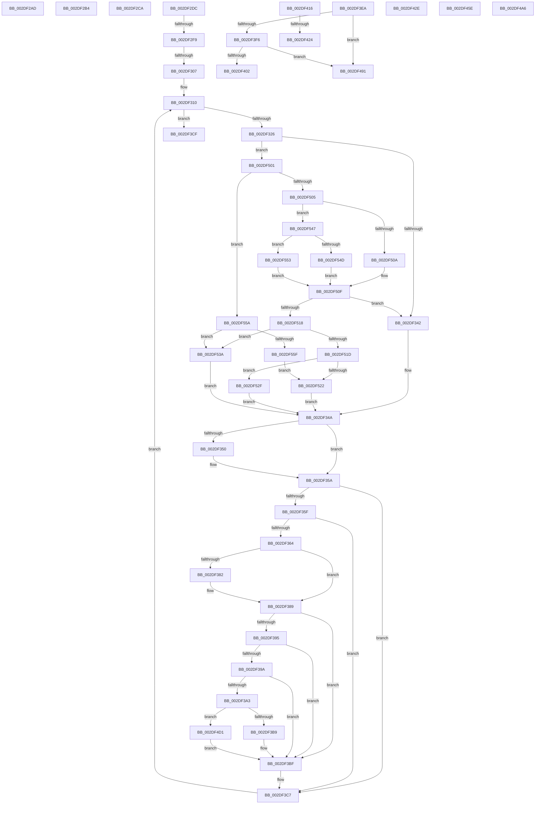

# sub_002DF2AD

- RVA: `0x002DF2AD`–`0x002DF561` (길이 `692` bytes)
- VA: `0x00000001402DF2AD`
- 실행 섹션: `.text`
- PDB 이름 있음: `아니요`; PDB Function 태그: `아니요`
- unwind 정보 RVA: `0x00070A10`
- 디코드: `178`개 명령, `692/692` bytes 표시
- 미해석 바이트: `0` (있으면 어셈블리에 `.byte`로 보존)

> 이 문서는 커널 이미지의 기계어와 PDB 기호를 분석해 생성했습니다. 4번과 5번은 함수 원형과 자료형을 바이너리 사용 방식에서 추정한 C 해석이며 원본 소스 복구 결과는 아닙니다.

## 1. Dependencies

- 직접 호출 지점: **1**; 고유 호출 대상: **1**
- 직접 호출자로 확인된 함수: **0**
- RIP 상대 이미지 참조: **2**

### Outgoing calls
- `0x002DF3D8` → [PpmConvertTimeTo](../43/PpmConvertTimeTo_function_0043B3CC.md) (function, `0x0043B3CC`)

### Direct callers
- 이 함수 시작 RVA로 연결되는 직접 call은 확인되지 않았습니다. 간접 호출은 완전히 역산할 수 없습니다.

### Static image references
- `0x002DF389` → RVA `0x00FC6BE0` (`ALMOSTRO`; read)
- `0x002DF491` → RVA `0x00FC6AA0` (`ALMOSTRO`; read)

## 2. Other-region calls and transfers

- 다른 실행 섹션으로 향하는 call: **0**
- call이 아닌 외부 분기/꼬리 이동: **13**
  - `0x002DF2B2` → [sub_002DF06B + 0x21F](Unknown_function_002DF06B.md) (`tail-transfer`)
  - `0x002DF2C5` → [sub_002DF06B + 0x6F](Unknown_function_002DF06B.md) (`tail-transfer`)
  - `0x002DF2DA` → [sub_002DF06B + 0x208](Unknown_function_002DF06B.md) (`tail-transfer`)
  - `0x002DF2F3` → [sub_002DF06B + 0x37](Unknown_function_002DF06B.md) (`tail-transfer`)
  - `0x002DF301` → [sub_002DF06B + 0x37](Unknown_function_002DF06B.md) (`tail-transfer`)
  - `0x002DF3E5` → [sub_002DF06B + 0x37](Unknown_function_002DF06B.md) (`tail-transfer`)
  - `0x002DF411` → [sub_002DF06B + 0x211](Unknown_function_002DF06B.md) (`tail-transfer`)
  - `0x002DF41E` → [sub_002DF06B + 0x1D9](Unknown_function_002DF06B.md) (`tail-transfer`)
  - `0x002DF429` → [sub_002DF06B + 0x1D9](Unknown_function_002DF06B.md) (`tail-transfer`)
  - `0x002DF459` → [sub_002DF06B + 0x166](Unknown_function_002DF06B.md) (`tail-transfer`)
  - `0x002DF48C` → [sub_002DF06B + 0x1CB](Unknown_function_002DF06B.md) (`tail-transfer`)
  - `0x002DF4A1` → [sub_002DF06B + 0x211](Unknown_function_002DF06B.md) (`tail-transfer`)
  - `0x002DF4CC` → [sub_002DF06B + 0xC7](Unknown_function_002DF06B.md) (`tail-transfer`)

## 3. Assembly (complete function range)

```asm
002DF2AD  B8 01 00 00 C0                  mov eax, 0xc0000001
002DF2B2  EB D6                           jmp 0x1402df28a
002DF2B4  B9 B2 0D 00 00                  mov ecx, 0xdb2
002DF2B9  0F 32                           rdmsr
002DF2BB  48 C1 E2 20                     shl rdx, 0x20
002DF2BF  48 0B C2                        or rax, rdx
002DF2C2  4C 8B E8                        mov r13, rax
002DF2C5  E9 10 FE FF FF                  jmp 0x1402df0da
002DF2CA  44 8B 8C 24 D8 00 00 00         mov r9d, dword ptr [rsp + 0xd8]
002DF2D2  44 8B 84 24 C0 00 00 00         mov r8d, dword ptr [rsp + 0xc0]
002DF2DA  EB 97                           jmp 0x1402df273
002DF2DC  48 83 7C 24 48 00               cmp qword ptr [rsp + 0x48], 0
002DF2E2  0F 57 C0                        xorps xmm0, xmm0
002DF2E5  41 0F 11 07                     movups xmmword ptr [r15], xmm0
002DF2E9  41 0F 11 47 10                  movups xmmword ptr [r15 + 0x10], xmm0
002DF2EE  41 0F 11 47 20                  movups xmmword ptr [r15 + 0x20], xmm0
002DF2F3  0F 84 A9 FD FF FF               je 0x1402df0a2
002DF2F9  4C 8B 5C 24 50                  mov r11, qword ptr [rsp + 0x50]
002DF2FE  4D 85 DB                        test r11, r11
002DF301  0F 84 9B FD FF FF               je 0x1402df0a2
002DF307  4C 8B 6C 24 48                  mov r13, qword ptr [rsp + 0x48]
002DF30C  44 8B D6                        mov r10d, esi
002DF30F  90                              nop
002DF310  41 8B 4D 00                     mov ecx, dword ptr [r13]
002DF314  41 8B 43 28                     mov eax, dword ptr [r11 + 0x28]
002DF318  3B C8                           cmp ecx, eax
002DF31A  0F 43 C8                        cmovae ecx, eax
002DF31D  44 3B D1                        cmp r10d, ecx
002DF320  0F 83 A9 00 00 00               jae 0x1402df3cf
002DF326  45 8B CA                        mov r9d, r10d
002DF329  49 69 C1 58 01 00 00            imul rax, r9, 0x158
002DF330  42 0F B6 8C 18 70 05 00 00      movzx ecx, byte ptr [rax + r11 + 0x570]
002DF339  83 F9 01                        cmp ecx, 1
002DF33C  0F 85 BF 01 00 00               jne 0x1402df501
002DF342  49 8D 57 20                     lea rdx, [r15 + 0x20]
002DF346  4D 8D 47 08                     lea r8, [r15 + 8]
002DF34A  45 3B 53 1C                     cmp r10d, dword ptr [r11 + 0x1c]
002DF34E  75 0A                           jne 0x1402df35a
002DF350  4C 89 44 24 38                  mov qword ptr [rsp + 0x38], r8
002DF355  48 89 54 24 40                  mov qword ptr [rsp + 0x40], rdx
002DF35A  48 85 D2                        test rdx, rdx
002DF35D  74 68                           je 0x1402df3c7
002DF35F  4D 85 C0                        test r8, r8
002DF362  74 63                           je 0x1402df3c7
002DF364  49 69 C9 F8 03 00 00            imul rcx, r9, 0x3f8
002DF36B  42 8B 44 29 38                  mov eax, dword ptr [rcx + r13 + 0x38]
002DF370  42 03 44 29 34                  add eax, dword ptr [rcx + r13 + 0x34]
002DF375  01 02                           add dword ptr [rdx], eax
002DF377  4E 8B 4C 29 28                  mov r9, qword ptr [rcx + r13 + 0x28]
002DF37C  45 39 53 1C                     cmp dword ptr [r11 + 0x1c], r10d
002DF380  75 07                           jne 0x1402df389
002DF382  4C 03 8B 50 88 00 00            add r9, qword ptr [rbx + 0x8850]
002DF389  4C 8B 1D 50 78 CE 00            mov r11, qword ptr [rip + 0xce7850]
002DF390  4D 85 C9                        test r9, r9
002DF393  74 2A                           je 0x1402df3bf
002DF395  4D 85 DB                        test r11, r11
002DF398  74 25                           je 0x1402df3bf
002DF39A  49 81 FB 80 96 98 00            cmp r11, 0x989680
002DF3A1  74 1C                           je 0x1402df3bf
002DF3A3  B8 80 96 98 00                  mov eax, 0x989680
002DF3A8  49 F7 E1                        mul r9
002DF3AB  48 89 54 24 60                  mov qword ptr [rsp + 0x60], rdx
002DF3B0  48 85 D2                        test rdx, rdx
002DF3B3  0F 85 18 01 00 00               jne 0x1402df4d1
002DF3B9  49 F7 F3                        div r11
002DF3BC  4C 8B C8                        mov r9, rax
002DF3BF  4D 01 08                        add qword ptr [r8], r9
002DF3C2  4C 8B 5C 24 50                  mov r11, qword ptr [rsp + 0x50]
002DF3C7  41 FF C2                        inc r10d
002DF3CA  E9 41 FF FF FF                  jmp 0x1402df310
002DF3CF  49 8B 4D 18                     mov rcx, qword ptr [r13 + 0x18]
002DF3D3  BA 80 96 98 00                  mov edx, 0x989680
002DF3D8  E8 EF BF 15 00                  call 0x14043b3cc
002DF3DD  4C 8B 6C 24 30                  mov r13, qword ptr [rsp + 0x30]
002DF3E2  49 89 07                        mov qword ptr [r15], rax
002DF3E5  E9 B8 FC FF FF                  jmp 0x1402df0a2
002DF3EA  48 83 7C 24 48 00               cmp qword ptr [rsp + 0x48], 0
002DF3F0  0F 84 9B 00 00 00               je 0x1402df491
002DF3F6  48 83 7C 24 50 00               cmp qword ptr [rsp + 0x50], 0
002DF3FC  0F 84 8F 00 00 00               je 0x1402df491
002DF402  49 8B 47 18                     mov rax, qword ptr [r15 + 0x18]
002DF406  49 03 47 10                     add rax, qword ptr [r15 + 0x10]
002DF40A  49 03 47 08                     add rax, qword ptr [r15 + 8]
002DF40E  49 01 07                        add qword ptr [r15], rax
002DF411  E9 66 FE FF FF                  jmp 0x1402df27c
002DF416  48 8B 4C 24 40                  mov rcx, qword ptr [rsp + 0x40]
002DF41B  48 85 C9                        test rcx, rcx
002DF41E  0F 84 20 FE FF FF               je 0x1402df244
002DF424  FF 01                           inc dword ptr [rcx]
002DF426  48 01 28                        add qword ptr [rax], rbp
002DF429  E9 16 FE FF FF                  jmp 0x1402df244
002DF42E  33 D2                           xor edx, edx
002DF430  49 8B C0                        mov rax, r8
002DF433  49 F7 F1                        div r9
002DF436  33 D2                           xor edx, edx
002DF438  48 8B C8                        mov rcx, rax
002DF43B  49 0F AF C1                     imul rax, r9
002DF43F  4C 2B C0                        sub r8, rax
002DF442  49 69 C0 80 96 98 00            imul rax, r8, 0x989680
002DF449  49 F7 F1                        div r9
002DF44C  4C 8B C0                        mov r8, rax
002DF44F  48 69 C1 80 96 98 00            imul rax, rcx, 0x989680
002DF456  4C 03 C0                        add r8, rax
002DF459  E9 73 FD FF FF                  jmp 0x1402df1d1
002DF45E  33 D2                           xor edx, edx
002DF460  48 8B C5                        mov rax, rbp
002DF463  49 F7 F1                        div r9
002DF466  33 D2                           xor edx, edx
002DF468  48 8B C8                        mov rcx, rax
002DF46B  4C 8B C0                        mov r8, rax
002DF46E  49 0F AF C9                     imul rcx, r9
002DF472  48 2B E9                        sub rbp, rcx
002DF475  48 69 C5 80 96 98 00            imul rax, rbp, 0x989680
002DF47C  49 F7 F1                        div r9
002DF47F  48 8B E8                        mov rbp, rax
002DF482  49 69 C0 80 96 98 00            imul rax, r8, 0x989680
002DF489  48 03 E8                        add rbp, rax
002DF48C  E9 A5 FD FF FF                  jmp 0x1402df236
002DF491  8B 15 09 76 CE 00               mov edx, dword ptr [rip + 0xce7609]
002DF497  41 8B C8                        mov ecx, r8d
002DF49A  48 0F AF D1                     imul rdx, rcx
002DF49E  49 89 17                        mov qword ptr [r15], rdx
002DF4A1  E9 D6 FD FF FF                  jmp 0x1402df27c
002DF4A6  33 D2                           xor edx, edx
002DF4A8  49 8B C0                        mov rax, r8
002DF4AB  49 F7 F2                        div r10
002DF4AE  33 D2                           xor edx, edx
002DF4B0  48 8B C8                        mov rcx, rax
002DF4B3  49 0F AF C2                     imul rax, r10
002DF4B7  4C 2B C0                        sub r8, rax
002DF4BA  4D 0F AF C3                     imul r8, r11
002DF4BE  49 8B C0                        mov rax, r8
002DF4C1  49 F7 F2                        div r10
002DF4C4  49 0F AF CB                     imul rcx, r11
002DF4C8  4C 8D 04 01                     lea r8, [rcx + rax]
002DF4CC  E9 61 FC FF FF                  jmp 0x1402df132
002DF4D1  33 D2                           xor edx, edx
002DF4D3  49 8B C1                        mov rax, r9
002DF4D6  49 F7 F3                        div r11
002DF4D9  33 D2                           xor edx, edx
002DF4DB  48 8B C8                        mov rcx, rax
002DF4DE  49 0F AF C3                     imul rax, r11
002DF4E2  4C 2B C8                        sub r9, rax
002DF4E5  49 69 C1 80 96 98 00            imul rax, r9, 0x989680
002DF4EC  49 F7 F3                        div r11
002DF4EF  4C 8B C8                        mov r9, rax
002DF4F2  48 69 C1 80 96 98 00            imul rax, rcx, 0x989680
002DF4F9  4C 03 C8                        add r9, rax
002DF4FC  E9 BE FE FF FF                  jmp 0x1402df3bf
002DF501  85 C9                           test ecx, ecx
002DF503  75 55                           jne 0x1402df55a
002DF505  45 85 D2                        test r10d, r10d
002DF508  75 3D                           jne 0x1402df547
002DF50A  B8 01 00 00 00                  mov eax, 1
002DF50F  83 E8 01                        sub eax, 1
002DF512  0F 84 2A FE FF FF               je 0x1402df342
002DF518  83 E8 01                        sub eax, 1
002DF51B  74 1D                           je 0x1402df53a
002DF51D  83 F8 01                        cmp eax, 1
002DF520  75 0D                           jne 0x1402df52f
002DF522  49 8D 57 28                     lea rdx, [r15 + 0x28]
002DF526  4D 8D 47 18                     lea r8, [r15 + 0x18]
002DF52A  E9 1B FE FF FF                  jmp 0x1402df34a
002DF52F  48 8B D6                        mov rdx, rsi
002DF532  4C 8B C6                        mov r8, rsi
002DF535  E9 10 FE FF FF                  jmp 0x1402df34a
002DF53A  49 8D 57 24                     lea rdx, [r15 + 0x24]
002DF53E  4D 8D 47 10                     lea r8, [r15 + 0x10]
002DF542  E9 03 FE FF FF                  jmp 0x1402df34a
002DF547  41 83 FA 01                     cmp r10d, 1
002DF54B  75 06                           jne 0x1402df553
002DF54D  41 8D 42 01                     lea eax, [r10 + 1]
002DF551  EB BC                           jmp 0x1402df50f
002DF553  B8 03 00 00 00                  mov eax, 3
002DF558  EB B5                           jmp 0x1402df50f
002DF55A  83 F9 02                        cmp ecx, 2
002DF55D  74 DB                           je 0x1402df53a
002DF55F  EB C1                           jmp 0x1402df522
```

## 4. C-style interpretation (structured pseudocode)

```c
__int64 __fastcall sub_002DF2AD(__int64 a1, __int64 a2)
{
    unsigned __int64 v_stack_p30;
    unsigned __int64 v_stack_p38;
    unsigned __int64 v_stack_p40;
    unsigned __int64 v_stack_p48;
    unsigned __int64 v_stack_p50;
    unsigned __int64 v_stack_p60;
    unsigned int v_stack_pC0;
    unsigned int v_stack_pD8;
}
```

## 5. (Beta) C Style

```c
int64_t sub_002DF2AD(int64_t Arg1, int64_t Arg2)
{
    uint64_t v_stack_p30;
    uint64_t v_stack_p38;
    uint64_t v_stack_p40;
    uint64_t v_stack_p48;
    uint64_t v_stack_p50;
    uint64_t v_stack_p60;
    uint32_t v_stack_pC0;
    uint32_t v_stack_pD8;
}
```

## 6. Execution-region graph

[열기: 2D/3D 그래프와 함수 탐색 컨트롤 패널](../../../control-panel.html?section=text&rva=0x002DF2AD&view=graph)

- 2D 그래프는 위에서 아래로 흐르고, 3D 그래프는 빈 공간을 드래그해 회전합니다. Shift+드래그는 이동, 휠은 확대·축소, 함수 노드 선택은 대상 보고서 이동입니다.

### Static fallback


