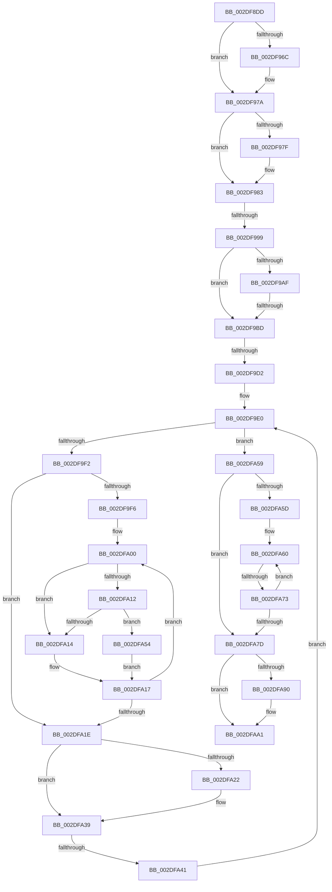

# sub_002DF8DD

- RVA: `0x002DF8DD`–`0x002DFB02` (길이 `549` bytes)
- VA: `0x00000001402DF8DD`
- 실행 섹션: `.text`
- PDB 이름 있음: `아니요`; PDB Function 태그: `아니요`
- unwind 정보 RVA: `0x00070A5C`
- 디코드: `138`개 명령, `549/549` bytes 표시
- 미해석 바이트: `0` (있으면 어셈블리에 `.byte`로 보존)

> 이 문서는 커널 이미지의 기계어와 PDB 기호를 분석해 생성했습니다. 4번과 5번은 함수 원형과 자료형을 바이너리 사용 방식에서 추정한 C 해석이며 원본 소스 복구 결과는 아닙니다.

## 1. Dependencies

- 직접 호출 지점: **4**; 고유 호출 대상: **4**
- 직접 호출자로 확인된 함수: **0**
- RIP 상대 이미지 참조: **0**

### Outgoing calls
- `0x002DF90E` → [memset](../6C/memset_function_006C6C40.md) (function, `0x006C6C40`)
- `0x002DF95C` → [KeAbPreAcquire](../21/KeAbPreAcquire_function_00210230.md) (function, `0x00210230`)
- `0x002DF975` → [ExfAcquirePushLockExclusiveEx](../20/ExfAcquirePushLockExclusiveEx_function_0020FC90.md) (function, `0x0020FC90`)
- `0x002DFAB7` → [SMKM_STORE_MGR<SM_TRAITS>::SmFeEvictUpdatePass](SMKM_STORE_MGR_SM_TRAITS_SmFeEvictUpdatePass_function_002DDDE0.md) (function, `0x002DDDE0`)

### Direct callers
- 이 함수 시작 RVA로 연결되는 직접 call은 확인되지 않았습니다. 간접 호출은 완전히 역산할 수 없습니다.

### Static image references
- 디코드된 RIP-relative 메모리 참조가 없습니다.

## 2. Other-region calls and transfers

- 다른 실행 섹션으로 향하는 call: **0**
- call이 아닌 외부 분기/꼬리 이동: **6**
  - `0x002DF993` → [sub_002DFB71 + 0x30](Unknown_function_002DFB71.md) (`tail-transfer`)
  - `0x002DF9B7` → [sub_002DFB71 + 0x14](Unknown_function_002DFB71.md) (`tail-transfer`)
  - `0x002DF9CC` → [sub_002DFB71](Unknown_function_002DFB71.md) (`tail-transfer`)
  - `0x002DFA3B` → [sub_002DFB53 + 0x8](Unknown_function_002DFB53.md) (`tail-transfer`)
  - `0x002DFA6D` → [sub_002DFB53](Unknown_function_002DFB53.md) (`tail-transfer`)
  - `0x002DFB00` → [sub_002DFB67](Unknown_function_002DFB67.md) (`tail-transfer`)

## 3. Assembly (complete function range)

```asm
002DF8DD  49 89 6B F0                     mov qword ptr [r11 - 0x10], rbp
002DF8E1  48 8B E9                        mov rbp, rcx
002DF8E4  49 89 73 E8                     mov qword ptr [r11 - 0x18], rsi
002DF8E8  48 8D 4C 24 58                  lea rcx, [rsp + 0x58]
002DF8ED  4D 89 63 D8                     mov qword ptr [r11 - 0x28], r12
002DF8F1  4D 8B E1                        mov r12, r9
002DF8F4  4D 89 6B D0                     mov qword ptr [r11 - 0x30], r13
002DF8F8  4D 89 73 C8                     mov qword ptr [r11 - 0x38], r14
002DF8FC  4C 8B F2                        mov r14, rdx
002DF8FF  4D 89 7B C0                     mov qword ptr [r11 - 0x40], r15
002DF903  33 D2                           xor edx, edx
002DF905  4D 8B F8                        mov r15, r8
002DF908  41 B8 80 00 00 00               mov r8d, 0x80
002DF90E  E8 2D 73 3E 00                  call 0x1406c6c40
002DF913  45 33 ED                        xor r13d, r13d
002DF916  C7 44 24 4C 08 00 00 00         mov dword ptr [rsp + 0x4c], 8
002DF91E  4C 89 6C 24 38                  mov qword ptr [rsp + 0x38], r13
002DF923  48 8D 44 24 58                  lea rax, [rsp + 0x58]
002DF928  48 89 44 24 30                  mov qword ptr [rsp + 0x30], rax
002DF92D  48 8D B5 B8 01 00 00            lea rsi, [rbp + 0x1b8]
002DF934  4C 89 6C 24 40                  mov qword ptr [rsp + 0x40], r13
002DF939  45 33 C0                        xor r8d, r8d
002DF93C  4C 89 6C 24 50                  mov qword ptr [rsp + 0x50], r13
002DF941  33 D2                           xor edx, edx
002DF943  44 89 6C 24 48                  mov dword ptr [rsp + 0x48], r13d
002DF948  48 8B CE                        mov rcx, rsi
002DF94B  65 48 8B 04 25 88 01 00 00      mov rax, qword ptr gs:[0x188]
002DF954  66 FF 88 E6 01 00 00            dec word ptr [rax + 0x1e6]
002DF95B  90                              nop
002DF95C  E8 CF 08 F3 FF                  call 0x140210230
002DF961  F0 48 0F BA 2E 00               lock bts qword ptr [rsi], 0
002DF967  48 8B D8                        mov rbx, rax
002DF96A  73 0E                           jae 0x1402df97a
002DF96C  4C 8B C6                        mov r8, rsi
002DF96F  48 8B D0                        mov rdx, rax
002DF972  48 8B CE                        mov rcx, rsi
002DF975  E8 16 03 F3 FF                  call 0x14020fc90
002DF97A  48 85 DB                        test rbx, rbx
002DF97D  74 04                           je 0x1402df983
002DF97F  C6 43 0A 01                     mov byte ptr [rbx + 0xa], 1
002DF983  83 7C 24 48 FF                  cmp dword ptr [rsp + 0x48], -1
002DF988  41 8B 1E                        mov ebx, dword ptr [r14]
002DF98B  48 89 BC 24 18 01 00 00         mov qword ptr [rsp + 0x118], rdi
002DF993  0F 84 08 02 00 00               je 0x1402dfba1
002DF999  48 8B 85 C0 01 00 00            mov rax, qword ptr [rbp + 0x1c0]
002DF9A0  BF 01 00 00 00                  mov edi, 1
002DF9A5  44 89 6C 24 48                  mov dword ptr [rsp + 0x48], r13d
002DF9AA  48 85 C0                        test rax, rax
002DF9AD  74 0E                           je 0x1402df9bd
002DF9AF  0F B6 48 02                     movzx ecx, byte ptr [rax + 2]
002DF9B3  39 4C 24 4C                     cmp dword ptr [rsp + 0x4c], ecx
002DF9B7  0F 82 C8 01 00 00               jb 0x1402dfb85
002DF9BD  4C 8B 5C 24 30                  mov r11, qword ptr [rsp + 0x30]
002DF9C2  4C 8B 95 C0 01 00 00            mov r10, qword ptr [rbp + 0x1c0]
002DF9C9  4D 85 D2                        test r10, r10
002DF9CC  0F 84 9F 01 00 00               je 0x1402dfb71
002DF9D2  0F 1F 40 00                     nop dword ptr [rax]
002DF9D6  66 66 0F 1F 84 00 00 00 00 00   nop word ptr [rax + rax]
002DF9E0  41 8B 0A                        mov ecx, dword ptr [r10]
002DF9E3  BA FF FF FF FF                  mov edx, 0xffffffff
002DF9E8  0F B7 C1                        movzx eax, cx
002DF9EB  C1 E9 18                        shr ecx, 0x18
002DF9EE  84 C9                           test cl, cl
002DF9F0  75 67                           jne 0x1402dfa59
002DF9F2  85 C0                           test eax, eax
002DF9F4  74 28                           je 0x1402dfa1e
002DF9F6  66 66 0F 1F 84 00 00 00 00 00   nop word ptr [rax + rax]
002DFA00  8D 0C 10                        lea ecx, [rax + rdx]
002DFA03  D1 E9                           shr ecx, 1
002DFA05  44 8B C9                        mov r9d, ecx
002DFA08  48 03 C9                        add rcx, rcx
002DFA0B  41 39 5C CA 10                  cmp dword ptr [r10 + rcx*8 + 0x10], ebx
002DFA10  72 02                           jb 0x1402dfa14
002DFA12  75 40                           jne 0x1402dfa54
002DFA14  41 8B D1                        mov edx, r9d
002DFA17  8D 4A 01                        lea ecx, [rdx + 1]
002DFA1A  3B C8                           cmp ecx, eax
002DFA1C  75 E2                           jne 0x1402dfa00
002DFA1E  85 FF                           test edi, edi
002DFA20  74 17                           je 0x1402dfa39
002DFA22  8B C8                           mov ecx, eax
002DFA24  48 FF C1                        inc rcx
002DFA27  4D 89 13                        mov qword ptr [r11], r10
002DFA2A  48 C1 E1 04                     shl rcx, 4
002DFA2E  49 03 CA                        add rcx, r10
002DFA31  49 89 4B 08                     mov qword ptr [r11 + 8], rcx
002DFA35  49 83 C3 10                     add r11, 0x10
002DFA39  85 C0                           test eax, eax
002DFA3B  0F 84 1A 01 00 00               je 0x1402dfb5b
002DFA41  49 83 C2 18                     add r10, 0x18
002DFA45  8D 48 FF                        lea ecx, [rax - 1]
002DFA48  48 C1 E1 04                     shl rcx, 4
002DFA4C  4C 03 D1                        add r10, rcx
002DFA4F  4D 8B 12                        mov r10, qword ptr [r10]
002DFA52  EB 8C                           jmp 0x1402df9e0
002DFA54  41 8B C1                        mov eax, r9d
002DFA57  EB BE                           jmp 0x1402dfa17
002DFA59  85 C0                           test eax, eax
002DFA5B  74 20                           je 0x1402dfa7d
002DFA5D  0F 1F 00                        nop dword ptr [rax]
002DFA60  8D 0C 10                        lea ecx, [rax + rdx]
002DFA63  D1 E9                           shr ecx, 1
002DFA65  44 8B C1                        mov r8d, ecx
002DFA68  41 39 5C CA 10                  cmp dword ptr [r10 + rcx*8 + 0x10], ebx
002DFA6D  0F 82 E0 00 00 00               jb 0x1402dfb53
002DFA73  41 8B C0                        mov eax, r8d
002DFA76  8D 4A 01                        lea ecx, [rdx + 1]
002DFA79  3B C8                           cmp ecx, eax
002DFA7B  75 E3                           jne 0x1402dfa60
002DFA7D  4D 89 13                        mov qword ptr [r11], r10
002DFA80  48 8D 40 02                     lea rax, [rax + 2]
002DFA84  49 8D 04 C2                     lea rax, [r10 + rax*8]
002DFA88  49 89 43 08                     mov qword ptr [r11 + 8], rax
002DFA8C  85 FF                           test edi, edi
002DFA8E  74 11                           je 0x1402dfaa1
002DFA90  4C 2B 5C 24 30                  sub r11, qword ptr [rsp + 0x30]
002DFA95  49 C1 FB 04                     sar r11, 4
002DFA99  41 FF C3                        inc r11d
002DFA9C  44 89 5C 24 48                  mov dword ptr [rsp + 0x48], r11d
002DFAA1  48 8D 44 24 30                  lea rax, [rsp + 0x30]
002DFAA6  4D 8B CC                        mov r9, r12
002DFAA9  4D 8B C7                        mov r8, r15
002DFAAC  48 89 44 24 20                  mov qword ptr [rsp + 0x20], rax
002DFAB1  49 8B D6                        mov rdx, r14
002DFAB4  48 8B CD                        mov rcx, rbp
002DFAB7  E8 24 E3 FF FF                  call 0x1402ddde0
002DFABC  8B D8                           mov ebx, eax
002DFABE  48 C7 C2 FF FF FF FF            mov rdx, 0xffffffffffffffff
002DFAC5  F0 48 0F C1 16                  lock xadd qword ptr [rsi], rdx
002DFACA  4C 8B BC 24 F8 00 00 00         mov r15, qword ptr [rsp + 0xf8]
002DFAD2  80 E2 06                        and dl, 6
002DFAD5  4C 8B B4 24 00 01 00 00         mov r14, qword ptr [rsp + 0x100]
002DFADD  4C 8B AC 24 08 01 00 00         mov r13, qword ptr [rsp + 0x108]
002DFAE5  4C 8B A4 24 10 01 00 00         mov r12, qword ptr [rsp + 0x110]
002DFAED  48 8B BC 24 18 01 00 00         mov rdi, qword ptr [rsp + 0x118]
002DFAF5  48 8B AC 24 28 01 00 00         mov rbp, qword ptr [rsp + 0x128]
002DFAFD  80 FA 02                        cmp dl, 2
002DFB00  74 65                           je 0x1402dfb67
```

## 4. C-style interpretation (structured pseudocode)

```c
__int64 __fastcall sub_002DF8DD(__int64 a1, __int64 a2, __int64 a3, __int64 a4, __int64 a5, __int64 a6, __int64 a7, __int64 a8, unsigned int a9, __int64 a10, __int64 a11, __int64 a12, __int64 a13, __int64 a14, __int64 a15, __int64 a16, __int64 a17, __int64 a18, __int64 a19, __int64 a20, __int64 a21, __int64 a22, __int64 a23, __int64 a24, __int64 a25, __int64 a26, __int64 a27, __int64 a28, __int64 a29, __int64 a30, __int64 a31, __int64 a32, __int64 a33, __int64 a34, __int64 a35, __int64 a36, __int64 a37)
{
    __int64 result;
    __int64 v_r10;
    __int64 v_r11;
    __int64 v_r13;
    unsigned __int64 v_stack_p118;
    unsigned __int64 v_stack_p20;
    unsigned __int64 v_stack_p30;
    unsigned __int64 v_stack_p38;
    unsigned __int64 v_stack_p40;
    unsigned int v_stack_p48;
    unsigned int v_stack_p4C;
    unsigned __int64 v_stack_p50;

    *(unsigned __int64 *)(v_r11 - 16) = v_rbp;
    *(unsigned __int64 *)(v_r11 - 24) = v_rsi;
    *(unsigned __int64 *)(v_r11 - 40) = v_r12;
    *(unsigned __int64 *)(v_r11 - 48) = v_r13;
    *(unsigned __int64 *)(v_r11 - 56) = v_r14;
    *(unsigned __int64 *)(v_r11 - 64) = v_r15;
    a2 = 0;
    result = memset(a11, a2, 128, a4);
    v_r13 = 0;
    v_stack_p4C = 8;
    v_stack_p38 = 0;
    v_stack_p30 = a11;
    v_stack_p40 = 0;
    a3 = 0;
    v_stack_p50 = 0;
    a2 = 0;
    v_stack_p48 = 0;
    result = KeAbPreAcquire(a1 + 440, a2, a3, a4);
    if (!(condition_is_above_or_equal)) {
        a3 = a1 + 440;
        a2 = result;
        a1 = a1 + 440;
        result = ExfAcquirePushLockExclusiveEx(a1, a2, a3, a4);
    }
    if (result != 0) {
        *(unsigned __int8 *)(result + 10) = 1;
    }
    v_stack_p118 = v_rdi;
    v_stack_p48 = 0;
    if (*(unsigned __int64 *)(a1 + 448) == 0) goto loc_002DF9BD;
loc_002DF9BD:
loc_002DF9E0:
    a1 = (unsigned int)(((unsigned int)(*(unsigned int *)(*(unsigned __int64 *)(a1 + 448)))) >> (24));
    if ((unsigned __int8)(a1) != 0) goto loc_002DFA59;
    if ((unsigned int)((unsigned __int16)((unsigned int)(*(unsigned int *)(*(unsigned __int64 *)(a1 + 448))))) == 0) goto loc_002DFA1E;
loc_002DFA00:
    a1 = (unsigned int)(((unsigned __int16)((unsigned int)(*(unsigned int *)(*(unsigned __int64 *)(a1 + 448)))) + (unsigned int)(0xFFFFFFFFULL) * 1) >> (1));
    a1 = (a1) + (a1);
    if ((*(unsigned int *)(*(unsigned __int64 *)(a1 + 448) + a1 * 8 + 16)) < ((unsigned int)((unsigned int)(*(unsigned int *)(a2))))) goto loc_002DFA14;
    if ((*(unsigned int *)(*(unsigned __int64 *)(a1 + 448) + a1 * 8 + 16)) != ((unsigned int)((unsigned int)(*(unsigned int *)(a2))))) goto loc_002DFA54;
loc_002DFA14:
loc_002DFA17:
    if (((unsigned int)((unsigned int)((unsigned int)((unsigned int)((unsigned int)(a1)))) + 1)) != ((unsigned int)((unsigned __int16)((unsigned int)(*(unsigned int *)(*(unsigned __int64 *)(a1 + 448))))))) goto loc_002DFA00;
loc_002DFA1E:
    v_r11 = a6;
    if (1 != 0) {
        a1 = (unsigned int)((unsigned __int16)((unsigned int)(*(unsigned int *)(*(unsigned __int64 *)(a1 + 448)))));
        a1 = (a1) + 1;
        *(unsigned __int64 *)(a6) = *(unsigned __int64 *)(a1 + 448);
        a1 = (a1) << (4);
        a1 = (a1) + (*(unsigned __int64 *)(a1 + 448));
        *(unsigned __int64 *)(a6 + 8) = a1;
        v_r11 = (a6) + (16);
    }
    v_r10 = (*(unsigned __int64 *)(a1 + 448)) + (24);
    a1 = ((unsigned __int16)((unsigned int)(*(unsigned int *)(*(unsigned __int64 *)(a1 + 448)))) - 1) << (4);
    v_r10 = (v_r10) + (a1);
    goto loc_002DF9E0;
loc_002DFA54:
    goto loc_002DFA17;
loc_002DFA59:
    if ((unsigned int)((unsigned int)((unsigned int)((unsigned int)((unsigned int)(a1))))) == 0) goto loc_002DFA7D;
loc_002DFA60:
    a1 = (unsigned int)(((unsigned int)((unsigned int)((unsigned int)((unsigned int)(a1)))) + (unsigned int)((unsigned int)((unsigned int)((unsigned int)(a1)))) * 1) >> (1));
    if (((unsigned int)((unsigned int)((unsigned int)((unsigned int)((unsigned int)(a1)))) + 1)) != ((unsigned int)((unsigned int)((unsigned int)((unsigned int)((unsigned int)(a1))))))) goto loc_002DFA60;
loc_002DFA7D:
    *(unsigned __int64 *)(v_r11) = *(unsigned __int64 *)(v_r10);
    *(unsigned __int64 *)(v_r11 + 8) = *(unsigned __int64 *)(v_r10) + (unsigned int)((unsigned int)((unsigned int)((unsigned int)(a1)))) + 2 * 8;
    if (1 != 0) {
        v_r11 = (v_r11) - (a6);
        v_r11 = (v_r11) >> (4);
        v_r11 = (unsigned int)((v_r11) + 1);
        v_stack_p48 = (unsigned int)(v_r11);
    }
    v_stack_p20 = a6;
    result = SMKM_STORE_MGR_SM_TRAITS___SmFeEvictUpdatePass(a1, a2, a3, a4);
    a2 = (unsigned __int8)((-1) & (6));
}
```

## 5. (Beta) C Style

```c
int64_t sub_002DF8DD(void *Arg1, void *Arg2, int64_t Arg3, int64_t Arg4, uint64_t Arg5, void *Arg6, uint64_t Arg7, uint64_t Arg8, uint32_t Arg9, uint64_t Arg10, int64_t Arg11, uint64_t Arg12, uint64_t Arg13, uint64_t Arg14, uint64_t Arg15, uint64_t Arg16, uint64_t Arg17, uint64_t Arg18, uint64_t Arg19, uint64_t Arg20, uint64_t Arg21, uint64_t Arg22, uint64_t Arg23, uint64_t Arg24, uint64_t Arg25, uint64_t Arg26, uint64_t Arg27, uint64_t Arg28, uint64_t Arg29, uint64_t Arg30, int64_t Arg31, int64_t Arg32, int64_t Arg33, int64_t Arg34, int64_t Arg35, uint64_t Arg36, int64_t Arg37)
{
    uint8_t *arg1 = (uint8_t *)Arg1;
    uint8_t *arg2 = (uint8_t *)Arg2;
    uint8_t *arg6 = (uint8_t *)Arg6;

    int64_t result;
    int64_t local_r10;
    int64_t local_r11;
    int64_t local_r13;
    uint64_t v_stack_p118;
    uint64_t v_stack_p20;
    uint64_t v_stack_p30;
    uint64_t v_stack_p38;
    uint64_t v_stack_p40;
    uint32_t v_stack_p48;
    uint32_t v_stack_p4C;
    uint64_t v_stack_p50;

    *(uint64_t *)(local_r11 - 0x10) = local_rbp;
    *(uint64_t *)(local_r11 - 0x18) = local_rsi;
    *(uint64_t *)(local_r11 - 0x28) = local_r12;
    *(uint64_t *)(local_r11 - 0x30) = local_r13;
    *(uint64_t *)(local_r11 - 0x38) = local_r14;
    *(uint64_t *)(local_r11 - 0x40) = local_r15;
    Arg2 = 0;
    result = memset(Arg11, Arg2, 128, Arg4);
    local_r13 = 0;
    v_stack_p4C = 8;
    v_stack_p38 = 0;
    v_stack_p30 = Arg11;
    v_stack_p40 = 0;
    Arg3 = 0;
    v_stack_p50 = 0;
    Arg2 = 0;
    v_stack_p48 = 0;
    result = KeAbPreAcquire(Arg1 + 440, Arg2, Arg3, Arg4);
    if (!(condition_is_above_or_equal)) {
        Arg3 = Arg1 + 440;
        Arg2 = result;
        Arg1 = Arg1 + 440;
        result = ExfAcquirePushLockExclusiveEx(Arg1, Arg2, Arg3, Arg4);
    }
    if (result != 0) {
        *(uint8_t *)(result + 0xA) = 1;
    }
    v_stack_p118 = local_rdi;
    v_stack_p48 = 0;
    if (*(uint64_t *)(arg1 + 0x1C0) == 0) goto loc_002DF9BD;
loc_002DF9BD:
loc_002DF9E0:
    Arg1 = (uint32_t)(((uint32_t)(*(uint32_t *)(*(uint64_t *)(arg1 + 0x1C0)))) >> (24));
    if ((uint8_t)(Arg1) != 0) goto loc_002DFA59;
    if ((uint32_t)((uint16_t)((uint32_t)(*(uint32_t *)(*(uint64_t *)(arg1 + 0x1C0))))) == 0) goto loc_002DFA1E;
loc_002DFA00:
    Arg1 = (uint32_t)(((uint16_t)((uint32_t)(*(uint32_t *)(*(uint64_t *)(arg1 + 0x1C0)))) + (uint32_t)(0xFFFFFFFFULL) * 1) >> (1));
    Arg1 = (Arg1) + (Arg1);
    if ((*(uint32_t *)(*(uint64_t *)(arg1 + 0x1C0) + arg1 * 8 + 0x10)) < ((uint32_t)((uint32_t)(*(uint32_t *)(arg2))))) goto loc_002DFA14;
    if ((*(uint32_t *)(*(uint64_t *)(arg1 + 0x1C0) + arg1 * 8 + 0x10)) != ((uint32_t)((uint32_t)(*(uint32_t *)(arg2))))) goto loc_002DFA54;
loc_002DFA14:
loc_002DFA17:
    if (((uint32_t)((uint32_t)((uint32_t)((uint32_t)((uint32_t)(Arg1)))) + 1)) != ((uint32_t)((uint16_t)((uint32_t)(*(uint32_t *)(*(uint64_t *)(arg1 + 0x1C0))))))) goto loc_002DFA00;
loc_002DFA1E:
    local_r11 = Arg6;
    if (1 != 0) {
        Arg1 = (uint32_t)((uint16_t)((uint32_t)(*(uint32_t *)(*(uint64_t *)(arg1 + 0x1C0)))));
        Arg1 = (Arg1) + 1;
        *(uint64_t *)(arg6) = *(uint64_t *)(arg1 + 0x1C0);
        Arg1 = (Arg1) << (4);
        Arg1 = (Arg1) + (*(uint64_t *)(arg1 + 0x1C0));
        *(void **)(arg6 + 0x8) = Arg1;
        local_r11 = (Arg6) + (16);
    }
    local_r10 = (*(uint64_t *)(arg1 + 0x1C0)) + (24);
    Arg1 = ((uint16_t)((uint32_t)(*(uint32_t *)(*(uint64_t *)(arg1 + 0x1C0)))) - 1) << (4);
    local_r10 = (local_r10) + (Arg1);
    goto loc_002DF9E0;
loc_002DFA54:
    goto loc_002DFA17;
loc_002DFA59:
    if ((uint32_t)((uint32_t)((uint32_t)((uint32_t)((uint32_t)(Arg1))))) == 0) goto loc_002DFA7D;
loc_002DFA60:
    Arg1 = (uint32_t)(((uint32_t)((uint32_t)((uint32_t)((uint32_t)(Arg1)))) + (uint32_t)((uint32_t)((uint32_t)((uint32_t)(Arg1)))) * 1) >> (1));
    if (((uint32_t)((uint32_t)((uint32_t)((uint32_t)((uint32_t)(Arg1)))) + 1)) != ((uint32_t)((uint32_t)((uint32_t)((uint32_t)((uint32_t)(Arg1))))))) goto loc_002DFA60;
loc_002DFA7D:
    *(uint64_t *)(local_r11) = *(uint64_t *)(local_r10);
    *(uint64_t *)(local_r11 + 0x8) = *(uint64_t *)(local_r10) + (uint32_t)((uint32_t)((uint32_t)((uint32_t)(Arg1)))) + 2 * 8;
    if (1 != 0) {
        local_r11 = (local_r11) - (Arg6);
        local_r11 = (local_r11) >> (4);
        local_r11 = (uint32_t)((local_r11) + 1);
        v_stack_p48 = (uint32_t)(local_r11);
    }
    v_stack_p20 = Arg6;
    result = SMKM_STORE_MGR_SM_TRAITS___SmFeEvictUpdatePass(Arg1, Arg2, Arg3, Arg4);
    Arg2 = (uint8_t)((-1) & (6));
}
```

### 관측된 메모리 오프셋

구조체 형식이 확인되지 않은 접근은 인자 기준의 오프셋으로만 기록했습니다.

| 기준 인자 | 오프셋 표현 | 폭 (bit) | 접근 |
|---|---:|---:|---|
| `Arg1` | `+ 0x0` | `64` | `R/W` |
| `Arg1` | `+ 0x1B8` | `64` | `R` |
| `Arg1` | `+ 0x1C0` | `64` | `R` |
| `Arg2` | `+ 0x0` | `32` | `R` |
| `Arg6` | `+ 0x0` | `64` | `W` |
| `Arg6` | `+ 0x8` | `64` | `W` |

## 6. Execution-region graph

[열기: 2D/3D 그래프와 함수 탐색 컨트롤 패널](../../../control-panel.html?section=text&rva=0x002DF8DD&view=graph)

- 2D 그래프는 위에서 아래로 흐르고, 3D 그래프는 빈 공간을 드래그해 회전합니다. Shift+드래그는 이동, 휠은 확대·축소, 함수 노드 선택은 대상 보고서 이동입니다.

### Static fallback


