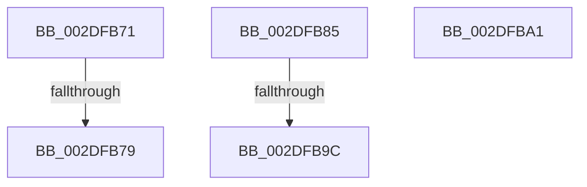

# sub_002DFB71

- RVA: `0x002DFB71`–`0x002DFBB3` (길이 `66` bytes)
- VA: `0x00000001402DFB71`
- 실행 섹션: `.text`
- PDB 이름 있음: `아니요`; PDB Function 태그: `아니요`
- unwind 정보 RVA: `0x00070AF0`
- 디코드: `15`개 명령, `66/66` bytes 표시
- 미해석 바이트: `0` (있으면 어셈블리에 `.byte`로 보존)

> 이 문서는 커널 이미지의 기계어와 PDB 기호를 분석해 생성했습니다. 4번과 5번은 함수 원형과 자료형을 바이너리 사용 방식에서 추정한 C 해석이며 원본 소스 복구 결과는 아닙니다.

## 1. Dependencies

- 직접 호출 지점: **1**; 고유 호출 대상: **1**
- 직접 호출자로 확인된 함수: **0**
- RIP 상대 이미지 참조: **0**

### Outgoing calls
- `0x002DFB8F` → [SmArrayGrow](../3A/SmArrayGrow_function_003AC6C8.md) (function, `0x003AC6C8`)

### Direct callers
- 이 함수 시작 RVA로 연결되는 직접 call은 확인되지 않았습니다. 간접 호출은 완전히 역산할 수 없습니다.

### Static image references
- 디코드된 RIP-relative 메모리 참조가 없습니다.

## 2. Other-region calls and transfers

- 다른 실행 섹션으로 향하는 call: **0**
- call이 아닌 외부 분기/꼬리 이동: **5**
  - `0x002DFB73` → [sub_002DF8DD + 0x1C4](Unknown_function_002DF8DD.md) (`tail-transfer`)
  - `0x002DFB80` → [sub_002DF8DD + 0x1C4](Unknown_function_002DF8DD.md) (`tail-transfer`)
  - `0x002DFB96` → [sub_002DF8DD + 0x1C4](Unknown_function_002DF8DD.md) (`tail-transfer`)
  - `0x002DFB9C` → [sub_002DF8DD + 0xE0](Unknown_function_002DF8DD.md) (`tail-transfer`)
  - `0x002DFBAE` → [sub_002DF8DD + 0xE5](Unknown_function_002DF8DD.md) (`tail-transfer`)

## 3. Assembly (complete function range)

```asm
002DFB71  85 FF                           test edi, edi
002DFB73  0F 85 28 FF FF FF               jne 0x1402dfaa1
002DFB79  4D 89 2B                        mov qword ptr [r11], r13
002DFB7C  4D 89 6B 08                     mov qword ptr [r11 + 8], r13
002DFB80  E9 1C FF FF FF                  jmp 0x1402dfaa1
002DFB85  4C 8D 4C 24 30                  lea r9, [rsp + 0x30]
002DFB8A  4C 8D 44 24 4C                  lea r8, [rsp + 0x4c]
002DFB8F  E8 34 CB 0C 00                  call 0x1403ac6c8
002DFB94  85 C0                           test eax, eax
002DFB96  0F 84 05 FF FF FF               je 0x1402dfaa1
002DFB9C  E9 1C FE FF FF                  jmp 0x1402df9bd
002DFBA1  4C 89 6C 24 38                  mov qword ptr [rsp + 0x38], r13
002DFBA6  4C 8D 5C 24 38                  lea r11, [rsp + 0x38]
002DFBAB  41 8B FD                        mov edi, r13d
002DFBAE  E9 0F FE FF FF                  jmp 0x1402df9c2
```

## 4. C-style interpretation (structured pseudocode)

```c
__int64 __fastcall sub_002DFB71(void)
{
    unsigned __int64 v_stack_p30;
    unsigned __int64 v_stack_p38;
    unsigned __int64 v_stack_p4C;

    *(unsigned __int64 *)(v_r11) = v_r13;
    *(unsigned __int64 *)(v_r11 + 8) = v_r13;
}
```

## 5. (Beta) C Style

```c
void sub_002DFB71(void)
{
    uint64_t v_stack_p30;
    uint64_t v_stack_p38;
    uint64_t v_stack_p4C;

    *(uint64_t *)(local_r11) = local_r13;
    *(uint64_t *)(local_r11 + 0x8) = local_r13;
}
```

## 6. Execution-region graph

[열기: 2D/3D 그래프와 함수 탐색 컨트롤 패널](../../../control-panel.html?section=text&rva=0x002DFB71&view=graph)

- 2D 그래프는 위에서 아래로 흐르고, 3D 그래프는 빈 공간을 드래그해 회전합니다. Shift+드래그는 이동, 휠은 확대·축소, 함수 노드 선택은 대상 보고서 이동입니다.

### Static fallback


