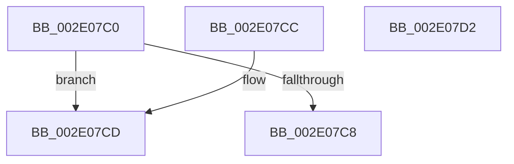

# B_TREE&lt;_SM_PAGE_KEY,SMKM_STORE_MGR&lt;SM_TRAITS&gt;::SMKM_FRONTEND_ENTRY,4096,B_TREE_DUMMY_NODE_POOL,B_TREE_KEY_COMPARATOR&lt;_SM_PAGE_KEY&gt; &gt;::BTreeSearchResultDeref

- RVA: `0x002E07C0`–`0x002E07D3` (길이 `19` bytes)
- VA: `0x00000001402E07C0`
- 실행 섹션: `.text`
- PDB 이름 있음: `예`; PDB Function 태그: `아니요`
- unwind 정보 RVA: `0x000DB714`
- 디코드: `9`개 명령, `19/19` bytes 표시
- 미해석 바이트: `0` (있으면 어셈블리에 `.byte`로 보존)

> 이 문서는 커널 이미지의 기계어와 PDB 기호를 분석해 생성했습니다. 4번과 5번은 함수 원형과 자료형을 바이너리 사용 방식에서 추정한 C 해석이며 원본 소스 복구 결과는 아닙니다.

## 1. Dependencies

- 직접 호출 지점: **0**; 고유 호출 대상: **0**
- 직접 호출자로 확인된 함수: **4**
- RIP 상대 이미지 참조: **0**

### Outgoing calls
- 직접 디코드된 call 명령이 없습니다.

### Direct callers
- [SMKM_STORE_MGR&lt;SM_TRAITS&gt;::SmFeEvictComplete](../26/SMKM_STORE_MGR_SM_TRAITS_SmFeEvictComplete_function_00266854.md) at `0x00266B47`
- [SMKM_STORE_MGR&lt;SM_TRAITS&gt;::SmFeAddComplete](../2D/SMKM_STORE_MGR_SM_TRAITS_SmFeAddComplete_function_002DFEE0.md) at `0x002DFFF8`
- [SMKM_STORE_MGR&lt;SM_TRAITS&gt;::SmFeAddComplete](../2D/SMKM_STORE_MGR_SM_TRAITS_SmFeAddComplete_function_002DFEE0.md) at `0x002E02FB`
- [sub_002E03B8](Unknown_function_002E03B8.md) at `0x002E0478`
- [sub_002E0736](Unknown_function_002E0736.md) at `0x002E0784`

### Static image references
- 디코드된 RIP-relative 메모리 참조가 없습니다.

## 2. Other-region calls and transfers

- 다른 실행 섹션으로 향하는 call: **0**
- 별도 외부 분기/꼬리 이동을 확인하지 못했습니다.

## 3. Assembly (complete function range)

```asm
002E07C0  33 C0                           xor eax, eax
002E07C2  83 7A 18 FF                     cmp dword ptr [rdx + 0x18], -1
002E07C6  74 05                           je 0x1402e07cd
002E07C8  89 42 18                        mov dword ptr [rdx + 0x18], eax
002E07CB  C3                              ret
002E07CC  CC                              int3
002E07CD  48 89 42 08                     mov qword ptr [rdx + 8], rax
002E07D1  C3                              ret
002E07D2  CC                              int3
```

## 4. C-style interpretation (structured pseudocode)

```c
__int64 __fastcall B_TREE__SM_PAGE_KEY_SMKM_STORE_MGR_SM_TRAITS___SMKM_FRONTEND_ENTRY_4096_B_TREE_DUMMY_NODE_POOL_B_TRE(__int64 a1, __int64 a2)
{
    __int64 result;

    result = 0;
    if ((*(unsigned int *)(a2 + 24)) == -1) goto loc_002E07CD;
    *(unsigned int *)(a2 + 24) = 0;
    return result;
loc_002E07CD:
    *(unsigned __int64 *)(a2 + 8) = 0;
    return result;
}
```

## 5. (Beta) C Style

```c
int64_t B_TREE__SM_PAGE_KEY_SMKM_STORE_MGR_SM_TRAITS___SMKM_FRONTEND_ENTRY_4096_B_TREE_DUMMY_NODE_POOL_B_TRE(int64_t Arg1, void *Arg2)
{
    uint8_t *arg2 = (uint8_t *)Arg2;

    int64_t result;

    result = 0;
    if ((*(uint32_t *)(arg2 + 0x18)) == -1) goto loc_002E07CD;
    *(uint32_t *)(arg2 + 0x18) = 0;
    return result;
loc_002E07CD:
    *(uint64_t *)(arg2 + 0x8) = 0;
    return result;
}
```

### 관측된 메모리 오프셋

구조체 형식이 확인되지 않은 접근은 인자 기준의 오프셋으로만 기록했습니다.

| 기준 인자 | 오프셋 표현 | 폭 (bit) | 접근 |
|---|---:|---:|---|
| `Arg2` | `+ 0x8` | `64` | `W` |
| `Arg2` | `+ 0x18` | `32` | `R` |
| `Arg2` | `+ 0x18` | `32` | `W` |

## 6. Execution-region graph

[열기: 2D/3D 그래프와 함수 탐색 컨트롤 패널](../../../control-panel.html?section=text&rva=0x002E07C0&view=graph)

- 2D 그래프는 위에서 아래로 흐르고, 3D 그래프는 빈 공간을 드래그해 회전합니다. Shift+드래그는 이동, 휠은 확대·축소, 함수 노드 선택은 대상 보고서 이동입니다.

### Static fallback


