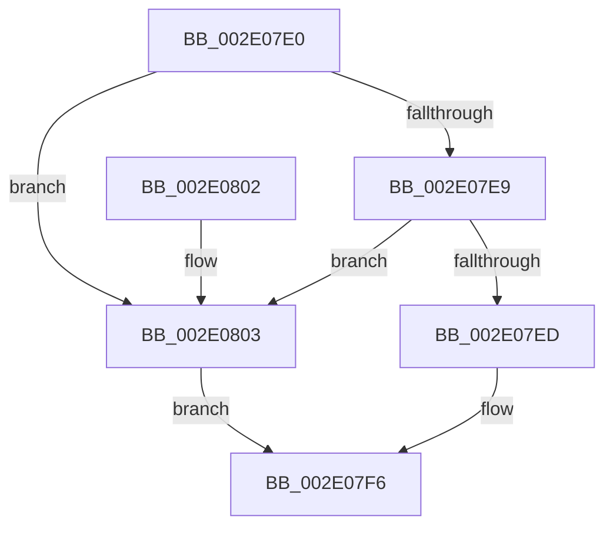

# B_TREE&lt;_SM_PAGE_KEY,SMKM_STORE_MGR&lt;SM_TRAITS&gt;::SMKM_FRONTEND_ENTRY,4096,B_TREE_DUMMY_NODE_POOL,B_TREE_KEY_COMPARATOR&lt;_SM_PAGE_KEY&gt; &gt;::BTreeIteratorFromSearchResult

- RVA: `0x002E07E0`–`0x002E0809` (길이 `41` bytes)
- VA: `0x00000001402E07E0`
- 실행 섹션: `.text`
- PDB 이름 있음: `예`; PDB Function 태그: `아니요`
- unwind 정보 RVA: `0x000DB714`
- 디코드: `15`개 명령, `41/41` bytes 표시
- 미해석 바이트: `0` (있으면 어셈블리에 `.byte`로 보존)

> 이 문서는 커널 이미지의 기계어와 PDB 기호를 분석해 생성했습니다. 4번과 5번은 함수 원형과 자료형을 바이너리 사용 방식에서 추정한 C 해석이며 원본 소스 복구 결과는 아닙니다.

## 1. Dependencies

- 직접 호출 지점: **0**; 고유 호출 대상: **0**
- 직접 호출자로 확인된 함수: **7**
- RIP 상대 이미지 참조: **0**

### Outgoing calls
- 직접 디코드된 call 명령이 없습니다.

### Direct callers
- [SMKM_STORE_MGR&lt;SM_TRAITS&gt;::SmFeAddInitiate](../26/SMKM_STORE_MGR_SM_TRAITS_SmFeAddInitiate_function_0026618C.md) at `0x00266277`
- [SMKM_STORE_MGR&lt;SM_TRAITS&gt;::SmFeEvictComplete](../26/SMKM_STORE_MGR_SM_TRAITS_SmFeEvictComplete_function_00266854.md) at `0x002668F6`
- [SMKM_STORE_MGR&lt;SM_TRAITS&gt;::SmFeAddComplete](../2D/SMKM_STORE_MGR_SM_TRAITS_SmFeAddComplete_function_002DFEE0.md) at `0x002E010B`
- [sub_002E03B8](Unknown_function_002E03B8.md) at `0x002E058B`
- [SMKM_STORE_MGR&lt;SM_TRAITS&gt;::SmFeStoreDelete](../3B/SMKM_STORE_MGR_SM_TRAITS_SmFeStoreDelete_function_003B12F0.md) at `0x003B13FE`
- [SMKM_STORE_MGR&lt;SM_TRAITS&gt;::SmFeSetEvictFailed](../60/SMKM_STORE_MGR_SM_TRAITS_SmFeSetEvictFailed_function_0060C7A4.md) at `0x0060C83D`
- [SMKM_STORE_MGR&lt;SM_TRAITS&gt;::SmFeStoreEvictKeys](../61/SMKM_STORE_MGR_SM_TRAITS_SmFeStoreEvictKeys_function_0061041C.md) at `0x006104C7`

### Static image references
- 디코드된 RIP-relative 메모리 참조가 없습니다.

## 2. Other-region calls and transfers

- 다른 실행 섹션으로 향하는 call: **0**
- 별도 외부 분기/꼬리 이동을 확인하지 못했습니다.

## 3. Assembly (complete function range)

```asm
002E07E0  41 8B 40 18                     mov eax, dword ptr [r8 + 0x18]
002E07E4  83 F8 FF                        cmp eax, -1
002E07E7  74 1A                           je 0x1402e0803
002E07E9  85 C0                           test eax, eax
002E07EB  74 16                           je 0x1402e0803
002E07ED  FF C8                           dec eax
002E07EF  48 C1 E0 04                     shl rax, 4
002E07F3  49 03 00                        add rax, qword ptr [r8]
002E07F6  0F 10 00                        movups xmm0, xmmword ptr [rax]
002E07F9  0F 11 02                        movups xmmword ptr [rdx], xmm0
002E07FC  48 83 42 08 F8                  add qword ptr [rdx + 8], -8
002E0801  C3                              ret
002E0802  CC                              int3
002E0803  49 8D 40 08                     lea rax, [r8 + 8]
002E0807  EB ED                           jmp 0x1402e07f6
```

## 4. C-style interpretation (structured pseudocode)

```c
__int64 __fastcall B_TREE__SM_PAGE_KEY_SMKM_STORE_MGR_SM_TRAITS___SMKM_FRONTEND_ENTRY_4096_B_TREE_DUMMY_NODE_POOL_B_TRE(__int64 a1, __int64 a2, __int64 a3)
{
    __int64 result;

    if (((unsigned int)((unsigned int)(*(unsigned int *)(a3 + 24)))) == -1) goto loc_002E0803;
    if ((unsigned int)((unsigned int)(*(unsigned int *)(a3 + 24))) == 0) goto loc_002E0803;
    result = (unsigned int)(((unsigned int)(*(unsigned int *)(a3 + 24))) - 1);
    result = (result) << (4);
    result = (result) + (*(unsigned __int64 *)(a3));
loc_002E07F6:
    *(unsigned __int64 *)(a2) = v_xmm0;
    return result;
loc_002E0803:
    goto loc_002E07F6;
}
```

## 5. (Beta) C Style

```c
int64_t B_TREE__SM_PAGE_KEY_SMKM_STORE_MGR_SM_TRAITS___SMKM_FRONTEND_ENTRY_4096_B_TREE_DUMMY_NODE_POOL_B_TRE(int64_t Arg1, void *Arg2, void *Arg3)
{
    uint8_t *arg2 = (uint8_t *)Arg2;
    uint8_t *arg3 = (uint8_t *)Arg3;

    int64_t result;

    if (((uint32_t)((uint32_t)(*(uint32_t *)(arg3 + 0x18)))) == -1) goto loc_002E0803;
    if ((uint32_t)((uint32_t)(*(uint32_t *)(arg3 + 0x18))) == 0) goto loc_002E0803;
    result = (uint32_t)(((uint32_t)(*(uint32_t *)(arg3 + 0x18))) - 1);
    result = (result) << (4);
    result = (result) + (*(uint64_t *)(arg3));
loc_002E07F6:
    *(uint64_t *)(arg2) = v_xmm0;
    return result;
loc_002E0803:
    goto loc_002E07F6;
}
```

### 관측된 메모리 오프셋

구조체 형식이 확인되지 않은 접근은 인자 기준의 오프셋으로만 기록했습니다.

| 기준 인자 | 오프셋 표현 | 폭 (bit) | 접근 |
|---|---:|---:|---|
| `Arg2` | `+ 0x0` | `128` | `R` |
| `Arg2` | `+ 0x8` | `64` | `R/W` |
| `Arg3` | `+ 0x0` | `64` | `R` |
| `Arg3` | `+ 0x8` | `64` | `R` |
| `Arg3` | `+ 0x18` | `32` | `R` |

## 6. Execution-region graph

[열기: 2D/3D 그래프와 함수 탐색 컨트롤 패널](../../../control-panel.html?section=text&rva=0x002E07E0&view=graph)

- 2D 그래프는 위에서 아래로 흐르고, 3D 그래프는 빈 공간을 드래그해 회전합니다. Shift+드래그는 이동, 휠은 확대·축소, 함수 노드 선택은 대상 보고서 이동입니다.

### Static fallback


