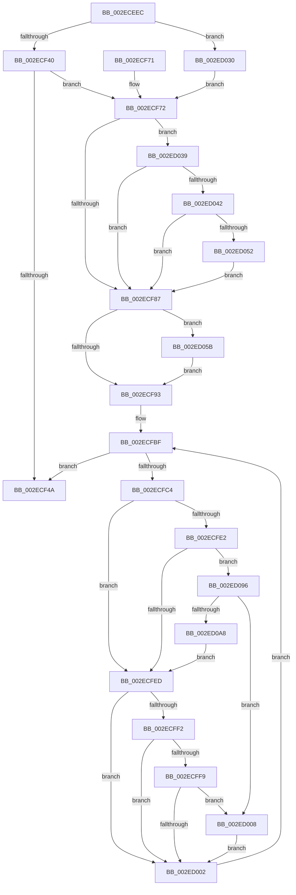

# EtwTracePool

- RVA: `0x002ECEEC`–`0x002ED0AD` (길이 `449` bytes)
- VA: `0x00000001402ECEEC`
- 실행 섹션: `.text`
- PDB 이름 있음: `예`; PDB Function 태그: `아니요`
- unwind 정보 RVA: `0x00071838`
- 디코드: `114`개 명령, `449/449` bytes 표시
- 미해석 바이트: `0` (있으면 어셈블리에 `.byte`로 보존)

> 이 문서는 커널 이미지의 기계어와 PDB 기호를 분석해 생성했습니다. 4번과 5번은 함수 원형과 자료형을 바이너리 사용 방식에서 추정한 C 해석이며 원본 소스 복구 결과는 아닙니다.

## 1. Dependencies

- 직접 호출 지점: **5**; 고유 호출 대상: **5**
- 직접 호출자로 확인된 함수: **9**
- RIP 상대 이미지 참조: **3**

### Outgoing calls
- `0x002ECF51` → [_security_check_cookie](../6A/_security_check_cookie_function_006AC640.md) (function, `0x006AC640`)
- `0x002ED029` → [EtwpLogKernelEvent](../25/EtwpLogKernelEvent_function_0025CC00.md) (function, `0x0025CC00`)
- `0x002ED045` → [MmIsNonPagedPoolNx](../68/MmIsNonPagedPoolNx_function_00682EEC.md) (function, `0x00682EEC`)
- `0x002ED06B` → [PsGetProcessSessionIdEx](../22/PsGetProcessSessionIdEx_function_0022F8F0.md) (function, `0x0022F8F0`)
- `0x002ED09B` → [EtwpCheckPoolTagFilters](../64/EtwpCheckPoolTagFilters_function_0064E738.md) (function, `0x0064E738`)

### Direct callers
- [ExpFreeHeapSpecialPool](ExpFreeHeapSpecialPool_function_002EE600.md) at `0x002EE8E6`
- [ExAllocateContiguousHeapPool](ExAllocateContiguousHeapPool_function_002EE960.md) at `0x002EEC68`
- [ExpInsertPoolTracker](ExpInsertPoolTracker_function_002EEFAC.md) at `0x002EF195`
- [ExAllocateHeapPool](../35/ExAllocateHeapPool_function_0035BA30.md) at `0x0035E510`
- [ExAllocateHeapPool](../35/ExAllocateHeapPool_function_0035BA30.md) at `0x0035E70A`
- [ExAllocateHeapPool](../35/ExAllocateHeapPool_function_0035BA30.md) at `0x0035E808`
- [ExAllocateHeapPool](../35/ExAllocateHeapPool_function_0035BA30.md) at `0x0035EC0A`
- [ExAllocateHeapPool](../35/ExAllocateHeapPool_function_0035BA30.md) at `0x0035F08C`
- [sub_00360968](../36/Unknown_function_00360968.md) at `0x00360E2F`
- [sub_00360968](../36/Unknown_function_00360968.md) at `0x00360EE0`
- [ExRemovePoolTag](../3F/ExRemovePoolTag_function_003F7CBC.md) at `0x003F7F5B`
- [ExPoolCleanupExpansionTable](../65/ExPoolCleanupExpansionTable_function_00656164.md) at `0x006561E5`
- [sub_006DED54](../6D/Unknown_function_006DED54.md) at `0x006DEDA8`
- [sub_00B8371E](../../poolcode/B8/Unknown_function_00B8371E.md) at `0x00B83BE7`
- [sub_00B8371E](../../poolcode/B8/Unknown_function_00B8371E.md) at `0x00B83C98`

### Static image references
- `0x002ECF06` → RVA `0x00E0A740` (`.data`; read)
- `0x002ECF40` → RVA `0x00FC6B04` (`ALMOSTRO`; read)
- `0x002ECF9E` → RVA `0x00FC6AA8` (`ALMOSTRO`; read)

## 2. Other-region calls and transfers

- 다른 실행 섹션으로 향하는 call: **0**
- 별도 외부 분기/꼬리 이동을 확인하지 못했습니다.

## 3. Assembly (complete function range)

```asm
002ECEEC  48 89 5C 24 10                  mov qword ptr [rsp + 0x10], rbx
002ECEF1  55                              push rbp
002ECEF2  56                              push rsi
002ECEF3  57                              push rdi
002ECEF4  41 54                           push r12
002ECEF6  41 55                           push r13
002ECEF8  41 56                           push r14
002ECEFA  41 57                           push r15
002ECEFC  48 8B EC                        mov rbp, rsp
002ECEFF  48 81 EC 80 00 00 00            sub rsp, 0x80
002ECF06  48 8B 05 33 D8 B1 00            mov rax, qword ptr [rip + 0xb1d833]
002ECF0D  48 33 C4                        xor rax, rsp
002ECF10  48 89 45 F0                     mov qword ptr [rbp - 0x10], rax
002ECF14  4C 8B 6D 60                     mov r13, qword ptr [rbp + 0x60]
002ECF18  33 F6                           xor esi, esi
002ECF1A  8B DA                           mov ebx, edx
002ECF1C  89 75 B0                        mov dword ptr [rbp - 0x50], esi
002ECF1F  81 E3 6D 02 00 00               and ebx, 0x26d
002ECF25  44 89 45 B4                     mov dword ptr [rbp - 0x4c], r8d
002ECF29  89 75 B0                        mov dword ptr [rbp - 0x50], esi
002ECF2C  49 8B F9                        mov rdi, r9
002ECF2F  44 0F B7 F1                     movzx r14d, cx
002ECF33  49 81 FD E0 0F 00 00            cmp r13, 0xfe0
002ECF3A  0F 87 F0 00 00 00               ja 0x1402ed030
002ECF40  8B 05 BE 9B CD 00               mov eax, dword ptr [rip + 0xcd9bbe]
002ECF46  A8 40                           test al, 0x40
002ECF48  75 28                           jne 0x1402ecf72
002ECF4A  48 8B 4D F0                     mov rcx, qword ptr [rbp - 0x10]
002ECF4E  48 33 CC                        xor rcx, rsp
002ECF51  E8 EA F6 3B 00                  call 0x1406ac640
002ECF56  48 8B 9C 24 C8 00 00 00         mov rbx, qword ptr [rsp + 0xc8]
002ECF5E  48 81 C4 80 00 00 00            add rsp, 0x80
002ECF65  41 5F                           pop r15
002ECF67  41 5E                           pop r14
002ECF69  41 5D                           pop r13
002ECF6B  41 5C                           pop r12
002ECF6D  5F                              pop rdi
002ECF6E  5E                              pop rsi
002ECF6F  5D                              pop rbp
002ECF70  C3                              ret
002ECF71  CC                              int3
002ECF72  B8 22 0E 00 00                  mov eax, 0xe22
002ECF77  41 BF 01 00 00 00               mov r15d, 1
002ECF7D  66 44 3B F0                     cmp r14w, ax
002ECF81  0F 84 B2 00 00 00               je 0x1402ed039
002ECF87  45 8B E7                        mov r12d, r15d
002ECF8A  F6 C3 20                        test bl, 0x20
002ECF8D  0F 85 C8 00 00 00               jne 0x1402ed05b
002ECF93  48 8D 45 B8                     lea rax, [rbp - 0x48]
002ECF97  89 5D B8                        mov dword ptr [rbp - 0x48], ebx
002ECF9A  48 89 45 D0                     mov qword ptr [rbp - 0x30], rax
002ECF9E  48 8B 05 03 9B CD 00            mov rax, qword ptr [rip + 0xcd9b03]
002ECFA5  44 89 45 BC                     mov dword ptr [rbp - 0x44], r8d
002ECFA9  4C 89 6D C0                     mov qword ptr [rbp - 0x40], r13
002ECFAD  48 89 7D C8                     mov qword ptr [rbp - 0x38], rdi
002ECFB1  48 C7 45 D8 18 00 00 00         mov qword ptr [rbp - 0x28], 0x18
002ECFB9  8B B8 A8 11 00 00               mov edi, dword ptr [rax + 0x11a8]
002ECFBF  0F BC F7                        bsf esi, edi
002ECFC2  74 86                           je 0x1402ecf4a
002ECFC4  4C 8B 3D DD 9A CD 00            mov r15, qword ptr [rip + 0xcd9add]
002ECFCB  8D 47 FF                        lea eax, [rdi - 1]
002ECFCE  23 F8                           and edi, eax
002ECFD0  8B C6                           mov eax, esi
002ECFD2  48 C1 E0 05                     shl rax, 5
002ECFD6  49 8D 9F CC 11 00 00            lea rbx, [r15 + 0x11cc]
002ECFDD  48 03 D8                        add rbx, rax
002ECFE0  74 0B                           je 0x1402ecfed
002ECFE2  8B 43 04                        mov eax, dword ptr [rbx + 4]
002ECFE5  A8 40                           test al, 0x40
002ECFE7  0F 85 A9 00 00 00               jne 0x1402ed096
002ECFED  48 85 DB                        test rbx, rbx
002ECFF0  74 10                           je 0x1402ed002
002ECFF2  8B 43 04                        mov eax, dword ptr [rbx + 4]
002ECFF5  A8 01                           test al, 1
002ECFF7  74 09                           je 0x1402ed002
002ECFF9  49 81 FD E0 0F 00 00            cmp r13, 0xfe0
002ED000  77 06                           ja 0x1402ed008
002ED002  44 8B 45 B4                     mov r8d, dword ptr [rbp - 0x4c]
002ED006  EB B7                           jmp 0x1402ecfbf
002ED008  45 0F B6 84 77 98 11 00 00      movzx r8d, byte ptr [r15 + rsi*2 + 0x1198]
002ED011  48 8D 4D D0                     lea rcx, [rbp - 0x30]
002ED015  C7 44 24 28 02 1B 50 01         mov dword ptr [rsp + 0x28], 0x1501b02
002ED01D  45 8B CC                        mov r9d, r12d
002ED020  49 8B D7                        mov rdx, r15
002ED023  66 44 89 74 24 20               mov word ptr [rsp + 0x20], r14w
002ED029  E8 D2 FB F6 FF                  call 0x14025cc00
002ED02E  EB D2                           jmp 0x1402ed002
002ED030  0F BA EB 1C                     bts ebx, 0x1c
002ED034  E9 39 FF FF FF                  jmp 0x1402ecf72
002ED039  41 84 DF                        test r15b, bl
002ED03C  0F 85 45 FF FF FF               jne 0x1402ecf87
002ED042  48 8B CF                        mov rcx, rdi
002ED045  E8 A2 5E 39 00                  call 0x140682eec
002ED04A  85 C0                           test eax, eax
002ED04C  0F 84 35 FF FF FF               je 0x1402ecf87
002ED052  0F BA EB 09                     bts ebx, 9
002ED056  E9 2C FF FF FF                  jmp 0x1402ecf87
002ED05B  65 48 8B 0C 25 88 01 00 00      mov rcx, qword ptr gs:[0x188]
002ED064  48 8B 89 B8 00 00 00            mov rcx, qword ptr [rcx + 0xb8]
002ED06B  E8 80 28 F4 FF                  call 0x14022f8f0
002ED070  44 8B 45 B4                     mov r8d, dword ptr [rbp - 0x4c]
002ED074  41 BC 02 00 00 00               mov r12d, 2
002ED07A  89 45 B0                        mov dword ptr [rbp - 0x50], eax
002ED07D  66 45 03 F7                     add r14w, r15w
002ED081  48 8D 45 B0                     lea rax, [rbp - 0x50]
002ED085  48 C7 45 E8 04 00 00 00         mov qword ptr [rbp - 0x18], 4
002ED08D  48 89 45 E0                     mov qword ptr [rbp - 0x20], rax
002ED091  E9 FD FE FF FF                  jmp 0x1402ecf93
002ED096  41 8B D0                        mov edx, r8d
002ED099  8B CE                           mov ecx, esi
002ED09B  E8 98 16 36 00                  call 0x14064e738
002ED0A0  84 C0                           test al, al
002ED0A2  0F 85 60 FF FF FF               jne 0x1402ed008
002ED0A8  E9 40 FF FF FF                  jmp 0x1402ecfed
```

## 4. C-style interpretation (structured pseudocode)

```c
__int64 __fastcall EtwTracePool(unsigned __int16 a1, int a2, int a3, __int64 a4, __int64 a5)
{
    __int64 result;
    __int64 v_r14;
    __int64 v_rbx;
    __int64 v_rdi;
    __int64 v_rsi;
    __int64 v_rsp;
    unsigned __int64 v_stack_m48;
    unsigned __int64 v_stack_m50;
    unsigned __int64 v_stack_m58;
    unsigned __int64 v_stack_m60;
    unsigned __int64 v_stack_m68;
    unsigned __int64 v_stack_m70;
    unsigned __int64 v_stack_m78;
    unsigned int v_stack_m7C;
    unsigned __int64 v_stack_m80;
    unsigned int v_stack_m84;
    unsigned int v_stack_m88;
    unsigned __int64 v_stack_p10;
    unsigned __int16 v_stack_p20;
    unsigned int v_stack_p28;

    v_stack_p10 = v_rbx;
    v_rsp = (v_rsp) - (128);
    result = (*(unsigned __int64 *)(v_rip + 11655219)) ^ (v_rsp);
    v_stack_m48 = result;
    v_rsi = 0;
    v_stack_m88 = 0;
    v_rbx = (unsigned int)(((unsigned int)(a2)) & (621));
    v_stack_m84 = a3;
    v_stack_m88 = 0;
    if (a5 > 0xFE0ULL) goto loc_002ED030;
    if ((((unsigned __int8)((unsigned int)(*(unsigned int *)(v_rip + 13474750)))) & (64)) != 0) goto loc_002ECF72;
loc_002ECF4A:
    a1 = (v_stack_m48) ^ (v_rsp);
    result = _security_check_cookie(a1, a2, a3, a4);
    v_rsp = (v_rsp) + (128);
    return result;
loc_002ECF72:
    if (a1 == ((unsigned __int16)((unsigned int)(0xE22ULL)))) goto loc_002ED039;
loc_002ECF87:
    if ((((unsigned __int8)(v_stack_p10)) & (32)) != 0) goto loc_002ED05B;
loc_002ECF93:
    v_stack_m80 = (unsigned int)(v_stack_p10);
    v_stack_m68 = v_stack_m80;
    v_stack_m7C = a3;
    v_stack_m78 = a5;
    v_stack_m70 = a4;
    v_stack_m60 = 24;
loc_002ECFBF:
    if ((((unsigned __int8)(v_stack_p10)) & (32)) == 0) goto loc_002ECF4A;
    v_rdi = (unsigned int)(((unsigned int)(*(unsigned int *)(*(unsigned __int64 *)(v_rip + 13474563) + 4520))) & ((unsigned int)((unsigned int)(*(unsigned int *)(*(unsigned __int64 *)(v_rip + 13474563) + 4520)) - 1)));
    result = (0) << (5);
    v_rbx = (*(unsigned __int64 *)(v_rip + 13474525) + 4556) + (result);
    if (condition_is_equal) goto loc_002ECFED;
    if ((((unsigned __int8)((unsigned int)(*(unsigned int *)(v_rbx + 4)))) & (64)) != 0) goto loc_002ED096;
loc_002ECFED:
    if (v_rbx == 0) goto loc_002ED002;
    if ((((unsigned __int8)((unsigned int)(*(unsigned int *)(v_rbx + 4)))) & (1)) == 0) goto loc_002ED002;
    if (a5 > 0xFE0ULL) goto loc_002ED008;
loc_002ED002:
    goto loc_002ECFBF;
loc_002ED008:
    v_stack_p28 = 0x1501B02ULL;
    v_stack_p20 = a1;
    result = EtwpLogKernelEvent(v_stack_m68, *(unsigned __int64 *)(v_rip + 13474525), *(unsigned __int8 *)(*(unsigned __int64 *)(v_rip + 13474525) + v_rsi * 2 + 4504), 1);
    goto loc_002ED002;
loc_002ED030:
    goto loc_002ECF72;
loc_002ED039:
    if ((((unsigned __int8)(*(unsigned __int64 *)(v_rip + 13474525))) & ((unsigned __int8)(v_rbx))) != 0) goto loc_002ECF87;
    result = MmIsNonPagedPoolNx(v_rdi, *(unsigned __int64 *)(v_rip + 13474525), *(unsigned __int8 *)(*(unsigned __int64 *)(v_rip + 13474525) + v_rsi * 2 + 4504), 1);
    if ((unsigned int)(result) == 0) goto loc_002ECF87;
    goto loc_002ECF87;
loc_002ED05B:
    result = PsGetProcessSessionIdEx(*(unsigned __int64 *)(*(unsigned __int64 *)(gs_base + (0 + 392)) + 184), *(unsigned __int64 *)(v_rip + 13474525), *(unsigned __int8 *)(*(unsigned __int64 *)(v_rip + 13474525) + v_rsi * 2 + 4504), 1);
    v_stack_m88 = (unsigned int)(result);
    v_r14 = (unsigned __int16)((a1) + ((unsigned __int16)(*(unsigned __int64 *)(v_rip + 13474525))));
    v_stack_m50 = 4;
    v_stack_m58 = v_stack_m88;
    goto loc_002ECF93;
loc_002ED096:
    result = EtwpCheckPoolTagFilters(0, (unsigned int)((unsigned int)((unsigned int)(v_stack_m84))), (unsigned int)(v_stack_m84), 1);
    if ((unsigned __int8)(result) != 0) goto loc_002ED008;
    goto loc_002ECFED;
}
```

## 5. (Beta) C Style

```c
int64_t EtwTracePool(uint16_t Arg1, int32_t Arg2, int32_t Arg3, int64_t Arg4, int64_t Arg5)
{
    int64_t result;
    int64_t local_r14;
    int64_t local_rbx;
    int64_t local_rdi;
    int64_t local_rsi;
    int64_t local_rsp;
    uint64_t v_stack_m48;
    uint64_t v_stack_m50;
    uint64_t v_stack_m58;
    uint64_t v_stack_m60;
    uint64_t v_stack_m68;
    uint64_t v_stack_m70;
    uint64_t v_stack_m78;
    uint32_t v_stack_m7C;
    uint64_t v_stack_m80;
    uint32_t v_stack_m84;
    uint32_t v_stack_m88;
    uint64_t v_stack_p10;
    uint16_t v_stack_p20;
    uint32_t v_stack_p28;

    v_stack_p10 = local_rbx;
    local_rsp = (local_rsp) - (128);
    result = (*(uint64_t *)(v_rip + 0xB1D833)) ^ (local_rsp);
    v_stack_m48 = result;
    local_rsi = 0;
    v_stack_m88 = 0;
    local_rbx = (uint32_t)(((uint32_t)(Arg2)) & (621));
    v_stack_m84 = Arg3;
    v_stack_m88 = 0;
    if (Arg5 > 0xFE0ULL) goto loc_002ED030;
    if ((((uint8_t)((uint32_t)(*(uint32_t *)(v_rip + 0xCD9BBE)))) & (64)) != 0) goto loc_002ECF72;
loc_002ECF4A:
    Arg1 = (v_stack_m48) ^ (local_rsp);
    result = _security_check_cookie(Arg1, Arg2, Arg3, Arg4);
    local_rsp = (local_rsp) + (128);
    return result;
loc_002ECF72:
    if (Arg1 == ((uint16_t)((uint32_t)(0xE22ULL)))) goto loc_002ED039;
loc_002ECF87:
    if ((((uint8_t)(v_stack_p10)) & (32)) != 0) goto loc_002ED05B;
loc_002ECF93:
    v_stack_m80 = (uint32_t)(v_stack_p10);
    v_stack_m68 = v_stack_m80;
    v_stack_m7C = Arg3;
    v_stack_m78 = Arg5;
    v_stack_m70 = Arg4;
    v_stack_m60 = 24;
loc_002ECFBF:
    if ((((uint8_t)(v_stack_p10)) & (32)) == 0) goto loc_002ECF4A;
    local_rdi = (uint32_t)(((uint32_t)(*(uint32_t *)(*(uint64_t *)(v_rip + 0xCD9B03) + 0x11A8))) & ((uint32_t)((uint32_t)(*(uint32_t *)(*(uint64_t *)(v_rip + 0xCD9B03) + 0x11A8)) - 1)));
    result = (0) << (5);
    local_rbx = (*(uint64_t *)(v_rip + 0xCD9ADD) + 4556) + (result);
    if (condition_is_equal) goto loc_002ECFED;
    if ((((uint8_t)((uint32_t)(*(uint32_t *)(local_rbx + 0x4)))) & (64)) != 0) goto loc_002ED096;
loc_002ECFED:
    if (local_rbx == 0) goto loc_002ED002;
    if ((((uint8_t)((uint32_t)(*(uint32_t *)(local_rbx + 0x4)))) & (1)) == 0) goto loc_002ED002;
    if (Arg5 > 0xFE0ULL) goto loc_002ED008;
loc_002ED002:
    goto loc_002ECFBF;
loc_002ED008:
    v_stack_p28 = 0x1501B02ULL;
    v_stack_p20 = Arg1;
    result = EtwpLogKernelEvent(v_stack_m68, *(uint64_t *)(v_rip + 0xCD9ADD), *(uint8_t *)(*(uint64_t *)(v_rip + 0xCD9ADD) + local_rsi * 2 + 0x1198), 1);
    goto loc_002ED002;
loc_002ED030:
    goto loc_002ECF72;
loc_002ED039:
    if ((((uint8_t)(*(uint64_t *)(v_rip + 0xCD9ADD))) & ((uint8_t)(local_rbx))) != 0) goto loc_002ECF87;
    result = MmIsNonPagedPoolNx(local_rdi, *(uint64_t *)(v_rip + 0xCD9ADD), *(uint8_t *)(*(uint64_t *)(v_rip + 0xCD9ADD) + local_rsi * 2 + 0x1198), 1);
    if ((uint32_t)(result) == 0) goto loc_002ECF87;
    goto loc_002ECF87;
loc_002ED05B:
    result = PsGetProcessSessionIdEx(*(uint64_t *)(*(uint64_t *)(gs_base + (0 + 0x188)) + 0xB8), *(uint64_t *)(v_rip + 0xCD9ADD), *(uint8_t *)(*(uint64_t *)(v_rip + 0xCD9ADD) + local_rsi * 2 + 0x1198), 1);
    v_stack_m88 = (uint32_t)(result);
    local_r14 = (uint16_t)((Arg1) + ((uint16_t)(*(uint64_t *)(v_rip + 0xCD9ADD))));
    v_stack_m50 = 4;
    v_stack_m58 = v_stack_m88;
    goto loc_002ECF93;
loc_002ED096:
    result = EtwpCheckPoolTagFilters(0, (uint32_t)((uint32_t)((uint32_t)(v_stack_m84))), (uint32_t)(v_stack_m84), 1);
    if ((uint8_t)(result) != 0) goto loc_002ED008;
    goto loc_002ECFED;
}
```

## 6. Execution-region graph

[열기: 2D/3D 그래프와 함수 탐색 컨트롤 패널](../../../control-panel.html?section=text&rva=0x002ECEEC&view=graph)

- 2D 그래프는 위에서 아래로 흐르고, 3D 그래프는 빈 공간을 드래그해 회전합니다. Shift+드래그는 이동, 휠은 확대·축소, 함수 노드 선택은 대상 보고서 이동입니다.

### Static fallback


