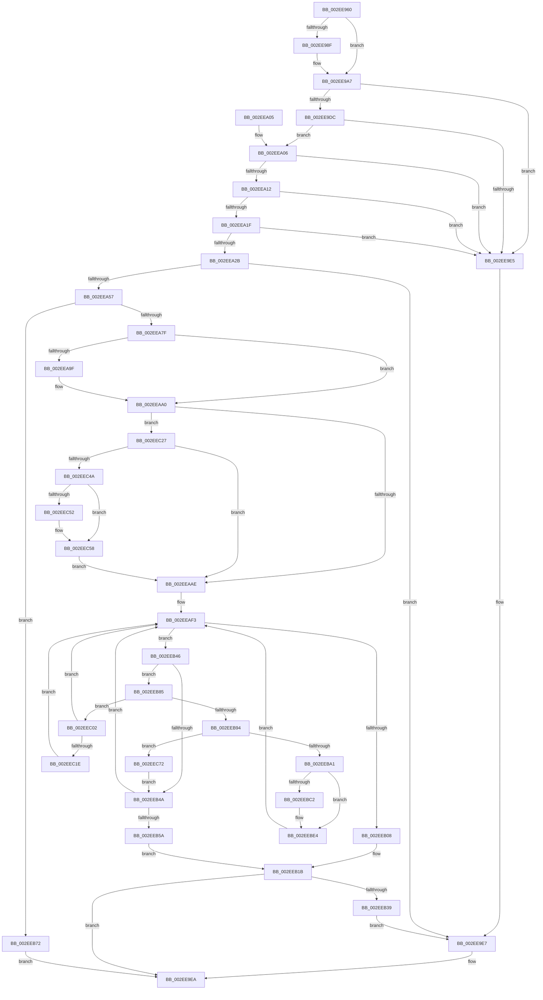

# ExAllocateContiguousHeapPool

- RVA: `0x002EE960`–`0x002EEC7B` (길이 `795` bytes)
- VA: `0x00000001402EE960`
- 실행 섹션: `.text`
- PDB 이름 있음: `예`; PDB Function 태그: `아니요`
- unwind 정보 RVA: `0x000719F8`
- 디코드: `205`개 명령, `795/795` bytes 표시
- 미해석 바이트: `0` (있으면 어셈블리에 `.byte`로 보존)

> 이 문서는 커널 이미지의 기계어와 PDB 기호를 분석해 생성했습니다. 4번과 5번은 함수 원형과 자료형을 바이너리 사용 방식에서 추정한 C 해석이며 원본 소스 복구 결과는 아닙니다.

## 1. Dependencies

- 직접 호출 지점: **12**; 고유 호출 대상: **12**
- 직접 호출자로 확인된 함수: **1**
- RIP 상대 이미지 참조: **9**

### Outgoing calls
- `0x002EEA48` → [RtlpHpAllocateHeapBackend](../32/RtlpHpAllocateHeapBackend_function_00326580.md) (function, `0x00326580`)
- `0x002EEA72` → [ExpAddTagForBigPages](ExpAddTagForBigPages_function_002EF570.md) (function, `0x002EF570`)
- `0x002EEB13` → [ExpPoolTrackerChargeEntry](../35/ExpPoolTrackerChargeEntry_function_0035B810.md) (function, `0x0035B810`)
- `0x002EEB2B` → [KasanPoolAllocate](KasanPoolAllocate_function_002EE3E0.md) (function, `0x002EE3E0`)
- `0x002EEB3C` → [ExFreeHeapPool](../35/ExFreeHeapPool_function_0035FAE0.md) (function, `0x0035FAE0`)
- `0x002EEB65` → [ExpInsertPoolTrackerExpansion](ExpInsertPoolTrackerExpansion_function_002ECCC0.md) (function, `0x002ECCC0`)
- `0x002EEB7B` → [RtlpHpFreeHeap](../35/RtlpHpFreeHeap_function_0035F600.md) (function, `0x0035F600`)
- `0x002EEBAC` → [KeAcquireInStackQueuedSpinLock](../27/KeAcquireInStackQueuedSpinLock_function_002757A0.md) (function, `0x002757A0`)
- `0x002EEBC4` → [ExpPlFindLimitEntry](ExpPlFindLimitEntry_function_002ECBF0.md) (function, `0x002ECBF0`)
- `0x002EEBE8` → [KeReleaseInStackQueuedSpinLock](../34/KeReleaseInStackQueuedSpinLock_function_00342CE0.md) (function, `0x00342CE0`)
- `0x002EEC3D` → [ExpPoolFlagsToPoolType](../../poolcode/B8/ExpPoolFlagsToPoolType_function_00B84080.md) (function, `0x00B84080`)
- `0x002EEC68` → [EtwTracePool](EtwTracePool_function_002ECEEC.md) (function, `0x002ECEEC`)

### Direct callers
- [MiAllocateContiguousMemory](../3E/MiAllocateContiguousMemory_function_003E9FDC.md) at `0x003EA1C8`

### Static image references
- `0x002EE9A7` → RVA `0x00E6BF10` (`.data`; read)
- `0x002EE9AE` → RVA `0x00000000` (`image boundary/outside`; read)
- `0x002EE9C9` → RVA `0x00E30088` (`.data`; read)
- `0x002EEA8B` → RVA `0x00FC514C` (`ALMOSTRO`; read)
- `0x002EEAA0` → RVA `0x00FC6B04` (`ALMOSTRO`; read)
- `0x002EEAB6` → RVA `0x00EFED58` (`.data`; read)
- `0x002EEABD` → RVA `0x00EFED50` (`.data`; read)
- `0x002EEB85` → RVA `0x00EFED60` (`.data`; read)
- `0x002EEBA5` → RVA `0x00EFAD00` (`.data`; read)

## 2. Other-region calls and transfers

- 다른 실행 섹션으로 향하는 call: **1**
  - `0x002EEC3D` → [ExpPoolFlagsToPoolType](../../poolcode/B8/ExpPoolFlagsToPoolType_function_00B84080.md) (`.text` → `POOLCODE`)
- 별도 외부 분기/꼬리 이동을 확인하지 못했습니다.

## 3. Assembly (complete function range)

```asm
002EE960  48 89 5C 24 10                  mov qword ptr [rsp + 0x10], rbx
002EE965  4C 89 4C 24 20                  mov qword ptr [rsp + 0x20], r9
002EE96A  55                              push rbp
002EE96B  56                              push rsi
002EE96C  57                              push rdi
002EE96D  41 54                           push r12
002EE96F  41 55                           push r13
002EE971  41 56                           push r14
002EE973  41 57                           push r15
002EE975  48 8B EC                        mov rbp, rsp
002EE978  48 83 EC 70                     sub rsp, 0x70
002EE97C  4D 8B D9                        mov r11, r9
002EE97F  4C 8B D1                        mov r10, rcx
002EE982  44 8B 4D 60                     mov r9d, dword ptr [rbp + 0x60]
002EE986  41 81 F9 00 00 00 80            cmp r9d, 0x80000000
002EE98D  75 18                           jne 0x1402ee9a7
002EE98F  65 48 8B 04 25 20 00 00 00      mov rax, qword ptr gs:[0x20]
002EE998  4C 8B 88 C0 00 00 00            mov r9, qword ptr [rax + 0xc0]
002EE99F  45 0F B7 89 8A 00 00 00         movzx r9d, word ptr [r9 + 0x8a]
002EE9A7  44 3B 0D 62 D5 B7 00            cmp r9d, dword ptr [rip + 0xb7d562]
002EE9AE  4C 8D 25 4B 16 D1 FF            lea r12, [rip - 0x2ee9b5]
002EE9B5  1B C0                           sbb eax, eax
002EE9B7  41 23 C1                        and eax, r9d
002EE9BA  48 69 C8 C0 20 00 00            imul rcx, rax, 0x20c0
002EE9C1  4E 8B B4 21 48 BF E6 00         mov r14, qword ptr [rcx + r12 + 0xe6bf48]
002EE9C9  48 8B 05 B8 16 B4 00            mov rax, qword ptr [rip + 0xb416b8]
002EE9D0  48 8B 08                        mov rcx, qword ptr [rax]
002EE9D3  4C 3B 91 40 48 00 00            cmp r10, qword ptr [rcx + 0x4840]
002EE9DA  77 09                           ja 0x1402ee9e5
002EE9DC  48 3B 91 48 48 00 00            cmp rdx, qword ptr [rcx + 0x4848]
002EE9E3  73 21                           jae 0x1402eea06
002EE9E5  33 DB                           xor ebx, ebx
002EE9E7  48 8B FB                        mov rdi, rbx
002EE9EA  48 8B 9C 24 B8 00 00 00         mov rbx, qword ptr [rsp + 0xb8]
002EE9F2  48 8B C7                        mov rax, rdi
002EE9F5  48 83 C4 70                     add rsp, 0x70
002EE9F9  41 5F                           pop r15
002EE9FB  41 5E                           pop r14
002EE9FD  41 5D                           pop r13
002EE9FF  41 5C                           pop r12
002EEA01  5F                              pop rdi
002EEA02  5E                              pop rsi
002EEA03  5D                              pop rbp
002EEA04  C3                              ret
002EEA05  CC                              int3
002EEA06  49 8D 40 FF                     lea rax, [r8 - 1]
002EEA0A  48 3D FE 01 00 00               cmp rax, 0x1fe
002EEA10  76 D3                           jbe 0x1402ee9e5
002EEA12  41 8A 86 4D 01 00 00            mov al, byte ptr [r14 + 0x14d]
002EEA19  24 07                           and al, 7
002EEA1B  3C 01                           cmp al, 1
002EEA1D  72 C6                           jb 0x1402ee9e5
002EEA1F  41 8B 86 10 02 00 00            mov eax, dword ptr [r14 + 0x210]
002EEA26  4C 3B D8                        cmp r11, rax
002EEA29  73 BA                           jae 0x1402ee9e5
002EEA2B  49 8D B3 FF 0F 00 00            lea rsi, [r11 + 0xfff]
002EEA32  41 B9 00 00 80 00               mov r9d, 0x800000
002EEA38  48 81 E6 00 F0 FF FF            and rsi, 0xfffffffffffff000
002EEA3F  49 8B CE                        mov rcx, r14
002EEA42  4C 8B C6                        mov r8, rsi
002EEA45  48 8B D6                        mov rdx, rsi
002EEA48  E8 33 7B 03 00                  call 0x140326580
002EEA4D  33 DB                           xor ebx, ebx
002EEA4F  4C 8B E8                        mov r13, rax
002EEA52  48 85 C0                        test rax, rax
002EEA55  74 90                           je 0x1402ee9e7
002EEA57  8B 7D 68                        mov edi, dword ptr [rbp + 0x68]
002EEA5A  44 8D 7B 40                     lea r15d, [rbx + 0x40]
002EEA5E  45 8B CF                        mov r9d, r15d
002EEA61  88 5C 24 28                     mov byte ptr [rsp + 0x28], bl
002EEA65  8B D7                           mov edx, edi
002EEA67  66 89 5C 24 20                  mov word ptr [rsp + 0x20], bx
002EEA6C  4C 8B C6                        mov r8, rsi
002EEA6F  48 8B C8                        mov rcx, rax
002EEA72  E8 F9 0A 00 00                  call 0x1402ef570
002EEA77  85 C0                           test eax, eax
002EEA79  0F 84 F3 00 00 00               je 0x1402eeb72
002EEA7F  33 C0                           xor eax, eax
002EEA81  89 5D C0                        mov dword ptr [rbp - 0x40], ebx
002EEA84  48 89 45 F8                     mov qword ptr [rbp - 8], rax
002EEA88  0F 57 C0                        xorps xmm0, xmm0
002EEA8B  8B 05 BB 66 CD 00               mov eax, dword ptr [rip + 0xcd66bb]
002EEA91  88 5D 60                        mov byte ptr [rbp + 0x60], bl
002EEA94  88 5D 40                        mov byte ptr [rbp + 0x40], bl
002EEA97  0F 11 45 E8                     movups xmmword ptr [rbp - 0x18], xmm0
002EEA9B  3B F8                           cmp edi, eax
002EEA9D  75 01                           jne 0x1402eeaa0
002EEA9F  CC                              int3
002EEAA0  8B 05 5E 80 CD 00               mov eax, dword ptr [rip + 0xcd805e]
002EEAA6  A8 41                           test al, 0x41
002EEAA8  0F 85 79 01 00 00               jne 0x1402eec27
002EEAAE  65 8B 04 25 A4 01 00 00         mov eax, dword ptr gs:[0x1a4]
002EEAB6  4C 8B 05 9B 02 C1 00            mov r8, qword ptr [rip + 0xc1029b]
002EEABD  4C 8B 15 8C 02 C1 00            mov r10, qword ptr [rip + 0xc1028c]
002EEAC4  48 69 CF 5F 9E 00 00            imul rcx, rdi, 0x9e5f
002EEACB  49 8B 94 C4 20 AD EF 00         mov rdx, qword ptr [r12 + rax*8 + 0xefad20]
002EEAD3  4C 8B E1                        mov r12, rcx
002EEAD6  48 89 55 C8                     mov qword ptr [rbp - 0x38], rdx
002EEADA  49 C1 EC 20                     shr r12, 0x20
002EEADE  44 33 E1                        xor r12d, ecx
002EEAE1  4C 89 45 D8                     mov qword ptr [rbp - 0x28], r8
002EEAE5  45 23 E0                        and r12d, r8d
002EEAE8  4C 89 55 E0                     mov qword ptr [rbp - 0x20], r10
002EEAEC  45 8B CC                        mov r9d, r12d
002EEAEF  44 89 65 C4                     mov dword ptr [rbp - 0x3c], r12d
002EEAF3  41 8B CC                        mov ecx, r12d
002EEAF6  4C 8D 34 89                     lea r14, [rcx + rcx*4]
002EEAFA  4D 03 F6                        add r14, r14
002EEAFD  4E 8D 3C F2                     lea r15, [rdx + r14*8]
002EEB01  41 8B 07                        mov eax, dword ptr [r15]
002EEB04  3B C7                           cmp eax, edi
002EEB06  75 3E                           jne 0x1402eeb46
002EEB08  4D 8B C7                        mov r8, r15
002EEB0B  48 8B D6                        mov rdx, rsi
002EEB0E  B9 01 00 00 00                  mov ecx, 1
002EEB13  E8 F8 CC 06 00                  call 0x14035b810
002EEB18  44 8B F0                        mov r14d, eax
002EEB1B  4C 8B 4D 58                     mov r9, qword ptr [rbp + 0x58]
002EEB1F  4D 8B C5                        mov r8, r13
002EEB22  48 8B D6                        mov rdx, rsi
002EEB25  49 8B CD                        mov rcx, r13
002EEB28  49 8B FD                        mov rdi, r13
002EEB2B  E8 B0 F8 FF FF                  call 0x1402ee3e0
002EEB30  45 85 F6                        test r14d, r14d
002EEB33  0F 85 B1 FE FF FF               jne 0x1402ee9ea
002EEB39  49 8B CD                        mov rcx, r13
002EEB3C  E8 9F 0F 07 00                  call 0x14035fae0
002EEB41  E9 A1 FE FF FF                  jmp 0x1402ee9e7
002EEB46  85 C0                           test eax, eax
002EEB48  74 3B                           je 0x1402eeb85
002EEB4A  41 8D 44 24 01                  lea eax, [r12 + 1]
002EEB4F  41 23 C0                        and eax, r8d
002EEB52  44 8B E0                        mov r12d, eax
002EEB55  41 3B C1                        cmp eax, r9d
002EEB58  75 99                           jne 0x1402eeaf3
002EEB5A  41 B8 40 00 00 00               mov r8d, 0x40
002EEB60  48 8B D6                        mov rdx, rsi
002EEB63  8B CF                           mov ecx, edi
002EEB65  E8 56 E1 FF FF                  call 0x1402eccc0
002EEB6A  41 BE 01 00 00 00               mov r14d, 1
002EEB70  EB A9                           jmp 0x1402eeb1b
002EEB72  49 8B D5                        mov rdx, r13
002EEB75  49 8B CE                        mov rcx, r14
002EEB78  48 8B FB                        mov rdi, rbx
002EEB7B  E8 80 0A 07 00                  call 0x14035f600
002EEB80  E9 65 FE FF FF                  jmp 0x1402ee9ea
002EEB85  48 8B 05 D4 01 C1 00            mov rax, qword ptr [rip + 0xc101d4]
002EEB8C  42 8B 14 F0                     mov edx, dword ptr [rax + r14*8]
002EEB90  85 D2                           test edx, edx
002EEB92  75 6E                           jne 0x1402eec02
002EEB94  49 8D 42 FF                     lea rax, [r10 - 1]
002EEB98  48 3B C8                        cmp rcx, rax
002EEB9B  0F 84 D1 00 00 00               je 0x1402eec72
002EEBA1  48 8D 55 E8                     lea rdx, [rbp - 0x18]
002EEBA5  48 8D 0D 54 C1 C0 00            lea rcx, [rip + 0xc0c154]
002EEBAC  E8 EF 6B F8 FF                  call 0x1402757a0
002EEBB1  48 8B 05 A8 01 C1 00            mov rax, qword ptr [rip + 0xc101a8]
002EEBB8  48 89 45 D0                     mov qword ptr [rbp - 0x30], rax
002EEBBC  42 39 1C F0                     cmp dword ptr [rax + r14*8], ebx
002EEBC0  75 22                           jne 0x1402eebe4
002EEBC2  8B CF                           mov ecx, edi
002EEBC4  E8 27 E0 FF FF                  call 0x1402ecbf0
002EEBC9  48 8B 4D D0                     mov rcx, qword ptr [rbp - 0x30]
002EEBCD  4A 89 44 F1 48                  mov qword ptr [rcx + r14*8 + 0x48], rax
002EEBD2  49 89 47 48                     mov qword ptr [r15 + 0x48], rax
002EEBD6  48 8B 05 83 01 C1 00            mov rax, qword ptr [rip + 0xc10183]
002EEBDD  42 89 3C F0                     mov dword ptr [rax + r14*8], edi
002EEBE1  41 89 3F                        mov dword ptr [r15], edi
002EEBE4  48 8D 4D E8                     lea rcx, [rbp - 0x18]
002EEBE8  E8 F3 40 05 00                  call 0x140342ce0
002EEBED  4C 8B 45 D8                     mov r8, qword ptr [rbp - 0x28]
002EEBF1  44 8B 4D C4                     mov r9d, dword ptr [rbp - 0x3c]
002EEBF5  4C 8B 55 E0                     mov r10, qword ptr [rbp - 0x20]
002EEBF9  48 8B 55 C8                     mov rdx, qword ptr [rbp - 0x38]
002EEBFD  E9 F1 FE FF FF                  jmp 0x1402eeaf3
002EEC02  41 89 17                        mov dword ptr [r15], edx
002EEC05  48 8B 05 54 01 C1 00            mov rax, qword ptr [rip + 0xc10154]
002EEC0C  48 8B 55 C8                     mov rdx, qword ptr [rbp - 0x38]
002EEC10  4A 8B 4C F0 48                  mov rcx, qword ptr [rax + r14*8 + 0x48]
002EEC15  48 85 C9                        test rcx, rcx
002EEC18  0F 84 D5 FE FF FF               je 0x1402eeaf3
002EEC1E  49 89 4F 48                     mov qword ptr [r15 + 0x48], rcx
002EEC22  E9 CC FE FF FF                  jmp 0x1402eeaf3
002EEC27  48 8D 45 40                     lea rax, [rbp + 0x40]
002EEC2B  33 D2                           xor edx, edx
002EEC2D  4C 8D 4D 60                     lea r9, [rbp + 0x60]
002EEC31  48 89 44 24 20                  mov qword ptr [rsp + 0x20], rax
002EEC36  4C 8D 45 C0                     lea r8, [rbp - 0x40]
002EEC3A  49 8B CF                        mov rcx, r15
002EEC3D  E8 3E 54 89 00                  call 0x140b84080
002EEC42  85 C0                           test eax, eax
002EEC44  0F 88 64 FE FF FF               js 0x1402eeaae
002EEC4A  8B 55 C0                        mov edx, dword ptr [rbp - 0x40]
002EEC4D  38 5D 60                        cmp byte ptr [rbp + 0x60], bl
002EEC50  74 06                           je 0x1402eec58
002EEC52  83 CA 08                        or edx, 8
002EEC55  89 55 C0                        mov dword ptr [rbp - 0x40], edx
002EEC58  B9 20 0E 00 00                  mov ecx, 0xe20
002EEC5D  48 89 74 24 20                  mov qword ptr [rsp + 0x20], rsi
002EEC62  4D 8B CD                        mov r9, r13
002EEC65  44 8B C7                        mov r8d, edi
002EEC68  E8 7F E2 FF FF                  call 0x1402eceec
002EEC6D  E9 3C FE FF FF                  jmp 0x1402eeaae
002EEC72  48 8B 55 C8                     mov rdx, qword ptr [rbp - 0x38]
002EEC76  E9 CF FE FF FF                  jmp 0x1402eeb4a
```

## 4. C-style interpretation (structured pseudocode)

```c
__int64 __fastcall ExAllocateContiguousHeapPool(__int64 a1, __int64 a2, __int64 a3, __int64 a4, unsigned __int8 a5, unsigned int a6)
{
    __int64 result;
    __int64 v_r12;
    __int64 v_r14;
    __int64 v_rbx;
    __int64 v_rsi;
    __int64 v_rsp;
    unsigned __int64 v_stack_m40;
    unsigned __int64 v_stack_m50;
    unsigned __int64 v_stack_m58;
    unsigned __int64 v_stack_m60;
    unsigned __int64 v_stack_m68;
    unsigned __int64 v_stack_m70;
    unsigned int v_stack_m74;
    unsigned int v_stack_m78;
    unsigned __int64 v_stack_p10;
    unsigned __int64 v_stack_p20;
    unsigned __int8 v_stack_p28;
    unsigned __int8 v_stack_p8;

    v_stack_p10 = v_rbx;
    v_stack_p20 = a4;
    v_rsp = (v_rsp) - (112);
    if (((unsigned int)((unsigned int)(a5))) == 0x80000000ULL) {
        result = *(unsigned __int64 *)(gs_base + (0 + 32));
        a4 = *(unsigned __int64 *)(result + 192);
        a4 = *(unsigned __int16 *)(a4 + 138);
    }
    result = (unsigned int)((result) & ((unsigned int)(a4)));
    a1 = (a1) * (result);
    if (a1 > (*(unsigned __int64 *)(*(unsigned __int64 *)(*(unsigned __int64 *)(v_rip + 11802296)) + 18496))) goto loc_002EE9E5;
    if (a2 >= (*(unsigned __int64 *)(*(unsigned __int64 *)(*(unsigned __int64 *)(v_rip + 11802296)) + 18504))) goto loc_002EEA06;
loc_002EE9E5:
    v_rbx = 0;
loc_002EE9E7:
loc_002EE9EA:
    v_rsp = (v_rsp) + (112);
    return 0;
loc_002EEA06:
    if ((a3 - 1) <= 510) goto loc_002EE9E5;
    result = (unsigned __int8)((*(unsigned __int8 *)(*(unsigned __int64 *)(a1 + v_rip - 3074485 * 1 + 15122248) + 333)) & (7));
    if (((unsigned __int8)(result)) < 1) goto loc_002EE9E5;
    if (a4 >= ((unsigned int)(*(unsigned int *)(*(unsigned __int64 *)(a1 + v_rip - 3074485 * 1 + 15122248) + 528)))) goto loc_002EE9E5;
    v_rsi = (a4 + 4095) & (0xFFFFFFFFFFFFF000ULL);
    result = RtlpHpAllocateHeapBackend(*(unsigned __int64 *)(a1 + v_rip - 3074485 * 1 + 15122248), v_rsi, v_rsi, (unsigned int)(0x800000ULL));
    v_rbx = 0;
    if (result == 0) goto loc_002EE9E7;
    v_stack_p28 = 0;
    v_stack_p20 = 0;
    result = ExpAddTagForBigPages(result, (unsigned int)((unsigned int)((unsigned int)(a6))), v_rsi, (unsigned int)((unsigned int)(v_rbx + 64)));
    if ((unsigned int)(result) == 0) goto loc_002EEB72;
    result = 0;
    v_stack_m78 = 0;
    v_stack_m40 = 0;
    v_stack_p28 = 0;
    v_stack_p8 = 0;
    v_stack_m50 = v_xmm0;
    if (((unsigned int)((unsigned int)(a6))) == ((unsigned int)((unsigned int)(*(unsigned int *)(v_rip + 13461179))))) {
    }
    if ((((unsigned __int8)((unsigned int)(*(unsigned int *)(v_rip + 13467742)))) & (65)) != 0) goto loc_002EEC27;
loc_002EEAAE:
    a1 = (result) * ((unsigned int)(a6));
    v_stack_m70 = *(unsigned __int64 *)(v_rip - 3074485 + (unsigned int)(*(unsigned int *)(gs_base + (0 + 420))) * 8 + 15707424);
    v_r12 = (a1) >> (32);
    v_r12 = (unsigned int)((v_r12) ^ ((unsigned int)(a1)));
    v_stack_m60 = *(unsigned __int64 *)(v_rip + 12649115);
    v_r12 = (unsigned int)((v_r12) & ((unsigned int)(*(unsigned __int64 *)(v_rip + 12649115))));
    v_stack_m58 = *(unsigned __int64 *)(v_rip + 12649100);
    v_stack_m74 = (unsigned int)(v_r12);
loc_002EEAF3:
    v_r14 = ((unsigned int)((unsigned int)(v_r12)) + (unsigned int)((unsigned int)(v_r12)) * 4) + ((unsigned int)((unsigned int)(v_r12)) + (unsigned int)((unsigned int)(v_r12)) * 4);
    if (((unsigned int)((unsigned int)(*(unsigned int *)(*(unsigned __int64 *)(v_rip - 3074485 + (unsigned int)(*(unsigned int *)(gs_base + (0 + 420))) * 8 + 15707424) + v_r14 * 8)))) != ((unsigned int)((unsigned int)(a6)))) goto loc_002EEB46;
    result = ExpPoolTrackerChargeEntry(1, v_rsi, *(unsigned __int64 *)(v_rip - 3074485 + (unsigned int)(*(unsigned int *)(gs_base + (0 + 420))) * 8 + 15707424) + v_r14 * 8, (unsigned int)((unsigned int)(v_r12)));
loc_002EEB1B:
    result = KasanPoolAllocate(result, v_rsi, result, v_stack_p20);
    if ((unsigned int)((unsigned int)((unsigned int)(result))) != 0) goto loc_002EE9EA;
    result = ExFreeHeapPool(result, v_rsi, result, v_stack_p20);
    goto loc_002EE9E7;
loc_002EEB46:
    if ((unsigned int)(result) == 0) goto loc_002EEB85;
loc_002EEB4A:
    result = (unsigned int)((v_r12 + 1) & ((unsigned int)(result)));
    if (((unsigned int)(result)) != ((unsigned int)(v_stack_p20))) goto loc_002EEAF3;
    result = ExpInsertPoolTrackerExpansion((unsigned int)((unsigned int)(result)), v_rsi, 64, v_stack_p20);
    goto loc_002EEB1B;
loc_002EEB72:
    result = RtlpHpFreeHeap(1, result, 64, v_stack_p20);
    goto loc_002EE9EA;
loc_002EEB85:
    if ((unsigned int)((unsigned int)(*(unsigned int *)(*(unsigned __int64 *)(v_rip + 12648916) + 1 * 8))) != 0) goto loc_002EEC02;
    if (1 == (*(unsigned __int64 *)(v_rip + 12649100) - 1)) goto loc_002EEC72;
    result = KeAcquireInStackQueuedSpinLock(v_rip + 12632404, v_stack_m50, 64, v_stack_p20);
    v_stack_m68 = *(unsigned __int64 *)(v_rip + 12648872);
    result = *(unsigned __int64 *)(v_rip + 12648872);
    if ((*(unsigned int *)(*(unsigned __int64 *)(v_rip + 12648872) + 1 * 8)) == 0) {
        a1 = 0;
        result = ExpPlFindLimitEntry(a1, v_stack_m50, 64, v_stack_p20);
        a1 = v_stack_m68;
        *(unsigned __int64 *)(a1 + 1 * 8 + 72) = result;
        *(unsigned __int64 *)(*(unsigned __int64 *)(v_rip - 3074485 + (unsigned int)(*(unsigned int *)(gs_base + (0 + 420))) * 8 + 15707424) + v_r14 * 8 + 72) = result;
        result = *(unsigned __int64 *)(v_rip + 12648835);
        *(unsigned int *)(result + 1 * 8) = 0;
        *(unsigned int *)(*(unsigned __int64 *)(v_rip - 3074485 + (unsigned int)(*(unsigned int *)(gs_base + (0 + 420))) * 8 + 15707424) + v_r14 * 8) = 0;
    }
    result = KeReleaseInStackQueuedSpinLock(v_stack_m50, v_stack_m50, 64, v_stack_p20);
    goto loc_002EEAF3;
loc_002EEC02:
    *(unsigned int *)(*(unsigned __int64 *)(v_rip - 3074485 + (unsigned int)(*(unsigned int *)(gs_base + (0 + 420))) * 8 + 15707424) + v_r14 * 8) = (unsigned int)(v_stack_m70);
    if (*(unsigned __int64 *)(*(unsigned __int64 *)(v_rip + 12648788) + 1 * 8 + 72) == 0) goto loc_002EEAF3;
    *(unsigned __int64 *)(*(unsigned __int64 *)(v_rip - 3074485 + (unsigned int)(*(unsigned int *)(gs_base + (0 + 420))) * 8 + 15707424) + v_r14 * 8 + 72) = *(unsigned __int64 *)(*(unsigned __int64 *)(v_rip + 12648788) + 1 * 8 + 72);
    goto loc_002EEAF3;
loc_002EEC27:
    a2 = 0;
    v_stack_p20 = v_stack_p8;
    result = ExpPoolFlagsToPoolType(*(unsigned __int64 *)(v_rip - 3074485 + (unsigned int)(*(unsigned int *)(gs_base + (0 + 420))) * 8 + 15707424) + v_r14 * 8, a2, v_stack_m78, a5);
    if (sign_flag) goto loc_002EEAAE;
    if (a5 != 0) {
        a2 = (unsigned int)(((unsigned int)(v_stack_m78)) | (8));
        v_stack_m78 = (unsigned int)(a2);
    }
    v_stack_p20 = v_rsi;
    result = EtwTracePool((unsigned int)(0xE20ULL), a2, 0, result);
    goto loc_002EEAAE;
loc_002EEC72:
    goto loc_002EEB4A;
}
```

## 5. (Beta) C Style

```c
int64_t ExAllocateContiguousHeapPool(void *Arg1, int64_t Arg2, void *Arg3, int64_t Arg4, uint8_t Arg5, uint32_t Arg6)
{
    uint8_t *arg1 = (uint8_t *)Arg1;
    uint8_t *arg3 = (uint8_t *)Arg3;

    int64_t result;
    int64_t local_r12;
    int64_t local_r14;
    int64_t local_rbx;
    int64_t local_rsi;
    int64_t local_rsp;
    uint64_t v_stack_m40;
    uint64_t v_stack_m50;
    uint64_t v_stack_m58;
    uint64_t v_stack_m60;
    uint64_t v_stack_m68;
    uint64_t v_stack_m70;
    uint32_t v_stack_m74;
    uint32_t v_stack_m78;
    uint64_t v_stack_p10;
    uint64_t v_stack_p20;
    uint8_t v_stack_p28;
    uint8_t v_stack_p8;

    v_stack_p10 = local_rbx;
    v_stack_p20 = Arg4;
    local_rsp = (local_rsp) - (112);
    if (((uint32_t)((uint32_t)(Arg5))) == 0x80000000ULL) {
        result = *(uint64_t *)(gs_base + (0 + 0x20));
        Arg4 = *(uint64_t *)(result + 0xC0);
        Arg4 = *(uint16_t *)(Arg4 + 0x8A);
    }
    result = (uint32_t)((result) & ((uint32_t)(Arg4)));
    Arg1 = (Arg1) * (result);
    if (Arg1 > (*(uint64_t *)(*(uint64_t *)(*(uint64_t *)(v_rip + 0xB416B8)) + 0x4840))) goto loc_002EE9E5;
    if (Arg2 >= (*(uint64_t *)(*(uint64_t *)(*(uint64_t *)(v_rip + 0xB416B8)) + 0x4848))) goto loc_002EEA06;
loc_002EE9E5:
    local_rbx = 0;
loc_002EE9E7:
loc_002EE9EA:
    local_rsp = (local_rsp) + (112);
    return 0;
loc_002EEA06:
    if ((Arg3 - 1) <= 510) goto loc_002EE9E5;
    result = (uint8_t)((*(uint8_t *)(*(uint64_t *)(arg1 + v_rip - 0x2EE9B5 * 1 + 0xE6BF48) + 0x14D)) & (7));
    if (((uint8_t)(result)) < 1) goto loc_002EE9E5;
    if (Arg4 >= ((uint32_t)(*(uint32_t *)(*(uint64_t *)(arg1 + v_rip - 0x2EE9B5 * 1 + 0xE6BF48) + 0x210)))) goto loc_002EE9E5;
    local_rsi = (Arg4 + 4095) & (0xFFFFFFFFFFFFF000ULL);
    result = RtlpHpAllocateHeapBackend(*(uint64_t *)(arg1 + v_rip - 0x2EE9B5 * 1 + 0xE6BF48), local_rsi, local_rsi, (uint32_t)(0x800000ULL));
    local_rbx = 0;
    if (result == 0) goto loc_002EE9E7;
    v_stack_p28 = 0;
    v_stack_p20 = 0;
    result = ExpAddTagForBigPages(result, (uint32_t)((uint32_t)((uint32_t)(Arg6))), local_rsi, (uint32_t)((uint32_t)(local_rbx + 64)));
    if ((uint32_t)(result) == 0) goto loc_002EEB72;
    result = 0;
    v_stack_m78 = 0;
    v_stack_m40 = 0;
    v_stack_p28 = 0;
    v_stack_p8 = 0;
    v_stack_m50 = v_xmm0;
    if (((uint32_t)((uint32_t)(Arg6))) == ((uint32_t)((uint32_t)(*(uint32_t *)(v_rip + 0xCD66BB))))) {
    }
    if ((((uint8_t)((uint32_t)(*(uint32_t *)(v_rip + 0xCD805E)))) & (65)) != 0) goto loc_002EEC27;
loc_002EEAAE:
    Arg1 = (result) * ((uint32_t)(Arg6));
    v_stack_m70 = *(uint64_t *)(v_rip - 0x2EE9B5 + (uint32_t)(*(uint32_t *)(gs_base + (0 + 0x1A4))) * 8 + 0xEFAD20);
    local_r12 = (Arg1) >> (32);
    local_r12 = (uint32_t)((local_r12) ^ ((uint32_t)(Arg1)));
    v_stack_m60 = *(uint64_t *)(v_rip + 0xC1029B);
    local_r12 = (uint32_t)((local_r12) & ((uint32_t)(*(uint64_t *)(v_rip + 0xC1029B))));
    v_stack_m58 = *(uint64_t *)(v_rip + 0xC1028C);
    v_stack_m74 = (uint32_t)(local_r12);
loc_002EEAF3:
    local_r14 = ((uint32_t)((uint32_t)(local_r12)) + (uint32_t)((uint32_t)(local_r12)) * 4) + ((uint32_t)((uint32_t)(local_r12)) + (uint32_t)((uint32_t)(local_r12)) * 4);
    if (((uint32_t)((uint32_t)(*(uint32_t *)(*(uint64_t *)(v_rip - 0x2EE9B5 + (uint32_t)(*(uint32_t *)(gs_base + (0 + 0x1A4))) * 8 + 0xEFAD20) + local_r14 * 8)))) != ((uint32_t)((uint32_t)(Arg6)))) goto loc_002EEB46;
    result = ExpPoolTrackerChargeEntry(1, local_rsi, *(uint64_t *)(v_rip - 0x2EE9B5 + (uint32_t)(*(uint32_t *)(gs_base + (0 + 0x1A4))) * 8 + 0xEFAD20) + local_r14 * 8, (uint32_t)((uint32_t)(local_r12)));
loc_002EEB1B:
    result = KasanPoolAllocate(result, local_rsi, result, v_stack_p20);
    if ((uint32_t)((uint32_t)((uint32_t)(result))) != 0) goto loc_002EE9EA;
    result = ExFreeHeapPool(result, local_rsi, result, v_stack_p20);
    goto loc_002EE9E7;
loc_002EEB46:
    if ((uint32_t)(result) == 0) goto loc_002EEB85;
loc_002EEB4A:
    result = (uint32_t)((local_r12 + 1) & ((uint32_t)(result)));
    if (((uint32_t)(result)) != ((uint32_t)(v_stack_p20))) goto loc_002EEAF3;
    result = ExpInsertPoolTrackerExpansion((uint32_t)((uint32_t)(result)), local_rsi, 64, v_stack_p20);
    goto loc_002EEB1B;
loc_002EEB72:
    result = RtlpHpFreeHeap(1, result, 64, v_stack_p20);
    goto loc_002EE9EA;
loc_002EEB85:
    if ((uint32_t)((uint32_t)(*(uint32_t *)(*(uint64_t *)(v_rip + 0xC101D4) + 0x1 * 8))) != 0) goto loc_002EEC02;
    if (1 == (*(uint64_t *)(v_rip + 0xC1028C) - 1)) goto loc_002EEC72;
    result = KeAcquireInStackQueuedSpinLock(v_rip + 12632404, v_stack_m50, 64, v_stack_p20);
    v_stack_m68 = *(uint64_t *)(v_rip + 0xC101A8);
    result = *(uint64_t *)(v_rip + 0xC101A8);
    if ((*(uint32_t *)(*(uint64_t *)(v_rip + 0xC101A8) + 0x1 * 8)) == 0) {
        Arg1 = 0;
        result = ExpPlFindLimitEntry(Arg1, v_stack_m50, 64, v_stack_p20);
        Arg1 = v_stack_m68;
        *(uint64_t *)(arg1 + 0x1 * 8 + 0x48) = result;
        *(uint64_t *)(*(uint64_t *)(v_rip - 0x2EE9B5 + (uint32_t)(*(uint32_t *)(gs_base + (0 + 0x1A4))) * 8 + 0xEFAD20) + local_r14 * 8 + 0x48) = result;
        result = *(uint64_t *)(v_rip + 0xC10183);
        *(uint32_t *)(result + 0x1 * 8) = 0;
        *(uint32_t *)(*(uint64_t *)(v_rip - 0x2EE9B5 + (uint32_t)(*(uint32_t *)(gs_base + (0 + 0x1A4))) * 8 + 0xEFAD20) + local_r14 * 8) = 0;
    }
    result = KeReleaseInStackQueuedSpinLock(v_stack_m50, v_stack_m50, 64, v_stack_p20);
    goto loc_002EEAF3;
loc_002EEC02:
    *(uint32_t *)(*(uint64_t *)(v_rip - 0x2EE9B5 + (uint32_t)(*(uint32_t *)(gs_base + (0 + 0x1A4))) * 8 + 0xEFAD20) + local_r14 * 8) = (uint32_t)(v_stack_m70);
    if (*(uint64_t *)(*(uint64_t *)(v_rip + 0xC10154) + 0x1 * 8 + 0x48) == 0) goto loc_002EEAF3;
    *(uint64_t *)(*(uint64_t *)(v_rip - 0x2EE9B5 + (uint32_t)(*(uint32_t *)(gs_base + (0 + 0x1A4))) * 8 + 0xEFAD20) + local_r14 * 8 + 0x48) = *(uint64_t *)(*(uint64_t *)(v_rip + 0xC10154) + 0x1 * 8 + 0x48);
    goto loc_002EEAF3;
loc_002EEC27:
    Arg2 = 0;
    v_stack_p20 = v_stack_p8;
    result = ExpPoolFlagsToPoolType(*(uint64_t *)(v_rip - 0x2EE9B5 + (uint32_t)(*(uint32_t *)(gs_base + (0 + 0x1A4))) * 8 + 0xEFAD20) + local_r14 * 8, Arg2, v_stack_m78, Arg5);
    if (sign_flag) goto loc_002EEAAE;
    if (Arg5 != 0) {
        Arg2 = (uint32_t)(((uint32_t)(v_stack_m78)) | (8));
        v_stack_m78 = (uint32_t)(Arg2);
    }
    v_stack_p20 = local_rsi;
    result = EtwTracePool((uint32_t)(0xE20ULL), Arg2, 0, result);
    goto loc_002EEAAE;
loc_002EEC72:
    goto loc_002EEB4A;
}
```

### 관측된 메모리 오프셋

구조체 형식이 확인되지 않은 접근은 인자 기준의 오프셋으로만 기록했습니다.

| 기준 인자 | 오프셋 표현 | 폭 (bit) | 접근 |
|---|---:|---:|---|
| `Arg1` | `+ 0xE6BF48 + r12*1` | `64` | `R` |
| `Arg3` | `- 0x1` | `64` | `R` |

## 6. Execution-region graph

[열기: 2D/3D 그래프와 함수 탐색 컨트롤 패널](../../../control-panel.html?section=text&rva=0x002EE960&view=graph)

- 2D 그래프는 위에서 아래로 흐르고, 3D 그래프는 빈 공간을 드래그해 회전합니다. Shift+드래그는 이동, 휠은 확대·축소, 함수 노드 선택은 대상 보고서 이동입니다.

### Static fallback


