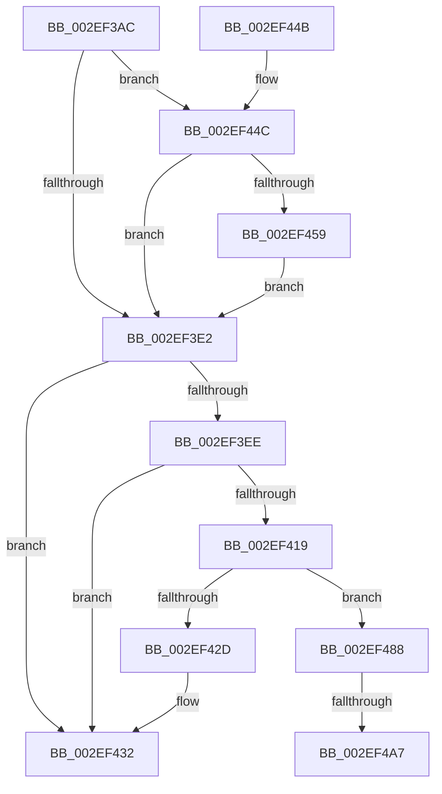

# ExInsertPoolTag

- RVA: `0x002EF3AC`–`0x002EF4AD` (길이 `257` bytes)
- VA: `0x00000001402EF3AC`
- 실행 섹션: `.text`
- PDB 이름 있음: `예`; PDB Function 태그: `예`
- unwind 정보 RVA: `0x00071AAC`
- 디코드: `73`개 명령, `257/257` bytes 표시
- 미해석 바이트: `0` (있으면 어셈블리에 `.byte`로 보존)

> 이 문서는 커널 이미지의 기계어와 PDB 기호를 분석해 생성했습니다. 4번과 5번은 함수 원형과 자료형을 바이너리 사용 방식에서 추정한 C 해석이며 원본 소스 복구 결과는 아닙니다.

## 1. Dependencies

- 직접 호출 지점: **3**; 고유 호출 대상: **3**
- 직접 호출자로 확인된 함수: **1**
- RIP 상대 이미지 참조: **1**

### Outgoing calls
- `0x002EF410` → [ExpAddTagForBigPages](ExpAddTagForBigPages_function_002EF570.md) (function, `0x002EF570`)
- `0x002EF424` → [ExpInsertPoolTracker](ExpInsertPoolTracker_function_002EEFAC.md) (function, `0x002EEFAC`)
- `0x002EF47E` → [memset](../6C/memset_function_006C6C40.md) (function, `0x006C6C40`)

### Direct callers
- [MiAllocateContiguousMemory](../3E/MiAllocateContiguousMemory_function_003E9FDC.md) at `0x003EA4AF`

### Static image references
- `0x002EF488` → RVA `0x00FC514C` (`ALMOSTRO`; read)

## 2. Other-region calls and transfers

- 다른 실행 섹션으로 향하는 call: **0**
- call이 아닌 외부 분기/꼬리 이동: **2**
  - `0x002EF4A1` → [sub_006DED54](../6D/Unknown_function_006DED54.md) (`tail-transfer`)
  - `0x002EF4A8` → [sub_006DED54](../6D/Unknown_function_006DED54.md) (`tail-transfer`)

## 3. Assembly (complete function range)

```asm
002EF3AC  48 89 5C 24 08                  mov qword ptr [rsp + 8], rbx
002EF3B1  48 89 6C 24 10                  mov qword ptr [rsp + 0x10], rbp
002EF3B6  4C 89 4C 24 20                  mov qword ptr [rsp + 0x20], r9
002EF3BB  56                              push rsi
002EF3BC  57                              push rdi
002EF3BD  41 54                           push r12
002EF3BF  41 56                           push r14
002EF3C1  41 57                           push r15
002EF3C3  48 83 EC 30                     sub rsp, 0x30
002EF3C7  33 FF                           xor edi, edi
002EF3C9  8B E9                           mov ebp, ecx
002EF3CB  F6 84 24 80 00 00 00 01         test byte ptr [rsp + 0x80], 1
002EF3D3  4D 8B F0                        mov r14, r8
002EF3D6  4C 8B FA                        mov r15, rdx
002EF3D9  40 8A DF                        mov bl, dil
002EF3DC  44 0F B7 E7                     movzx r12d, di
002EF3E0  75 6A                           jne 0x1402ef44c
002EF3E2  49 8D B6 FF 0F 00 00            lea rsi, [r14 + 0xfff]
002EF3E9  4C 3B F6                        cmp r14, rsi
002EF3EC  73 44                           jae 0x1402ef432
002EF3EE  48 81 E6 00 F0 FF FF            and rsi, 0xfffffffffffff000
002EF3F5  88 5C 24 28                     mov byte ptr [rsp + 0x28], bl
002EF3F9  41 BE 88 00 00 00               mov r14d, 0x88
002EF3FF  66 44 89 64 24 20               mov word ptr [rsp + 0x20], r12w
002EF405  45 8B CE                        mov r9d, r14d
002EF408  4C 8B C6                        mov r8, rsi
002EF40B  8B D5                           mov edx, ebp
002EF40D  49 8B CF                        mov rcx, r15
002EF410  E8 5B 01 00 00                  call 0x1402ef570
002EF415  85 C0                           test eax, eax
002EF417  74 19                           je 0x1402ef432
002EF419  4D 8B CF                        mov r9, r15
002EF41C  45 8B C6                        mov r8d, r14d
002EF41F  48 8B D6                        mov rdx, rsi
002EF422  8B CD                           mov ecx, ebp
002EF424  E8 83 FB FF FF                  call 0x1402eefac
002EF429  85 C0                           test eax, eax
002EF42B  74 5B                           je 0x1402ef488
002EF42D  BF 01 00 00 00                  mov edi, 1
002EF432  48 8B 5C 24 60                  mov rbx, qword ptr [rsp + 0x60]
002EF437  8B C7                           mov eax, edi
002EF439  48 8B 6C 24 68                  mov rbp, qword ptr [rsp + 0x68]
002EF43E  48 83 C4 30                     add rsp, 0x30
002EF442  41 5F                           pop r15
002EF444  41 5E                           pop r14
002EF446  41 5C                           pop r12
002EF448  5F                              pop rdi
002EF449  5E                              pop rsi
002EF44A  C3                              ret
002EF44B  CC                              int3
002EF44C  4A 8D 0C 02                     lea rcx, [rdx + r8]
002EF450  BA FF 0F 00 00                  mov edx, 0xfff
002EF455  85 CA                           test edx, ecx
002EF457  74 89                           je 0x1402ef3e2
002EF459  44 8D 62 01                     lea r12d, [rdx + 1]
002EF45D  0F B7 C1                        movzx eax, cx
002EF460  66 23 C2                        and ax, dx
002EF463  48 BB 20 03 00 00 80 F7 FF FF   movabs rbx, 0xfffff78000000320
002EF46D  66 44 2B E0                     sub r12w, ax
002EF471  45 0F B7 C4                     movzx r8d, r12w
002EF475  48 8B 1B                        mov rbx, qword ptr [rbx]
002EF478  80 CB 01                        or bl, 1
002EF47B  0F B6 D3                        movzx edx, bl
002EF47E  E8 BD 77 3D 00                  call 0x1406c6c40
002EF483  E9 5A FF FF FF                  jmp 0x1402ef3e2
002EF488  8B 05 BE 5C CD 00               mov eax, dword ptr [rip + 0xcd5cbe]
002EF48E  89 7C 24 70                     mov dword ptr [rsp + 0x70], edi
002EF492  40 88 BC 24 80 00 00 00         mov byte ptr [rsp + 0x80], dil
002EF49A  40 88 7C 24 78                  mov byte ptr [rsp + 0x78], dil
002EF49F  3B E8                           cmp ebp, eax
002EF4A1  0F 85 AD F8 3E 00               jne 0x1406ded54
002EF4A7  CC                              int3
002EF4A8  E9 A7 F8 3E 00                  jmp 0x1406ded54
```

## 4. C-style interpretation (structured pseudocode)

```c
__int64 __fastcall ExInsertPoolTag(int a1, __int64 a2, __int64 a3, __int64 a4, unsigned __int8 a5)
{
    __int64 result;
    __int64 v_r12;
    __int64 v_rbx;
    __int64 v_rdi;
    __int64 v_rsi;
    __int64 v_rsp;
    unsigned __int8 v_stack_m30;
    unsigned __int16 v_stack_m38;
    unsigned __int64 v_stack_p10;
    unsigned __int64 v_stack_p20;
    unsigned int v_stack_p70;
    unsigned __int8 v_stack_p78;
    unsigned __int64 v_stack_p8;
    unsigned __int8 v_stack_p80;

    v_stack_p8 = v_rbx;
    v_stack_p10 = v_rbp;
    v_stack_p20 = a4;
    v_rsp = (v_rsp) - (48);
    v_rdi = 0;
    if (((a5) & (1)) != 0) goto loc_002EF44C;
loc_002EF3E2:
    if (a3 >= (a3 + 4095)) goto loc_002EF432;
    v_rsi = (a3 + 4095) & (0xFFFFFFFFFFFFF000ULL);
    v_stack_m30 = 0;
    v_stack_m38 = 0;
    result = ExpAddTagForBigPages(a2, (unsigned int)((unsigned int)((unsigned int)(a1))), v_rsi, 136);
    if ((unsigned int)(result) == 0) goto loc_002EF432;
    result = ExpInsertPoolTracker((unsigned int)((unsigned int)((unsigned int)(a1))), v_rsi, 136, a2);
    if ((unsigned int)(result) == 0) goto loc_002EF488;
loc_002EF432:
    v_rsp = (v_rsp) + (48);
    return 1;
loc_002EF44C:
    if ((((unsigned int)((unsigned int)(0xFFFULL))) & ((unsigned int)(v_rsi + 136 * 1))) == 0) goto loc_002EF3E2;
    result = (unsigned __int16)(((unsigned __int16)(v_rsi + 136 * 1)) & ((unsigned __int16)((unsigned int)(0xFFFULL))));
    v_r12 = (unsigned __int16)(((unsigned int)(0xFFFULL) + 1) - ((unsigned __int16)(result)));
    v_rbx = (unsigned __int8)((*(unsigned __int64 *)(v_stack_p8)) | (1));
    result = memset(v_rsi + 136 * 1, (unsigned __int8)(v_rbx), (unsigned __int16)(v_r12), a2);
    goto loc_002EF3E2;
loc_002EF488:
    v_stack_p70 = 1;
    v_stack_p80 = 1;
    v_stack_p78 = 1;
}
```

## 5. (Beta) C Style

```c
int64_t ExInsertPoolTag(int32_t Arg1, void *Arg2, void *Arg3, int64_t Arg4, uint8_t Arg5)
{
    uint8_t *arg2 = (uint8_t *)Arg2;
    uint8_t *arg3 = (uint8_t *)Arg3;

    int64_t result;
    int64_t local_r12;
    int64_t local_rbx;
    int64_t local_rdi;
    int64_t local_rsi;
    int64_t local_rsp;
    uint8_t v_stack_m30;
    uint16_t v_stack_m38;
    uint64_t v_stack_p10;
    uint64_t v_stack_p20;
    uint32_t v_stack_p70;
    uint8_t v_stack_p78;
    uint64_t v_stack_p8;
    uint8_t v_stack_p80;

    v_stack_p8 = local_rbx;
    v_stack_p10 = local_rbp;
    v_stack_p20 = Arg4;
    local_rsp = (local_rsp) - (48);
    local_rdi = 0;
    if (((Arg5) & (1)) != 0) goto loc_002EF44C;
loc_002EF3E2:
    if (Arg3 >= (Arg3 + 4095)) goto loc_002EF432;
    local_rsi = (Arg3 + 4095) & (0xFFFFFFFFFFFFF000ULL);
    v_stack_m30 = 0;
    v_stack_m38 = 0;
    result = ExpAddTagForBigPages(Arg2, (uint32_t)((uint32_t)((uint32_t)(Arg1))), local_rsi, 136);
    if ((uint32_t)(result) == 0) goto loc_002EF432;
    result = ExpInsertPoolTracker((uint32_t)((uint32_t)((uint32_t)(Arg1))), local_rsi, 136, Arg2);
    if ((uint32_t)(result) == 0) goto loc_002EF488;
loc_002EF432:
    local_rsp = (local_rsp) + (48);
    return 1;
loc_002EF44C:
    if ((((uint32_t)((uint32_t)(0xFFFULL))) & ((uint32_t)(local_rsi + 136 * 1))) == 0) goto loc_002EF3E2;
    result = (uint16_t)(((uint16_t)(local_rsi + 136 * 1)) & ((uint16_t)((uint32_t)(0xFFFULL))));
    local_r12 = (uint16_t)(((uint32_t)(0xFFFULL) + 1) - ((uint16_t)(result)));
    local_rbx = (uint8_t)((*(uint64_t *)(v_stack_p8)) | (1));
    result = memset(local_rsi + 136 * 1, (uint8_t)(local_rbx), (uint16_t)(local_r12), Arg2);
    goto loc_002EF3E2;
loc_002EF488:
    v_stack_p70 = 1;
    v_stack_p80 = 1;
    v_stack_p78 = 1;
}
```

### 관측된 메모리 오프셋

구조체 형식이 확인되지 않은 접근은 인자 기준의 오프셋으로만 기록했습니다.

| 기준 인자 | 오프셋 표현 | 폭 (bit) | 접근 |
|---|---:|---:|---|
| `Arg2` | `+ 0x0 + r8*1` | `64` | `R` |
| `Arg3` | `+ 0xFFF` | `64` | `R` |

## 6. Execution-region graph

[열기: 2D/3D 그래프와 함수 탐색 컨트롤 패널](../../../control-panel.html?section=text&rva=0x002EF3AC&view=graph)

- 2D 그래프는 위에서 아래로 흐르고, 3D 그래프는 빈 공간을 드래그해 회전합니다. Shift+드래그는 이동, 휠은 확대·축소, 함수 노드 선택은 대상 보고서 이동입니다.

### Static fallback


