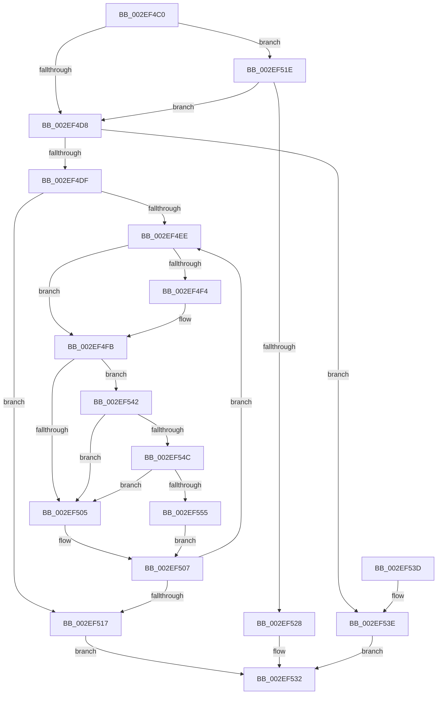

# ExTryConvertSharedSpinLockExclusive

- RVA: `0x002EF4C0`–`0x002EF55E` (길이 `158` bytes)
- VA: `0x00000001402EF4C0`
- 실행 섹션: `.text`
- PDB 이름 있음: `예`; PDB Function 태그: `아니요`
- unwind 정보 RVA: `0x0005D368`
- 디코드: `49`개 명령, `158/158` bytes 표시
- 미해석 바이트: `0` (있으면 어셈블리에 `.byte`로 보존)

> 이 문서는 커널 이미지의 기계어와 PDB 기호를 분석해 생성했습니다. 4번과 5번은 함수 원형과 자료형을 바이너리 사용 방식에서 추정한 C 해석이며 원본 소스 복구 결과는 아닙니다.

## 1. Dependencies

- 직접 호출 지점: **3**; 고유 호출 대상: **3**
- 직접 호출자로 확인된 함수: **4**
- RIP 상대 이미지 참조: **4**

### Outgoing calls
- `0x002EF52D` → [ExpTryConvertSharedSpinLockExclusiveInstrumented](ExpTryConvertSharedSpinLockExclusiveInstrumented_function_002EF988.md) (function, `0x002EF988`)
- `0x002EF54C` → [KiCheckVpBackingLongSpinWaitHypercall](../30/KiCheckVpBackingLongSpinWaitHypercall_function_0030F490.md) (function, `0x0030F490`)
- `0x002EF557` → [HvlNotifyLongSpinWait](../30/HvlNotifyLongSpinWait_function_0030F460.md) (function, `0x0030F460`)

### Direct callers
- [sub_002215AA](../22/Unknown_function_002215AA.md) at `0x00221627`
- [sub_00248B10](../24/Unknown_function_00248B10.md) at `0x00248D2F`
- [sub_00248B10](../24/Unknown_function_00248B10.md) at `0x00248DD4`
- [ExpAddTagForBigPages](ExpAddTagForBigPages_function_002EF570.md) at `0x002EF8BF`
- [ViDeadlockDetectionTryConvertSharedToExclusive](../61/ViDeadlockDetectionTryConvertSharedToExclusive_function_00615F98.md) at `0x00615FA3`

### Static image references
- `0x002EF4CF` → RVA `0x00FC6B06` (`ALMOSTRO`; read)
- `0x002EF4FD` → RVA `0x00FC52AC` (`ALMOSTRO`; reference)
- `0x002EF51E` → RVA `0x00F0DE58` (`.data`; read)
- `0x002EF542` → RVA `0x00FC6AB8` (`ALMOSTRO`; read)

## 2. Other-region calls and transfers

- 다른 실행 섹션으로 향하는 call: **0**
- 별도 외부 분기/꼬리 이동을 확인하지 못했습니다.

## 3. Assembly (complete function range)

```asm
002EF4C0  48 89 5C 24 08                  mov qword ptr [rsp + 8], rbx
002EF4C5  57                              push rdi
002EF4C6  48 83 EC 20                     sub rsp, 0x20
002EF4CA  33 FF                           xor edi, edi
002EF4CC  48 8B D9                        mov rbx, rcx
002EF4CF  F6 05 30 76 CD 00 21            test byte ptr [rip + 0xcd7630], 0x21
002EF4D6  75 46                           jne 0x1402ef51e
002EF4D8  F0 0F BA 29 1F                  lock bts dword ptr [rcx], 0x1f
002EF4DD  72 5F                           jb 0x1402ef53e
002EF4DF  8B 11                           mov edx, dword ptr [rcx]
002EF4E1  8B C2                           mov eax, edx
002EF4E3  0F BA F0 1E                     btr eax, 0x1e
002EF4E7  3D 01 00 00 80                  cmp eax, 0x80000001
002EF4EC  74 29                           je 0x1402ef517
002EF4EE  0F BA E2 1E                     bt edx, 0x1e
002EF4F2  72 07                           jb 0x1402ef4fb
002EF4F4  F0 81 0B 00 00 00 40            lock or dword ptr [rbx], 0x40000000
002EF4FB  FF C7                           inc edi
002EF4FD  85 3D A9 5D CD 00               test dword ptr [rip + 0xcd5da9], edi
002EF503  74 3D                           je 0x1402ef542
002EF505  F3 90                           pause
002EF507  8B 13                           mov edx, dword ptr [rbx]
002EF509  8B CA                           mov ecx, edx
002EF50B  0F BA F1 1E                     btr ecx, 0x1e
002EF50F  81 F9 01 00 00 80               cmp ecx, 0x80000001
002EF515  75 D7                           jne 0x1402ef4ee
002EF517  B8 01 00 00 00                  mov eax, 1
002EF51C  EB 14                           jmp 0x1402ef532
002EF51E  8B 05 34 E9 C1 00               mov eax, dword ptr [rip + 0xc1e934]
002EF524  85 C0                           test eax, eax
002EF526  75 B0                           jne 0x1402ef4d8
002EF528  48 8B 54 24 28                  mov rdx, qword ptr [rsp + 0x28]
002EF52D  E8 56 04 00 00                  call 0x1402ef988
002EF532  48 8B 5C 24 30                  mov rbx, qword ptr [rsp + 0x30]
002EF537  48 83 C4 20                     add rsp, 0x20
002EF53B  5F                              pop rdi
002EF53C  C3                              ret
002EF53D  CC                              int3
002EF53E  33 C0                           xor eax, eax
002EF540  EB F0                           jmp 0x1402ef532
002EF542  8B 05 70 75 CD 00               mov eax, dword ptr [rip + 0xcd7570]
002EF548  A8 40                           test al, 0x40
002EF54A  74 B9                           je 0x1402ef505
002EF54C  E8 3F FF 01 00                  call 0x14030f490
002EF551  84 C0                           test al, al
002EF553  74 B0                           je 0x1402ef505
002EF555  8B CF                           mov ecx, edi
002EF557  E8 04 FF 01 00                  call 0x14030f460
002EF55C  EB A9                           jmp 0x1402ef507
```

## 4. C-style interpretation (structured pseudocode)

```c
__int64 __fastcall ExTryConvertSharedSpinLockExclusive(__int64 a1)
{
    __int64 result;
    __int64 v_rdi;
    __int64 v_rsp;
    unsigned __int64 v_stack_p0;
    unsigned __int64 v_stack_p8;

    v_stack_p8 = v_rbx;
    v_rsp = (v_rsp) - (32);
    v_rdi = 0;
    if (((*(unsigned __int8 *)(v_rip + 13465136)) & (33)) != 0) goto loc_002EF51E;
loc_002EF4D8:
    if (condition_is_below) goto loc_002EF53E;
    if (((unsigned int)((unsigned int)((unsigned int)((unsigned int)(*(unsigned int *)(a1)))))) == 0x80000001ULL) goto loc_002EF517;
loc_002EF4EE:
    if (((unsigned int)((unsigned int)((unsigned int)((unsigned int)(*(unsigned int *)(a1)))))) >= 0x80000001ULL) {
    }
    v_rdi = (unsigned int)((v_rdi) + 1);
    if (((*(unsigned int *)(v_rip + 13458857)) & ((unsigned int)(v_rdi))) == 0) goto loc_002EF542;
loc_002EF505:
loc_002EF507:
    if (((unsigned int)((unsigned int)((unsigned int)((unsigned int)(*(unsigned int *)(a1)))))) != 0x80000001ULL) goto loc_002EF4EE;
loc_002EF517:
    goto loc_002EF532;
loc_002EF51E:
    if ((unsigned int)((unsigned int)(*(unsigned int *)(v_rip + 12708148))) != 0) goto loc_002EF4D8;
    result = ExpTryConvertSharedSpinLockExclusiveInstrumented((unsigned int)((unsigned int)((unsigned int)(*(unsigned int *)(a1)))), v_stack_p0, a3, a4);
loc_002EF532:
    v_rsp = (v_rsp) + (32);
    return result;
loc_002EF53E:
    result = 0;
    goto loc_002EF532;
loc_002EF542:
    if ((((unsigned __int8)((unsigned int)(*(unsigned int *)(v_rip + 13464944)))) & (64)) == 0) goto loc_002EF505;
    result = KiCheckVpBackingLongSpinWaitHypercall((unsigned int)((unsigned int)((unsigned int)(*(unsigned int *)(a1)))), v_stack_p0, a3, a4);
    if ((unsigned __int8)(result) == 0) goto loc_002EF505;
    result = HvlNotifyLongSpinWait((unsigned int)((unsigned int)(v_rdi)), v_stack_p0, a3, a4);
    goto loc_002EF507;
}
```

## 5. (Beta) C Style

```c
int64_t ExTryConvertSharedSpinLockExclusive(void *Arg1)
{
    uint8_t *arg1 = (uint8_t *)Arg1;

    int64_t result;
    int64_t local_rdi;
    int64_t local_rsp;
    uint64_t v_stack_p0;
    uint64_t v_stack_p8;

    v_stack_p8 = local_rbx;
    local_rsp = (local_rsp) - (32);
    local_rdi = 0;
    if (((*(uint8_t *)(v_rip + 0xCD7630)) & (33)) != 0) goto loc_002EF51E;
loc_002EF4D8:
    if (condition_is_below) goto loc_002EF53E;
    if (((uint32_t)((uint32_t)((uint32_t)((uint32_t)(*(uint32_t *)(arg1)))))) == 0x80000001ULL) goto loc_002EF517;
loc_002EF4EE:
    if (((uint32_t)((uint32_t)((uint32_t)((uint32_t)(*(uint32_t *)(arg1)))))) >= 0x80000001ULL) {
    }
    local_rdi = (uint32_t)((local_rdi) + 1);
    if (((*(uint32_t *)(v_rip + 0xCD5DA9)) & ((uint32_t)(local_rdi))) == 0) goto loc_002EF542;
loc_002EF505:
loc_002EF507:
    if (((uint32_t)((uint32_t)((uint32_t)((uint32_t)(*(uint32_t *)(arg1)))))) != 0x80000001ULL) goto loc_002EF4EE;
loc_002EF517:
    goto loc_002EF532;
loc_002EF51E:
    if ((uint32_t)((uint32_t)(*(uint32_t *)(v_rip + 0xC1E934))) != 0) goto loc_002EF4D8;
    result = ExpTryConvertSharedSpinLockExclusiveInstrumented((uint32_t)((uint32_t)((uint32_t)(*(uint32_t *)(arg1)))), v_stack_p0, a3, a4);
loc_002EF532:
    local_rsp = (local_rsp) + (32);
    return result;
loc_002EF53E:
    result = 0;
    goto loc_002EF532;
loc_002EF542:
    if ((((uint8_t)((uint32_t)(*(uint32_t *)(v_rip + 0xCD7570)))) & (64)) == 0) goto loc_002EF505;
    result = KiCheckVpBackingLongSpinWaitHypercall((uint32_t)((uint32_t)((uint32_t)(*(uint32_t *)(arg1)))), v_stack_p0, a3, a4);
    if ((uint8_t)(result) == 0) goto loc_002EF505;
    result = HvlNotifyLongSpinWait((uint32_t)((uint32_t)(local_rdi)), v_stack_p0, a3, a4);
    goto loc_002EF507;
}
```

### 관측된 메모리 오프셋

구조체 형식이 확인되지 않은 접근은 인자 기준의 오프셋으로만 기록했습니다.

| 기준 인자 | 오프셋 표현 | 폭 (bit) | 접근 |
|---|---:|---:|---|
| `Arg1` | `+ 0x0` | `32` | `R` |
| `Arg1` | `+ 0x0` | `32` | `R/W` |

## 6. Execution-region graph

[열기: 2D/3D 그래프와 함수 탐색 컨트롤 패널](../../../control-panel.html?section=text&rva=0x002EF4C0&view=graph)

- 2D 그래프는 위에서 아래로 흐르고, 3D 그래프는 빈 공간을 드래그해 회전합니다. Shift+드래그는 이동, 휠은 확대·축소, 함수 노드 선택은 대상 보고서 이동입니다.

### Static fallback


