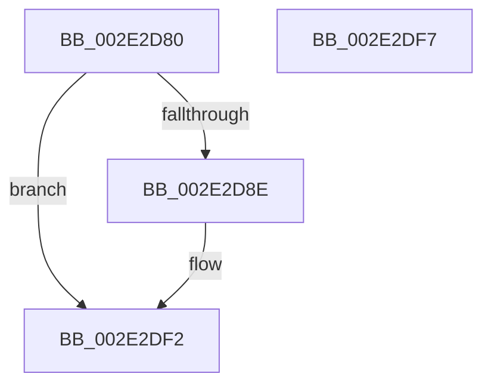

# ExpCleanupAutoExpandPushLock

- RVA: `0x002E2D80`–`0x002E2DF8` (길이 `120` bytes)
- VA: `0x00000001402E2D80`
- 실행 섹션: `.text`
- PDB 이름 있음: `예`; PDB Function 태그: `아니요`
- unwind 정보 RVA: `0x0005C788`
- 디코드: `28`개 명령, `120/120` bytes 표시
- 미해석 바이트: `0` (있으면 어셈블리에 `.byte`로 보존)

> 이 문서는 커널 이미지의 기계어와 PDB 기호를 분석해 생성했습니다. 4번과 5번은 함수 원형과 자료형을 바이너리 사용 방식에서 추정한 C 해석이며 원본 소스 복구 결과는 아닙니다.

## 1. Dependencies

- 직접 호출 지점: **2**; 고유 호출 대상: **2**
- 직접 호출자로 확인된 함수: **1**
- RIP 상대 이미지 참조: **1**

### Outgoing calls
- `0x002E2DE8` → [ExpSaAllocatorFree](ExpSaAllocatorFree_function_002E2E00.md) (function, `0x002E2E00`)
- `0x002E2DED` → [KeLeaveGuardedRegion](KeLeaveGuardedRegion_function_002E2C40.md) (function, `0x002E2C40`)

### Direct callers
- [ExFreeAutoExpandPushLock](../58/ExFreeAutoExpandPushLock_function_00581620.md) at `0x00581629`

### Static image references
- `0x002E2DA3` → RVA `0x00EFA280` (`.data`; read)

## 2. Other-region calls and transfers

- 다른 실행 섹션으로 향하는 call: **0**
- 별도 외부 분기/꼬리 이동을 확인하지 못했습니다.

## 3. Assembly (complete function range)

```asm
002E2D80  48 83 EC 28                     sub rsp, 0x28
002E2D84  44 8B 41 08                     mov r8d, dword ptr [rcx + 8]
002E2D88  41 F6 C0 01                     test r8b, 1
002E2D8C  74 64                           je 0x1402e2df2
002E2D8E  B8 F8 FF FF FF                  mov eax, 0xfffffff8
002E2D93  C7 44 24 30 00 00 00 00         mov dword ptr [rsp + 0x30], 0
002E2D9B  4C 23 C0                        and r8, rax
002E2D9E  BA 01 00 00 00                  mov edx, 1
002E2DA3  48 8B 05 D6 74 C1 00            mov rax, qword ptr [rip + 0xc174d6]
002E2DAA  45 8B C8                        mov r9d, r8d
002E2DAD  41 C1 E9 0D                     shr r9d, 0xd
002E2DB1  41 81 E1 FF FF 03 00            and r9d, 0x3ffff
002E2DB8  41 0F BD C9                     bsr ecx, r9d
002E2DBC  D3 E2                           shl edx, cl
002E2DBE  83 C1 FE                        add ecx, -2
002E2DC1  49 33 D1                        xor rdx, r9
002E2DC4  41 B9 02 00 00 00               mov r9d, 2
002E2DCA  48 8B 0C C8                     mov rcx, qword ptr [rax + rcx*8]
002E2DCE  65 48 8B 04 25 88 01 00 00      mov rax, qword ptr gs:[0x188]
002E2DD7  48 8B 54 D1 08                  mov rdx, qword ptr [rcx + rdx*8 + 8]
002E2DDC  48 8B 4A 10                     mov rcx, qword ptr [rdx + 0x10]
002E2DE0  66 FF 88 E6 01 00 00            dec word ptr [rax + 0x1e6]
002E2DE7  90                              nop
002E2DE8  E8 13 00 00 00                  call 0x1402e2e00
002E2DED  E8 4E FE FF FF                  call 0x1402e2c40
002E2DF2  48 83 C4 28                     add rsp, 0x28
002E2DF6  C3                              ret
002E2DF7  CC                              int3
```

## 4. C-style interpretation (structured pseudocode)

```c
__int64 __fastcall ExpCleanupAutoExpandPushLock(__int64 a1)
{
    __int64 result;
    __int64 v_rsp;
    unsigned int v_stack_p8;

    v_rsp = (v_rsp) - (40);
    if ((((unsigned __int8)((unsigned int)(*(unsigned int *)(a1 + 8)))) & (1)) != 0) {
        result = 0xFFFFFFF8ULL;
        v_stack_p8 = 0;
        a3 = ((unsigned int)(*(unsigned int *)(a1 + 8))) & (result);
        a2 = 1;
        result = *(unsigned __int64 *)(v_rip + 12678358);
        a4 = (unsigned int)(a3);
        a4 = (unsigned int)((a4) >> (13));
        a4 = (unsigned int)((a4) & (0x3FFFFULL));
        a2 = (unsigned int)((a2) << ((unsigned __int8)(a1)));
        a1 = (unsigned int)((a1) + (-2));
        a2 = (a2) ^ (a4);
        a4 = 2;
        a1 = *(unsigned __int64 *)(result + a1 * 8);
        result = *(unsigned __int64 *)(gs_base + (0 + 392));
        a2 = *(unsigned __int64 *)(a1 + a2 * 8 + 8);
        a1 = *(unsigned __int64 *)(a2 + 16);
        result = ExpSaAllocatorFree(a1, a2, a3, a4);
        result = KeLeaveGuardedRegion(a1, a2, a3, a4);
    }
    v_rsp = (v_rsp) + (40);
    return result;
}
```

## 5. (Beta) C Style

```c
int64_t ExpCleanupAutoExpandPushLock(void *Arg1)
{
    uint8_t *arg1 = (uint8_t *)Arg1;

    int64_t result;
    int64_t local_rsp;
    uint32_t v_stack_p8;

    local_rsp = (local_rsp) - (40);
    if ((((uint8_t)((uint32_t)(*(uint32_t *)(arg1 + 0x8)))) & (1)) != 0) {
        result = 0xFFFFFFF8ULL;
        v_stack_p8 = 0;
        a3 = ((uint32_t)(*(uint32_t *)(arg1 + 0x8))) & (result);
        a2 = 1;
        result = *(uint64_t *)(v_rip + 0xC174D6);
        a4 = (uint32_t)(a3);
        a4 = (uint32_t)((a4) >> (13));
        a4 = (uint32_t)((a4) & (0x3FFFFULL));
        a2 = (uint32_t)((a2) << ((uint8_t)(Arg1)));
        Arg1 = (uint32_t)((Arg1) + (-2));
        a2 = (a2) ^ (a4);
        a4 = 2;
        Arg1 = *(uint64_t *)(result + arg1 * 8);
        result = *(uint64_t *)(gs_base + (0 + 0x188));
        a2 = *(uint64_t *)(arg1 + a2 * 8 + 0x8);
        Arg1 = *(uint64_t *)(a2 + 0x10);
        result = ExpSaAllocatorFree(Arg1, a2, a3, a4);
        result = KeLeaveGuardedRegion(Arg1, a2, a3, a4);
    }
    local_rsp = (local_rsp) + (40);
    return result;
}
```

### 관측된 메모리 오프셋

구조체 형식이 확인되지 않은 접근은 인자 기준의 오프셋으로만 기록했습니다.

| 기준 인자 | 오프셋 표현 | 폭 (bit) | 접근 |
|---|---:|---:|---|
| `Arg1` | `+ 0x8` | `32` | `R` |

## 6. Execution-region graph

[열기: 2D/3D 그래프와 함수 탐색 컨트롤 패널](../../../control-panel.html?section=text&rva=0x002E2D80&view=graph)

- 2D 그래프는 위에서 아래로 흐르고, 3D 그래프는 빈 공간을 드래그해 회전합니다. Shift+드래그는 이동, 휠은 확대·축소, 함수 노드 선택은 대상 보고서 이동입니다.

### Static fallback


