# ExpFreeHeapSpecialPool

- RVA: `0x002EE600`–`0x002EE957` (길이 `855` bytes)
- VA: `0x00000001402EE600`
- 실행 섹션: `.text`
- PDB 이름 있음: `예`; PDB Function 태그: `아니요`
- unwind 정보 RVA: `0x000719E0`
- 디코드: `219`개 명령, `855/855` bytes 표시
- 미해석 바이트: `0` (있으면 어셈블리에 `.byte`로 보존)

> 이 문서는 커널 이미지의 기계어와 PDB 기호를 분석해 생성했습니다. 4번과 5번은 함수 원형과 자료형을 바이너리 사용 방식에서 추정한 C 해석이며 원본 소스 복구 결과는 아닙니다.

## 1. Dependencies

- 직접 호출 지점: **15**; 고유 호출 대상: **10**
- 직접 호출자로 확인된 함수: **1**
- RIP 상대 이미지 참조: **7**

### Outgoing calls
- `0x002EE619` → [MmDeterminePoolType](../35/MmDeterminePoolType_function_0035F5B0.md) (function, `0x0035F5B0`)
- `0x002EE65C` → [ExpFreePoolChecks](../35/ExpFreePoolChecks_function_0035F4F0.md) (function, `0x0035F4F0`)
- `0x002EE693` → [KeBugCheckEx](../4F/KeBugCheckEx_function_004FD660.md) (function, `0x004FD660`)
- `0x002EE6C6` → [KeBugCheckEx](../4F/KeBugCheckEx_function_004FD660.md) (function, `0x004FD660`)
- `0x002EE71E` → [ViFreeTrackedPool](../../pagevrfy/BB/ViFreeTrackedPool_function_00BB8FC0.md) (function, `0x00BB8FC0`)
- `0x002EE7B7` → [ExpRemovePoolTrackerExpansion](../36/ExpRemovePoolTrackerExpansion_function_00361300.md) (function, `0x00361300`)
- `0x002EE7C2` → [RtlpHpFreeHeap](../35/RtlpHpFreeHeap_function_0035F600.md) (function, `0x0035F600`)
- `0x002EE7F9` → [KeBugCheckEx](../4F/KeBugCheckEx_function_004FD660.md) (function, `0x004FD660`)
- `0x002EE81F` → [KeBugCheckEx](../4F/KeBugCheckEx_function_004FD660.md) (function, `0x004FD660`)
- `0x002EE833` → [ExpPoolTrackerReturnLimit](../36/ExpPoolTrackerReturnLimit_function_00361570.md) (function, `0x00361570`)
- `0x002EE895` → [KeBugCheckEx](../4F/KeBugCheckEx_function_004FD660.md) (function, `0x004FD660`)
- `0x002EE8B7` → [ExpPoolFlagsToPoolType](../../poolcode/B8/ExpPoolFlagsToPoolType_function_00B84080.md) (function, `0x00B84080`)
- `0x002EE8E6` → [EtwTracePool](EtwTracePool_function_002ECEEC.md) (function, `0x002ECEEC`)
- `0x002EE917` → [KeBugCheckEx](../4F/KeBugCheckEx_function_004FD660.md) (function, `0x004FD660`)
- `0x002EE93D` → [memset](../6C/memset_function_006C6C40.md) (function, `0x006C6C40`)

### Direct callers
- [ExAllocateHeapPool](../35/ExAllocateHeapPool_function_0035BA30.md) at `0x0035EF00`

### Static image references
- `0x002EE62B` → RVA `0x00FCEC68` (`ALMOSTRO`; read)
- `0x002EE72B` → RVA `0x00FC514C` (`ALMOSTRO`; read)
- `0x002EE740` → RVA `0x00FC6B04` (`ALMOSTRO`; read)
- `0x002EE756` → RVA `0x00EFAD20` (`.data`; read)
- `0x002EE75D` → RVA `0x00EFED58` (`.data`; read)
- `0x002EE83A` → RVA `0x00EFED60` (`.data`; read)
- `0x002EE936` → RVA `0x00FC6ED8` (`ALMOSTRO`; read)

## 2. Other-region calls and transfers

- 다른 실행 섹션으로 향하는 call: **2**
  - `0x002EE71E` → [ViFreeTrackedPool](../../pagevrfy/BB/ViFreeTrackedPool_function_00BB8FC0.md) (`.text` → `PAGEVRFY`)
  - `0x002EE8B7` → [ExpPoolFlagsToPoolType](../../poolcode/B8/ExpPoolFlagsToPoolType_function_00B84080.md) (`.text` → `POOLCODE`)
- 별도 외부 분기/꼬리 이동을 확인하지 못했습니다.

## 3. Assembly (complete function range)

```asm
002EE600  48 89 5C 24 08                  mov qword ptr [rsp + 8], rbx
002EE605  55                              push rbp
002EE606  56                              push rsi
002EE607  57                              push rdi
002EE608  41 56                           push r14
002EE60A  41 57                           push r15
002EE60C  48 83 EC 30                     sub rsp, 0x30
002EE610  4C 8B F9                        mov r15, rcx
002EE613  48 8B FA                        mov rdi, rdx
002EE616  48 8B CA                        mov rcx, rdx
002EE619  E8 92 0F 07 00                  call 0x14035f5b0
002EE61E  48 8B DA                        mov rbx, rdx
002EE621  48 8B F0                        mov rsi, rax
002EE624  48 81 E3 00 F0 FF FF            and rbx, 0xfffffffffffff000
002EE62B  80 3D 36 06 CE 00 00            cmp byte ptr [rip + 0xce0636], 0
002EE632  0F 85 37 02 00 00               jne 0x1402ee86f
002EE638  8B 53 04                        mov edx, dword ptr [rbx + 4]
002EE63B  8B C7                           mov eax, edi
002EE63D  25 FF 0F 00 00                  and eax, 0xfff
002EE642  48 89 7C 24 20                  mov qword ptr [rsp + 0x20], rdi
002EE647  B9 00 10 00 00                  mov ecx, 0x1000
002EE64C  41 B9 80 00 00 00               mov r9d, 0x80
002EE652  2B C8                           sub ecx, eax
002EE654  8B E9                           mov ebp, ecx
002EE656  44 8B C1                        mov r8d, ecx
002EE659  48 8B CF                        mov rcx, rdi
002EE65C  E8 8F 0E 07 00                  call 0x14035f4f0
002EE661  4C 8B DE                        mov r11, rsi
002EE664  41 B8 00 01 00 00               mov r8d, 0x100
002EE66A  4D 23 D8                        and r11, r8
002EE66D  44 0F 20 C2                     mov rdx, cr8
002EE671  49 8B C3                        mov rax, r11
002EE674  48 F7 D8                        neg rax
002EE677  1A C9                           sbb cl, cl
002EE679  80 C1 02                        add cl, 2
002EE67C  3A D1                           cmp dl, cl
002EE67E  76 19                           jbe 0x1402ee699
002EE680  0F B6 D2                        movzx edx, dl
002EE683  41 8D 48 C1                     lea ecx, [r8 - 0x3f]
002EE687  4C 8B CF                        mov r9, rdi
002EE68A  48 C7 44 24 20 31 00 00 00      mov qword ptr [rsp + 0x20], 0x31
002EE693  E8 C8 EF 20 00                  call 0x1404fd660
002EE698  CC                              int3
002EE699  0F B7 13                        movzx edx, word ptr [rbx]
002EE69C  81 E2 FF 1F 00 00               and edx, 0x1fff
002EE6A2  4C 8D 72 0F                     lea r14, [rdx + 0xf]
002EE6A6  49 83 E6 F0                     and r14, 0xfffffffffffffff0
002EE6AA  4C 3B F5                        cmp r14, rbp
002EE6AD  74 1D                           je 0x1402ee6cc
002EE6AF  44 8B C2                        mov r8d, edx
002EE6B2  48 C7 44 24 20 21 00 00 00      mov qword ptr [rsp + 0x20], 0x21
002EE6BB  48 8B D7                        mov rdx, rdi
002EE6BE  4C 8B CD                        mov r9, rbp
002EE6C1  B9 C1 00 00 00                  mov ecx, 0xc1
002EE6C6  E8 95 EF 20 00                  call 0x1404fd660
002EE6CB  CC                              int3
002EE6CC  8B 0B                           mov ecx, dword ptr [rbx]
002EE6CE  4C 8D 43 10                     lea r8, [rbx + 0x10]
002EE6D2  44 8B D1                        mov r10d, ecx
002EE6D5  41 81 E2 00 40 00 00            and r10d, 0x4000
002EE6DC  74 04                           je 0x1402ee6e2
002EE6DE  4C 8D 43 18                     lea r8, [rbx + 0x18]
002EE6E2  4C 3B C7                        cmp r8, rdi
002EE6E5  0F 82 EE 00 00 00               jb 0x1402ee7d9
002EE6EB  4C 8D 8F FF 0F 00 00            lea r9, [rdi + 0xfff]
002EE6F2  49 81 E1 00 F0 FF FF            and r9, 0xfffffffffffff000
002EE6F9  4C 8D 04 3A                     lea r8, [rdx + rdi]
002EE6FD  4D 3B C1                        cmp r8, r9
002EE700  0F 82 F9 00 00 00               jb 0x1402ee7ff
002EE706  45 85 D2                        test r10d, r10d
002EE709  74 18                           je 0x1402ee723
002EE70B  45 33 C0                        xor r8d, r8d
002EE70E  41 B9 01 00 00 00               mov r9d, 1
002EE714  4D 85 DB                        test r11, r11
002EE717  48 8B CF                        mov rcx, rdi
002EE71A  41 0F 95 C0                     setne r8b
002EE71E  E8 9D A8 8C 00                  call 0x140bb8fc0
002EE723  8B 6B 04                        mov ebp, dword ptr [rbx + 4]
002EE726  83 64 24 78 00                  and dword ptr [rsp + 0x78], 0
002EE72B  8B 05 1B 6A CD 00               mov eax, dword ptr [rip + 0xcd6a1b]
002EE731  C6 44 24 68 00                  mov byte ptr [rsp + 0x68], 0
002EE736  C6 44 24 70 00                  mov byte ptr [rsp + 0x70], 0
002EE73B  3B E8                           cmp ebp, eax
002EE73D  75 01                           jne 0x1402ee740
002EE73F  CC                              int3
002EE740  8B 05 BE 83 CD 00               mov eax, dword ptr [rip + 0xcd83be]
002EE746  A8 41                           test al, 0x41
002EE748  0F 85 4D 01 00 00               jne 0x1402ee89b
002EE74E  65 8B 04 25 A4 01 00 00         mov eax, dword ptr gs:[0x1a4]
002EE756  48 8D 3D C3 C5 C0 00            lea rdi, [rip + 0xc0c5c3]
002EE75D  4C 8B 15 F4 05 C1 00            mov r10, qword ptr [rip + 0xc105f4]
002EE764  48 83 E6 FB                     and rsi, 0xfffffffffffffffb
002EE768  48 69 CD 5F 9E 00 00            imul rcx, rbp, 0x9e5f
002EE76F  48 8B 3C C7                     mov rdi, qword ptr [rdi + rax*8]
002EE773  48 8B D1                        mov rdx, rcx
002EE776  48 C1 EA 20                     shr rdx, 0x20
002EE77A  33 D1                           xor edx, ecx
002EE77C  41 23 D2                        and edx, r10d
002EE77F  44 8B DA                        mov r11d, edx
002EE782  8B C2                           mov eax, edx
002EE784  48 8D 0C 80                     lea rcx, [rax + rax*4]
002EE788  48 03 C9                        add rcx, rcx
002EE78B  4C 8D 04 CF                     lea r8, [rdi + rcx*8]
002EE78F  41 8B 00                        mov eax, dword ptr [r8]
002EE792  3B C5                           cmp eax, ebp
002EE794  0F 84 8B 00 00 00               je 0x1402ee825
002EE79A  85 C0                           test eax, eax
002EE79C  0F 84 98 00 00 00               je 0x1402ee83a
002EE7A2  8D 42 01                        lea eax, [rdx + 1]
002EE7A5  41 23 C2                        and eax, r10d
002EE7A8  8B D0                           mov edx, eax
002EE7AA  41 3B C3                        cmp eax, r11d
002EE7AD  75 D3                           jne 0x1402ee782
002EE7AF  4C 8B C6                        mov r8, rsi
002EE7B2  49 8B D6                        mov rdx, r14
002EE7B5  8B CD                           mov ecx, ebp
002EE7B7  E8 44 2B 07 00                  call 0x140361300
002EE7BC  48 8B D3                        mov rdx, rbx
002EE7BF  49 8B CF                        mov rcx, r15
002EE7C2  E8 39 0E 07 00                  call 0x14035f600
002EE7C7  48 8B 5C 24 60                  mov rbx, qword ptr [rsp + 0x60]
002EE7CC  48 83 C4 30                     add rsp, 0x30
002EE7D0  41 5F                           pop r15
002EE7D2  41 5E                           pop r14
002EE7D4  5F                              pop rdi
002EE7D5  5E                              pop rsi
002EE7D6  5D                              pop rbp
002EE7D7  C3                              ret
002EE7D8  CC                              int3
002EE7D9  8A 43 02                        mov al, byte ptr [rbx + 2]
002EE7DC  41 38 00                        cmp byte ptr [r8], al
002EE7DF  0F 84 62 01 00 00               je 0x1402ee947
002EE7E5  4C 8B C9                        mov r9, rcx
002EE7E8  48 C7 44 24 20 23 00 00 00      mov qword ptr [rsp + 0x20], 0x23
002EE7F1  B9 C1 00 00 00                  mov ecx, 0xc1
002EE7F6  48 8B D7                        mov rdx, rdi
002EE7F9  E8 62 EE 20 00                  call 0x1404fd660
002EE7FE  CC                              int3
002EE7FF  8A 43 02                        mov al, byte ptr [rbx + 2]
002EE802  41 38 00                        cmp byte ptr [r8], al
002EE805  0F 84 44 01 00 00               je 0x1402ee94f
002EE80B  4C 8B C9                        mov r9, rcx
002EE80E  48 C7 44 24 20 24 00 00 00      mov qword ptr [rsp + 0x20], 0x24
002EE817  B9 C1 00 00 00                  mov ecx, 0xc1
002EE81C  48 8B D7                        mov rdx, rdi
002EE81F  E8 3C EE 20 00                  call 0x1404fd660
002EE824  CC                              int3
002EE825  48 C1 EE 08                     shr rsi, 8
002EE829  49 8B D6                        mov rdx, r14
002EE82C  F7 D6                           not esi
002EE82E  83 E6 01                        and esi, 1
002EE831  8B CE                           mov ecx, esi
002EE833  E8 38 2D 07 00                  call 0x140361570
002EE838  EB 82                           jmp 0x1402ee7bc
002EE83A  48 8B 05 1F 05 C1 00            mov rax, qword ptr [rip + 0xc1051f]
002EE841  44 8B 0C C8                     mov r9d, dword ptr [rax + rcx*8]
002EE845  45 85 C9                        test r9d, r9d
002EE848  0F 84 54 FF FF FF               je 0x1402ee7a2
002EE84E  45 89 08                        mov dword ptr [r8], r9d
002EE851  48 8B 05 08 05 C1 00            mov rax, qword ptr [rip + 0xc10508]
002EE858  4C 8B 4C C8 48                  mov r9, qword ptr [rax + rcx*8 + 0x48]
002EE85D  4D 85 C9                        test r9, r9
002EE860  0F 84 1C FF FF FF               je 0x1402ee782
002EE866  4D 89 48 48                     mov qword ptr [r8 + 0x48], r9
002EE86A  E9 13 FF FF FF                  jmp 0x1402ee782
002EE86F  48 B8 00 00 00 00 00 80 FF FF   movabs rax, 0xffff800000000000
002EE879  48 3B D8                        cmp rbx, rax
002EE87C  73 72                           jae 0x1402ee8f0
002EE87E  48 83 64 24 20 00               and qword ptr [rsp + 0x20], 0
002EE884  BA 02 00 00 00                  mov edx, 2
002EE889  4C 8B CB                        mov r9, rbx
002EE88C  B9 F1 01 00 00                  mov ecx, 0x1f1
002EE891  44 8D 42 FF                     lea r8d, [rdx - 1]
002EE895  E8 C6 ED 20 00                  call 0x1404fd660
002EE89A  CC                              int3
002EE89B  8B D6                           mov edx, esi
002EE89D  48 8D 44 24 70                  lea rax, [rsp + 0x70]
002EE8A2  83 E2 10                        and edx, 0x10
002EE8A5  48 89 44 24 20                  mov qword ptr [rsp + 0x20], rax
002EE8AA  4C 8D 4C 24 68                  lea r9, [rsp + 0x68]
002EE8AF  48 8B CE                        mov rcx, rsi
002EE8B2  4C 8D 44 24 78                  lea r8, [rsp + 0x78]
002EE8B7  E8 C4 57 89 00                  call 0x140b84080
002EE8BC  85 C0                           test eax, eax
002EE8BE  0F 88 8A FE FF FF               js 0x1402ee74e
002EE8C4  80 7C 24 68 00                  cmp byte ptr [rsp + 0x68], 0
002EE8C9  8B 54 24 78                     mov edx, dword ptr [rsp + 0x78]
002EE8CD  74 07                           je 0x1402ee8d6
002EE8CF  83 CA 08                        or edx, 8
002EE8D2  89 54 24 78                     mov dword ptr [rsp + 0x78], edx
002EE8D6  B9 22 0E 00 00                  mov ecx, 0xe22
002EE8DB  4C 89 74 24 20                  mov qword ptr [rsp + 0x20], r14
002EE8E0  4C 8B CF                        mov r9, rdi
002EE8E3  44 8B C5                        mov r8d, ebp
002EE8E6  E8 01 E6 FF FF                  call 0x1402eceec
002EE8EB  E9 5E FE FF FF                  jmp 0x1402ee74e
002EE8F0  48 8D 83 00 10 00 00            lea rax, [rbx + 0x1000]
002EE8F7  48 3B C3                        cmp rax, rbx
002EE8FA  73 21                           jae 0x1402ee91d
002EE8FC  B9 00 10 00 00                  mov ecx, 0x1000
002EE901  BA 02 00 00 00                  mov edx, 2
002EE906  48 89 4C 24 20                  mov qword ptr [rsp + 0x20], rcx
002EE90B  4C 8B CB                        mov r9, rbx
002EE90E  B9 F1 01 00 00                  mov ecx, 0x1f1
002EE913  44 8D 42 01                     lea r8d, [rdx + 1]
002EE917  E8 44 ED 20 00                  call 0x1404fd660
002EE91C  CC                              int3
002EE91D  48 B9 00 00 00 00 00 80 00 00   movabs rcx, 0x800000000000
002EE927  33 D2                           xor edx, edx
002EE929  48 03 CB                        add rcx, rbx
002EE92C  41 B8 00 02 00 00               mov r8d, 0x200
002EE932  48 C1 E9 03                     shr rcx, 3
002EE936  48 03 0D 9B 85 CD 00            add rcx, qword ptr [rip + 0xcd859b]
002EE93D  E8 FE 82 3D 00                  call 0x1406c6c40
002EE942  E9 F1 FC FF FF                  jmp 0x1402ee638
002EE947  49 FF C0                        inc r8
002EE94A  E9 93 FD FF FF                  jmp 0x1402ee6e2
002EE94F  49 FF C0                        inc r8
002EE952  E9 A6 FD FF FF                  jmp 0x1402ee6fd
```

## 4. C-style interpretation (structured pseudocode)

```c
__int64 __fastcall ExpFreeHeapSpecialPool(__int64 a1, __int64 a2)
{
    __int64 result;
    __int64 v_r10;
    __int64 v_r11;
    __int64 v_r14;
    __int64 v_rbx;
    __int64 v_rsi;
    __int64 v_rsp;
    unsigned __int64 v_stack_m38;
    unsigned __int8 v_stack_p10;
    unsigned __int8 v_stack_p18;
    unsigned int v_stack_p20;
    unsigned __int64 v_stack_p68;
    unsigned __int64 v_stack_p70;
    unsigned __int64 v_stack_p78;
    unsigned __int64 v_stack_p8;

    v_stack_p8 = v_rbx;
    v_rsp = (v_rsp) - (48);
    result = MmDeterminePoolType(a2, a2, a3, a4);
    v_rbx = (a2) & (0xFFFFFFFFFFFFF000ULL);
    if ((*(unsigned __int8 *)(v_rip + 13502006)) != 0) goto loc_002EE86F;
loc_002EE638:
    result = (unsigned int)(((unsigned int)((unsigned int)(a2))) & (0xFFFULL));
    v_stack_m38 = a2;
    a1 = (unsigned int)(((unsigned int)(0x1000ULL)) - ((unsigned int)(result)));
    result = ExpFreePoolChecks(a2, (unsigned int)(*(unsigned int *)(v_rbx + 4)), (unsigned int)((unsigned int)(a1)), 128);
    v_r11 = (result) & (256);
    result = -(v_r11);
    a1 = (unsigned __int8)((a2) + (2));
    if (((unsigned __int8)(v_cr8)) >= = ((unsigned __int8)(a1))) {
        a2 = (unsigned __int8)(v_cr8);
        a1 = 256 - 63;
        a4 = a2;
        v_stack_m38 = 49;
        result = KeBugCheckEx(a1, a2, 256, a4);
    }
    a2 = (unsigned int)((*(unsigned __int16 *)(v_rbx)) & (0x1FFFULL));
    v_r14 = (a2 + 15) & (-16);
    if (v_r14 != ((unsigned int)((unsigned int)(a1)))) {
        a3 = (unsigned int)(a2);
        v_stack_m38 = 33;
        a2 = a2;
        a4 = (unsigned int)((unsigned int)(a1));
        a1 = 193;
        result = KeBugCheckEx(a1, a2, a3, a4);
    }
    v_r10 = (unsigned int)(((unsigned int)((unsigned int)((unsigned int)(*(unsigned int *)(v_rbx))))) & (0x4000ULL));
    if (!(condition_is_equal)) {
        a3 = v_rbx + 24;
    }
    if (a3 < a2) goto loc_002EE7D9;
    a4 = (a2 + 4095) & (0xFFFFFFFFFFFFF000ULL);
loc_002EE6FD:
    if ((a2 + a2 * 1) < a4) goto loc_002EE7FF;
    if ((unsigned int)(v_r10) != 0) {
        a3 = 0;
        a4 = 1;
        a1 = a2;
        a3 = (v_r11 != 0) ? 1 : 0;
        result = ViFreeTrackedPool(a1, a2, a3, a4);
    }
    v_stack_p10 = 0;
    v_stack_p18 = 0;
    if (((unsigned int)((unsigned int)(*(unsigned int *)(v_rbx + 4)))) == ((unsigned int)((unsigned int)(*(unsigned int *)(v_rip + 13462043))))) {
    }
    if ((((unsigned __int8)((unsigned int)(*(unsigned int *)(v_rip + 13468606)))) & (65)) != 0) goto loc_002EE89B;
loc_002EE74E:
    v_rsi = (result) & (-5);
    a1 = (a1) * ((unsigned int)(*(unsigned int *)(v_rbx + 4)));
    a2 = (a1) >> (32);
    a2 = (unsigned int)((a2) ^ ((unsigned int)(a1)));
    a2 = (unsigned int)((a2) & ((unsigned int)(*(unsigned __int64 *)(v_rip + 12649972))));
loc_002EE782:
    a1 = ((unsigned int)((unsigned int)(a2)) + (unsigned int)((unsigned int)(a2)) * 4) + ((unsigned int)((unsigned int)(a2)) + (unsigned int)((unsigned int)(a2)) * 4);
    if (((unsigned int)((unsigned int)(*(unsigned int *)(*(unsigned __int64 *)(v_rip + 12633539 + (unsigned int)(*(unsigned int *)(gs_base + (0 + 420))) * 8) + a1 * 8)))) == ((unsigned int)((unsigned int)(*(unsigned int *)(v_rbx + 4))))) goto loc_002EE825;
    if ((unsigned int)((unsigned int)(*(unsigned int *)(*(unsigned __int64 *)(v_rip + 12633539 + (unsigned int)(*(unsigned int *)(gs_base + (0 + 420))) * 8) + a1 * 8))) == 0) goto loc_002EE83A;
loc_002EE7A2:
    result = (unsigned int)((a2 + 1) & ((unsigned int)(*(unsigned __int64 *)(v_rip + 12649972))));
    if (((unsigned int)(result)) != ((unsigned int)((unsigned int)((unsigned int)(a2))))) goto loc_002EE782;
    result = ExpRemovePoolTrackerExpansion((unsigned int)((unsigned int)((unsigned int)(*(unsigned int *)(v_rbx + 4)))), v_r14, v_rsi, a4);
loc_002EE7BC:
    result = RtlpHpFreeHeap(a1, v_rbx, v_rsi, a4);
    v_rsp = (v_rsp) + (48);
    return result;
loc_002EE7D9:
    if ((*(unsigned __int8 *)(v_rsi)) == ((unsigned __int8)(*(unsigned __int8 *)(v_stack_p8 + 2)))) goto loc_002EE947;
    v_stack_p20 = 35;
    result = KeBugCheckEx(193, *(unsigned __int64 *)(v_rip + 12633539 + (unsigned int)(*(unsigned int *)(gs_base + (0 + 420))) * 8), v_rsi, a1);
loc_002EE7FF:
    if ((*(unsigned __int8 *)(v_rsi)) == ((unsigned __int8)(*(unsigned __int8 *)(v_stack_p8 + 2)))) goto loc_002EE94F;
    v_stack_p20 = 36;
    result = KeBugCheckEx(193, *(unsigned __int64 *)(v_rip + 12633539 + (unsigned int)(*(unsigned int *)(gs_base + (0 + 420))) * 8), v_rsi, 193);
loc_002EE825:
    v_rsi = (v_rsi) >> (8);
    v_rsi = (unsigned int)(~(v_rsi));
    v_rsi = (unsigned int)((v_rsi) & (1));
    result = ExpPoolTrackerReturnLimit((unsigned int)((unsigned int)(v_rsi)), v_r14, v_rsi, 193);
    goto loc_002EE7BC;
loc_002EE83A:
    if ((unsigned int)((unsigned int)(*(unsigned int *)(*(unsigned __int64 *)(v_rip + 12649759) + (unsigned int)((unsigned int)(v_rsi)) * 8))) == 0) goto loc_002EE7A2;
    *(unsigned int *)(v_rsi) = (unsigned int)((unsigned int)(*(unsigned int *)(*(unsigned __int64 *)(v_rip + 12649759) + (unsigned int)((unsigned int)(v_rsi)) * 8)));
    if (*(unsigned __int64 *)(*(unsigned __int64 *)(v_rip + 12649736) + (unsigned int)((unsigned int)(v_rsi)) * 8 + 72) == 0) goto loc_002EE782;
    *(unsigned __int64 *)(v_rsi + 72) = *(unsigned __int64 *)(*(unsigned __int64 *)(v_rip + 12649736) + (unsigned int)((unsigned int)(v_rsi)) * 8 + 72);
    goto loc_002EE782;
loc_002EE86F:
    if (v_stack_p8 >= (*(unsigned __int64 *)(v_rip + 12649736))) goto loc_002EE8F0;
    result = KeBugCheckEx(497, 2, 2 - 1, v_stack_p8);
loc_002EE89B:
    a2 = (unsigned int)(((unsigned int)((unsigned int)(v_rsi))) & (16));
    v_stack_p20 = v_stack_p70;
    result = ExpPoolFlagsToPoolType(v_rsi, a2, v_stack_p78, v_stack_p68);
    if (sign_flag) goto loc_002EE74E;
    if (v_stack_p68 != 0) {
        a2 = (unsigned int)(((unsigned int)(v_stack_p78)) | (8));
        v_stack_p78 = (unsigned int)(a2);
    }
    v_stack_p20 = v_r14;
    result = EtwTracePool((unsigned int)(0xE22ULL), a2, (unsigned int)((unsigned int)((unsigned int)(*(unsigned int *)(v_rbx + 4)))), *(unsigned __int64 *)(v_rip + 12633539 + (unsigned int)(*(unsigned int *)(gs_base + (0 + 420))) * 8));
    goto loc_002EE74E;
loc_002EE8F0:
    result = v_stack_p8 + 4096;
    if ((v_stack_p8 + 4096) < v_stack_p8) {
        a1 = 0x1000ULL;
        a2 = 2;
        v_stack_p20 = a1;
        a4 = v_stack_p8;
        a1 = 497;
        a3 = a2 + 1;
        result = KeBugCheckEx(a1, a2, a3, a4);
    }
    a2 = 0;
    a1 = (a1) + (v_stack_p8);
    a1 = (a1) >> (3);
    a1 = (a1) + (*(unsigned __int64 *)(v_rip + 13469083));
    result = memset(a1, a2, 512, a4);
    goto loc_002EE638;
loc_002EE947:
    a3 = (512) + 1;
    goto loc_002EE6E2;
loc_002EE94F:
    a3 = (a3) + 1;
    goto loc_002EE6FD;
}
```

## 5. (Beta) C Style

```c
int64_t ExpFreeHeapSpecialPool(int64_t Arg1, void *Arg2)
{
    uint8_t *arg2 = (uint8_t *)Arg2;

    int64_t result;
    int64_t local_r10;
    int64_t local_r11;
    int64_t local_r14;
    int64_t local_rbx;
    int64_t local_rsi;
    int64_t local_rsp;
    uint64_t v_stack_m38;
    uint8_t v_stack_p10;
    uint8_t v_stack_p18;
    uint32_t v_stack_p20;
    uint64_t v_stack_p68;
    uint64_t v_stack_p70;
    uint64_t v_stack_p78;
    uint64_t v_stack_p8;

    v_stack_p8 = local_rbx;
    local_rsp = (local_rsp) - (48);
    result = MmDeterminePoolType(Arg2, Arg2, a3, a4);
    local_rbx = (Arg2) & (0xFFFFFFFFFFFFF000ULL);
    if ((*(uint8_t *)(v_rip + 0xCE0636)) != 0) goto loc_002EE86F;
loc_002EE638:
    result = (uint32_t)(((uint32_t)((uint32_t)(Arg2))) & (0xFFFULL));
    v_stack_m38 = Arg2;
    Arg1 = (uint32_t)(((uint32_t)(0x1000ULL)) - ((uint32_t)(result)));
    result = ExpFreePoolChecks(Arg2, (uint32_t)(*(uint32_t *)(local_rbx + 0x4)), (uint32_t)((uint32_t)(Arg1)), 128);
    local_r11 = (result) & (256);
    result = -(local_r11);
    Arg1 = (uint8_t)((Arg2) + (2));
    if (((uint8_t)(v_cr8)) >= = ((uint8_t)(Arg1))) {
        Arg2 = (uint8_t)(v_cr8);
        Arg1 = 256 - 63;
        a4 = Arg2;
        v_stack_m38 = 49;
        result = KeBugCheckEx(Arg1, Arg2, 256, a4);
    }
    Arg2 = (uint32_t)((*(uint16_t *)(local_rbx)) & (0x1FFFULL));
    local_r14 = (Arg2 + 15) & (-16);
    if (local_r14 != ((uint32_t)((uint32_t)(Arg1)))) {
        a3 = (uint32_t)(Arg2);
        v_stack_m38 = 33;
        Arg2 = Arg2;
        a4 = (uint32_t)((uint32_t)(Arg1));
        Arg1 = 193;
        result = KeBugCheckEx(Arg1, Arg2, a3, a4);
    }
    local_r10 = (uint32_t)(((uint32_t)((uint32_t)((uint32_t)(*(uint32_t *)(local_rbx))))) & (0x4000ULL));
    if (!(condition_is_equal)) {
        a3 = local_rbx + 24;
    }
    if (a3 < Arg2) goto loc_002EE7D9;
    a4 = (Arg2 + 4095) & (0xFFFFFFFFFFFFF000ULL);
loc_002EE6FD:
    if ((Arg2 + Arg2 * 1) < a4) goto loc_002EE7FF;
    if ((uint32_t)(local_r10) != 0) {
        a3 = 0;
        a4 = 1;
        Arg1 = Arg2;
        a3 = (local_r11 != 0) ? 1 : 0;
        result = ViFreeTrackedPool(Arg1, Arg2, a3, a4);
    }
    v_stack_p10 = 0;
    v_stack_p18 = 0;
    if (((uint32_t)((uint32_t)(*(uint32_t *)(local_rbx + 0x4)))) == ((uint32_t)((uint32_t)(*(uint32_t *)(v_rip + 0xCD6A1B))))) {
    }
    if ((((uint8_t)((uint32_t)(*(uint32_t *)(v_rip + 0xCD83BE)))) & (65)) != 0) goto loc_002EE89B;
loc_002EE74E:
    local_rsi = (result) & (-5);
    Arg1 = (Arg1) * ((uint32_t)(*(uint32_t *)(local_rbx + 0x4)));
    Arg2 = (Arg1) >> (32);
    Arg2 = (uint32_t)((Arg2) ^ ((uint32_t)(Arg1)));
    Arg2 = (uint32_t)((Arg2) & ((uint32_t)(*(uint64_t *)(v_rip + 0xC105F4))));
loc_002EE782:
    Arg1 = ((uint32_t)((uint32_t)(Arg2)) + (uint32_t)((uint32_t)(Arg2)) * 4) + ((uint32_t)((uint32_t)(Arg2)) + (uint32_t)((uint32_t)(Arg2)) * 4);
    if (((uint32_t)((uint32_t)(*(uint32_t *)(*(uint64_t *)(v_rip + 0xC0C5C3 + (uint32_t)(*(uint32_t *)(gs_base + (0 + 0x1A4))) * 8) + Arg1 * 8)))) == ((uint32_t)((uint32_t)(*(uint32_t *)(local_rbx + 0x4))))) goto loc_002EE825;
    if ((uint32_t)((uint32_t)(*(uint32_t *)(*(uint64_t *)(v_rip + 0xC0C5C3 + (uint32_t)(*(uint32_t *)(gs_base + (0 + 0x1A4))) * 8) + Arg1 * 8))) == 0) goto loc_002EE83A;
loc_002EE7A2:
    result = (uint32_t)((Arg2 + 1) & ((uint32_t)(*(uint64_t *)(v_rip + 0xC105F4))));
    if (((uint32_t)(result)) != ((uint32_t)((uint32_t)((uint32_t)(Arg2))))) goto loc_002EE782;
    result = ExpRemovePoolTrackerExpansion((uint32_t)((uint32_t)((uint32_t)(*(uint32_t *)(local_rbx + 0x4)))), local_r14, local_rsi, a4);
loc_002EE7BC:
    result = RtlpHpFreeHeap(Arg1, local_rbx, local_rsi, a4);
    local_rsp = (local_rsp) + (48);
    return result;
loc_002EE7D9:
    if ((*(uint8_t *)(local_rsi)) == ((uint8_t)(*(uint8_t *)(v_stack_p8 + 0x2)))) goto loc_002EE947;
    v_stack_p20 = 35;
    result = KeBugCheckEx(193, *(uint64_t *)(v_rip + 0xC0C5C3 + (uint32_t)(*(uint32_t *)(gs_base + (0 + 0x1A4))) * 8), local_rsi, Arg1);
loc_002EE7FF:
    if ((*(uint8_t *)(local_rsi)) == ((uint8_t)(*(uint8_t *)(v_stack_p8 + 0x2)))) goto loc_002EE94F;
    v_stack_p20 = 36;
    result = KeBugCheckEx(193, *(uint64_t *)(v_rip + 0xC0C5C3 + (uint32_t)(*(uint32_t *)(gs_base + (0 + 0x1A4))) * 8), local_rsi, 193);
loc_002EE825:
    local_rsi = (local_rsi) >> (8);
    local_rsi = (uint32_t)(~(local_rsi));
    local_rsi = (uint32_t)((local_rsi) & (1));
    result = ExpPoolTrackerReturnLimit((uint32_t)((uint32_t)(local_rsi)), local_r14, local_rsi, 193);
    goto loc_002EE7BC;
loc_002EE83A:
    if ((uint32_t)((uint32_t)(*(uint32_t *)(*(uint64_t *)(v_rip + 0xC1051F) + (uint32_t)((uint32_t)(local_rsi)) * 8))) == 0) goto loc_002EE7A2;
    *(uint32_t *)(local_rsi) = (uint32_t)((uint32_t)(*(uint32_t *)(*(uint64_t *)(v_rip + 0xC1051F) + (uint32_t)((uint32_t)(local_rsi)) * 8)));
    if (*(uint64_t *)(*(uint64_t *)(v_rip + 0xC10508) + (uint32_t)((uint32_t)(local_rsi)) * 8 + 0x48) == 0) goto loc_002EE782;
    *(uint64_t *)(local_rsi + 0x48) = *(uint64_t *)(*(uint64_t *)(v_rip + 0xC10508) + (uint32_t)((uint32_t)(local_rsi)) * 8 + 0x48);
    goto loc_002EE782;
loc_002EE86F:
    if (v_stack_p8 >= (*(uint64_t *)(v_rip + 0xC10508))) goto loc_002EE8F0;
    result = KeBugCheckEx(497, 2, 2 - 1, v_stack_p8);
loc_002EE89B:
    Arg2 = (uint32_t)(((uint32_t)((uint32_t)(local_rsi))) & (16));
    v_stack_p20 = v_stack_p70;
    result = ExpPoolFlagsToPoolType(local_rsi, Arg2, v_stack_p78, v_stack_p68);
    if (sign_flag) goto loc_002EE74E;
    if (v_stack_p68 != 0) {
        Arg2 = (uint32_t)(((uint32_t)(v_stack_p78)) | (8));
        v_stack_p78 = (uint32_t)(Arg2);
    }
    v_stack_p20 = local_r14;
    result = EtwTracePool((uint32_t)(0xE22ULL), Arg2, (uint32_t)((uint32_t)((uint32_t)(*(uint32_t *)(local_rbx + 0x4)))), *(uint64_t *)(v_rip + 0xC0C5C3 + (uint32_t)(*(uint32_t *)(gs_base + (0 + 0x1A4))) * 8));
    goto loc_002EE74E;
loc_002EE8F0:
    result = v_stack_p8 + 4096;
    if ((v_stack_p8 + 4096) < v_stack_p8) {
        Arg1 = 0x1000ULL;
        Arg2 = 2;
        v_stack_p20 = Arg1;
        a4 = v_stack_p8;
        Arg1 = 497;
        a3 = Arg2 + 1;
        result = KeBugCheckEx(Arg1, Arg2, a3, a4);
    }
    Arg2 = 0;
    Arg1 = (Arg1) + (v_stack_p8);
    Arg1 = (Arg1) >> (3);
    Arg1 = (Arg1) + (*(uint64_t *)(v_rip + 0xCD859B));
    result = memset(Arg1, Arg2, 512, a4);
    goto loc_002EE638;
loc_002EE947:
    a3 = (512) + 1;
    goto loc_002EE6E2;
loc_002EE94F:
    a3 = (a3) + 1;
    goto loc_002EE6FD;
}
```

### 관측된 메모리 오프셋

구조체 형식이 확인되지 않은 접근은 인자 기준의 오프셋으로만 기록했습니다.

| 기준 인자 | 오프셋 표현 | 폭 (bit) | 접근 |
|---|---:|---:|---|
| `Arg2` | `+ 0xFFF` | `64` | `R` |

## 6. Execution-region graph

[열기: 2D/3D 그래프와 함수 탐색 컨트롤 패널](../../../control-panel.html?section=text&rva=0x002EE600&view=graph)

- 2D 그래프는 위에서 아래로 흐르고, 3D 그래프는 빈 공간을 드래그해 회전합니다. Shift+드래그는 이동, 휠은 확대·축소, 함수 노드 선택은 대상 보고서 이동입니다.

### Static fallback

```mermaid
flowchart TD
  bb_002EE600[BB_002EE600]
  bb_002EE638[BB_002EE638]
  bb_002EE680[BB_002EE680]
  bb_002EE699[BB_002EE699]
  bb_002EE6AF[BB_002EE6AF]
  bb_002EE6CC[BB_002EE6CC]
  bb_002EE6DE[BB_002EE6DE]
  bb_002EE6E2[BB_002EE6E2]
  bb_002EE6EB[BB_002EE6EB]
  bb_002EE6FD[BB_002EE6FD]
  bb_002EE706[BB_002EE706]
  bb_002EE70B[BB_002EE70B]
  bb_002EE723[BB_002EE723]
  bb_002EE73F[BB_002EE73F]
  bb_002EE740[BB_002EE740]
  bb_002EE74E[BB_002EE74E]
  bb_002EE782[BB_002EE782]
  bb_002EE79A[BB_002EE79A]
  bb_002EE7A2[BB_002EE7A2]
  bb_002EE7AF[BB_002EE7AF]
  bb_002EE7BC[BB_002EE7BC]
  bb_002EE7D8[BB_002EE7D8]
  bb_002EE7D9[BB_002EE7D9]
  bb_002EE7E5[BB_002EE7E5]
  bb_002EE7FF[BB_002EE7FF]
  bb_002EE80B[BB_002EE80B]
  bb_002EE825[BB_002EE825]
  bb_002EE83A[BB_002EE83A]
  bb_002EE84E[BB_002EE84E]
  bb_002EE866[BB_002EE866]
  bb_002EE86F[BB_002EE86F]
  bb_002EE87E[BB_002EE87E]
  bb_002EE89B[BB_002EE89B]
  bb_002EE8C4[BB_002EE8C4]
  bb_002EE8CF[BB_002EE8CF]
  bb_002EE8D6[BB_002EE8D6]
  bb_002EE8F0[BB_002EE8F0]
  bb_002EE8FC[BB_002EE8FC]
  bb_002EE91D[BB_002EE91D]
  bb_002EE947[BB_002EE947]
  bb_002EE94F[BB_002EE94F]
  bb_002EE600 -->|branch| bb_002EE86F
  bb_002EE600 -->|fallthrough| bb_002EE638
  bb_002EE638 -->|branch| bb_002EE699
  bb_002EE638 -->|fallthrough| bb_002EE680
  bb_002EE680 -->|flow| bb_002EE699
  bb_002EE699 -->|branch| bb_002EE6CC
  bb_002EE699 -->|fallthrough| bb_002EE6AF
  bb_002EE6AF -->|flow| bb_002EE6CC
  bb_002EE6CC -->|branch| bb_002EE6E2
  bb_002EE6CC -->|fallthrough| bb_002EE6DE
  bb_002EE6DE -->|flow| bb_002EE6E2
  bb_002EE6E2 -->|branch| bb_002EE7D9
  bb_002EE6E2 -->|fallthrough| bb_002EE6EB
  bb_002EE6EB -->|flow| bb_002EE6FD
  bb_002EE6FD -->|branch| bb_002EE7FF
  bb_002EE6FD -->|fallthrough| bb_002EE706
  bb_002EE706 -->|branch| bb_002EE723
  bb_002EE706 -->|fallthrough| bb_002EE70B
  bb_002EE70B -->|flow| bb_002EE723
  bb_002EE723 -->|branch| bb_002EE740
  bb_002EE723 -->|fallthrough| bb_002EE73F
  bb_002EE73F -->|flow| bb_002EE740
  bb_002EE740 -->|branch| bb_002EE89B
  bb_002EE740 -->|fallthrough| bb_002EE74E
  bb_002EE74E -->|flow| bb_002EE782
  bb_002EE782 -->|branch| bb_002EE825
  bb_002EE782 -->|fallthrough| bb_002EE79A
  bb_002EE79A -->|branch| bb_002EE83A
  bb_002EE79A -->|fallthrough| bb_002EE7A2
  bb_002EE7A2 -->|branch| bb_002EE782
  bb_002EE7A2 -->|fallthrough| bb_002EE7AF
  bb_002EE7AF -->|flow| bb_002EE7BC
  bb_002EE7D8 -->|flow| bb_002EE7D9
  bb_002EE7D9 -->|branch| bb_002EE947
  bb_002EE7D9 -->|fallthrough| bb_002EE7E5
  bb_002EE7E5 -->|flow| bb_002EE7FF
  bb_002EE7FF -->|branch| bb_002EE94F
  bb_002EE7FF -->|fallthrough| bb_002EE80B
  bb_002EE80B -->|flow| bb_002EE825
  bb_002EE825 -->|branch| bb_002EE7BC
  bb_002EE83A -->|branch| bb_002EE7A2
  bb_002EE83A -->|fallthrough| bb_002EE84E
  bb_002EE84E -->|branch| bb_002EE782
  bb_002EE84E -->|fallthrough| bb_002EE866
  bb_002EE866 -->|branch| bb_002EE782
  bb_002EE86F -->|branch| bb_002EE8F0
  bb_002EE86F -->|fallthrough| bb_002EE87E
  bb_002EE87E -->|flow| bb_002EE89B
  bb_002EE89B -->|branch| bb_002EE74E
  bb_002EE89B -->|fallthrough| bb_002EE8C4
  bb_002EE8C4 -->|branch| bb_002EE8D6
  bb_002EE8C4 -->|fallthrough| bb_002EE8CF
  bb_002EE8CF -->|flow| bb_002EE8D6
  bb_002EE8D6 -->|branch| bb_002EE74E
  bb_002EE8F0 -->|branch| bb_002EE91D
  bb_002EE8F0 -->|fallthrough| bb_002EE8FC
  bb_002EE8FC -->|flow| bb_002EE91D
  bb_002EE91D -->|branch| bb_002EE638
  bb_002EE947 -->|branch| bb_002EE6E2
  bb_002EE94F -->|branch| bb_002EE6FD
```


