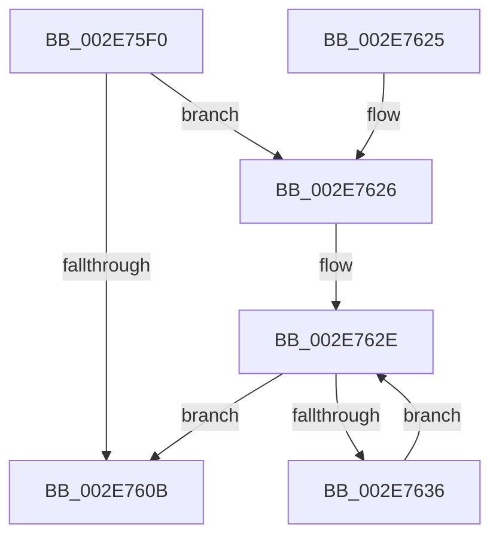

# ExpHpCompactHeapCallback

- RVA: `0x002E75F0`–`0x002E764E` (길이 `94` bytes)
- VA: `0x00000001402E75F0`
- 실행 섹션: `.text`
- PDB 이름 있음: `예`; PDB Function 태그: `아니요`
- unwind 정보 RVA: `0x0007132C`
- 디코드: `29`개 명령, `94/94` bytes 표시
- 미해석 바이트: `0` (있으면 어셈블리에 `.byte`로 보존)

> 이 문서는 커널 이미지의 기계어와 PDB 기호를 분석해 생성했습니다. 4번과 5번은 함수 원형과 자료형을 바이너리 사용 방식에서 추정한 C 해석이며 원본 소스 복구 결과는 아닙니다.

## 1. Dependencies

- 직접 호출 지점: **4**; 고유 호출 대상: **4**
- 직접 호출자로 확인된 함수: **0**
- RIP 상대 이미지 참조: **0**

### Outgoing calls
- `0x002E760E` → [RtlpHpHeapCompact](RtlpHpHeapCompact_function_002E7654.md) (function, `0x002E7654`)
- `0x002E7626` → [RtlpDynamicLookasideFlush](RtlpDynamicLookasideFlush_function_002E7C30.md) (function, `0x002E7C30`)
- `0x002E763C` → [ExGetHeapFromVA](../36/ExGetHeapFromVA_function_00361840.md) (function, `0x00361840`)
- `0x002E7647` → [RtlpHpFreeHeap](../35/RtlpHpFreeHeap_function_0035F600.md) (function, `0x0035F600`)

### Direct callers
- 이 함수 시작 RVA로 연결되는 직접 call은 확인되지 않았습니다. 간접 호출은 완전히 역산할 수 없습니다.

### Static image references
- 디코드된 RIP-relative 메모리 참조가 없습니다.

## 2. Other-region calls and transfers

- 다른 실행 섹션으로 향하는 call: **0**
- 별도 외부 분기/꼬리 이동을 확인하지 못했습니다.

## 3. Assembly (complete function range)

```asm
002E75F0  48 89 5C 24 08                  mov qword ptr [rsp + 8], rbx
002E75F5  48 89 74 24 10                  mov qword ptr [rsp + 0x10], rsi
002E75FA  57                              push rdi
002E75FB  48 83 EC 20                     sub rsp, 0x20
002E75FF  48 8B F9                        mov rdi, rcx
002E7602  48 8B 49 38                     mov rcx, qword ptr [rcx + 0x38]
002E7606  48 85 C9                        test rcx, rcx
002E7609  75 1B                           jne 0x1402e7626
002E760B  48 8B CF                        mov rcx, rdi
002E760E  E8 41 00 00 00                  call 0x1402e7654
002E7613  48 8B 5C 24 30                  mov rbx, qword ptr [rsp + 0x30]
002E7618  33 C0                           xor eax, eax
002E761A  48 8B 74 24 38                  mov rsi, qword ptr [rsp + 0x38]
002E761F  48 83 C4 20                     add rsp, 0x20
002E7623  5F                              pop rdi
002E7624  C3                              ret
002E7625  CC                              int3
002E7626  E8 05 06 00 00                  call 0x1402e7c30
002E762B  48 8B D8                        mov rbx, rax
002E762E  48 8B F3                        mov rsi, rbx
002E7631  48 85 DB                        test rbx, rbx
002E7634  74 D5                           je 0x1402e760b
002E7636  48 8B 1B                        mov rbx, qword ptr [rbx]
002E7639  48 8B CE                        mov rcx, rsi
002E763C  E8 FF A1 07 00                  call 0x140361840
002E7641  48 8B D6                        mov rdx, rsi
002E7644  48 8B C8                        mov rcx, rax
002E7647  E8 B4 7F 07 00                  call 0x14035f600
002E764C  EB E0                           jmp 0x1402e762e
```

## 4. C-style interpretation (structured pseudocode)

```c
__int64 __fastcall ExpHpCompactHeapCallback(__int64 a1)
{
    __int64 result;
    __int64 v_rsp;
    unsigned __int64 v_stack_p10;
    unsigned __int64 v_stack_p8;

    v_stack_p8 = v_rbx;
    v_stack_p10 = v_rsi;
    v_rsp = (v_rsp) - (32);
    if (*(unsigned __int64 *)(a1 + 56) != 0) goto loc_002E7626;
loc_002E760B:
    result = RtlpHpHeapCompact(a1, a2, a3, a4);
    result = 0;
    v_rsp = (v_rsp) + (32);
    return result;
loc_002E7626:
    result = RtlpDynamicLookasideFlush(a1, a2, a3, a4);
loc_002E762E:
    if (result == 0) goto loc_002E760B;
    result = ExGetHeapFromVA(result, a2, a3, a4);
    result = RtlpHpFreeHeap(result, result, a3, a4);
    goto loc_002E762E;
}
```

## 5. (Beta) C Style

```c
int64_t ExpHpCompactHeapCallback(void *Arg1)
{
    uint8_t *arg1 = (uint8_t *)Arg1;

    int64_t result;
    int64_t local_rsp;
    uint64_t v_stack_p10;
    uint64_t v_stack_p8;

    v_stack_p8 = local_rbx;
    v_stack_p10 = local_rsi;
    local_rsp = (local_rsp) - (32);
    if (*(uint64_t *)(arg1 + 0x38) != 0) goto loc_002E7626;
loc_002E760B:
    result = RtlpHpHeapCompact(Arg1, a2, a3, a4);
    result = 0;
    local_rsp = (local_rsp) + (32);
    return result;
loc_002E7626:
    result = RtlpDynamicLookasideFlush(Arg1, a2, a3, a4);
loc_002E762E:
    if (result == 0) goto loc_002E760B;
    result = ExGetHeapFromVA(result, a2, a3, a4);
    result = RtlpHpFreeHeap(result, result, a3, a4);
    goto loc_002E762E;
}
```

### 관측된 메모리 오프셋

구조체 형식이 확인되지 않은 접근은 인자 기준의 오프셋으로만 기록했습니다.

| 기준 인자 | 오프셋 표현 | 폭 (bit) | 접근 |
|---|---:|---:|---|
| `Arg1` | `+ 0x38` | `64` | `R` |

## 6. Execution-region graph

[열기: 2D/3D 그래프와 함수 탐색 컨트롤 패널](../../../control-panel.html?section=text&rva=0x002E75F0&view=graph)

- 2D 그래프는 위에서 아래로 흐르고, 3D 그래프는 빈 공간을 드래그해 회전합니다. Shift+드래그는 이동, 휠은 확대·축소, 함수 노드 선택은 대상 보고서 이동입니다.

### Static fallback


