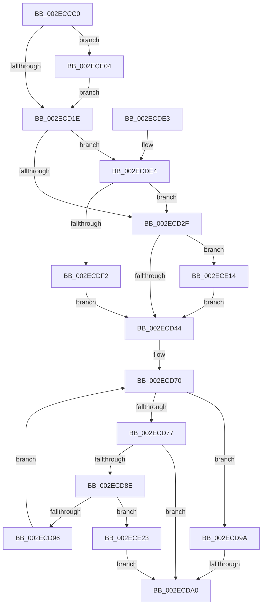

# ExpInsertPoolTrackerExpansion

- RVA: `0x002ECCC0`–`0x002ECE3A` (길이 `378` bytes)
- VA: `0x00000001402ECCC0`
- 실행 섹션: `.text`
- PDB 이름 있음: `예`; PDB Function 태그: `예`
- unwind 정보 RVA: `0x0007180C`
- 디코드: `96`개 명령, `378/378` bytes 표시
- 미해석 바이트: `0` (있으면 어셈블리에 `.byte`로 보존)

> 이 문서는 커널 이미지의 기계어와 PDB 기호를 분석해 생성했습니다. 4번과 5번은 함수 원형과 자료형을 바이너리 사용 방식에서 추정한 C 해석이며 원본 소스 복구 결과는 아닙니다.

## 1. Dependencies

- 직접 호출 지점: **6**; 고유 호출 대상: **6**
- 직접 호출자로 확인된 함수: **4**
- RIP 상대 이미지 참조: **9**

### Outgoing calls
- `0x002ECDBC` → [ExpPoolTrackerChargeEntry](../35/ExpPoolTrackerChargeEntry_function_0035B810.md) (function, `0x0035B810`)
- `0x002ECDC6` → [KeReleaseInStackQueuedSpinLock](../34/KeReleaseInStackQueuedSpinLock_function_00342CE0.md) (function, `0x00342CE0`)
- `0x002ECDFA` → [KiAcquireQueuedSpinLockInstrumented](../27/KiAcquireQueuedSpinLockInstrumented_function_00275850.md) (function, `0x00275850`)
- `0x002ECE0A` → [KiRaiseIrqlProcessIrqlFlags](../4F/KiRaiseIrqlProcessIrqlFlags_function_004F56FC.md) (function, `0x004F56FC`)
- `0x002ECE19` → [KxWaitForLockOwnerShip](../25/KxWaitForLockOwnerShip_function_00257EB0.md) (function, `0x00257EB0`)
- `0x002ECE2B` → [ExpPlFindLimitEntry](ExpPlFindLimitEntry_function_002ECBF0.md) (function, `0x002ECBF0`)

### Direct callers
- [ExAllocateContiguousHeapPool](ExAllocateContiguousHeapPool_function_002EE960.md) at `0x002EEB65`
- [ExpInsertPoolTracker](ExpInsertPoolTracker_function_002EEFAC.md) at `0x002EF0AA`
- [ExAllocateHeapPool](../35/ExAllocateHeapPool_function_0035BA30.md) at `0x0035D657`
- [ExAllocateHeapPool](../35/ExAllocateHeapPool_function_0035BA30.md) at `0x0035E139`
- [ExAllocateHeapPool](../35/ExAllocateHeapPool_function_0035BA30.md) at `0x0035EF49`
- [sub_006DEB9E](../6D/Unknown_function_006DEB9E.md) at `0x006DECB4`

### Static image references
- `0x002ECCDB` → RVA `0x00EFAD00` (`.data`; read)
- `0x002ECD12` → RVA `0x00FC6D20` (`ALMOSTRO`; read)
- `0x002ECD1E` → RVA `0x00FC6B06` (`ALMOSTRO`; read)
- `0x002ECD34` → RVA `0x00EFAD00` (`.data`; read/write)
- `0x002ECD44` → RVA `0x00EFED60` (`.data`; read)
- `0x002ECD4B` → RVA `0x00EFED50` (`.data`; read)
- `0x002ECD52` → RVA `0x00EFED48` (`.data`; read)
- `0x002ECD59` → RVA `0x00EFED40` (`.data`; read)
- `0x002ECDE4` → RVA `0x00F0DE58` (`.data`; read)

## 2. Other-region calls and transfers

- 다른 실행 섹션으로 향하는 call: **0**
- call이 아닌 외부 분기/꼬리 이동: **1**
  - `0x002ECD9A` → [sub_006DEB9E](../6D/Unknown_function_006DEB9E.md) (`tail-transfer`)

## 3. Assembly (complete function range)

```asm
002ECCC0  48 89 5C 24 08                  mov qword ptr [rsp + 8], rbx
002ECCC5  48 89 54 24 10                  mov qword ptr [rsp + 0x10], rdx
002ECCCA  55                              push rbp
002ECCCB  56                              push rsi
002ECCCC  57                              push rdi
002ECCCD  41 54                           push r12
002ECCCF  41 55                           push r13
002ECCD1  41 56                           push r14
002ECCD3  41 57                           push r15
002ECCD5  48 83 EC 40                     sub rsp, 0x40
002ECCD9  33 C0                           xor eax, eax
002ECCDB  48 8D 35 1E E0 C0 00            lea rsi, [rip + 0xc0e01e]
002ECCE2  0F 57 C0                        xorps xmm0, xmm0
002ECCE5  48 89 44 24 38                  mov qword ptr [rsp + 0x38], rax
002ECCEA  0F 11 44 24 28                  movups xmmword ptr [rsp + 0x28], xmm0
002ECCEF  33 FF                           xor edi, edi
002ECCF1  48 89 74 24 30                  mov qword ptr [rsp + 0x30], rsi
002ECCF6  48 89 7C 24 28                  mov qword ptr [rsp + 0x28], rdi
002ECCFB  4D 8B E8                        mov r13, r8
002ECCFE  90                              nop
002ECCFF  4C 8B FA                        mov r15, rdx
002ECD02  44 8B F1                        mov r14d, ecx
002ECD05  44 0F 20 C3                     mov rbx, cr8
002ECD09  B8 02 00 00 00                  mov eax, 2
002ECD0E  44 0F 22 C0                     mov cr8, rax
002ECD12  39 3D 08 A0 CD 00               cmp dword ptr [rip + 0xcda008], edi
002ECD18  0F 85 E6 00 00 00               jne 0x1402ece04
002ECD1E  F6 05 E1 9D CD 00 21            test byte ptr [rip + 0xcd9de1], 0x21
002ECD25  88 5C 24 38                     mov byte ptr [rsp + 0x38], bl
002ECD29  0F 85 B5 00 00 00               jne 0x1402ecde4
002ECD2F  48 8D 54 24 28                  lea rdx, [rsp + 0x28]
002ECD34  48 87 15 C5 DF C0 00            xchg qword ptr [rip + 0xc0dfc5], rdx
002ECD3B  48 85 D2                        test rdx, rdx
002ECD3E  0F 85 D0 00 00 00               jne 0x1402ece14
002ECD44  4C 8B 25 15 20 C1 00            mov r12, qword ptr [rip + 0xc12015]
002ECD4B  48 8B 35 FE 1F C1 00            mov rsi, qword ptr [rip + 0xc11ffe]
002ECD52  48 8B 15 EF 1F C1 00            mov rdx, qword ptr [rip + 0xc11fef]
002ECD59  48 8B 2D E0 1F C1 00            mov rbp, qword ptr [rip + 0xc11fe0]
002ECD60  4C 89 64 24 20                  mov qword ptr [rsp + 0x20], r12
002ECD65  48 89 B4 24 98 00 00 00         mov qword ptr [rsp + 0x98], rsi
002ECD6D  0F 1F 00                        nop dword ptr [rax]
002ECD70  8B DF                           mov ebx, edi
002ECD72  48 3B DA                        cmp rbx, rdx
002ECD75  73 23                           jae 0x1402ecd9a
002ECD77  48 8D 04 9B                     lea rax, [rbx + rbx*4]
002ECD7B  48 03 C0                        add rax, rax
002ECD7E  48 8D 34 C5 00 00 00 00         lea rsi, [rax*8]
002ECD86  8B 0C 2E                        mov ecx, dword ptr [rsi + rbp]
002ECD89  41 3B CE                        cmp ecx, r14d
002ECD8C  74 12                           je 0x1402ecda0
002ECD8E  85 C9                           test ecx, ecx
002ECD90  0F 84 8D 00 00 00               je 0x1402ece23
002ECD96  FF C7                           inc edi
002ECD98  EB D6                           jmp 0x1402ecd70
002ECD9A  0F 84 FE 1D 3F 00               je 0x1406deb9e
002ECDA0  49 C1 ED 08                     shr r13, 8
002ECDA4  4C 8D 04 9B                     lea r8, [rbx + rbx*4]
002ECDA8  49 C1 E0 04                     shl r8, 4
002ECDAC  41 F7 D5                        not r13d
002ECDAF  41 83 E5 01                     and r13d, 1
002ECDB3  4C 03 C5                        add r8, rbp
002ECDB6  41 8B CD                        mov ecx, r13d
002ECDB9  49 8B D7                        mov rdx, r15
002ECDBC  E8 4F EA 06 00                  call 0x14035b810
002ECDC1  48 8D 4C 24 28                  lea rcx, [rsp + 0x28]
002ECDC6  E8 15 5F 05 00                  call 0x140342ce0
002ECDCB  48 8B 9C 24 80 00 00 00         mov rbx, qword ptr [rsp + 0x80]
002ECDD3  48 83 C4 40                     add rsp, 0x40
002ECDD7  41 5F                           pop r15
002ECDD9  41 5E                           pop r14
002ECDDB  41 5D                           pop r13
002ECDDD  41 5C                           pop r12
002ECDDF  5F                              pop rdi
002ECDE0  5E                              pop rsi
002ECDE1  5D                              pop rbp
002ECDE2  C3                              ret
002ECDE3  CC                              int3
002ECDE4  8B 05 6E 10 C2 00               mov eax, dword ptr [rip + 0xc2106e]
002ECDEA  85 C0                           test eax, eax
002ECDEC  0F 85 3D FF FF FF               jne 0x1402ecd2f
002ECDF2  48 8B D6                        mov rdx, rsi
002ECDF5  48 8D 4C 24 28                  lea rcx, [rsp + 0x28]
002ECDFA  E8 51 8A F8 FF                  call 0x140275850
002ECDFF  E9 40 FF FF FF                  jmp 0x1402ecd44
002ECE04  0F B6 D0                        movzx edx, al
002ECE07  0F B6 CB                        movzx ecx, bl
002ECE0A  E8 ED 88 20 00                  call 0x1404f56fc
002ECE0F  E9 0A FF FF FF                  jmp 0x1402ecd1e
002ECE14  48 8D 4C 24 28                  lea rcx, [rsp + 0x28]
002ECE19  E8 92 B0 F6 FF                  call 0x140257eb0
002ECE1E  E9 21 FF FF FF                  jmp 0x1402ecd44
002ECE23  41 8B CE                        mov ecx, r14d
002ECE26  44 89 74 C5 00                  mov dword ptr [rbp + rax*8], r14d
002ECE2B  E8 C0 FD FF FF                  call 0x1402ecbf0
002ECE30  48 89 44 2E 48                  mov qword ptr [rsi + rbp + 0x48], rax
002ECE35  E9 66 FF FF FF                  jmp 0x1402ecda0
```

## 4. C-style interpretation (structured pseudocode)

```c
__int64 __fastcall ExpInsertPoolTrackerExpansion(int a1, __int64 a2, __int64 a3)
{
    __int64 result;
    __int64 v_r13;
    __int64 v_rdi;
    __int64 v_rsp;
    unsigned __int64 v_stack_m40;
    unsigned __int64 v_stack_m48;
    unsigned __int64 v_stack_m50;
    unsigned __int64 v_stack_m58;
    unsigned __int64 v_stack_p10;
    unsigned __int64 v_stack_p20;
    unsigned __int64 v_stack_p28;
    unsigned __int64 v_stack_p8;

    v_stack_p8 = v_rbx;
    v_stack_p10 = a2;
    v_rsp = (v_rsp) - (64);
    result = 0;
    v_stack_m40 = 0;
    v_stack_m50 = v_xmm0;
    v_rdi = 0;
    v_stack_m48 = v_rip + 12640286;
    v_stack_m50 = 0;
    if ((*(unsigned int *)(v_rip + 13475848)) != 0) goto loc_002ECE04;
loc_002ECD1E:
    v_stack_m40 = (unsigned __int8)(v_cr8);
    if (((*(unsigned __int8 *)(v_rip + 13475297)) & (33)) != 0) goto loc_002ECDE4;
loc_002ECD2F:
    if (v_stack_m50 != 0) goto loc_002ECE14;
loc_002ECD44:
    v_stack_m58 = *(unsigned __int64 *)(v_rip + 12656661);
    v_stack_p20 = *(unsigned __int64 *)(v_rip + 12656638);
loc_002ECD70:
    if (0 >= (*(unsigned __int64 *)(v_rip + 12656623))) goto loc_002ECD9A;
    result = (0 + 0 * 4) + (0 + 0 * 4);
    if (((unsigned int)((unsigned int)(*(unsigned int *)(result * 8 + *(unsigned __int64 *)(v_rip + 12656608) * 1)))) == ((unsigned int)((unsigned int)(a1)))) goto loc_002ECDA0;
    if ((unsigned int)((unsigned int)(*(unsigned int *)(result * 8 + *(unsigned __int64 *)(v_rip + 12656608) * 1))) == 0) goto loc_002ECE23;
    v_rdi = (unsigned int)((v_rdi) + 1);
    goto loc_002ECD70;
loc_002ECD9A:
loc_002ECDA0:
    v_r13 = (a3) >> (8);
    a3 = (0 + 0 * 4) << (4);
    v_r13 = (unsigned int)(~(v_r13));
    v_r13 = (unsigned int)((v_r13) & (1));
    a3 = (a3) + (*(unsigned __int64 *)(v_rip + 12656608));
    result = ExpPoolTrackerChargeEntry((unsigned int)((unsigned int)(v_r13)), a2, a3, a4);
    result = KeReleaseInStackQueuedSpinLock(v_stack_m50, a2, a3, a4);
    v_rsp = (v_rsp) + (64);
    return result;
loc_002ECDE4:
    if ((unsigned int)((unsigned int)(*(unsigned int *)(v_rip + 12718190))) != 0) goto loc_002ECD2F;
    result = KiAcquireQueuedSpinLockInstrumented(v_stack_p28, result * 8, a3, a4);
    goto loc_002ECD44;
loc_002ECE04:
    result = KiRaiseIrqlProcessIrqlFlags((unsigned __int8)(v_stack_p8), (unsigned __int8)(result), a3, a4);
    goto loc_002ECD1E;
loc_002ECE14:
    result = KxWaitForLockOwnerShip(v_stack_p28, (unsigned __int8)(result), a3, a4);
    goto loc_002ECD44;
loc_002ECE23:
    *(unsigned int *)(*(unsigned __int64 *)(v_rip + 12656608) + result * 8) = (unsigned int)((unsigned int)(a1));
    result = ExpPlFindLimitEntry((unsigned int)((unsigned int)((unsigned int)(a1))), (unsigned __int8)(result), a3, a4);
    *(unsigned __int64 *)(result * 8 + *(unsigned __int64 *)(v_rip + 12656608) * 1 + 72) = result;
    goto loc_002ECDA0;
}
```

## 5. (Beta) C Style

```c
int64_t ExpInsertPoolTrackerExpansion(int32_t Arg1, int64_t Arg2, int64_t Arg3)
{
    int64_t result;
    int64_t local_r13;
    int64_t local_rdi;
    int64_t local_rsp;
    uint64_t v_stack_m40;
    uint64_t v_stack_m48;
    uint64_t v_stack_m50;
    uint64_t v_stack_m58;
    uint64_t v_stack_p10;
    uint64_t v_stack_p20;
    uint64_t v_stack_p28;
    uint64_t v_stack_p8;

    v_stack_p8 = local_rbx;
    v_stack_p10 = Arg2;
    local_rsp = (local_rsp) - (64);
    result = 0;
    v_stack_m40 = 0;
    v_stack_m50 = v_xmm0;
    local_rdi = 0;
    v_stack_m48 = v_rip + 12640286;
    v_stack_m50 = 0;
    if ((*(uint32_t *)(v_rip + 0xCDA008)) != 0) goto loc_002ECE04;
loc_002ECD1E:
    v_stack_m40 = (uint8_t)(v_cr8);
    if (((*(uint8_t *)(v_rip + 0xCD9DE1)) & (33)) != 0) goto loc_002ECDE4;
loc_002ECD2F:
    if (v_stack_m50 != 0) goto loc_002ECE14;
loc_002ECD44:
    v_stack_m58 = *(uint64_t *)(v_rip + 0xC12015);
    v_stack_p20 = *(uint64_t *)(v_rip + 0xC11FFE);
loc_002ECD70:
    if (0 >= (*(uint64_t *)(v_rip + 0xC11FEF))) goto loc_002ECD9A;
    result = (0 + 0 * 4) + (0 + 0 * 4);
    if (((uint32_t)((uint32_t)(*(uint32_t *)(result * 8 + *(uint64_t *)(v_rip + 0xC11FE0) * 1)))) == ((uint32_t)((uint32_t)(Arg1)))) goto loc_002ECDA0;
    if ((uint32_t)((uint32_t)(*(uint32_t *)(result * 8 + *(uint64_t *)(v_rip + 0xC11FE0) * 1))) == 0) goto loc_002ECE23;
    local_rdi = (uint32_t)((local_rdi) + 1);
    goto loc_002ECD70;
loc_002ECD9A:
loc_002ECDA0:
    local_r13 = (Arg3) >> (8);
    Arg3 = (0 + 0 * 4) << (4);
    local_r13 = (uint32_t)(~(local_r13));
    local_r13 = (uint32_t)((local_r13) & (1));
    Arg3 = (Arg3) + (*(uint64_t *)(v_rip + 0xC11FE0));
    result = ExpPoolTrackerChargeEntry((uint32_t)((uint32_t)(local_r13)), Arg2, Arg3, a4);
    result = KeReleaseInStackQueuedSpinLock(v_stack_m50, Arg2, Arg3, a4);
    local_rsp = (local_rsp) + (64);
    return result;
loc_002ECDE4:
    if ((uint32_t)((uint32_t)(*(uint32_t *)(v_rip + 0xC2106E))) != 0) goto loc_002ECD2F;
    result = KiAcquireQueuedSpinLockInstrumented(v_stack_p28, result * 8, Arg3, a4);
    goto loc_002ECD44;
loc_002ECE04:
    result = KiRaiseIrqlProcessIrqlFlags((uint8_t)(v_stack_p8), (uint8_t)(result), Arg3, a4);
    goto loc_002ECD1E;
loc_002ECE14:
    result = KxWaitForLockOwnerShip(v_stack_p28, (uint8_t)(result), Arg3, a4);
    goto loc_002ECD44;
loc_002ECE23:
    *(uint32_t *)(*(uint64_t *)(v_rip + 0xC11FE0) + result * 8) = (uint32_t)((uint32_t)(Arg1));
    result = ExpPlFindLimitEntry((uint32_t)((uint32_t)((uint32_t)(Arg1))), (uint8_t)(result), Arg3, a4);
    *(uint64_t *)(result * 8 + *(uint64_t *)(v_rip + 0xC11FE0) * 1 + 0x48) = result;
    goto loc_002ECDA0;
}
```

## 6. Execution-region graph

[열기: 2D/3D 그래프와 함수 탐색 컨트롤 패널](../../../control-panel.html?section=text&rva=0x002ECCC0&view=graph)

- 2D 그래프는 위에서 아래로 흐르고, 3D 그래프는 빈 공간을 드래그해 회전합니다. Shift+드래그는 이동, 휠은 확대·축소, 함수 노드 선택은 대상 보고서 이동입니다.

### Static fallback


