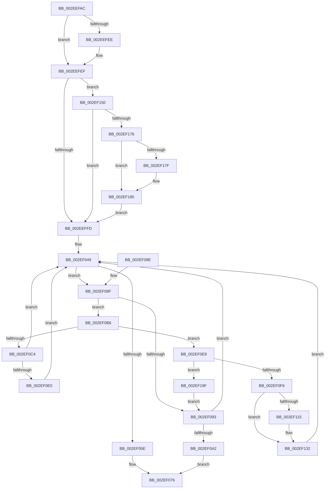

# ExpInsertPoolTracker

- RVA: `0x002EEFAC`–`0x002EF1A8` (길이 `508` bytes)
- VA: `0x00000001402EEFAC`
- 실행 섹션: `.text`
- PDB 이름 있음: `예`; PDB Function 태그: `아니요`
- unwind 정보 RVA: `0x00071A4C`
- 디코드: `140`개 명령, `508/508` bytes 표시
- 미해석 바이트: `0` (있으면 어셈블리에 `.byte`로 보존)

> 이 문서는 커널 이미지의 기계어와 PDB 기호를 분석해 생성했습니다. 4번과 5번은 함수 원형과 자료형을 바이너리 사용 방식에서 추정한 C 해석이며 원본 소스 복구 결과는 아닙니다.

## 1. Dependencies

- 직접 호출 지점: **7**; 고유 호출 대상: **7**
- 직접 호출자로 확인된 함수: **4**
- RIP 상대 이미지 참조: **7**

### Outgoing calls
- `0x002EF071` → [ExpPoolTrackerChargeEntry](../35/ExpPoolTrackerChargeEntry_function_0035B810.md) (function, `0x0035B810`)
- `0x002EF0AA` → [ExpInsertPoolTrackerExpansion](ExpInsertPoolTrackerExpansion_function_002ECCC0.md) (function, `0x002ECCC0`)
- `0x002EF101` → [KeAcquireInStackQueuedSpinLock](../27/KeAcquireInStackQueuedSpinLock_function_002757A0.md) (function, `0x002757A0`)
- `0x002EF117` → [ExpPlFindLimitEntry](ExpPlFindLimitEntry_function_002ECBF0.md) (function, `0x002ECBF0`)
- `0x002EF136` → [KeReleaseInStackQueuedSpinLock](../34/KeReleaseInStackQueuedSpinLock_function_00342CE0.md) (function, `0x00342CE0`)
- `0x002EF169` → [ExpPoolFlagsToPoolType](../../poolcode/B8/ExpPoolFlagsToPoolType_function_00B84080.md) (function, `0x00B84080`)
- `0x002EF195` → [EtwTracePool](EtwTracePool_function_002ECEEC.md) (function, `0x002ECEEC`)

### Direct callers
- [ExpResizeBigPageTable](ExpResizeBigPageTable_function_002EE1B4.md) at `0x002EE2E1`
- [ExInsertPoolTag](ExInsertPoolTag_function_002EF3AC.md) at `0x002EF424`
- [sub_006DEB9E](../6D/Unknown_function_006DEB9E.md) at `0x006DEC87`
- [ExInitializePoolTracker](../../init/C5/ExInitializePoolTracker_function_00C52F10.md) at `0x00C53010`

### Static image references
- `0x002EEFE0` → RVA `0x00FC514C` (`ALMOSTRO`; read)
- `0x002EEFEF` → RVA `0x00FC6B04` (`ALMOSTRO`; read)
- `0x002EF005` → RVA `0x00EFAD20` (`.data`; read)
- `0x002EF00C` → RVA `0x00EFED58` (`.data`; read)
- `0x002EF017` → RVA `0x00EFED50` (`.data`; read)
- `0x002EF0B6` → RVA `0x00EFED60` (`.data`; read)
- `0x002EF0FA` → RVA `0x00EFAD00` (`.data`; read)

## 2. Other-region calls and transfers

- 다른 실행 섹션으로 향하는 call: **1**
  - `0x002EF169` → [ExpPoolFlagsToPoolType](../../poolcode/B8/ExpPoolFlagsToPoolType_function_00B84080.md) (`.text` → `POOLCODE`)
- 별도 외부 분기/꼬리 이동을 확인하지 못했습니다.

## 3. Assembly (complete function range)

```asm
002EEFAC  48 89 5C 24 10                  mov qword ptr [rsp + 0x10], rbx
002EEFB1  55                              push rbp
002EEFB2  56                              push rsi
002EEFB3  57                              push rdi
002EEFB4  41 54                           push r12
002EEFB6  41 55                           push r13
002EEFB8  41 56                           push r14
002EEFBA  41 57                           push r15
002EEFBC  48 8B EC                        mov rbp, rsp
002EEFBF  48 83 EC 70                     sub rsp, 0x70
002EEFC3  33 C0                           xor eax, eax
002EEFC5  8B F1                           mov esi, ecx
002EEFC7  21 45 C0                        and dword ptr [rbp - 0x40], eax
002EEFCA  0F 57 C0                        xorps xmm0, xmm0
002EEFCD  48 89 45 F0                     mov qword ptr [rbp - 0x10], rax
002EEFD1  49 8B F9                        mov rdi, r9
002EEFD4  88 45 40                        mov byte ptr [rbp + 0x40], al
002EEFD7  49 8B D8                        mov rbx, r8
002EEFDA  88 45 50                        mov byte ptr [rbp + 0x50], al
002EEFDD  4C 8B E2                        mov r12, rdx
002EEFE0  8B 05 66 61 CD 00               mov eax, dword ptr [rip + 0xcd6166]
002EEFE6  0F 11 45 E0                     movups xmmword ptr [rbp - 0x20], xmm0
002EEFEA  3B C8                           cmp ecx, eax
002EEFEC  75 01                           jne 0x1402eefef
002EEFEE  CC                              int3
002EEFEF  8B 05 0F 7B CD 00               mov eax, dword ptr [rip + 0xcd7b0f]
002EEFF5  A8 41                           test al, 0x41
002EEFF7  0F 85 53 01 00 00               jne 0x1402ef150
002EEFFD  65 8B 04 25 A4 01 00 00         mov eax, dword ptr gs:[0x1a4]
002EF005  48 8D 15 14 BD C0 00            lea rdx, [rip + 0xc0bd14]
002EF00C  4C 8B 05 45 FD C0 00            mov r8, qword ptr [rip + 0xc0fd45]
002EF013  48 83 E3 FB                     and rbx, 0xfffffffffffffffb
002EF017  4C 8B 15 32 FD C0 00            mov r10, qword ptr [rip + 0xc0fd32]
002EF01E  48 69 CE 5F 9E 00 00            imul rcx, rsi, 0x9e5f
002EF025  48 8B 14 C2                     mov rdx, qword ptr [rdx + rax*8]
002EF029  4C 8B F1                        mov r14, rcx
002EF02C  48 89 55 C8                     mov qword ptr [rbp - 0x38], rdx
002EF030  49 C1 EE 20                     shr r14, 0x20
002EF034  44 33 F1                        xor r14d, ecx
002EF037  4C 89 45 D0                     mov qword ptr [rbp - 0x30], r8
002EF03B  45 23 F0                        and r14d, r8d
002EF03E  4C 89 55 D8                     mov qword ptr [rbp - 0x28], r10
002EF042  45 8B CE                        mov r9d, r14d
002EF045  44 89 75 C4                     mov dword ptr [rbp - 0x3c], r14d
002EF049  41 8B CE                        mov ecx, r14d
002EF04C  48 8D 3C 89                     lea rdi, [rcx + rcx*4]
002EF050  48 03 FF                        add rdi, rdi
002EF053  4C 8D 3C FA                     lea r15, [rdx + rdi*8]
002EF057  41 8B 07                        mov eax, dword ptr [r15]
002EF05A  3B C6                           cmp eax, esi
002EF05C  75 31                           jne 0x1402ef08f
002EF05E  48 C1 EB 08                     shr rbx, 8
002EF062  B9 01 00 00 00                  mov ecx, 1
002EF067  F7 D3                           not ebx
002EF069  4D 8B C7                        mov r8, r15
002EF06C  23 CB                           and ecx, ebx
002EF06E  49 8B D4                        mov rdx, r12
002EF071  E8 9A C7 06 00                  call 0x14035b810
002EF076  48 8B 9C 24 B8 00 00 00         mov rbx, qword ptr [rsp + 0xb8]
002EF07E  48 83 C4 70                     add rsp, 0x70
002EF082  41 5F                           pop r15
002EF084  41 5E                           pop r14
002EF086  41 5D                           pop r13
002EF088  41 5C                           pop r12
002EF08A  5F                              pop rdi
002EF08B  5E                              pop rsi
002EF08C  5D                              pop rbp
002EF08D  C3                              ret
002EF08E  CC                              int3
002EF08F  85 C0                           test eax, eax
002EF091  74 23                           je 0x1402ef0b6
002EF093  41 8D 46 01                     lea eax, [r14 + 1]
002EF097  41 23 C0                        and eax, r8d
002EF09A  44 8B F0                        mov r14d, eax
002EF09D  41 3B C1                        cmp eax, r9d
002EF0A0  75 A7                           jne 0x1402ef049
002EF0A2  4C 8B C3                        mov r8, rbx
002EF0A5  49 8B D4                        mov rdx, r12
002EF0A8  8B CE                           mov ecx, esi
002EF0AA  E8 11 DC FF FF                  call 0x1402eccc0
002EF0AF  B8 01 00 00 00                  mov eax, 1
002EF0B4  EB C0                           jmp 0x1402ef076
002EF0B6  48 8B 05 A3 FC C0 00            mov rax, qword ptr [rip + 0xc0fca3]
002EF0BD  8B 14 F8                        mov edx, dword ptr [rax + rdi*8]
002EF0C0  85 D2                           test edx, edx
002EF0C2  74 25                           je 0x1402ef0e9
002EF0C4  41 89 17                        mov dword ptr [r15], edx
002EF0C7  48 8B 05 92 FC C0 00            mov rax, qword ptr [rip + 0xc0fc92]
002EF0CE  48 8B 55 C8                     mov rdx, qword ptr [rbp - 0x38]
002EF0D2  48 8B 4C F8 48                  mov rcx, qword ptr [rax + rdi*8 + 0x48]
002EF0D7  48 85 C9                        test rcx, rcx
002EF0DA  0F 84 69 FF FF FF               je 0x1402ef049
002EF0E0  49 89 4F 48                     mov qword ptr [r15 + 0x48], rcx
002EF0E4  E9 60 FF FF FF                  jmp 0x1402ef049
002EF0E9  49 8D 42 FF                     lea rax, [r10 - 1]
002EF0ED  48 3B C8                        cmp rcx, rax
002EF0F0  0F 84 A9 00 00 00               je 0x1402ef19f
002EF0F6  48 8D 55 E0                     lea rdx, [rbp - 0x20]
002EF0FA  48 8D 0D FF BB C0 00            lea rcx, [rip + 0xc0bbff]
002EF101  E8 9A 66 F8 FF                  call 0x1402757a0
002EF106  4C 8B 2D 53 FC C0 00            mov r13, qword ptr [rip + 0xc0fc53]
002EF10D  41 83 7C FD 00 00               cmp dword ptr [r13 + rdi*8], 0
002EF113  75 1D                           jne 0x1402ef132
002EF115  8B CE                           mov ecx, esi
002EF117  E8 D4 DA FF FF                  call 0x1402ecbf0
002EF11C  49 89 44 FD 48                  mov qword ptr [r13 + rdi*8 + 0x48], rax
002EF121  49 89 47 48                     mov qword ptr [r15 + 0x48], rax
002EF125  48 8B 05 34 FC C0 00            mov rax, qword ptr [rip + 0xc0fc34]
002EF12C  89 34 F8                        mov dword ptr [rax + rdi*8], esi
002EF12F  41 89 37                        mov dword ptr [r15], esi
002EF132  48 8D 4D E0                     lea rcx, [rbp - 0x20]
002EF136  E8 A5 3B 05 00                  call 0x140342ce0
002EF13B  4C 8B 45 D0                     mov r8, qword ptr [rbp - 0x30]
002EF13F  44 8B 4D C4                     mov r9d, dword ptr [rbp - 0x3c]
002EF143  4C 8B 55 D8                     mov r10, qword ptr [rbp - 0x28]
002EF147  48 8B 55 C8                     mov rdx, qword ptr [rbp - 0x38]
002EF14B  E9 F9 FE FF FF                  jmp 0x1402ef049
002EF150  8B D3                           mov edx, ebx
002EF152  48 8D 45 50                     lea rax, [rbp + 0x50]
002EF156  83 E2 10                        and edx, 0x10
002EF159  48 89 44 24 20                  mov qword ptr [rsp + 0x20], rax
002EF15E  4C 8D 4D 40                     lea r9, [rbp + 0x40]
002EF162  48 8B CB                        mov rcx, rbx
002EF165  4C 8D 45 C0                     lea r8, [rbp - 0x40]
002EF169  E8 12 4F 89 00                  call 0x140b84080
002EF16E  85 C0                           test eax, eax
002EF170  0F 88 87 FE FF FF               js 0x1402eeffd
002EF176  80 7D 40 00                     cmp byte ptr [rbp + 0x40], 0
002EF17A  8B 55 C0                        mov edx, dword ptr [rbp - 0x40]
002EF17D  74 06                           je 0x1402ef185
002EF17F  83 CA 08                        or edx, 8
002EF182  89 55 C0                        mov dword ptr [rbp - 0x40], edx
002EF185  B9 20 0E 00 00                  mov ecx, 0xe20
002EF18A  4C 89 64 24 20                  mov qword ptr [rsp + 0x20], r12
002EF18F  4C 8B CF                        mov r9, rdi
002EF192  44 8B C6                        mov r8d, esi
002EF195  E8 52 DD FF FF                  call 0x1402eceec
002EF19A  E9 5E FE FF FF                  jmp 0x1402eeffd
002EF19F  48 8B 55 C8                     mov rdx, qword ptr [rbp - 0x38]
002EF1A3  E9 EB FE FF FF                  jmp 0x1402ef093
```

## 4. C-style interpretation (structured pseudocode)

```c
__int64 __fastcall ExpInsertPoolTracker(int a1, __int64 a2, __int64 a3, __int64 a4)
{
    __int64 result;
    __int64 v_r14;
    __int64 v_rbx;
    __int64 v_rdi;
    __int64 v_rsp;
    unsigned __int64 v_stack_m48;
    unsigned __int64 v_stack_m58;
    unsigned __int64 v_stack_m60;
    unsigned __int64 v_stack_m68;
    unsigned __int64 v_stack_m70;
    unsigned int v_stack_m74;
    unsigned int v_stack_m78;
    unsigned __int64 v_stack_p10;
    unsigned __int8 v_stack_p18;
    unsigned __int64 v_stack_p20;
    unsigned __int8 v_stack_p8;

    v_stack_p10 = v_rbx;
    v_rsp = (v_rsp) - (112);
    result = 0;
    v_stack_m48 = 0;
    v_stack_p8 = 0;
    v_stack_p18 = 0;
    v_stack_m58 = v_xmm0;
    if (a1 == ((unsigned int)((unsigned int)(*(unsigned int *)(v_rip + 13459814))))) {
    }
    if ((((unsigned __int8)((unsigned int)(*(unsigned int *)(v_rip + 13466383)))) & (65)) != 0) goto loc_002EF150;
loc_002EEFFD:
    v_rbx = (a3) & (-5);
    a1 = (a1) * ((unsigned int)(a1));
    v_stack_m70 = *(unsigned __int64 *)(v_rip + 12631316 + (unsigned int)(*(unsigned int *)(gs_base + (0 + 420))) * 8);
    v_r14 = (a1) >> (32);
    v_r14 = (unsigned int)((v_r14) ^ (a1));
    v_stack_m68 = *(unsigned __int64 *)(v_rip + 12647749);
    v_r14 = (unsigned int)((v_r14) & ((unsigned int)(*(unsigned __int64 *)(v_rip + 12647749))));
    v_stack_m60 = *(unsigned __int64 *)(v_rip + 12647730);
    v_stack_m74 = (unsigned int)(v_r14);
loc_002EF049:
    v_rdi = ((unsigned int)((unsigned int)(v_r14)) + (unsigned int)((unsigned int)(v_r14)) * 4) + ((unsigned int)((unsigned int)(v_r14)) + (unsigned int)((unsigned int)(v_r14)) * 4);
    if (((unsigned int)((unsigned int)(*(unsigned int *)(*(unsigned __int64 *)(v_rip + 12631316 + (unsigned int)(*(unsigned int *)(gs_base + (0 + 420))) * 8) + v_rdi * 8)))) != ((unsigned int)((unsigned int)(a1)))) goto loc_002EF08F;
    v_rbx = (v_rbx) >> (8);
    v_rbx = (unsigned int)(~(v_rbx));
    a1 = (unsigned int)((1) & ((unsigned int)(v_rbx)));
    result = ExpPoolTrackerChargeEntry(a1, a2, *(unsigned __int64 *)(v_rip + 12631316 + (unsigned int)(*(unsigned int *)(gs_base + (0 + 420))) * 8) + v_rdi * 8, (unsigned int)((unsigned int)(v_r14)));
loc_002EF076:
    v_rsp = (v_rsp) + (112);
    return result;
loc_002EF08F:
    if ((unsigned int)(result) == 0) goto loc_002EF0B6;
loc_002EF093:
    result = (unsigned int)((v_r14 + 1) & ((unsigned int)(*(unsigned __int64 *)(v_rip + 12631316 + (unsigned int)(*(unsigned int *)(gs_base + (0 + 420))) * 8) + v_rdi * 8)));
    if (((unsigned int)(result)) != ((unsigned int)((unsigned int)((unsigned int)(v_r14))))) goto loc_002EF049;
    result = ExpInsertPoolTrackerExpansion((unsigned int)((unsigned int)((unsigned int)(a1))), a2, v_stack_p10, (unsigned int)((unsigned int)(v_r14)));
    goto loc_002EF076;
loc_002EF0B6:
    if ((unsigned int)((unsigned int)(*(unsigned int *)(*(unsigned __int64 *)(v_rip + 12647587) + v_rdi * 8))) == 0) goto loc_002EF0E9;
    *(unsigned int *)(*(unsigned __int64 *)(v_rip + 12631316 + (unsigned int)(*(unsigned int *)(gs_base + (0 + 420))) * 8) + v_rdi * 8) = (unsigned int)((unsigned int)(*(unsigned int *)(*(unsigned __int64 *)(v_rip + 12647587) + v_rdi * 8)));
    if (*(unsigned __int64 *)(*(unsigned __int64 *)(v_rip + 12647570) + v_rdi * 8 + 72) == 0) goto loc_002EF049;
    *(unsigned __int64 *)(*(unsigned __int64 *)(v_rip + 12631316 + (unsigned int)(*(unsigned int *)(gs_base + (0 + 420))) * 8) + v_rdi * 8 + 72) = *(unsigned __int64 *)(*(unsigned __int64 *)(v_rip + 12647570) + v_rdi * 8 + 72);
    goto loc_002EF049;
loc_002EF0E9:
    if ((*(unsigned __int64 *)(*(unsigned __int64 *)(v_rip + 12647570) + v_rdi * 8 + 72)) == (*(unsigned __int64 *)(v_rip + 12647730) - 1)) goto loc_002EF19F;
    result = KeAcquireInStackQueuedSpinLock(v_rip + 12631039, v_stack_m58, v_stack_p10, (unsigned int)((unsigned int)(v_r14)));
    if ((*(unsigned int *)(*(unsigned __int64 *)(v_rip + 12647507) + v_rdi * 8)) == 0) {
        a1 = (unsigned int)((unsigned int)(a1));
        result = ExpPlFindLimitEntry(a1, v_stack_m58, v_stack_p10, (unsigned int)((unsigned int)(v_r14)));
        *(unsigned __int64 *)(*(unsigned __int64 *)(v_rip + 12647507) + v_rdi * 8 + 72) = result;
        *(unsigned __int64 *)(*(unsigned __int64 *)(v_rip + 12631316 + (unsigned int)(*(unsigned int *)(gs_base + (0 + 420))) * 8) + v_rdi * 8 + 72) = result;
        result = *(unsigned __int64 *)(v_rip + 12647476);
        *(unsigned int *)(result + v_rdi * 8) = (unsigned int)((unsigned int)(a1));
        *(unsigned int *)(*(unsigned __int64 *)(v_rip + 12631316 + (unsigned int)(*(unsigned int *)(gs_base + (0 + 420))) * 8) + v_rdi * 8) = (unsigned int)((unsigned int)(a1));
    }
    result = KeReleaseInStackQueuedSpinLock(v_stack_m58, v_stack_m58, v_stack_p10, (unsigned int)((unsigned int)(v_r14)));
    goto loc_002EF049;
loc_002EF150:
    a2 = (unsigned int)(((unsigned int)((unsigned int)(v_stack_p10))) & (16));
    v_stack_p20 = v_stack_p18;
    result = ExpPoolFlagsToPoolType(v_stack_p10, a2, v_stack_m78, v_stack_p8);
    if (sign_flag) goto loc_002EEFFD;
    if (v_stack_p8 != 0) {
        a2 = (unsigned int)(((unsigned int)(v_stack_m78)) | (8));
        v_stack_m78 = (unsigned int)(a2);
    }
    v_stack_p20 = a2;
    result = EtwTracePool((unsigned int)(0xE20ULL), a2, (unsigned int)((unsigned int)((unsigned int)(a1))), v_rdi);
    goto loc_002EEFFD;
loc_002EF19F:
    goto loc_002EF093;
}
```

## 5. (Beta) C Style

```c
int64_t ExpInsertPoolTracker(int32_t Arg1, int64_t Arg2, int64_t Arg3, int64_t Arg4)
{
    int64_t result;
    int64_t local_r14;
    int64_t local_rbx;
    int64_t local_rdi;
    int64_t local_rsp;
    uint64_t v_stack_m48;
    uint64_t v_stack_m58;
    uint64_t v_stack_m60;
    uint64_t v_stack_m68;
    uint64_t v_stack_m70;
    uint32_t v_stack_m74;
    uint32_t v_stack_m78;
    uint64_t v_stack_p10;
    uint8_t v_stack_p18;
    uint64_t v_stack_p20;
    uint8_t v_stack_p8;

    v_stack_p10 = local_rbx;
    local_rsp = (local_rsp) - (112);
    result = 0;
    v_stack_m48 = 0;
    v_stack_p8 = 0;
    v_stack_p18 = 0;
    v_stack_m58 = v_xmm0;
    if (Arg1 == ((uint32_t)((uint32_t)(*(uint32_t *)(v_rip + 0xCD6166))))) {
    }
    if ((((uint8_t)((uint32_t)(*(uint32_t *)(v_rip + 0xCD7B0F)))) & (65)) != 0) goto loc_002EF150;
loc_002EEFFD:
    local_rbx = (Arg3) & (-5);
    Arg1 = (Arg1) * ((uint32_t)(Arg1));
    v_stack_m70 = *(uint64_t *)(v_rip + 0xC0BD14 + (uint32_t)(*(uint32_t *)(gs_base + (0 + 0x1A4))) * 8);
    local_r14 = (Arg1) >> (32);
    local_r14 = (uint32_t)((local_r14) ^ (Arg1));
    v_stack_m68 = *(uint64_t *)(v_rip + 0xC0FD45);
    local_r14 = (uint32_t)((local_r14) & ((uint32_t)(*(uint64_t *)(v_rip + 0xC0FD45))));
    v_stack_m60 = *(uint64_t *)(v_rip + 0xC0FD32);
    v_stack_m74 = (uint32_t)(local_r14);
loc_002EF049:
    local_rdi = ((uint32_t)((uint32_t)(local_r14)) + (uint32_t)((uint32_t)(local_r14)) * 4) + ((uint32_t)((uint32_t)(local_r14)) + (uint32_t)((uint32_t)(local_r14)) * 4);
    if (((uint32_t)((uint32_t)(*(uint32_t *)(*(uint64_t *)(v_rip + 0xC0BD14 + (uint32_t)(*(uint32_t *)(gs_base + (0 + 0x1A4))) * 8) + local_rdi * 8)))) != ((uint32_t)((uint32_t)(Arg1)))) goto loc_002EF08F;
    local_rbx = (local_rbx) >> (8);
    local_rbx = (uint32_t)(~(local_rbx));
    Arg1 = (uint32_t)((1) & ((uint32_t)(local_rbx)));
    result = ExpPoolTrackerChargeEntry(Arg1, Arg2, *(uint64_t *)(v_rip + 0xC0BD14 + (uint32_t)(*(uint32_t *)(gs_base + (0 + 0x1A4))) * 8) + local_rdi * 8, (uint32_t)((uint32_t)(local_r14)));
loc_002EF076:
    local_rsp = (local_rsp) + (112);
    return result;
loc_002EF08F:
    if ((uint32_t)(result) == 0) goto loc_002EF0B6;
loc_002EF093:
    result = (uint32_t)((local_r14 + 1) & ((uint32_t)(*(uint64_t *)(v_rip + 0xC0BD14 + (uint32_t)(*(uint32_t *)(gs_base + (0 + 0x1A4))) * 8) + local_rdi * 8)));
    if (((uint32_t)(result)) != ((uint32_t)((uint32_t)((uint32_t)(local_r14))))) goto loc_002EF049;
    result = ExpInsertPoolTrackerExpansion((uint32_t)((uint32_t)((uint32_t)(Arg1))), Arg2, v_stack_p10, (uint32_t)((uint32_t)(local_r14)));
    goto loc_002EF076;
loc_002EF0B6:
    if ((uint32_t)((uint32_t)(*(uint32_t *)(*(uint64_t *)(v_rip + 0xC0FCA3) + local_rdi * 8))) == 0) goto loc_002EF0E9;
    *(uint32_t *)(*(uint64_t *)(v_rip + 0xC0BD14 + (uint32_t)(*(uint32_t *)(gs_base + (0 + 0x1A4))) * 8) + local_rdi * 8) = (uint32_t)((uint32_t)(*(uint32_t *)(*(uint64_t *)(v_rip + 0xC0FCA3) + local_rdi * 8)));
    if (*(uint64_t *)(*(uint64_t *)(v_rip + 0xC0FC92) + local_rdi * 8 + 0x48) == 0) goto loc_002EF049;
    *(uint64_t *)(*(uint64_t *)(v_rip + 0xC0BD14 + (uint32_t)(*(uint32_t *)(gs_base + (0 + 0x1A4))) * 8) + local_rdi * 8 + 0x48) = *(uint64_t *)(*(uint64_t *)(v_rip + 0xC0FC92) + local_rdi * 8 + 0x48);
    goto loc_002EF049;
loc_002EF0E9:
    if ((*(uint64_t *)(*(uint64_t *)(v_rip + 0xC0FC92) + local_rdi * 8 + 0x48)) == (*(uint64_t *)(v_rip + 0xC0FD32) - 1)) goto loc_002EF19F;
    result = KeAcquireInStackQueuedSpinLock(v_rip + 12631039, v_stack_m58, v_stack_p10, (uint32_t)((uint32_t)(local_r14)));
    if ((*(uint32_t *)(*(uint64_t *)(v_rip + 0xC0FC53) + local_rdi * 8)) == 0) {
        Arg1 = (uint32_t)((uint32_t)(Arg1));
        result = ExpPlFindLimitEntry(Arg1, v_stack_m58, v_stack_p10, (uint32_t)((uint32_t)(local_r14)));
        *(uint64_t *)(*(uint64_t *)(v_rip + 0xC0FC53) + local_rdi * 8 + 0x48) = result;
        *(uint64_t *)(*(uint64_t *)(v_rip + 0xC0BD14 + (uint32_t)(*(uint32_t *)(gs_base + (0 + 0x1A4))) * 8) + local_rdi * 8 + 0x48) = result;
        result = *(uint64_t *)(v_rip + 0xC0FC34);
        *(uint32_t *)(result + local_rdi * 8) = (uint32_t)((uint32_t)(Arg1));
        *(uint32_t *)(*(uint64_t *)(v_rip + 0xC0BD14 + (uint32_t)(*(uint32_t *)(gs_base + (0 + 0x1A4))) * 8) + local_rdi * 8) = (uint32_t)((uint32_t)(Arg1));
    }
    result = KeReleaseInStackQueuedSpinLock(v_stack_m58, v_stack_m58, v_stack_p10, (uint32_t)((uint32_t)(local_r14)));
    goto loc_002EF049;
loc_002EF150:
    Arg2 = (uint32_t)(((uint32_t)((uint32_t)(v_stack_p10))) & (16));
    v_stack_p20 = v_stack_p18;
    result = ExpPoolFlagsToPoolType(v_stack_p10, Arg2, v_stack_m78, v_stack_p8);
    if (sign_flag) goto loc_002EEFFD;
    if (v_stack_p8 != 0) {
        Arg2 = (uint32_t)(((uint32_t)(v_stack_m78)) | (8));
        v_stack_m78 = (uint32_t)(Arg2);
    }
    v_stack_p20 = Arg2;
    result = EtwTracePool((uint32_t)(0xE20ULL), Arg2, (uint32_t)((uint32_t)((uint32_t)(Arg1))), local_rdi);
    goto loc_002EEFFD;
loc_002EF19F:
    goto loc_002EF093;
}
```

## 6. Execution-region graph

[열기: 2D/3D 그래프와 함수 탐색 컨트롤 패널](../../../control-panel.html?section=text&rva=0x002EEFAC&view=graph)

- 2D 그래프는 위에서 아래로 흐르고, 3D 그래프는 빈 공간을 드래그해 회전합니다. Shift+드래그는 이동, 휠은 확대·축소, 함수 노드 선택은 대상 보고서 이동입니다.

### Static fallback


