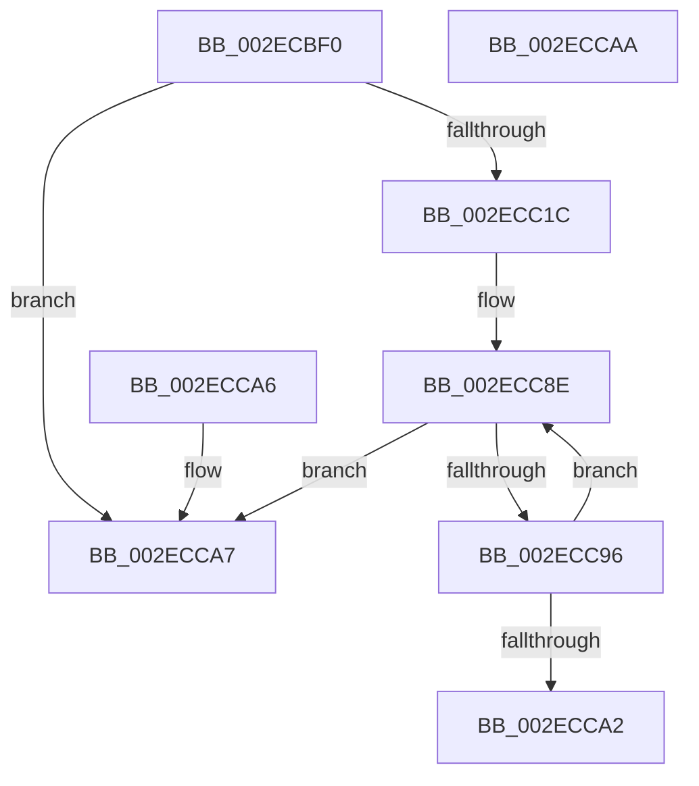

# ExpPlFindLimitEntry

- RVA: `0x002ECBF0`–`0x002ECCAB` (길이 `187` bytes)
- VA: `0x00000001402ECBF0`
- 실행 섹션: `.text`
- PDB 이름 있음: `예`; PDB Function 태그: `아니요`
- unwind 정보 RVA: `0x000DB714`
- 디코드: `52`개 명령, `187/187` bytes 표시
- 미해석 바이트: `0` (있으면 어셈블리에 `.byte`로 보존)

> 이 문서는 커널 이미지의 기계어와 PDB 기호를 분석해 생성했습니다. 4번과 5번은 함수 원형과 자료형을 바이너리 사용 방식에서 추정한 C 해석이며 원본 소스 복구 결과는 아닙니다.

## 1. Dependencies

- 직접 호출 지점: **0**; 고유 호출 대상: **0**
- 직접 호출자로 확인된 함수: **6**
- RIP 상대 이미지 참조: **2**

### Outgoing calls
- 직접 디코드된 call 명령이 없습니다.

### Direct callers
- [ExpInsertPoolTrackerExpansion](ExpInsertPoolTrackerExpansion_function_002ECCC0.md) at `0x002ECE2B`
- [ExAllocateContiguousHeapPool](ExAllocateContiguousHeapPool_function_002EE960.md) at `0x002EEBC4`
- [ExpInsertPoolTracker](ExpInsertPoolTracker_function_002EEFAC.md) at `0x002EF117`
- [ExAllocateHeapPool](../35/ExAllocateHeapPool_function_0035BA30.md) at `0x0035DB29`
- [ExAllocateHeapPool](../35/ExAllocateHeapPool_function_0035BA30.md) at `0x0035E321`
- [ExAllocateHeapPool](../35/ExAllocateHeapPool_function_0035BA30.md) at `0x0035EFE3`
- [ExPoolQueryLimits](../65/ExPoolQueryLimits_function_006562A0.md) at `0x006563DB`
- [ExpTrackTableInsertLimit](../65/ExpTrackTableInsertLimit_function_006572D0.md) at `0x0065743F`

### Static image references
- `0x002ECBF0` → RVA `0x00E29084` (`.data`; read)
- `0x002ECC83` → RVA `0x00E29088` (`.data`; read)

## 2. Other-region calls and transfers

- 다른 실행 섹션으로 향하는 call: **0**
- 별도 외부 분기/꼬리 이동을 확인하지 못했습니다.

## 3. Assembly (complete function range)

```asm
002ECBF0  44 8B 15 8D C4 B3 00            mov r10d, dword ptr [rip + 0xb3c48d]
002ECBF7  49 83 CB FF                     or r11, 0xffffffffffffffff
002ECBFB  44 8B C9                        mov r9d, ecx
002ECBFE  41 8B CA                        mov ecx, r10d
002ECC01  83 E1 1F                        and ecx, 0x1f
002ECC04  41 C1 EA 05                     shr r10d, 5
002ECC08  49 D3 E3                        shl r11, cl
002ECC0B  4D 23 CB                        and r9, r11
002ECC0E  4C 89 4C 24 10                  mov qword ptr [rsp + 0x10], r9
002ECC13  45 85 D2                        test r10d, r10d
002ECC16  0F 84 8B 00 00 00               je 0x1402ecca7
002ECC1C  41 0F B6 C1                     movzx eax, r9b
002ECC20  48 05 CB 5D B1 00               add rax, 0xb15dcb
002ECC26  48 6B C8 25                     imul rcx, rax, 0x25
002ECC2A  0F B6 44 24 11                  movzx eax, byte ptr [rsp + 0x11]
002ECC2F  48 03 C8                        add rcx, rax
002ECC32  0F B6 44 24 12                  movzx eax, byte ptr [rsp + 0x12]
002ECC37  48 6B D1 25                     imul rdx, rcx, 0x25
002ECC3B  48 03 D0                        add rdx, rax
002ECC3E  0F B6 44 24 13                  movzx eax, byte ptr [rsp + 0x13]
002ECC43  48 6B CA 25                     imul rcx, rdx, 0x25
002ECC47  48 03 C8                        add rcx, rax
002ECC4A  0F B6 44 24 14                  movzx eax, byte ptr [rsp + 0x14]
002ECC4F  48 6B D1 25                     imul rdx, rcx, 0x25
002ECC53  48 03 D0                        add rdx, rax
002ECC56  0F B6 44 24 15                  movzx eax, byte ptr [rsp + 0x15]
002ECC5B  48 6B CA 25                     imul rcx, rdx, 0x25
002ECC5F  48 03 C8                        add rcx, rax
002ECC62  0F B6 44 24 16                  movzx eax, byte ptr [rsp + 0x16]
002ECC67  48 6B D1 25                     imul rdx, rcx, 0x25
002ECC6B  41 8D 4A FF                     lea ecx, [r10 - 1]
002ECC6F  48 03 D0                        add rdx, rax
002ECC72  0F B6 44 24 17                  movzx eax, byte ptr [rsp + 0x17]
002ECC77  4C 6B C2 25                     imul r8, rdx, 0x25
002ECC7B  49 03 C0                        add rax, r8
002ECC7E  8B C0                           mov eax, eax
002ECC80  48 23 C8                        and rcx, rax
002ECC83  48 8B 05 FE C3 B3 00            mov rax, qword ptr [rip + 0xb3c3fe]
002ECC8A  48 8D 14 C8                     lea rdx, [rax + rcx*8]
002ECC8E  48 8B 12                        mov rdx, qword ptr [rdx]
002ECC91  F6 C2 01                        test dl, 1
002ECC94  75 11                           jne 0x1402ecca7
002ECC96  48 8B 42 08                     mov rax, qword ptr [rdx + 8]
002ECC9A  49 23 C3                        and rax, r11
002ECC9D  4C 3B C8                        cmp r9, rax
002ECCA0  75 EC                           jne 0x1402ecc8e
002ECCA2  48 8B C2                        mov rax, rdx
002ECCA5  C3                              ret
002ECCA6  CC                              int3
002ECCA7  33 C0                           xor eax, eax
002ECCA9  C3                              ret
002ECCAA  CC                              int3
```

## 4. C-style interpretation (structured pseudocode)

```c
__int64 __fastcall ExpPlFindLimitEntry(int a1)
{
    __int64 result;
    __int64 v_r10;
    __int64 v_r11;
    unsigned __int64 v_stack_p10;
    unsigned __int8 v_stack_p11;
    unsigned __int8 v_stack_p12;
    unsigned __int8 v_stack_p13;
    unsigned __int8 v_stack_p14;
    unsigned __int8 v_stack_p15;
    unsigned __int8 v_stack_p16;
    unsigned __int8 v_stack_p17;

    v_r11 = (v_r11) | (-1);
    a1 = (unsigned int)(((unsigned int)((unsigned int)((unsigned int)(*(unsigned int *)(v_rip + 11781261))))) & (31));
    v_r10 = (unsigned int)(((unsigned int)(*(unsigned int *)(v_rip + 11781261))) >> (5));
    v_r11 = (v_r11) << ((unsigned __int8)(a1));
    a4 = ((unsigned int)(a1)) & (v_r11);
    v_stack_p10 = a4;
    if ((unsigned int)(v_r10) == 0) goto loc_002ECCA7;
    result = ((unsigned __int8)(a4)) + (0xB15DCBULL);
    a1 = (a1) * (result);
    a1 = (a1) + (v_stack_p11);
    a2 = (a2) * (a1);
    a2 = (a2) + (v_stack_p12);
    a1 = (a1) * (a2);
    a1 = (a1) + (v_stack_p13);
    a2 = (a2) * (a1);
    a2 = (a2) + (v_stack_p14);
    a1 = (a1) * (a2);
    a1 = (a1) + (v_stack_p15);
    a2 = (a2) * (a1);
    a2 = (a2) + (v_stack_p16);
    a3 = (a3) * (a2);
    result = (v_stack_p17) + (a3);
    a1 = (v_r10 - 1) & ((unsigned int)((unsigned int)(result)));
loc_002ECC8E:
    if ((((unsigned __int8)(*(unsigned __int64 *)(*(unsigned __int64 *)(v_rip + 11781118) + a1 * 8))) & (1)) != 0) goto loc_002ECCA7;
    result = (*(unsigned __int64 *)(*(unsigned __int64 *)(*(unsigned __int64 *)(v_rip + 11781118) + a1 * 8) + 8)) & (v_r11);
    if (a4 != result) goto loc_002ECC8E;
    return *(unsigned __int64 *)(*(unsigned __int64 *)(v_rip + 11781118) + a1 * 8);
loc_002ECCA7:
    result = 0;
    return result;
}
```

## 5. (Beta) C Style

```c
int64_t ExpPlFindLimitEntry(int32_t Arg1)
{
    int64_t result;
    int64_t local_r10;
    int64_t local_r11;
    uint64_t v_stack_p10;
    uint8_t v_stack_p11;
    uint8_t v_stack_p12;
    uint8_t v_stack_p13;
    uint8_t v_stack_p14;
    uint8_t v_stack_p15;
    uint8_t v_stack_p16;
    uint8_t v_stack_p17;

    local_r11 = (local_r11) | (-1);
    Arg1 = (uint32_t)(((uint32_t)((uint32_t)((uint32_t)(*(uint32_t *)(v_rip + 0xB3C48D))))) & (31));
    local_r10 = (uint32_t)(((uint32_t)(*(uint32_t *)(v_rip + 0xB3C48D))) >> (5));
    local_r11 = (local_r11) << ((uint8_t)(Arg1));
    a4 = ((uint32_t)(Arg1)) & (local_r11);
    v_stack_p10 = a4;
    if ((uint32_t)(local_r10) == 0) goto loc_002ECCA7;
    result = ((uint8_t)(a4)) + (0xB15DCBULL);
    Arg1 = (Arg1) * (result);
    Arg1 = (Arg1) + (v_stack_p11);
    a2 = (a2) * (Arg1);
    a2 = (a2) + (v_stack_p12);
    Arg1 = (Arg1) * (a2);
    Arg1 = (Arg1) + (v_stack_p13);
    a2 = (a2) * (Arg1);
    a2 = (a2) + (v_stack_p14);
    Arg1 = (Arg1) * (a2);
    Arg1 = (Arg1) + (v_stack_p15);
    a2 = (a2) * (Arg1);
    a2 = (a2) + (v_stack_p16);
    a3 = (a3) * (a2);
    result = (v_stack_p17) + (a3);
    Arg1 = (local_r10 - 1) & ((uint32_t)((uint32_t)(result)));
loc_002ECC8E:
    if ((((uint8_t)(*(uint64_t *)(*(uint64_t *)(v_rip + 0xB3C3FE) + Arg1 * 8))) & (1)) != 0) goto loc_002ECCA7;
    result = (*(uint64_t *)(*(uint64_t *)(*(uint64_t *)(v_rip + 0xB3C3FE) + Arg1 * 8) + 0x8)) & (local_r11);
    if (a4 != result) goto loc_002ECC8E;
    return *(uint64_t *)(*(uint64_t *)(v_rip + 0xB3C3FE) + Arg1 * 8);
loc_002ECCA7:
    result = 0;
    return result;
}
```

## 6. Execution-region graph

[열기: 2D/3D 그래프와 함수 탐색 컨트롤 패널](../../../control-panel.html?section=text&rva=0x002ECBF0&view=graph)

- 2D 그래프는 위에서 아래로 흐르고, 3D 그래프는 빈 공간을 드래그해 회전합니다. Shift+드래그는 이동, 휠은 확대·축소, 함수 노드 선택은 대상 보고서 이동입니다.

### Static fallback


