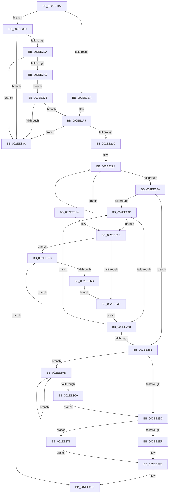

# ExpResizeBigPageTable

- RVA: `0x002EE1B4`–`0x002EE3CE` (길이 `538` bytes)
- VA: `0x00000001402EE1B4`
- 실행 섹션: `.text`
- PDB 이름 있음: `예`; PDB Function 태그: `아니요`
- unwind 정보 RVA: `0x000719A4`
- 디코드: `143`개 명령, `538/538` bytes 표시
- 미해석 바이트: `0` (있으면 어셈블리에 `.byte`로 보존)

> 이 문서는 커널 이미지의 기계어와 PDB 기호를 분석해 생성했습니다. 4번과 5번은 함수 원형과 자료형을 바이너리 사용 방식에서 추정한 C 해석이며 원본 소스 복구 결과는 아닙니다.

## 1. Dependencies

- 직접 호출 지점: **3**; 고유 호출 대상: **3**
- 직접 호출자로 확인된 함수: **1**
- RIP 상대 이미지 참조: **5**

### Outgoing calls
- `0x002EE1FF` → [ExAllocateHeapPages](../44/ExAllocateHeapPages_function_00446BB4.md) (function, `0x00446BB4`)
- `0x002EE218` → [memset](../6C/memset_function_006C6C40.md) (function, `0x006C6C40`)
- `0x002EE2E1` → [ExpInsertPoolTracker](ExpInsertPoolTracker_function_002EEFAC.md) (function, `0x002EEFAC`)

### Direct callers
- [ExpAddTagForBigPages](ExpAddTagForBigPages_function_002EF570.md) at `0x002EF804`
- [ExpAddTagForBigPages](ExpAddTagForBigPages_function_002EF570.md) at `0x002EF8CE`

### Static image references
- `0x002EE1D3` → RVA `0x00EFED38` (`.data`; read)
- `0x002EE1DA` → RVA `0x00EFED30` (`.data`; read)
- `0x002EE2C0` → RVA `0x00FCF100` (`CACHEALI`; read/write)
- `0x002EE2CA` → RVA `0x00EFED30` (`.data`; write)
- `0x002EE2D7` → RVA `0x00EFED38` (`.data`; write)

## 2. Other-region calls and transfers

- 다른 실행 섹션으로 향하는 call: **0**
- 별도 외부 분기/꼬리 이동을 확인하지 못했습니다.

## 3. Assembly (complete function range)

```asm
002EE1B4  48 89 5C 24 08                  mov qword ptr [rsp + 8], rbx
002EE1B9  48 89 6C 24 10                  mov qword ptr [rsp + 0x10], rbp
002EE1BE  48 89 74 24 18                  mov qword ptr [rsp + 0x18], rsi
002EE1C3  57                              push rdi
002EE1C4  41 56                           push r14
002EE1C6  41 57                           push r15
002EE1C8  48 83 EC 20                     sub rsp, 0x20
002EE1CC  49 83 20 00                     and qword ptr [r8], 0
002EE1D0  4D 8B F8                        mov r15, r8
002EE1D3  48 8B 1D 5E 0B C1 00            mov rbx, qword ptr [rip + 0xc10b5e]
002EE1DA  48 8B 35 4F 0B C1 00            mov rsi, qword ptr [rip + 0xc10b4f]
002EE1E1  48 85 DB                        test rbx, rbx
002EE1E4  0F 85 A7 01 00 00               jne 0x1402ee391
002EE1EA  BD FF 4F 00 00                  mov ebp, 0x4fff
002EE1EF  41 BE 00 02 00 00               mov r14d, 0x200
002EE1F5  48 81 E5 00 F0 FF FF            and rbp, 0xfffffffffffff000
002EE1FC  48 8B D5                        mov rdx, rbp
002EE1FF  E8 B0 89 15 00                  call 0x140446bb4
002EE204  48 8B F8                        mov rdi, rax
002EE207  48 85 C0                        test rax, rax
002EE20A  0F 84 7A 01 00 00               je 0x1402ee38a
002EE210  4C 8B C5                        mov r8, rbp
002EE213  33 D2                           xor edx, edx
002EE215  48 8B C8                        mov rcx, rax
002EE218  E8 23 8A 3D 00                  call 0x1406c6c40
002EE21D  49 8B CE                        mov rcx, r14
002EE220  48 8B C7                        mov rax, rdi
002EE223  48 C1 E1 05                     shl rcx, 5
002EE227  48 03 CF                        add rcx, rdi
002EE22A  48 C7 00 01 00 00 00            mov qword ptr [rax], 1
002EE231  48 83 C0 20                     add rax, 0x20
002EE235  48 3B C1                        cmp rax, rcx
002EE238  75 F0                           jne 0x1402ee22a
002EE23A  48 C1 E3 05                     shl rbx, 5
002EE23E  45 8D 4E FF                     lea r9d, [r14 - 1]
002EE242  48 03 DE                        add rbx, rsi
002EE245  48 8B D6                        mov rdx, rsi
002EE248  48 3B F3                        cmp rsi, rbx
002EE24B  74 14                           je 0x1402ee261
002EE24D  48 8B 02                        mov rax, qword ptr [rdx]
002EE250  A8 01                           test al, 1
002EE252  0F 84 BD 00 00 00               je 0x1402ee315
002EE258  48 83 C2 20                     add rdx, 0x20
002EE25C  48 3B D3                        cmp rdx, rbx
002EE25F  75 EC                           jne 0x1402ee24d
002EE261  48 8B C7                        mov rax, rdi
002EE264  48 C1 E8 0C                     shr rax, 0xc
002EE268  48 69 C8 5F 9E 00 00            imul rcx, rax, 0x9e5f
002EE26F  48 8B D1                        mov rdx, rcx
002EE272  48 C1 EA 20                     shr rdx, 0x20
002EE276  33 D1                           xor edx, ecx
002EE278  41 23 D1                        and edx, r9d
002EE27B  8B C2                           mov eax, edx
002EE27D  48 C1 E0 05                     shl rax, 5
002EE281  48 8B 04 38                     mov rax, qword ptr [rax + rdi]
002EE285  A8 01                           test al, 1
002EE287  0F 84 1E 01 00 00               je 0x1402ee3ab
002EE28D  44 8B CA                        mov r9d, edx
002EE290  B9 50 6F 6F 6C                  mov ecx, 0x6c6f6f50
002EE295  49 C1 E1 05                     shl r9, 5
002EE299  41 89 4C 39 08                  mov dword ptr [r9 + rdi + 8], ecx
002EE29E  49 89 3C 39                     mov qword ptr [r9 + rdi], rdi
002EE2A2  41 C6 44 39 0C 00               mov byte ptr [r9 + rdi + 0xc], 0
002EE2A8  41 8B 44 39 0C                  mov eax, dword ptr [r9 + rdi + 0xc]
002EE2AD  44 0F B6 C0                     movzx r8d, al
002EE2B1  41 0F BA E8 0E                  bts r8d, 0xe
002EE2B6  49 89 6C 39 10                  mov qword ptr [r9 + rdi + 0x10], rbp
002EE2BB  45 89 44 39 0C                  mov dword ptr [r9 + rdi + 0xc], r8d
002EE2C0  F0 FF 05 39 0E CE 00            lock inc dword ptr [rip + 0xce0e39]
002EE2C7  4C 8B CF                        mov r9, rdi
002EE2CA  48 89 3D 5F 0A C1 00            mov qword ptr [rip + 0xc10a5f], rdi
002EE2D1  41 B8 40 00 00 00               mov r8d, 0x40
002EE2D7  4C 89 35 5A 0A C1 00            mov qword ptr [rip + 0xc10a5a], r14
002EE2DE  48 8B D5                        mov rdx, rbp
002EE2E1  E8 C6 0C 00 00                  call 0x1402eefac
002EE2E6  48 85 F6                        test rsi, rsi
002EE2E9  0F 84 82 00 00 00               je 0x1402ee371
002EE2EF  48 83 26 00                     and qword ptr [rsi], 0
002EE2F3  49 89 37                        mov qword ptr [r15], rsi
002EE2F6  B8 01 00 00 00                  mov eax, 1
002EE2FB  48 8B 5C 24 40                  mov rbx, qword ptr [rsp + 0x40]
002EE300  48 8B 6C 24 48                  mov rbp, qword ptr [rsp + 0x48]
002EE305  48 8B 74 24 50                  mov rsi, qword ptr [rsp + 0x50]
002EE30A  48 83 C4 20                     add rsp, 0x20
002EE30E  41 5F                           pop r15
002EE310  41 5E                           pop r14
002EE312  5F                              pop rdi
002EE313  C3                              ret
002EE314  CC                              int3
002EE315  48 C1 E8 0C                     shr rax, 0xc
002EE319  48 69 C0 5F 9E 00 00            imul rax, rax, 0x9e5f
002EE320  48 8B C8                        mov rcx, rax
002EE323  48 C1 E9 20                     shr rcx, 0x20
002EE327  33 C8                           xor ecx, eax
002EE329  41 23 C9                        and ecx, r9d
002EE32C  8B C1                           mov eax, ecx
002EE32E  48 C1 E0 05                     shl rax, 5
002EE332  F6 04 38 01                     test byte ptr [rax + rdi], 1
002EE336  74 1B                           je 0x1402ee353
002EE338  0F 10 02                        movups xmm0, xmmword ptr [rdx]
002EE33B  8B C1                           mov eax, ecx
002EE33D  48 C1 E0 05                     shl rax, 5
002EE341  0F 11 04 38                     movups xmmword ptr [rax + rdi], xmm0
002EE345  0F 10 4A 10                     movups xmm1, xmmword ptr [rdx + 0x10]
002EE349  0F 11 4C 38 10                  movups xmmword ptr [rax + rdi + 0x10], xmm1
002EE34E  E9 05 FF FF FF                  jmp 0x1402ee258
002EE353  FF C1                           inc ecx
002EE355  33 C0                           xor eax, eax
002EE357  41 3B C9                        cmp ecx, r9d
002EE35A  0F 46 C1                        cmovbe eax, ecx
002EE35D  44 8B C0                        mov r8d, eax
002EE360  8B C8                           mov ecx, eax
002EE362  48 C1 E0 05                     shl rax, 5
002EE366  F6 04 38 01                     test byte ptr [rax + rdi], 1
002EE36A  74 E7                           je 0x1402ee353
002EE36C  41 8B C8                        mov ecx, r8d
002EE36F  EB C7                           jmp 0x1402ee338
002EE371  EB 80                           jmp 0x1402ee2f3
002EE373  48 8B C3                        mov rax, rbx
002EE376  48 C1 E0 06                     shl rax, 6
002EE37A  48 8D A8 FF 0F 00 00            lea rbp, [rax + 0xfff]
002EE381  48 3B C5                        cmp rax, rbp
002EE384  0F 82 6B FE FF FF               jb 0x1402ee1f5
002EE38A  33 C0                           xor eax, eax
002EE38C  E9 6A FF FF FF                  jmp 0x1402ee2fb
002EE391  4C 8D 34 1B                     lea r14, [rbx + rbx]
002EE395  4C 3B F3                        cmp r14, rbx
002EE398  76 F0                           jbe 0x1402ee38a
002EE39A  48 B8 FF FF FF FF FF FF FF 07   movabs rax, 0x7ffffffffffffff
002EE3A4  4C 3B F0                        cmp r14, rax
002EE3A7  77 E1                           ja 0x1402ee38a
002EE3A9  EB C8                           jmp 0x1402ee373
002EE3AB  8D 4A 01                        lea ecx, [rdx + 1]
002EE3AE  33 C0                           xor eax, eax
002EE3B0  41 3B C9                        cmp ecx, r9d
002EE3B3  0F 46 C1                        cmovbe eax, ecx
002EE3B6  44 8B C0                        mov r8d, eax
002EE3B9  48 C1 E0 05                     shl rax, 5
002EE3BD  41 8B D0                        mov edx, r8d
002EE3C0  48 8B 0C 38                     mov rcx, qword ptr [rax + rdi]
002EE3C4  F6 C1 01                        test cl, 1
002EE3C7  74 E2                           je 0x1402ee3ab
002EE3C9  E9 BF FE FF FF                  jmp 0x1402ee28d
```

## 4. C-style interpretation (structured pseudocode)

```c
__int64 __fastcall ExpResizeBigPageTable(__int64 a1, __int64 a2, __int64 a3)
{
    __int64 result;
    __int64 v_rbp;
    __int64 v_rbx;
    __int64 v_rsp;
    unsigned __int64 v_stack_p10;
    unsigned __int64 v_stack_p18;
    unsigned __int64 v_stack_p8;

    v_stack_p8 = v_rbx;
    v_stack_p10 = v_rbp;
    v_stack_p18 = v_rsi;
    v_rsp = (v_rsp) - (32);
    if (*(unsigned __int64 *)(v_rip + 12651358) != 0) goto loc_002EE391;
loc_002EE1F5:
    v_rbp = ((unsigned int)(0x4FFFULL)) & (0xFFFFFFFFFFFFF000ULL);
    result = ExAllocateHeapPages(a1, v_rbp, a3, a4);
    if (result == 0) goto loc_002EE38A;
    a2 = 0;
    result = memset(result, a2, v_rbp, a4);
    a1 = (512) << (5);
    a1 = (a1) + (result);
loc_002EE22A:
    *(unsigned __int64 *)(result) = 1;
    result = (result) + (32);
    if (result != a1) goto loc_002EE22A;
    v_rbx = (*(unsigned __int64 *)(v_rip + 12651358)) << (5);
    v_rbx = (v_rbx) + (*(unsigned __int64 *)(v_rip + 12651343));
    if ((*(unsigned __int64 *)(v_rip + 12651343)) == v_rbx) goto loc_002EE261;
loc_002EE24D:
    if ((((unsigned __int8)(*(unsigned __int64 *)(*(unsigned __int64 *)(v_rip + 12651343)))) & (1)) == 0) goto loc_002EE315;
loc_002EE258:
    a2 = (*(unsigned __int64 *)(v_rip + 12651343)) + (32);
    if (a2 != v_rbx) goto loc_002EE24D;
loc_002EE261:
    result = (result) >> (12);
    a1 = (a1) * (result);
    a2 = (a1) >> (32);
    a2 = (unsigned int)((a2) ^ ((unsigned int)(a1)));
    a2 = (unsigned int)((a2) & ((unsigned int)(512 - 1)));
    result = ((unsigned int)((unsigned int)(a2))) << (5);
    if ((((unsigned __int8)(*(unsigned __int64 *)(result + result * 1))) & (1)) == 0) goto loc_002EE3AB;
loc_002EE28D:
    a4 = ((unsigned int)((unsigned int)(a2))) << (5);
    *(unsigned int *)(a4 + result * 1 + 8) = (unsigned int)((unsigned int)(0x6C6F6F50ULL));
    *(unsigned __int64 *)(a4 + result * 1) = result;
    *(unsigned __int8 *)(a4 + result * 1 + 12) = 0;
    *(unsigned __int64 *)(a4 + result * 1 + 16) = v_rbp;
    *(unsigned int *)(a4 + result * 1 + 12) = (unsigned int)((unsigned __int8)((unsigned int)(*(unsigned int *)(a4 + result * 1 + 12))));
    *(unsigned __int64 *)(v_rip + 12651103) = result;
    *(unsigned __int64 *)(v_rip + 12651098) = 512;
    result = ExpInsertPoolTracker((unsigned int)(0x6C6F6F50ULL), v_rbp, 64, result);
    if (*(unsigned __int64 *)(v_rip + 12651343) == 0) goto loc_002EE371;
loc_002EE2F3:
    *(unsigned __int64 *)(a3) = *(unsigned __int64 *)(v_rip + 12651343);
loc_002EE2FB:
    v_rsp = (v_rsp) + (32);
    return 1;
loc_002EE315:
    result = (1) >> (12);
    result = (result) * (result);
    a1 = (result) >> (32);
    a1 = (unsigned int)((a1) ^ ((unsigned int)(result)));
    a1 = (unsigned int)((a1) & ((unsigned int)(result)));
    result = ((unsigned int)((unsigned int)(a1))) << (5);
    if (((*(unsigned __int8 *)(result + result * 1)) & (1)) == 0) goto loc_002EE353;
loc_002EE338:
    result = ((unsigned int)((unsigned int)(a1))) << (5);
    *(unsigned __int64 *)(result + result * 1) = v_xmm0;
    *(unsigned __int64 *)(result + result * 1 + 16) = v_xmm1;
    goto loc_002EE258;
loc_002EE353:
    a1 = (unsigned int)((a1) + 1);
    result = 0;
    if (((unsigned int)(a1)) <= 0) { result = (unsigned int)(a1); }
    result = (result) << (5);
    if (((*(unsigned __int8 *)(result + result * 1)) & (1)) == 0) goto loc_002EE353;
    goto loc_002EE338;
loc_002EE371:
    goto loc_002EE2F3;
loc_002EE373:
    result = (v_stack_p8) << (6);
    if (result < (result + 4095)) goto loc_002EE1F5;
loc_002EE38A:
    result = 0;
    goto loc_002EE2FB;
loc_002EE391:
    if ((v_stack_p8 + v_stack_p8 * 1) <= v_stack_p8) goto loc_002EE38A;
    if ((v_stack_p8 + v_stack_p8 * 1) > 0) goto loc_002EE38A;
    goto loc_002EE373;
loc_002EE3AB:
    result = 0;
    if (((unsigned int)(v_rbp + 1)) <= 0) { result = (unsigned int)(v_rbp + 1); }
    result = (result) << (5);
    if ((((unsigned __int8)(*(unsigned __int64 *)(result + result * 1))) & (1)) == 0) goto loc_002EE3AB;
    goto loc_002EE28D;
}
```

## 5. (Beta) C Style

```c
int64_t ExpResizeBigPageTable(int64_t Arg1, int64_t Arg2, void *Arg3)
{
    uint8_t *arg3 = (uint8_t *)Arg3;

    int64_t result;
    int64_t local_rbp;
    int64_t local_rbx;
    int64_t local_rsp;
    uint64_t v_stack_p10;
    uint64_t v_stack_p18;
    uint64_t v_stack_p8;

    v_stack_p8 = local_rbx;
    v_stack_p10 = local_rbp;
    v_stack_p18 = local_rsi;
    local_rsp = (local_rsp) - (32);
    if (*(uint64_t *)(v_rip + 0xC10B5E) != 0) goto loc_002EE391;
loc_002EE1F5:
    local_rbp = ((uint32_t)(0x4FFFULL)) & (0xFFFFFFFFFFFFF000ULL);
    result = ExAllocateHeapPages(Arg1, local_rbp, Arg3, a4);
    if (result == 0) goto loc_002EE38A;
    Arg2 = 0;
    result = memset(result, Arg2, local_rbp, a4);
    Arg1 = (512) << (5);
    Arg1 = (Arg1) + (result);
loc_002EE22A:
    *(uint64_t *)(result) = 1;
    result = (result) + (32);
    if (result != Arg1) goto loc_002EE22A;
    local_rbx = (*(uint64_t *)(v_rip + 0xC10B5E)) << (5);
    local_rbx = (local_rbx) + (*(uint64_t *)(v_rip + 0xC10B4F));
    if ((*(uint64_t *)(v_rip + 0xC10B4F)) == local_rbx) goto loc_002EE261;
loc_002EE24D:
    if ((((uint8_t)(*(uint64_t *)(*(uint64_t *)(v_rip + 0xC10B4F)))) & (1)) == 0) goto loc_002EE315;
loc_002EE258:
    Arg2 = (*(uint64_t *)(v_rip + 0xC10B4F)) + (32);
    if (Arg2 != local_rbx) goto loc_002EE24D;
loc_002EE261:
    result = (result) >> (12);
    Arg1 = (Arg1) * (result);
    Arg2 = (Arg1) >> (32);
    Arg2 = (uint32_t)((Arg2) ^ ((uint32_t)(Arg1)));
    Arg2 = (uint32_t)((Arg2) & ((uint32_t)(512 - 1)));
    result = ((uint32_t)((uint32_t)(Arg2))) << (5);
    if ((((uint8_t)(*(uint64_t *)(result + result * 1))) & (1)) == 0) goto loc_002EE3AB;
loc_002EE28D:
    a4 = ((uint32_t)((uint32_t)(Arg2))) << (5);
    *(uint32_t *)(a4 + result * 1 + 0x8) = (uint32_t)((uint32_t)(0x6C6F6F50ULL));
    *(uint64_t *)(a4 + result * 1) = result;
    *(uint8_t *)(a4 + result * 1 + 0xC) = 0;
    *(uint64_t *)(a4 + result * 1 + 0x10) = local_rbp;
    *(uint32_t *)(a4 + result * 1 + 0xC) = (uint32_t)((uint8_t)((uint32_t)(*(uint32_t *)(a4 + result * 1 + 0xC))));
    *(uint64_t *)(v_rip + 0xC10A5F) = result;
    *(uint64_t *)(v_rip + 0xC10A5A) = 512;
    result = ExpInsertPoolTracker((uint32_t)(0x6C6F6F50ULL), local_rbp, 64, result);
    if (*(uint64_t *)(v_rip + 0xC10B4F) == 0) goto loc_002EE371;
loc_002EE2F3:
    *(uint64_t *)(arg3) = *(uint64_t *)(v_rip + 0xC10B4F);
loc_002EE2FB:
    local_rsp = (local_rsp) + (32);
    return 1;
loc_002EE315:
    result = (1) >> (12);
    result = (result) * (result);
    Arg1 = (result) >> (32);
    Arg1 = (uint32_t)((Arg1) ^ ((uint32_t)(result)));
    Arg1 = (uint32_t)((Arg1) & ((uint32_t)(result)));
    result = ((uint32_t)((uint32_t)(Arg1))) << (5);
    if (((*(uint8_t *)(result + result * 1)) & (1)) == 0) goto loc_002EE353;
loc_002EE338:
    result = ((uint32_t)((uint32_t)(Arg1))) << (5);
    *(uint64_t *)(result + result * 1) = v_xmm0;
    *(uint64_t *)(result + result * 1 + 0x10) = v_xmm1;
    goto loc_002EE258;
loc_002EE353:
    Arg1 = (uint32_t)((Arg1) + 1);
    result = 0;
    if (((uint32_t)(Arg1)) <= 0) { result = (uint32_t)(Arg1); }
    result = (result) << (5);
    if (((*(uint8_t *)(result + result * 1)) & (1)) == 0) goto loc_002EE353;
    goto loc_002EE338;
loc_002EE371:
    goto loc_002EE2F3;
loc_002EE373:
    result = (v_stack_p8) << (6);
    if (result < (result + 4095)) goto loc_002EE1F5;
loc_002EE38A:
    result = 0;
    goto loc_002EE2FB;
loc_002EE391:
    if ((v_stack_p8 + v_stack_p8 * 1) <= v_stack_p8) goto loc_002EE38A;
    if ((v_stack_p8 + v_stack_p8 * 1) > 0) goto loc_002EE38A;
    goto loc_002EE373;
loc_002EE3AB:
    result = 0;
    if (((uint32_t)(local_rbp + 1)) <= 0) { result = (uint32_t)(local_rbp + 1); }
    result = (result) << (5);
    if ((((uint8_t)(*(uint64_t *)(result + result * 1))) & (1)) == 0) goto loc_002EE3AB;
    goto loc_002EE28D;
}
```

### 관측된 메모리 오프셋

구조체 형식이 확인되지 않은 접근은 인자 기준의 오프셋으로만 기록했습니다.

| 기준 인자 | 오프셋 표현 | 폭 (bit) | 접근 |
|---|---:|---:|---|
| `Arg3` | `+ 0x0` | `64` | `R/W` |
| `Arg3` | `+ 0x0` | `64` | `W` |

## 6. Execution-region graph

[열기: 2D/3D 그래프와 함수 탐색 컨트롤 패널](../../../control-panel.html?section=text&rva=0x002EE1B4&view=graph)

- 2D 그래프는 위에서 아래로 흐르고, 3D 그래프는 빈 공간을 드래그해 회전합니다. Shift+드래그는 이동, 휠은 확대·축소, 함수 노드 선택은 대상 보고서 이동입니다.

### Static fallback


