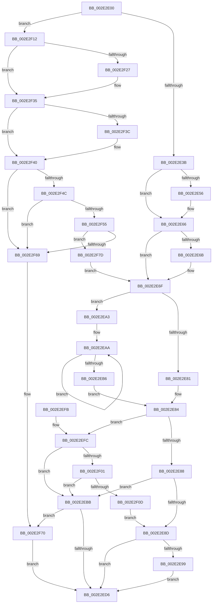

# ExpSaAllocatorFree

- RVA: `0x002E2E00`–`0x002E2F90` (길이 `400` bytes)
- VA: `0x00000001402E2E00`
- 실행 섹션: `.text`
- PDB 이름 있음: `예`; PDB Function 태그: `아니요`
- unwind 정보 RVA: `0x00070D98`
- 디코드: `122`개 명령, `400/400` bytes 표시
- 미해석 바이트: `0` (있으면 어셈블리에 `.byte`로 보존)

> 이 문서는 커널 이미지의 기계어와 PDB 기호를 분석해 생성했습니다. 4번과 5번은 함수 원형과 자료형을 바이너리 사용 방식에서 추정한 C 해석이며 원본 소스 복구 결과는 아닙니다.

## 1. Dependencies

- 직접 호출 지점: **9**; 고유 호출 대상: **8**
- 직접 호출자로 확인된 함수: **2**
- RIP 상대 이미지 참조: **0**

### Outgoing calls
- `0x002E2E42` → [KeAbPreAcquire](../21/KeAbPreAcquire_function_00210230.md) (function, `0x00210230`)
- `0x002E2E61` → [ExfAcquirePushLockSharedEx](../21/ExfAcquirePushLockSharedEx_function_0021044C.md) (function, `0x0021044C`)
- `0x002E2E78` → [ExpSaPageGroupFreeMemory](../49/ExpSaPageGroupFreeMemory_function_00493E8C.md) (function, `0x00493E8C`)
- `0x002E2E9C` → [ExfReleasePushLockShared](../26/ExfReleasePushLockShared_function_00263440.md) (function, `0x00263440`)
- `0x002E2EBE` → [ExpSaAllocatorOptimizeList](../4B/ExpSaAllocatorOptimizeList_function_004B5DDC.md) (function, `0x004B5DDC`)
- `0x002E2ED9` → [KeAbPostRelease](KeAbPostRelease_function_002E1600.md) (function, `0x002E1600`)
- `0x002E2F17` → [KeAbPreAcquire](../21/KeAbPreAcquire_function_00210230.md) (function, `0x00210230`)
- `0x002E2F30` → [ExfAcquirePushLockExclusiveEx](../20/ExfAcquirePushLockExclusiveEx_function_0020FC90.md) (function, `0x0020FC90`)
- `0x002E2F73` → [ExfTryToWakePushLock](../26/ExfTryToWakePushLock_function_00265DD0.md) (function, `0x00265DD0`)

### Direct callers
- [ExpCleanupAutoExpandPushLock](ExpCleanupAutoExpandPushLock_function_002E2D80.md) at `0x002E2DE8`
- [ExSaFree](../43/ExSaFree_function_0043FACC.md) at `0x0043FB25`

### Static image references
- 디코드된 RIP-relative 메모리 참조가 없습니다.

## 2. Other-region calls and transfers

- 다른 실행 섹션으로 향하는 call: **0**
- 별도 외부 분기/꼬리 이동을 확인하지 못했습니다.

## 3. Assembly (complete function range)

```asm
002E2E00  48 89 5C 24 08                  mov qword ptr [rsp + 8], rbx
002E2E05  48 89 6C 24 18                  mov qword ptr [rsp + 0x18], rbp
002E2E0A  48 89 74 24 20                  mov qword ptr [rsp + 0x20], rsi
002E2E0F  57                              push rdi
002E2E10  41 54                           push r12
002E2E12  41 55                           push r13
002E2E14  41 56                           push r14
002E2E16  41 57                           push r15
002E2E18  48 83 EC 20                     sub rsp, 0x20
002E2E1C  49 8B D8                        mov rbx, r8
002E2E1F  41 BD 01 00 00 00               mov r13d, 1
002E2E25  45 33 C0                        xor r8d, r8d
002E2E28  45 8B E1                        mov r12d, r9d
002E2E2B  48 8B F2                        mov rsi, rdx
002E2E2E  48 8B F9                        mov rdi, rcx
002E2E31  44 39 6A 28                     cmp dword ptr [rdx + 0x28], r13d
002E2E35  0F 84 D7 00 00 00               je 0x1402e2f12
002E2E3B  33 ED                           xor ebp, ebp
002E2E3D  33 D2                           xor edx, edx
002E2E3F  44 8A FD                        mov r15b, bpl
002E2E42  E8 E9 D3 F2 FF                  call 0x140210230
002E2E47  4C 8B F0                        mov r14, rax
002E2E4A  8D 4D 11                        lea ecx, [rbp + 0x11]
002E2E4D  33 C0                           xor eax, eax
002E2E4F  F0 48 0F B1 0F                  lock cmpxchg qword ptr [rdi], rcx
002E2E54  74 10                           je 0x1402e2e66
002E2E56  4C 8B CF                        mov r9, rdi
002E2E59  4D 8B C6                        mov r8, r14
002E2E5C  33 D2                           xor edx, edx
002E2E5E  48 8B CF                        mov rcx, rdi
002E2E61  E8 E6 D5 F2 FF                  call 0x14021044c
002E2E66  4D 85 F6                        test r14, r14
002E2E69  74 04                           je 0x1402e2e6f
002E2E6B  45 88 6E 0A                     mov byte ptr [r14 + 0xa], r13b
002E2E6F  45 8B C4                        mov r8d, r12d
002E2E72  48 8B D3                        mov rdx, rbx
002E2E75  48 8B CE                        mov rcx, rsi
002E2E78  E8 0F 10 1B 00                  call 0x140493e8c
002E2E7D  84 C0                           test al, al
002E2E7F  75 22                           jne 0x1402e2ea3
002E2E81  8B 47 40                        mov eax, dword ptr [rdi + 0x40]
002E2E84  A8 02                           test al, 2
002E2E86  75 74                           jne 0x1402e2efc
002E2E88  45 84 FF                        test r15b, r15b
002E2E8B  75 2E                           jne 0x1402e2ebb
002E2E8D  B8 11 00 00 00                  mov eax, 0x11
002E2E92  F0 48 0F B1 2F                  lock cmpxchg qword ptr [rdi], rbp
002E2E97  74 3D                           je 0x1402e2ed6
002E2E99  48 8B CF                        mov rcx, rdi
002E2E9C  E8 9F 05 F8 FF                  call 0x140263440
002E2EA1  EB 33                           jmp 0x1402e2ed6
002E2EA3  0F 0D 4F 40                     prefetchw byte ptr [rdi + 0x40]
002E2EA7  8B 47 40                        mov eax, dword ptr [rdi + 0x40]
002E2EAA  8B C8                           mov ecx, eax
002E2EAC  83 C9 02                        or ecx, 2
002E2EAF  F0 0F B1 4F 40                  lock cmpxchg dword ptr [rdi + 0x40], ecx
002E2EB4  75 F4                           jne 0x1402e2eaa
002E2EB6  83 C8 02                        or eax, 2
002E2EB9  EB C9                           jmp 0x1402e2e84
002E2EBB  48 8B CF                        mov rcx, rdi
002E2EBE  E8 19 2F 1D 00                  call 0x1404b5ddc
002E2EC3  48 83 C8 FF                     or rax, 0xffffffffffffffff
002E2EC7  F0 48 0F C1 07                  lock xadd qword ptr [rdi], rax
002E2ECC  24 06                           and al, 6
002E2ECE  3C 02                           cmp al, 2
002E2ED0  0F 84 9A 00 00 00               je 0x1402e2f70
002E2ED6  48 8B CF                        mov rcx, rdi
002E2ED9  E8 22 E7 FF FF                  call 0x1402e1600
002E2EDE  48 8B 5C 24 50                  mov rbx, qword ptr [rsp + 0x50]
002E2EE3  48 8B 6C 24 60                  mov rbp, qword ptr [rsp + 0x60]
002E2EE8  48 8B 74 24 68                  mov rsi, qword ptr [rsp + 0x68]
002E2EED  48 83 C4 20                     add rsp, 0x20
002E2EF1  41 5F                           pop r15
002E2EF3  41 5E                           pop r14
002E2EF5  41 5D                           pop r13
002E2EF7  41 5C                           pop r12
002E2EF9  5F                              pop rdi
002E2EFA  C3                              ret
002E2EFB  CC                              int3
002E2EFC  45 84 FF                        test r15b, r15b
002E2EFF  75 BA                           jne 0x1402e2ebb
002E2F01  B8 11 00 00 00                  mov eax, 0x11
002E2F06  F0 4C 0F B1 2F                  lock cmpxchg qword ptr [rdi], r13
002E2F0B  74 AE                           je 0x1402e2ebb
002E2F0D  E9 7B FF FF FF                  jmp 0x1402e2e8d
002E2F12  33 D2                           xor edx, edx
002E2F14  45 8A FD                        mov r15b, r13b
002E2F17  E8 14 D3 F2 FF                  call 0x140210230
002E2F1C  F0 48 0F BA 2F 00               lock bts qword ptr [rdi], 0
002E2F22  4C 8B F0                        mov r14, rax
002E2F25  73 0E                           jae 0x1402e2f35
002E2F27  4C 8B C7                        mov r8, rdi
002E2F2A  48 8B D0                        mov rdx, rax
002E2F2D  48 8B CF                        mov rcx, rdi
002E2F30  E8 5B CD F2 FF                  call 0x14020fc90
002E2F35  33 ED                           xor ebp, ebp
002E2F37  4D 85 F6                        test r14, r14
002E2F3A  74 04                           je 0x1402e2f40
002E2F3C  45 88 6E 0A                     mov byte ptr [r14 + 0xa], r13b
002E2F40  89 6E 28                        mov dword ptr [rsi + 0x28], ebp
002E2F43  48 8B 06                        mov rax, qword ptr [rsi]
002E2F46  48 39 70 08                     cmp qword ptr [rax + 8], rsi
002E2F4A  75 1D                           jne 0x1402e2f69
002E2F4C  48 8B 4E 08                     mov rcx, qword ptr [rsi + 8]
002E2F50  48 39 31                        cmp qword ptr [rcx], rsi
002E2F53  75 14                           jne 0x1402e2f69
002E2F55  48 89 01                        mov qword ptr [rcx], rax
002E2F58  48 89 48 08                     mov qword ptr [rax + 8], rcx
002E2F5C  48 8D 47 08                     lea rax, [rdi + 8]
002E2F60  48 8B 48 08                     mov rcx, qword ptr [rax + 8]
002E2F64  48 39 01                        cmp qword ptr [rcx], rax
002E2F67  74 14                           je 0x1402e2f7d
002E2F69  B9 03 00 00 00                  mov ecx, 3
002E2F6E  CD 29                           int 0x29
002E2F70  48 8B CF                        mov rcx, rdi
002E2F73  E8 58 2E F8 FF                  call 0x140265dd0
002E2F78  E9 59 FF FF FF                  jmp 0x1402e2ed6
002E2F7D  48 89 06                        mov qword ptr [rsi], rax
002E2F80  48 89 4E 08                     mov qword ptr [rsi + 8], rcx
002E2F84  48 89 31                        mov qword ptr [rcx], rsi
002E2F87  48 89 70 08                     mov qword ptr [rax + 8], rsi
002E2F8B  E9 DF FE FF FF                  jmp 0x1402e2e6f
```

## 4. C-style interpretation (structured pseudocode)

```c
__int64 __fastcall ExpSaAllocatorFree(__int64 a1, __int64 a2, __int64 a3, int a4)
{
    __int64 result;
    __int64 v_rbp;
    __int64 v_rsp;
    unsigned __int64 v_stack_p18;
    unsigned __int64 v_stack_p20;
    unsigned __int64 v_stack_p8;

    v_stack_p8 = v_rbx;
    v_stack_p18 = v_rbp;
    v_stack_p20 = v_rsi;
    v_rsp = (v_rsp) - (32);
    a3 = 0;
    if ((*(unsigned int *)(a2 + 40)) == 1) goto loc_002E2F12;
    v_rbp = 0;
    a2 = 0;
    result = KeAbPreAcquire(a1, a2, a3, a4);
    result = 0;
    if (!(condition_is_equal)) {
        a4 = a1;
        a3 = 0;
        a2 = 0;
        a1 = a1;
        result = ExfAcquirePushLockSharedEx(a1, a2, a3, a4);
    }
    if (result != 0) {
        *(unsigned __int8 *)(result + 10) = 1;
    }
    result = ExpSaPageGroupFreeMemory(0, a3, (unsigned int)((unsigned int)((unsigned int)(a4))), a4);
    if ((unsigned __int8)(result) != 0) goto loc_002E2EA3;
loc_002E2E84:
    if ((((unsigned __int8)((unsigned int)(*(unsigned int *)(a1 + 64)))) & (2)) != 0) goto loc_002E2EFC;
    if (0 != 0) goto loc_002E2EBB;
loc_002E2E8D:
    if (0 == 0) goto loc_002E2ED6;
    result = ExfReleasePushLockShared(a1, a3, (unsigned int)((unsigned int)((unsigned int)(a4))), a4);
    goto loc_002E2ED6;
loc_002E2EA3:
loc_002E2EAA:
    a1 = (unsigned int)(((unsigned int)((unsigned int)((unsigned int)(*(unsigned int *)(a1 + 64))))) | (2));
    if (condition_is_not_equal) goto loc_002E2EAA;
    result = (unsigned int)(((unsigned int)(*(unsigned int *)(a1 + 64))) | (2));
    goto loc_002E2E84;
loc_002E2EBB:
    result = ExpSaAllocatorOptimizeList(a1, a3, (unsigned int)((unsigned int)((unsigned int)(a4))), a4);
    result = (result) | (-1);
    result = (unsigned __int8)((result) & (6));
    if (((unsigned __int8)(result)) == 2) goto loc_002E2F70;
loc_002E2ED6:
    result = KeAbPostRelease(a1, a3, (unsigned int)((unsigned int)((unsigned int)(a4))), a4);
    v_rsp = (v_rsp) + (32);
    return result;
loc_002E2EFC:
    if (0 != 0) goto loc_002E2EBB;
    if (0 == 0) goto loc_002E2EBB;
    goto loc_002E2E8D;
loc_002E2F12:
    a2 = 0;
    result = KeAbPreAcquire(a1, a2, (unsigned int)((unsigned int)((unsigned int)(a4))), a4);
    if (!(condition_is_above_or_equal)) {
        a3 = a1;
        a2 = result;
        a1 = a1;
        result = ExfAcquirePushLockExclusiveEx(a1, a2, a3, a4);
    }
    v_rbp = 0;
    if (result != 0) {
        *(unsigned __int8 *)(result + 10) = 1;
    }
    *(unsigned int *)(v_stack_p20 + 40) = 0;
    if ((*(unsigned __int64 *)(*(unsigned __int64 *)(v_stack_p20) + 8)) != v_stack_p20) goto loc_002E2F69;
    if ((*(unsigned __int64 *)(*(unsigned __int64 *)(v_stack_p20 + 8))) != v_stack_p20) goto loc_002E2F69;
    *(unsigned __int64 *)(*(unsigned __int64 *)(v_stack_p20 + 8)) = *(unsigned __int64 *)(v_stack_p20);
    *(unsigned __int64 *)(*(unsigned __int64 *)(v_stack_p20) + 8) = *(unsigned __int64 *)(v_stack_p20 + 8);
    if ((*(unsigned __int64 *)(*(unsigned __int64 *)(a1 + 8 + 8))) == (a1 + 8)) goto loc_002E2F7D;
loc_002E2F69:
loc_002E2F70:
    result = ExfTryToWakePushLock(a1, a2, a3, a4);
    goto loc_002E2ED6;
loc_002E2F7D:
    *(unsigned __int64 *)(v_stack_p20) = result;
    *(unsigned __int64 *)(v_stack_p20 + 8) = a1;
    *(unsigned __int64 *)(a1) = v_stack_p20;
    *(unsigned __int64 *)(result + 8) = v_stack_p20;
    goto loc_002E2E6F;
}
```

## 5. (Beta) C Style

```c
int64_t ExpSaAllocatorFree(void *Arg1, void *Arg2, int64_t Arg3, int32_t Arg4)
{
    uint8_t *arg1 = (uint8_t *)Arg1;
    uint8_t *arg2 = (uint8_t *)Arg2;

    int64_t result;
    int64_t local_rbp;
    int64_t local_rsp;
    uint64_t v_stack_p18;
    uint64_t v_stack_p20;
    uint64_t v_stack_p8;

    v_stack_p8 = local_rbx;
    v_stack_p18 = local_rbp;
    v_stack_p20 = local_rsi;
    local_rsp = (local_rsp) - (32);
    Arg3 = 0;
    if ((*(uint32_t *)(arg2 + 0x28)) == 1) goto loc_002E2F12;
    local_rbp = 0;
    Arg2 = 0;
    result = KeAbPreAcquire(Arg1, Arg2, Arg3, Arg4);
    result = 0;
    if (!(condition_is_equal)) {
        Arg4 = Arg1;
        Arg3 = 0;
        Arg2 = 0;
        Arg1 = Arg1;
        result = ExfAcquirePushLockSharedEx(Arg1, Arg2, Arg3, Arg4);
    }
    if (result != 0) {
        *(uint8_t *)(result + 0xA) = 1;
    }
    result = ExpSaPageGroupFreeMemory(0, Arg3, (uint32_t)((uint32_t)((uint32_t)(Arg4))), Arg4);
    if ((uint8_t)(result) != 0) goto loc_002E2EA3;
loc_002E2E84:
    if ((((uint8_t)((uint32_t)(*(uint32_t *)(arg1 + 0x40)))) & (2)) != 0) goto loc_002E2EFC;
    if (0 != 0) goto loc_002E2EBB;
loc_002E2E8D:
    if (0 == 0) goto loc_002E2ED6;
    result = ExfReleasePushLockShared(Arg1, Arg3, (uint32_t)((uint32_t)((uint32_t)(Arg4))), Arg4);
    goto loc_002E2ED6;
loc_002E2EA3:
loc_002E2EAA:
    Arg1 = (uint32_t)(((uint32_t)((uint32_t)((uint32_t)(*(uint32_t *)(arg1 + 0x40))))) | (2));
    if (condition_is_not_equal) goto loc_002E2EAA;
    result = (uint32_t)(((uint32_t)(*(uint32_t *)(arg1 + 0x40))) | (2));
    goto loc_002E2E84;
loc_002E2EBB:
    result = ExpSaAllocatorOptimizeList(Arg1, Arg3, (uint32_t)((uint32_t)((uint32_t)(Arg4))), Arg4);
    result = (result) | (-1);
    result = (uint8_t)((result) & (6));
    if (((uint8_t)(result)) == 2) goto loc_002E2F70;
loc_002E2ED6:
    result = KeAbPostRelease(Arg1, Arg3, (uint32_t)((uint32_t)((uint32_t)(Arg4))), Arg4);
    local_rsp = (local_rsp) + (32);
    return result;
loc_002E2EFC:
    if (0 != 0) goto loc_002E2EBB;
    if (0 == 0) goto loc_002E2EBB;
    goto loc_002E2E8D;
loc_002E2F12:
    Arg2 = 0;
    result = KeAbPreAcquire(Arg1, Arg2, (uint32_t)((uint32_t)((uint32_t)(Arg4))), Arg4);
    if (!(condition_is_above_or_equal)) {
        Arg3 = Arg1;
        Arg2 = result;
        Arg1 = Arg1;
        result = ExfAcquirePushLockExclusiveEx(Arg1, Arg2, Arg3, Arg4);
    }
    local_rbp = 0;
    if (result != 0) {
        *(uint8_t *)(result + 0xA) = 1;
    }
    *(uint32_t *)(v_stack_p20 + 0x28) = 0;
    if ((*(uint64_t *)(*(uint64_t *)(v_stack_p20) + 0x8)) != v_stack_p20) goto loc_002E2F69;
    if ((*(uint64_t *)(*(uint64_t *)(v_stack_p20 + 0x8))) != v_stack_p20) goto loc_002E2F69;
    *(uint64_t *)(*(uint64_t *)(v_stack_p20 + 0x8)) = *(uint64_t *)(v_stack_p20);
    *(uint64_t *)(*(uint64_t *)(v_stack_p20) + 0x8) = *(uint64_t *)(v_stack_p20 + 0x8);
    if ((*(uint64_t *)(*(uint64_t *)(arg1 + 0x8 + 0x8))) == (Arg1 + 8)) goto loc_002E2F7D;
loc_002E2F69:
loc_002E2F70:
    result = ExfTryToWakePushLock(Arg1, Arg2, Arg3, Arg4);
    goto loc_002E2ED6;
loc_002E2F7D:
    *(uint64_t *)(v_stack_p20) = result;
    *(void **)(v_stack_p20 + 0x8) = Arg1;
    *(uint64_t *)(arg1) = v_stack_p20;
    *(uint64_t *)(result + 0x8) = v_stack_p20;
    goto loc_002E2E6F;
}
```

### 관측된 메모리 오프셋

구조체 형식이 확인되지 않은 접근은 인자 기준의 오프셋으로만 기록했습니다.

| 기준 인자 | 오프셋 표현 | 폭 (bit) | 접근 |
|---|---:|---:|---|
| `Arg1` | `+ 0x0` | `64` | `R` |
| `Arg1` | `+ 0x0` | `64` | `R/W` |
| `Arg1` | `+ 0x8` | `64` | `R` |
| `Arg1` | `+ 0x8` | `64` | `W` |
| `Arg1` | `+ 0x40` | `8` | `R` |
| `Arg1` | `+ 0x40` | `32` | `R` |
| `Arg2` | `+ 0x0` | `64` | `R` |
| `Arg2` | `+ 0x0` | `64` | `W` |
| `Arg2` | `+ 0x8` | `64` | `R` |
| `Arg2` | `+ 0x8` | `64` | `W` |
| `Arg2` | `+ 0x28` | `32` | `R` |
| `Arg2` | `+ 0x28` | `32` | `W` |

## 6. Execution-region graph

[열기: 2D/3D 그래프와 함수 탐색 컨트롤 패널](../../../control-panel.html?section=text&rva=0x002E2E00&view=graph)

- 2D 그래프는 위에서 아래로 흐르고, 3D 그래프는 빈 공간을 드래그해 회전합니다. Shift+드래그는 이동, 휠은 확대·축소, 함수 노드 선택은 대상 보고서 이동입니다.

### Static fallback


