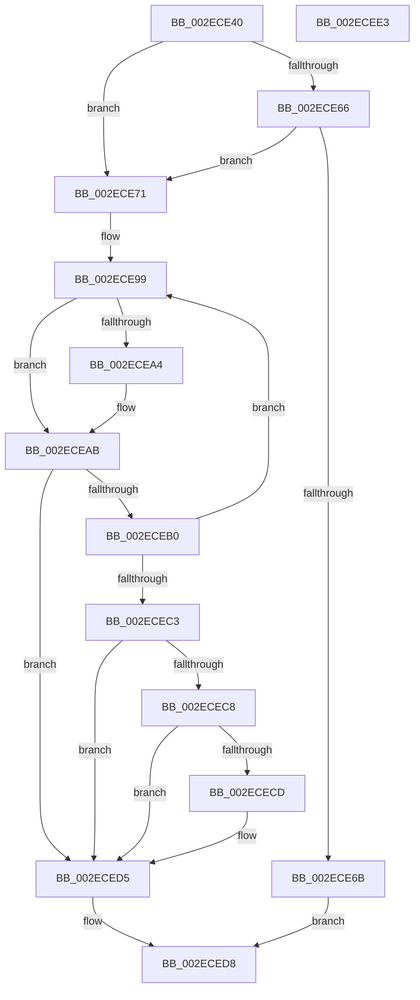

# ExpTrackTableGetMoreLimit

- RVA: `0x002ECE40`–`0x002ECEE4` (길이 `164` bytes)
- VA: `0x00000001402ECE40`
- 실행 섹션: `.text`
- PDB 이름 있음: `예`; PDB Function 태그: `아니요`
- unwind 정보 RVA: `0x0005CAAC`
- 디코드: `49`개 명령, `164/164` bytes 표시
- 미해석 바이트: `0` (있으면 어셈블리에 `.byte`로 보존)

> 이 문서는 커널 이미지의 기계어와 PDB 기호를 분석해 생성했습니다. 4번과 5번은 함수 원형과 자료형을 바이너리 사용 방식에서 추정한 C 해석이며 원본 소스 복구 결과는 아닙니다.

## 1. Dependencies

- 직접 호출 지점: **1**; 고유 호출 대상: **1**
- 직접 호출자로 확인된 함수: **2**
- RIP 상대 이미지 참조: **0**

### Outgoing calls
- `0x002ECED0` → [ExpTrackRaiseLimitNotification](../65/ExpTrackRaiseLimitNotification_function_00657264.md) (function, `0x00657264`)

### Direct callers
- [sub_0035B872](../35/Unknown_function_0035B872.md) at `0x0035B89D`
- [ExAllocateHeapPool](../35/ExAllocateHeapPool_function_0035BA30.md) at `0x0035D52C`
- [ExAllocateHeapPool](../35/ExAllocateHeapPool_function_0035BA30.md) at `0x0035E0DD`

### Static image references
- 디코드된 RIP-relative 메모리 참조가 없습니다.

## 2. Other-region calls and transfers

- 다른 실행 섹션으로 향하는 call: **0**
- 별도 외부 분기/꼬리 이동을 확인하지 못했습니다.

## 3. Assembly (complete function range)

```asm
002ECE40  48 89 5C 24 08                  mov qword ptr [rsp + 8], rbx
002ECE45  57                              push rdi
002ECE46  48 83 EC 20                     sub rsp, 0x20
002ECE4A  49 63 C0                        movsxd rax, r8d
002ECE4D  48 8B DA                        mov rbx, rdx
002ECE50  4C 8B C9                        mov r9, rcx
002ECE53  4C 8D 1C 40                     lea r11, [rax + rax*2]
002ECE57  4E 8B 54 D9 10                  mov r10, qword ptr [rcx + r11*8 + 0x10]
002ECE5C  4E 8B 44 D9 18                  mov r8, qword ptr [rcx + r11*8 + 0x18]
002ECE61  4D 85 D2                        test r10, r10
002ECE64  75 0B                           jne 0x1402ece71
002ECE66  4D 85 C0                        test r8, r8
002ECE69  75 06                           jne 0x1402ece71
002ECE6B  41 8D 42 01                     lea eax, [r10 + 1]
002ECE6F  EB 67                           jmp 0x1402eced8
002ECE71  4A 8B 54 D9 20                  mov rdx, qword ptr [rcx + r11*8 + 0x20]
002ECE76  48 8D 1C 5D 3F 00 00 00         lea rbx, [rbx*2 + 0x3f]
002ECE7E  B9 00 00 40 06                  mov ecx, 0x6400000
002ECE83  49 8B C2                        mov rax, r10
002ECE86  48 C1 E8 04                     shr rax, 4
002ECE8A  48 3B C1                        cmp rax, rcx
002ECE8D  48 0F 47 C1                     cmova rax, rcx
002ECE91  48 83 E3 C0                     and rbx, 0xffffffffffffffc0
002ECE95  4A 8D 3C 10                     lea rdi, [rax + r10]
002ECE99  48 8B CF                        mov rcx, rdi
002ECE9C  48 2B CA                        sub rcx, rdx
002ECE9F  4D 85 D2                        test r10, r10
002ECEA2  74 07                           je 0x1402eceab
002ECEA4  48 3B D9                        cmp rbx, rcx
002ECEA7  48 0F 47 D9                     cmova rbx, rcx
002ECEAB  48 85 DB                        test rbx, rbx
002ECEAE  74 25                           je 0x1402eced5
002ECEB0  48 8D 0C 13                     lea rcx, [rbx + rdx]
002ECEB4  48 8B C2                        mov rax, rdx
002ECEB7  F0 4B 0F B1 4C D9 20            lock cmpxchg qword ptr [r9 + r11*8 + 0x20], rcx
002ECEBE  48 8B D0                        mov rdx, rax
002ECEC1  75 D6                           jne 0x1402ece99
002ECEC3  49 3B C0                        cmp rax, r8
002ECEC6  77 0D                           ja 0x1402eced5
002ECEC8  49 3B C8                        cmp rcx, r8
002ECECB  76 08                           jbe 0x1402eced5
002ECECD  49 8B C9                        mov rcx, r9
002ECED0  E8 8F A3 36 00                  call 0x140657264
002ECED5  48 8B C3                        mov rax, rbx
002ECED8  48 8B 5C 24 30                  mov rbx, qword ptr [rsp + 0x30]
002ECEDD  48 83 C4 20                     add rsp, 0x20
002ECEE1  5F                              pop rdi
002ECEE2  C3                              ret
002ECEE3  CC                              int3
```

## 4. C-style interpretation (structured pseudocode)

```c
__int64 __fastcall ExpTrackTableGetMoreLimit(__int64 a1, __int64 a2, int a3)
{
    __int64 result;
    __int64 v_rbx;
    __int64 v_rsp;
    unsigned __int64 v_stack_p8;

    v_stack_p8 = v_rbx;
    v_rsp = (v_rsp) - (32);
    if (*(unsigned __int64 *)(a1 + (int)(a3) + (int)(a3) * 2 * 8 + 16) != 0) goto loc_002ECE71;
    if (*(unsigned __int64 *)(a1 + (int)(a3) + (int)(a3) * 2 * 8 + 24) != 0) goto loc_002ECE71;
    goto loc_002ECED8;
loc_002ECE71:
    result = (*(unsigned __int64 *)(a1 + (int)(a3) + (int)(a3) * 2 * 8 + 16)) >> (4);
    if (result > ((unsigned int)(0x6400000ULL))) { result = (unsigned int)(0x6400000ULL); }
    v_rbx = (a2 * 2 + 63) & (-64);
loc_002ECE99:
    a1 = (result + *(unsigned __int64 *)(a1 + (int)(a3) + (int)(a3) * 2 * 8 + 16) * 1) - (*(unsigned __int64 *)(a1 + (int)(a3) + (int)(a3) * 2 * 8 + 32));
    if (*(unsigned __int64 *)(a1 + (int)(a3) + (int)(a3) * 2 * 8 + 16) != 0) {
        if (v_rbx > a1) { v_rbx = a1; }
    }
    if (v_rbx == 0) goto loc_002ECED5;
    if (v_rbx != 0) goto loc_002ECE99;
    if ((*(unsigned __int64 *)(a1 + (int)(a3) + (int)(a3) * 2 * 8 + 32)) > (*(unsigned __int64 *)(a1 + (int)(a3) + (int)(a3) * 2 * 8 + 24))) goto loc_002ECED5;
    result = *(unsigned __int64 *)(a1 + (int)(a3) + (int)(a3) * 2 * 8 + 32);
    if ((v_rbx + *(unsigned __int64 *)(a1 + (int)(a3) + (int)(a3) * 2 * 8 + 32) * 1) >= = (*(unsigned __int64 *)(a1 + (int)(a3) + (int)(a3) * 2 * 8 + 24))) {
        a1 = a1;
        result = ExpTrackRaiseLimitNotification(a1, *(unsigned __int64 *)(a1 + (int)(a3) + (int)(a3) * 2 * 8 + 32), *(unsigned __int64 *)(a1 + (int)(a3) + (int)(a3) * 2 * 8 + 24), a1);
    }
loc_002ECED8:
    v_rsp = (v_rsp) + (32);
    return v_rbx;
}
```

## 5. (Beta) C Style

```c
int64_t ExpTrackTableGetMoreLimit(void *Arg1, int64_t Arg2, void *Arg3)
{
    uint8_t *arg1 = (uint8_t *)Arg1;
    uint8_t *arg3 = (uint8_t *)Arg3;

    int64_t result;
    int64_t local_rbx;
    int64_t local_rsp;
    uint64_t v_stack_p8;

    v_stack_p8 = local_rbx;
    local_rsp = (local_rsp) - (32);
    if (*(uint64_t *)(arg1 + (int32_t)(arg3) + (int32_t)(arg3) * 2 * 8 + 0x10) != 0) goto loc_002ECE71;
    if (*(uint64_t *)(arg1 + (int32_t)(arg3) + (int32_t)(arg3) * 2 * 8 + 0x18) != 0) goto loc_002ECE71;
    goto loc_002ECED8;
loc_002ECE71:
    result = (*(uint64_t *)(arg1 + (int32_t)(arg3) + (int32_t)(arg3) * 2 * 8 + 0x10)) >> (4);
    if (result > ((uint32_t)(0x6400000ULL))) { result = (uint32_t)(0x6400000ULL); }
    local_rbx = (Arg2 * 2 + 63) & (-64);
loc_002ECE99:
    Arg1 = (result + *(uint64_t *)(arg1 + (int32_t)(arg3) + (int32_t)(arg3) * 2 * 8 + 0x10) * 1) - (*(uint64_t *)(arg1 + (int32_t)(arg3) + (int32_t)(arg3) * 2 * 8 + 0x20));
    if (*(uint64_t *)(arg1 + (int32_t)(arg3) + (int32_t)(arg3) * 2 * 8 + 0x10) != 0) {
        if (local_rbx > Arg1) { local_rbx = Arg1; }
    }
    if (local_rbx == 0) goto loc_002ECED5;
    if (local_rbx != 0) goto loc_002ECE99;
    if ((*(uint64_t *)(arg1 + (int32_t)(arg3) + (int32_t)(arg3) * 2 * 8 + 0x20)) > (*(uint64_t *)(arg1 + (int32_t)(arg3) + (int32_t)(arg3) * 2 * 8 + 0x18))) goto loc_002ECED5;
    result = *(uint64_t *)(arg1 + (int32_t)(arg3) + (int32_t)(arg3) * 2 * 8 + 0x20);
    if ((local_rbx + *(uint64_t *)(arg1 + (int32_t)(arg3) + (int32_t)(arg3) * 2 * 8 + 0x20) * 1) >= = (*(uint64_t *)(arg1 + (int32_t)(arg3) + (int32_t)(arg3) * 2 * 8 + 0x18))) {
        Arg1 = Arg1;
        result = ExpTrackRaiseLimitNotification(Arg1, *(uint64_t *)(arg1 + (int32_t)(arg3) + (int32_t)(arg3) * 2 * 8 + 0x20), *(uint64_t *)(arg1 + (int32_t)(arg3) + (int32_t)(arg3) * 2 * 8 + 0x18), Arg1);
    }
loc_002ECED8:
    local_rsp = (local_rsp) + (32);
    return local_rbx;
}
```

### 관측된 메모리 오프셋

구조체 형식이 확인되지 않은 접근은 인자 기준의 오프셋으로만 기록했습니다.

| 기준 인자 | 오프셋 표현 | 폭 (bit) | 접근 |
|---|---:|---:|---|
| `Arg1` | `+ 0x10 + r11*8` | `64` | `R` |
| `Arg1` | `+ 0x18 + r11*8` | `64` | `R` |
| `Arg1` | `+ 0x20 + r11*8` | `64` | `R` |
| `Arg3` | `+ 0x0 + rax*2` | `64` | `R` |

## 6. Execution-region graph

[열기: 2D/3D 그래프와 함수 탐색 컨트롤 패널](../../../control-panel.html?section=text&rva=0x002ECE40&view=graph)

- 2D 그래프는 위에서 아래로 흐르고, 3D 그래프는 빈 공간을 드래그해 회전합니다. Shift+드래그는 이동, 휠은 확대·축소, 함수 노드 선택은 대상 보고서 이동입니다.

### Static fallback


