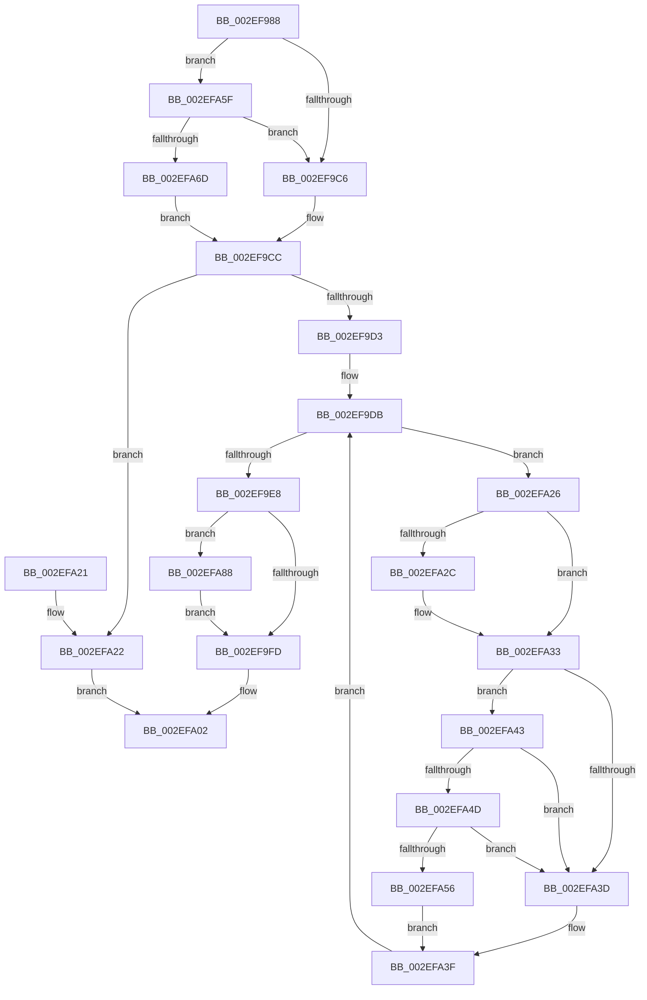

# ExpTryConvertSharedSpinLockExclusiveInstrumented

- RVA: `0x002EF988`–`0x002EFACB` (길이 `323` bytes)
- VA: `0x00000001402EF988`
- 실행 섹션: `.text`
- PDB 이름 있음: `예`; PDB Function 태그: `아니요`
- unwind 정보 RVA: `0x00071AF8`
- 디코드: `90`개 명령, `323/323` bytes 표시
- 미해석 바이트: `0` (있으면 어셈블리에 `.byte`로 보존)

> 이 문서는 커널 이미지의 기계어와 PDB 기호를 분석해 생성했습니다. 4번과 5번은 함수 원형과 자료형을 바이너리 사용 방식에서 추정한 C 해석이며 원본 소스 복구 결과는 아닙니다.

## 1. Dependencies

- 직접 호출 지점: **4**; 고유 호출 대상: **4**
- 직접 호출자로 확인된 함수: **2**
- RIP 상대 이미지 참조: **4**

### Outgoing calls
- `0x002EFA4D` → [KiCheckVpBackingLongSpinWaitHypercall](../30/KiCheckVpBackingLongSpinWaitHypercall_function_0030F490.md) (function, `0x0030F490`)
- `0x002EFA58` → [HvlNotifyLongSpinWait](../30/HvlNotifyLongSpinWait_function_0030F460.md) (function, `0x0030F460`)
- `0x002EFA9A` → [PerfLogSpinLockRelease](../4C/PerfLogSpinLockRelease_function_004CD094.md) (function, `0x004CD094`)
- `0x002EFAC1` → [PerfLogSpinLockAcquire](../41/PerfLogSpinLockAcquire_function_00414FC4.md) (function, `0x00414FC4`)

### Direct callers
- [ExTryConvertSharedSpinLockExclusive](ExTryConvertSharedSpinLockExclusive_function_002EF4C0.md) at `0x002EF52D`
- [ExpAddTagForBigPages](ExpAddTagForBigPages_function_002EF570.md) at `0x002EF7F6`

### Static image references
- `0x002EF9B6` → RVA `0x00FC6B06` (`ALMOSTRO`; read)
- `0x002EFA35` → RVA `0x00FC52AC` (`ALMOSTRO`; reference)
- `0x002EFA43` → RVA `0x00FC6AB8` (`ALMOSTRO`; read)
- `0x002EFA5F` → RVA `0x00F0DE58` (`.data`; read)

## 2. Other-region calls and transfers

- 다른 실행 섹션으로 향하는 call: **0**
- 별도 외부 분기/꼬리 이동을 확인하지 못했습니다.

## 3. Assembly (complete function range)

```asm
002EF988  48 8B C4                        mov rax, rsp
002EF98B  48 89 58 08                     mov qword ptr [rax + 8], rbx
002EF98F  48 89 68 10                     mov qword ptr [rax + 0x10], rbp
002EF993  48 89 70 18                     mov qword ptr [rax + 0x18], rsi
002EF997  48 89 78 20                     mov qword ptr [rax + 0x20], rdi
002EF99B  41 54                           push r12
002EF99D  41 56                           push r14
002EF99F  41 57                           push r15
002EF9A1  48 83 EC 30                     sub rsp, 0x30
002EF9A5  65 48 8B 1C 25 20 00 00 00      mov rbx, qword ptr gs:[0x20]
002EF9AE  33 F6                           xor esi, esi
002EF9B0  45 33 FF                        xor r15d, r15d
002EF9B3  4C 8B E2                        mov r12, rdx
002EF9B6  F6 05 49 71 CD 00 01            test byte ptr [rip + 0xcd7149], 1
002EF9BD  48 8B F9                        mov rdi, rcx
002EF9C0  0F 85 99 00 00 00               jne 0x1402efa5f
002EF9C6  40 32 ED                        xor bpl, bpl
002EF9C9  45 33 F6                        xor r14d, r14d
002EF9CC  F0 0F BA 29 1F                  lock bts dword ptr [rcx], 0x1f
002EF9D1  72 4F                           jb 0x1402efa22
002EF9D3  FF 83 C0 8E 00 00               inc dword ptr [rbx + 0x8ec0]
002EF9D9  8B 09                           mov ecx, dword ptr [rcx]
002EF9DB  8B C1                           mov eax, ecx
002EF9DD  0F BA F0 1E                     btr eax, 0x1e
002EF9E1  3D 01 00 00 80                  cmp eax, 0x80000001
002EF9E6  75 3E                           jne 0x1402efa26
002EF9E8  FF 83 C4 8E 00 00               inc dword ptr [rbx + 0x8ec4]
002EF9EE  01 B3 C8 8E 00 00               add dword ptr [rbx + 0x8ec8], esi
002EF9F4  40 84 ED                        test bpl, bpl
002EF9F7  0F 85 8B 00 00 00               jne 0x1402efa88
002EF9FD  B8 01 00 00 00                  mov eax, 1
002EFA02  48 8B 5C 24 50                  mov rbx, qword ptr [rsp + 0x50]
002EFA07  48 8B 6C 24 58                  mov rbp, qword ptr [rsp + 0x58]
002EFA0C  48 8B 74 24 60                  mov rsi, qword ptr [rsp + 0x60]
002EFA11  48 8B 7C 24 68                  mov rdi, qword ptr [rsp + 0x68]
002EFA16  48 83 C4 30                     add rsp, 0x30
002EFA1A  41 5F                           pop r15
002EFA1C  41 5E                           pop r14
002EFA1E  41 5C                           pop r12
002EFA20  C3                              ret
002EFA21  CC                              int3
002EFA22  33 C0                           xor eax, eax
002EFA24  EB DC                           jmp 0x1402efa02
002EFA26  0F BA E1 1E                     bt ecx, 0x1e
002EFA2A  72 07                           jb 0x1402efa33
002EFA2C  F0 81 0F 00 00 00 40            lock or dword ptr [rdi], 0x40000000
002EFA33  FF C6                           inc esi
002EFA35  85 35 71 58 CD 00               test dword ptr [rip + 0xcd5871], esi
002EFA3B  74 06                           je 0x1402efa43
002EFA3D  F3 90                           pause
002EFA3F  8B 0F                           mov ecx, dword ptr [rdi]
002EFA41  EB 98                           jmp 0x1402ef9db
002EFA43  8B 05 6F 70 CD 00               mov eax, dword ptr [rip + 0xcd706f]
002EFA49  A8 40                           test al, 0x40
002EFA4B  74 F0                           je 0x1402efa3d
002EFA4D  E8 3E FA 01 00                  call 0x14030f490
002EFA52  84 C0                           test al, al
002EFA54  74 E7                           je 0x1402efa3d
002EFA56  8B CE                           mov ecx, esi
002EFA58  E8 03 FA 01 00                  call 0x14030f460
002EFA5D  EB E0                           jmp 0x1402efa3f
002EFA5F  8B 05 F3 E3 C1 00               mov eax, dword ptr [rip + 0xc1e3f3]
002EFA65  85 C0                           test eax, eax
002EFA67  0F 85 59 FF FF FF               jne 0x1402ef9c6
002EFA6D  40 B5 01                        mov bpl, 1
002EFA70  0F 31                           rdtsc
002EFA72  44 8B B3 40 86 00 00            mov r14d, dword ptr [rbx + 0x8640]
002EFA79  48 C1 E2 20                     shl rdx, 0x20
002EFA7D  48 0B C2                        or rax, rdx
002EFA80  4C 8B F8                        mov r15, rax
002EFA83  E9 44 FF FF FF                  jmp 0x1402ef9cc
002EFA88  0F 31                           rdtsc
002EFA8A  48 C1 E2 20                     shl rdx, 0x20
002EFA8E  48 8B CF                        mov rcx, rdi
002EFA91  48 0B C2                        or rax, rdx
002EFA94  49 8B D4                        mov rdx, r12
002EFA97  4C 8B C0                        mov r8, rax
002EFA9A  E8 F5 D5 1D 00                  call 0x1404cd094
002EFA9F  0F 31                           rdtsc
002EFAA1  48 C1 E2 20                     shl rdx, 0x20
002EFAA5  44 8B CE                        mov r9d, esi
002EFAA8  48 0B C2                        or rax, rdx
002EFAAB  C6 44 24 28 04                  mov byte ptr [rsp + 0x28], 4
002EFAB0  44 8B C0                        mov r8d, eax
002EFAB3  44 89 74 24 20                  mov dword ptr [rsp + 0x20], r14d
002EFAB8  45 2B C7                        sub r8d, r15d
002EFABB  48 8B D0                        mov rdx, rax
002EFABE  48 8B CF                        mov rcx, rdi
002EFAC1  E8 FE 54 12 00                  call 0x140414fc4
002EFAC6  E9 32 FF FF FF                  jmp 0x1402ef9fd
```

## 4. C-style interpretation (structured pseudocode)

```c
__int64 __fastcall ExpTryConvertSharedSpinLockExclusiveInstrumented(__int64 a1, __int64 a2)
{
    __int64 result;
    __int64 v_r14;
    __int64 v_r15;
    __int64 v_rbp;
    __int64 v_rsi;
    __int64 v_rsp;
    unsigned __int64 v_stack_p10;
    unsigned __int64 v_stack_p18;
    unsigned __int64 v_stack_p20;
    unsigned __int8 v_stack_p28;
    unsigned __int64 v_stack_p8;

    *(unsigned __int64 *)(v_rsp + 8) = v_rbx;
    *(unsigned __int64 *)(v_rsp + 16) = v_rbp;
    *(unsigned __int64 *)(v_rsp + 24) = v_rsi;
    *(unsigned __int64 *)(v_rsp + 32) = v_rdi;
    v_rsp = (v_rsp) - (48);
    v_rsi = 0;
    v_r15 = 0;
    if (((*(unsigned __int8 *)(v_rip + 13463881)) & (1)) != 0) goto loc_002EFA5F;
loc_002EF9C6:
    v_rbp = 0;
    v_r14 = 0;
loc_002EF9CC:
    if (condition_is_below) goto loc_002EFA22;
loc_002EF9DB:
    if (((unsigned int)((unsigned int)((unsigned int)((unsigned int)(*(unsigned int *)(a1)))))) != 0x80000001ULL) goto loc_002EFA26;
    if (0 != 0) goto loc_002EFA88;
loc_002EF9FD:
loc_002EFA02:
    v_rsp = (v_rsp) + (48);
    return 1;
loc_002EFA22:
    result = 0;
    goto loc_002EFA02;
loc_002EFA26:
    if (!(condition_is_below)) {
    }
    v_rsi = (unsigned int)((v_stack_p18) + 1);
    if (((*(unsigned int *)(v_rip + 13457521)) & ((unsigned int)(v_rsi))) == 0) goto loc_002EFA43;
loc_002EFA3D:
loc_002EFA3F:
    goto loc_002EF9DB;
loc_002EFA43:
    if ((((unsigned __int8)((unsigned int)(*(unsigned int *)(v_rip + 13463663)))) & (64)) == 0) goto loc_002EFA3D;
    result = KiCheckVpBackingLongSpinWaitHypercall((unsigned int)(*(unsigned int *)(v_stack_p20)), a2, a3, a4);
    if ((unsigned __int8)(result) == 0) goto loc_002EFA3D;
    result = HvlNotifyLongSpinWait((unsigned int)((unsigned int)(v_rsi)), a2, a3, a4);
    goto loc_002EFA3F;
loc_002EFA5F:
    if ((unsigned int)((unsigned int)(*(unsigned int *)(v_rip + 12706803))) != 0) goto loc_002EF9C6;
    a2 = (a2) << (32);
    result = ((unsigned int)(*(unsigned int *)(v_rip + 12706803))) | (a2);
    goto loc_002EF9CC;
loc_002EFA88:
    a2 = (a2) << (32);
    result = (result) | (a2);
    result = PerfLogSpinLockRelease(v_stack_p20, a2, result, a4);
    a2 = (a2) << (32);
    result = (result) | (a2);
    v_stack_p28 = 4;
    v_stack_p20 = (unsigned int)((unsigned int)(*(unsigned int *)(v_stack_p8 + 34368)));
    a3 = (unsigned int)(((unsigned int)((unsigned int)(result))) - ((unsigned int)(result)));
    result = PerfLogSpinLockAcquire(v_stack_p20, result, a3, (unsigned int)((unsigned int)(v_rsi)));
    goto loc_002EF9FD;
}
```

## 5. (Beta) C Style

```c
int64_t ExpTryConvertSharedSpinLockExclusiveInstrumented(void *Arg1, int64_t Arg2)
{
    uint8_t *arg1 = (uint8_t *)Arg1;

    int64_t result;
    int64_t local_r14;
    int64_t local_r15;
    int64_t local_rbp;
    int64_t local_rsi;
    int64_t local_rsp;
    uint64_t v_stack_p10;
    uint64_t v_stack_p18;
    uint64_t v_stack_p20;
    uint8_t v_stack_p28;
    uint64_t v_stack_p8;

    *(uint64_t *)(local_rsp + 0x8) = local_rbx;
    *(uint64_t *)(local_rsp + 0x10) = local_rbp;
    *(uint64_t *)(local_rsp + 0x18) = local_rsi;
    *(uint64_t *)(local_rsp + 0x20) = local_rdi;
    local_rsp = (local_rsp) - (48);
    local_rsi = 0;
    local_r15 = 0;
    if (((*(uint8_t *)(v_rip + 0xCD7149)) & (1)) != 0) goto loc_002EFA5F;
loc_002EF9C6:
    local_rbp = 0;
    local_r14 = 0;
loc_002EF9CC:
    if (condition_is_below) goto loc_002EFA22;
loc_002EF9DB:
    if (((uint32_t)((uint32_t)((uint32_t)((uint32_t)(*(uint32_t *)(arg1)))))) != 0x80000001ULL) goto loc_002EFA26;
    if (0 != 0) goto loc_002EFA88;
loc_002EF9FD:
loc_002EFA02:
    local_rsp = (local_rsp) + (48);
    return 1;
loc_002EFA22:
    result = 0;
    goto loc_002EFA02;
loc_002EFA26:
    if (!(condition_is_below)) {
    }
    local_rsi = (uint32_t)((v_stack_p18) + 1);
    if (((*(uint32_t *)(v_rip + 0xCD5871)) & ((uint32_t)(local_rsi))) == 0) goto loc_002EFA43;
loc_002EFA3D:
loc_002EFA3F:
    goto loc_002EF9DB;
loc_002EFA43:
    if ((((uint8_t)((uint32_t)(*(uint32_t *)(v_rip + 0xCD706F)))) & (64)) == 0) goto loc_002EFA3D;
    result = KiCheckVpBackingLongSpinWaitHypercall((uint32_t)(*(uint32_t *)(v_stack_p20)), Arg2, a3, a4);
    if ((uint8_t)(result) == 0) goto loc_002EFA3D;
    result = HvlNotifyLongSpinWait((uint32_t)((uint32_t)(local_rsi)), Arg2, a3, a4);
    goto loc_002EFA3F;
loc_002EFA5F:
    if ((uint32_t)((uint32_t)(*(uint32_t *)(v_rip + 0xC1E3F3))) != 0) goto loc_002EF9C6;
    Arg2 = (Arg2) << (32);
    result = ((uint32_t)(*(uint32_t *)(v_rip + 0xC1E3F3))) | (Arg2);
    goto loc_002EF9CC;
loc_002EFA88:
    Arg2 = (Arg2) << (32);
    result = (result) | (Arg2);
    result = PerfLogSpinLockRelease(v_stack_p20, Arg2, result, a4);
    Arg2 = (Arg2) << (32);
    result = (result) | (Arg2);
    v_stack_p28 = 4;
    v_stack_p20 = (uint32_t)((uint32_t)(*(uint32_t *)(v_stack_p8 + 0x8640)));
    a3 = (uint32_t)(((uint32_t)((uint32_t)(result))) - ((uint32_t)(result)));
    result = PerfLogSpinLockAcquire(v_stack_p20, result, a3, (uint32_t)((uint32_t)(local_rsi)));
    goto loc_002EF9FD;
}
```

### 관측된 메모리 오프셋

구조체 형식이 확인되지 않은 접근은 인자 기준의 오프셋으로만 기록했습니다.

| 기준 인자 | 오프셋 표현 | 폭 (bit) | 접근 |
|---|---:|---:|---|
| `Arg1` | `+ 0x0` | `32` | `R` |
| `Arg1` | `+ 0x0` | `32` | `R/W` |

## 6. Execution-region graph

[열기: 2D/3D 그래프와 함수 탐색 컨트롤 패널](../../../control-panel.html?section=text&rva=0x002EF988&view=graph)

- 2D 그래프는 위에서 아래로 흐르고, 3D 그래프는 빈 공간을 드래그해 회전합니다. Shift+드래그는 이동, 휠은 확대·축소, 함수 노드 선택은 대상 보고서 이동입니다.

### Static fallback


