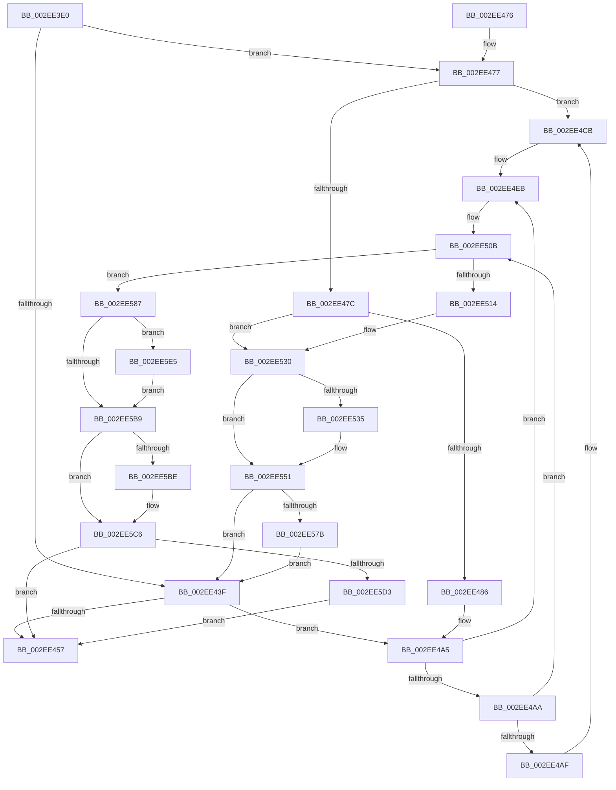

# KasanPoolAllocate

- RVA: `0x002EE3E0`–`0x002EE5F7` (길이 `535` bytes)
- VA: `0x00000001402EE3E0`
- 실행 섹션: `.text`
- PDB 이름 있음: `예`; PDB Function 태그: `아니요`
- unwind 정보 RVA: `0x000719C0`
- 디코드: `143`개 명령, `535/535` bytes 표시
- 미해석 바이트: `0` (있으면 어셈블리에 `.byte`로 보존)

> 이 문서는 커널 이미지의 기계어와 PDB 기호를 분석해 생성했습니다. 4번과 5번은 함수 원형과 자료형을 바이너리 사용 방식에서 추정한 C 해석이며 원본 소스 복구 결과는 아닙니다.

## 1. Dependencies

- 직접 호출 지점: **9**; 고유 호출 대상: **2**
- 직접 호출자로 확인된 함수: **2**
- RIP 상대 이미지 참조: **2**

### Outgoing calls
- `0x002EE49F` → [KeBugCheckEx](../4F/KeBugCheckEx_function_004FD660.md) (function, `0x004FD660`)
- `0x002EE4C5` → [KeBugCheckEx](../4F/KeBugCheckEx_function_004FD660.md) (function, `0x004FD660`)
- `0x002EE4E5` → [KeBugCheckEx](../4F/KeBugCheckEx_function_004FD660.md) (function, `0x004FD660`)
- `0x002EE505` → [KeBugCheckEx](../4F/KeBugCheckEx_function_004FD660.md) (function, `0x004FD660`)
- `0x002EE52A` → [KeBugCheckEx](../4F/KeBugCheckEx_function_004FD660.md) (function, `0x004FD660`)
- `0x002EE54B` → [KeBugCheckEx](../4F/KeBugCheckEx_function_004FD660.md) (function, `0x004FD660`)
- `0x002EE57D` → [memset](../6C/memset_function_006C6C40.md) (function, `0x006C6C40`)
- `0x002EE5DB` → [memset](../6C/memset_function_006C6C40.md) (function, `0x006C6C40`)
- `0x002EE5ED` → [memset](../6C/memset_function_006C6C40.md) (function, `0x006C6C40`)

### Direct callers
- [ExAllocateContiguousHeapPool](ExAllocateContiguousHeapPool_function_002EE960.md) at `0x002EEB2B`
- [ExAllocateHeapPool](../35/ExAllocateHeapPool_function_0035BA30.md) at `0x0035EEC3`
- [ExAllocateHeapPool](../35/ExAllocateHeapPool_function_0035BA30.md) at `0x0035EF64`

### Static image references
- `0x002EE3FE` → RVA `0x00FCEC68` (`ALMOSTRO`; read)
- `0x002EE563` → RVA `0x00FC6ED8` (`ALMOSTRO`; read)

## 2. Other-region calls and transfers

- 다른 실행 섹션으로 향하는 call: **0**
- 별도 외부 분기/꼬리 이동을 확인하지 못했습니다.

## 3. Assembly (complete function range)

```asm
002EE3E0  48 89 5C 24 08                  mov qword ptr [rsp + 8], rbx
002EE3E5  48 89 6C 24 10                  mov qword ptr [rsp + 0x10], rbp
002EE3EA  48 89 74 24 18                  mov qword ptr [rsp + 0x18], rsi
002EE3EF  48 89 7C 24 20                  mov qword ptr [rsp + 0x20], rdi
002EE3F4  41 54                           push r12
002EE3F6  41 56                           push r14
002EE3F8  41 57                           push r15
002EE3FA  48 83 EC 30                     sub rsp, 0x30
002EE3FE  0F B6 35 63 08 CE 00            movzx esi, byte ptr [rip + 0xce0863]
002EE405  49 8B C0                        mov rax, r8
002EE408  48 2B C1                        sub rax, rcx
002EE40B  48 8B F9                        mov rdi, rcx
002EE40E  49 8B C8                        mov rcx, r8
002EE411  83 E0 07                        and eax, 7
002EE414  48 2B C8                        sub rcx, rax
002EE417  49 8B D8                        mov rbx, r8
002EE41A  4C 8B C1                        mov r8, rcx
002EE41D  49 8B E9                        mov rbp, r9
002EE420  4C 2B C7                        sub r8, rdi
002EE423  4C 8B F2                        mov r14, rdx
002EE426  49 BF 00 00 00 00 00 80 FF FF   movabs r15, 0xffff800000000000
002EE430  49 BC 00 00 00 00 00 80 00 00   movabs r12, 0x800000000000
002EE43A  40 84 F6                        test sil, sil
002EE43D  75 38                           jne 0x1402ee477
002EE43F  48 8B CB                        mov rcx, rbx
002EE442  48 83 E1 F8                     and rcx, 0xfffffffffffffff8
002EE446  48 2B D9                        sub rbx, rcx
002EE449  48 2B F9                        sub rdi, rcx
002EE44C  48 03 DD                        add rbx, rbp
002EE44F  49 03 FE                        add rdi, r14
002EE452  40 84 F6                        test sil, sil
002EE455  75 4E                           jne 0x1402ee4a5
002EE457  48 8B 5C 24 50                  mov rbx, qword ptr [rsp + 0x50]
002EE45C  48 8B 6C 24 58                  mov rbp, qword ptr [rsp + 0x58]
002EE461  48 8B 74 24 60                  mov rsi, qword ptr [rsp + 0x60]
002EE466  48 8B 7C 24 68                  mov rdi, qword ptr [rsp + 0x68]
002EE46B  48 83 C4 30                     add rsp, 0x30
002EE46F  41 5F                           pop r15
002EE471  41 5E                           pop r14
002EE473  41 5C                           pop r12
002EE475  C3                              ret
002EE476  CC                              int3
002EE477  49 3B FF                        cmp rdi, r15
002EE47A  72 4F                           jb 0x1402ee4cb
002EE47C  40 F6 C7 07                     test dil, 7
002EE480  0F 84 AA 00 00 00               je 0x1402ee530
002EE486  BA 02 00 00 00                  mov edx, 2
002EE48B  48 C7 44 24 20 08 00 00 00      mov qword ptr [rsp + 0x20], 8
002EE494  44 8B C2                        mov r8d, edx
002EE497  4C 8B CF                        mov r9, rdi
002EE49A  B9 F1 01 00 00                  mov ecx, 0x1f1
002EE49F  E8 BC F1 20 00                  call 0x1404fd660
002EE4A4  CC                              int3
002EE4A5  49 3B CF                        cmp rcx, r15
002EE4A8  72 41                           jb 0x1402ee4eb
002EE4AA  48 3B DF                        cmp rbx, rdi
002EE4AD  76 5C                           jbe 0x1402ee50b
002EE4AF  BA 02 00 00 00                  mov edx, 2
002EE4B4  48 89 7C 24 20                  mov qword ptr [rsp + 0x20], rdi
002EE4B9  4C 8B CB                        mov r9, rbx
002EE4BC  B9 F1 01 00 00                  mov ecx, 0x1f1
002EE4C1  44 8D 42 01                     lea r8d, [rdx + 1]
002EE4C5  E8 96 F1 20 00                  call 0x1404fd660
002EE4CA  CC                              int3
002EE4CB  BA 02 00 00 00                  mov edx, 2
002EE4D0  48 C7 44 24 20 00 00 00 00      mov qword ptr [rsp + 0x20], 0
002EE4D9  4C 8B CF                        mov r9, rdi
002EE4DC  B9 F1 01 00 00                  mov ecx, 0x1f1
002EE4E1  44 8D 42 FF                     lea r8d, [rdx - 1]
002EE4E5  E8 76 F1 20 00                  call 0x1404fd660
002EE4EA  CC                              int3
002EE4EB  BA 02 00 00 00                  mov edx, 2
002EE4F0  48 C7 44 24 20 00 00 00 00      mov qword ptr [rsp + 0x20], 0
002EE4F9  4C 8B C9                        mov r9, rcx
002EE4FC  B9 F1 01 00 00                  mov ecx, 0x1f1
002EE501  44 8D 42 FF                     lea r8d, [rdx - 1]
002EE505  E8 56 F1 20 00                  call 0x1404fd660
002EE50A  CC                              int3
002EE50B  48 8D 04 0F                     lea rax, [rdi + rcx]
002EE50F  48 3B C1                        cmp rax, rcx
002EE512  73 73                           jae 0x1402ee587
002EE514  BA 02 00 00 00                  mov edx, 2
002EE519  48 89 7C 24 20                  mov qword ptr [rsp + 0x20], rdi
002EE51E  4C 8B C9                        mov r9, rcx
002EE521  B9 F1 01 00 00                  mov ecx, 0x1f1
002EE526  44 8D 42 01                     lea r8d, [rdx + 1]
002EE52A  E8 31 F1 20 00                  call 0x1404fd660
002EE52F  CC                              int3
002EE530  48 3B CF                        cmp rcx, rdi
002EE533  73 1C                           jae 0x1402ee551
002EE535  BA 02 00 00 00                  mov edx, 2
002EE53A  4C 89 44 24 20                  mov qword ptr [rsp + 0x20], r8
002EE53F  4C 8B CF                        mov r9, rdi
002EE542  B9 F1 01 00 00                  mov ecx, 0x1f1
002EE547  44 8D 42 01                     lea r8d, [rdx + 1]
002EE54B  E8 10 F1 20 00                  call 0x1404fd660
002EE550  CC                              int3
002EE551  49 8D 40 FF                     lea rax, [r8 - 1]
002EE555  83 E0 07                        and eax, 7
002EE558  4A 8D 0C 27                     lea rcx, [rdi + r12]
002EE55C  4C 2B C0                        sub r8, rax
002EE55F  48 C1 E9 03                     shr rcx, 3
002EE563  48 03 0D 6E 89 CD 00            add rcx, qword ptr [rip + 0xcd896e]
002EE56A  49 83 C0 07                     add r8, 7
002EE56E  49 C1 E8 03                     shr r8, 3
002EE572  4D 85 C0                        test r8, r8
002EE575  0F 84 C4 FE FF FF               je 0x1402ee43f
002EE57B  B2 8D                           mov dl, 0x8d
002EE57D  E8 BE 86 3D 00                  call 0x1406c6c40
002EE582  E9 B8 FE FF FF                  jmp 0x1402ee43f
002EE587  48 8D 47 FF                     lea rax, [rdi - 1]
002EE58B  48 8B EB                        mov rbp, rbx
002EE58E  48 8D 73 FF                     lea rsi, [rbx - 1]
002EE592  48 C1 ED 03                     shr rbp, 3
002EE596  83 E6 07                        and esi, 7
002EE599  83 E0 07                        and eax, 7
002EE59C  48 2B F0                        sub rsi, rax
002EE59F  48 2B F3                        sub rsi, rbx
002EE5A2  48 03 F7                        add rsi, rdi
002EE5A5  4A 8D 3C 21                     lea rdi, [rcx + r12]
002EE5A9  48 C1 EF 03                     shr rdi, 3
002EE5AD  48 03 3D 24 89 CD 00            add rdi, qword ptr [rip + 0xcd8924]
002EE5B4  48 85 ED                        test rbp, rbp
002EE5B7  75 2C                           jne 0x1402ee5e5
002EE5B9  F6 C3 07                        test bl, 7
002EE5BC  74 08                           je 0x1402ee5c6
002EE5BE  80 E3 07                        and bl, 7
002EE5C1  88 1F                           mov byte ptr [rdi], bl
002EE5C3  48 FF C7                        inc rdi
002EE5C6  48 C1 EE 03                     shr rsi, 3
002EE5CA  48 85 F6                        test rsi, rsi
002EE5CD  0F 84 84 FE FF FF               je 0x1402ee457
002EE5D3  4C 8B C6                        mov r8, rsi
002EE5D6  B2 86                           mov dl, 0x86
002EE5D8  48 8B CF                        mov rcx, rdi
002EE5DB  E8 60 86 3D 00                  call 0x1406c6c40
002EE5E0  E9 72 FE FF FF                  jmp 0x1402ee457
002EE5E5  4C 8B C5                        mov r8, rbp
002EE5E8  33 D2                           xor edx, edx
002EE5EA  48 8B CF                        mov rcx, rdi
002EE5ED  E8 4E 86 3D 00                  call 0x1406c6c40
002EE5F2  48 03 FD                        add rdi, rbp
002EE5F5  EB C2                           jmp 0x1402ee5b9
```

## 4. C-style interpretation (structured pseudocode)

```c
__int64 __fastcall KasanPoolAllocate(__int64 a1, __int64 a2, __int64 a3, __int64 a4)
{
    __int64 result;
    __int64 v_rbp;
    __int64 v_rbx;
    __int64 v_rdi;
    __int64 v_rsi;
    __int64 v_rsp;
    unsigned __int64 v_stack_p10;
    unsigned __int64 v_stack_p18;
    unsigned __int64 v_stack_p20;
    unsigned __int64 v_stack_p8;

    v_stack_p8 = v_rbx;
    v_stack_p10 = v_rbp;
    v_stack_p18 = v_rsi;
    v_stack_p20 = v_rdi;
    v_rsp = (v_rsp) - (48);
    result = (a3) - (a1);
    result = (unsigned int)((result) & (7));
    a1 = (a3) - (result);
    a3 = (a1) - (a1);
    if ((unsigned __int8)(*(unsigned __int8 *)(v_rip + 13502563)) != 0) goto loc_002EE477;
loc_002EE43F:
    a1 = (a3) & (-8);
    v_rbx = (a3) - (a1);
    v_rdi = (a1) - (a1);
    v_rbx = (v_rbx) + (a4);
    v_rdi = (v_rdi) + (a2);
    if ((unsigned __int8)(*(unsigned __int8 *)(v_rip + 13502563)) != 0) goto loc_002EE4A5;
loc_002EE457:
    v_rsp = (v_rsp) + (48);
    return result;
loc_002EE477:
    if (v_stack_p20 < v_r15) goto loc_002EE4CB;
    if ((((unsigned __int8)(v_stack_p20)) & (7)) == 0) goto loc_002EE530;
    v_stack_p20 = 8;
    result = KeBugCheckEx(497, 2, 2, v_stack_p20);
loc_002EE4A5:
    if (497 < v_r15) goto loc_002EE4EB;
    if (v_stack_p8 <= v_stack_p20) goto loc_002EE50B;
    v_stack_p20 = v_stack_p20;
    result = KeBugCheckEx(497, 2, 2 + 1, v_stack_p8);
loc_002EE4CB:
    v_stack_p20 = 0;
    result = KeBugCheckEx(497, 2, 2 - 1, v_stack_p20);
loc_002EE4EB:
    v_stack_p20 = 0;
    result = KeBugCheckEx(497, 2, 2 - 1, 497);
loc_002EE50B:
    if ((v_stack_p20 + 497 * 1) >= 497) goto loc_002EE587;
    v_stack_p20 = v_stack_p20;
    result = KeBugCheckEx(497, 2, 2 + 1, 497);
loc_002EE530:
    if (497 < v_stack_p20) {
        a2 = 2;
        v_stack_p20 = 2 + 1;
        a4 = v_stack_p20;
        a1 = 497;
        a3 = a2 + 1;
        result = KeBugCheckEx(a1, a2, a3, a4);
    }
    result = (unsigned int)((a3 - 1) & (7));
    a3 = (a3) - (result);
    a1 = (v_stack_p20 + v_r12 * 1) >> (3);
    a1 = (a1) + (*(unsigned __int64 *)(v_rip + 13470062));
    a3 = (a3) + (7);
    a3 = (a3) >> (3);
    if (a3 == 0) goto loc_002EE43F;
    result = memset(a1, 141, a3, a4);
    goto loc_002EE43F;
loc_002EE587:
    v_rbp = (v_stack_p8) >> (3);
    v_rsi = (unsigned int)((v_stack_p8 - 1) & (7));
    result = (unsigned int)((v_stack_p20 - 1) & (7));
    v_rsi = (v_rsi) - (result);
    v_rsi = (v_rsi) - (v_stack_p8);
    v_rsi = (v_rsi) + (v_stack_p20);
    v_rdi = (a1 + v_r12 * 1) >> (3);
    v_rdi = (v_rdi) + (*(unsigned __int64 *)(v_rip + 13469988));
    if (v_rbp != 0) goto loc_002EE5E5;
loc_002EE5B9:
    v_rbx = v_stack_p8;
    if ((((unsigned __int8)(v_stack_p8)) & (7)) != 0) {
        v_rbx = (unsigned __int8)((v_stack_p8) & (7));
        *(unsigned __int8 *)(v_rdi) = (unsigned __int8)(v_rbx);
        v_rdi = (v_rdi) + 1;
    }
    v_rsi = (v_rsi) >> (3);
    if (v_rsi == 0) goto loc_002EE457;
    result = memset(v_rdi, 134, v_rsi, a4);
    goto loc_002EE457;
loc_002EE5E5:
    a2 = 0;
    result = memset(v_rdi, a2, v_rbp, a4);
    v_rdi = (v_rdi) + (v_rbp);
    goto loc_002EE5B9;
}
```

## 5. (Beta) C Style

```c
int64_t KasanPoolAllocate(int64_t Arg1, int64_t Arg2, int64_t Arg3, int64_t Arg4)
{
    int64_t result;
    int64_t local_rbp;
    int64_t local_rbx;
    int64_t local_rdi;
    int64_t local_rsi;
    int64_t local_rsp;
    uint64_t v_stack_p10;
    uint64_t v_stack_p18;
    uint64_t v_stack_p20;
    uint64_t v_stack_p8;

    v_stack_p8 = local_rbx;
    v_stack_p10 = local_rbp;
    v_stack_p18 = local_rsi;
    v_stack_p20 = local_rdi;
    local_rsp = (local_rsp) - (48);
    result = (Arg3) - (Arg1);
    result = (uint32_t)((result) & (7));
    Arg1 = (Arg3) - (result);
    Arg3 = (Arg1) - (Arg1);
    if ((uint8_t)(*(uint8_t *)(v_rip + 0xCE0863)) != 0) goto loc_002EE477;
loc_002EE43F:
    Arg1 = (Arg3) & (-8);
    local_rbx = (Arg3) - (Arg1);
    local_rdi = (Arg1) - (Arg1);
    local_rbx = (local_rbx) + (Arg4);
    local_rdi = (local_rdi) + (Arg2);
    if ((uint8_t)(*(uint8_t *)(v_rip + 0xCE0863)) != 0) goto loc_002EE4A5;
loc_002EE457:
    local_rsp = (local_rsp) + (48);
    return result;
loc_002EE477:
    if (v_stack_p20 < local_r15) goto loc_002EE4CB;
    if ((((uint8_t)(v_stack_p20)) & (7)) == 0) goto loc_002EE530;
    v_stack_p20 = 8;
    result = KeBugCheckEx(497, 2, 2, v_stack_p20);
loc_002EE4A5:
    if (497 < local_r15) goto loc_002EE4EB;
    if (v_stack_p8 <= v_stack_p20) goto loc_002EE50B;
    v_stack_p20 = v_stack_p20;
    result = KeBugCheckEx(497, 2, 2 + 1, v_stack_p8);
loc_002EE4CB:
    v_stack_p20 = 0;
    result = KeBugCheckEx(497, 2, 2 - 1, v_stack_p20);
loc_002EE4EB:
    v_stack_p20 = 0;
    result = KeBugCheckEx(497, 2, 2 - 1, 497);
loc_002EE50B:
    if ((v_stack_p20 + 497 * 1) >= 497) goto loc_002EE587;
    v_stack_p20 = v_stack_p20;
    result = KeBugCheckEx(497, 2, 2 + 1, 497);
loc_002EE530:
    if (497 < v_stack_p20) {
        Arg2 = 2;
        v_stack_p20 = 2 + 1;
        Arg4 = v_stack_p20;
        Arg1 = 497;
        Arg3 = Arg2 + 1;
        result = KeBugCheckEx(Arg1, Arg2, Arg3, Arg4);
    }
    result = (uint32_t)((Arg3 - 1) & (7));
    Arg3 = (Arg3) - (result);
    Arg1 = (v_stack_p20 + local_r12 * 1) >> (3);
    Arg1 = (Arg1) + (*(uint64_t *)(v_rip + 0xCD896E));
    Arg3 = (Arg3) + (7);
    Arg3 = (Arg3) >> (3);
    if (Arg3 == 0) goto loc_002EE43F;
    result = memset(Arg1, 141, Arg3, Arg4);
    goto loc_002EE43F;
loc_002EE587:
    local_rbp = (v_stack_p8) >> (3);
    local_rsi = (uint32_t)((v_stack_p8 - 1) & (7));
    result = (uint32_t)((v_stack_p20 - 1) & (7));
    local_rsi = (local_rsi) - (result);
    local_rsi = (local_rsi) - (v_stack_p8);
    local_rsi = (local_rsi) + (v_stack_p20);
    local_rdi = (Arg1 + local_r12 * 1) >> (3);
    local_rdi = (local_rdi) + (*(uint64_t *)(v_rip + 0xCD8924));
    if (local_rbp != 0) goto loc_002EE5E5;
loc_002EE5B9:
    local_rbx = v_stack_p8;
    if ((((uint8_t)(v_stack_p8)) & (7)) != 0) {
        local_rbx = (uint8_t)((v_stack_p8) & (7));
        *(uint8_t *)(local_rdi) = (uint8_t)(local_rbx);
        local_rdi = (local_rdi) + 1;
    }
    local_rsi = (local_rsi) >> (3);
    if (local_rsi == 0) goto loc_002EE457;
    result = memset(local_rdi, 134, local_rsi, Arg4);
    goto loc_002EE457;
loc_002EE5E5:
    Arg2 = 0;
    result = memset(local_rdi, Arg2, local_rbp, Arg4);
    local_rdi = (local_rdi) + (local_rbp);
    goto loc_002EE5B9;
}
```

## 6. Execution-region graph

[열기: 2D/3D 그래프와 함수 탐색 컨트롤 패널](../../../control-panel.html?section=text&rva=0x002EE3E0&view=graph)

- 2D 그래프는 위에서 아래로 흐르고, 3D 그래프는 빈 공간을 드래그해 회전합니다. Shift+드래그는 이동, 휠은 확대·축소, 함수 노드 선택은 대상 보고서 이동입니다.

### Static fallback


