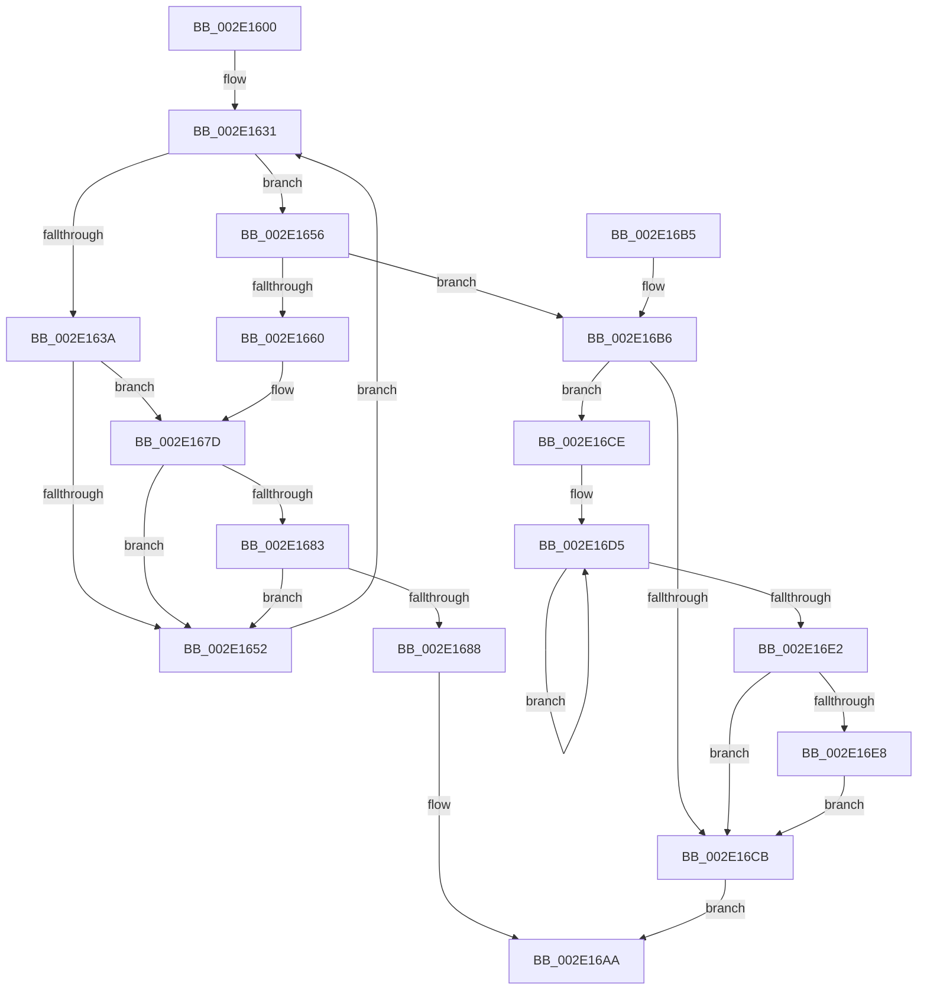

# KeAbPostRelease

- RVA: `0x002E1600`–`0x002E16EF` (길이 `239` bytes)
- VA: `0x00000001402E1600`
- 실행 섹션: `.text`
- PDB 이름 있음: `예`; PDB Function 태그: `아니요`
- unwind 정보 RVA: `0x00070CF4`
- 디코드: `66`개 명령, `239/239` bytes 표시
- 미해석 바이트: `0` (있으면 어셈블리에 `.byte`로 보존)

> 이 문서는 커널 이미지의 기계어와 PDB 기호를 분석해 생성했습니다. 4번과 5번은 함수 원형과 자료형을 바이너리 사용 방식에서 추정한 C 해석이며 원본 소스 복구 결과는 아닙니다.

## 1. Dependencies

- 직접 호출 지점: **3**; 고유 호출 대상: **3**
- 직접 호출자로 확인된 함수: **1037**
- RIP 상대 이미지 참조: **0**

### Outgoing calls
- `0x002E1677` → [KeBugCheckEx](../4F/KeBugCheckEx_function_004FD660.md) (function, `0x004FD660`)
- `0x002E16A5` → [KiAbEntryFreeAndEnableInterrupts](../26/KiAbEntryFreeAndEnableInterrupts_function_002622D0.md) (function, `0x002622D0`)
- `0x002E16E8` → [KiRemoveSystemWorkPriorityKick](../26/KiRemoveSystemWorkPriorityKick_function_002631D0.md) (function, `0x002631D0`)

### Direct callers
- [sub_00206865](../20/Unknown_function_00206865.md) at `0x00206A07`
- [sub_00206865](../20/Unknown_function_00206865.md) at `0x00206AA6`
- [ExpDeleteTimer](../23/ExpDeleteTimer_function_00230C40.md) at `0x00230D58`
- [ExpSetTimerObject](../23/ExpSetTimerObject_function_00231730.md) at `0x0023252C`
- [CcFlushCacheOneRange](../23/CcFlushCacheOneRange_function_00236A30.md) at `0x00236BB7`
- [FsRtlReleaseAutoExpandPushLockExclusive](../26/FsRtlReleaseAutoExpandPushLockExclusive_function_00265B5C.md) at `0x00265BAF`
- [FsRtlReleasePushLock](../26/FsRtlReleasePushLock_function_00265D7C.md) at `0x00265DAF`
- [sub_0026748E](../26/Unknown_function_0026748E.md) at `0x00267491`
- [CcGetVacbMiss](../27/CcGetVacbMiss_function_00272900.md) at `0x00272C55`
- [CcGetVacbMiss](../27/CcGetVacbMiss_function_00272900.md) at `0x00272EC7`
- [MiCreatePrototypePtes](../29/MiCreatePrototypePtes_function_002950FC.md) at `0x00295443`
- [MiRemoveFromSystemSpace](../29/MiRemoveFromSystemSpace_function_002962FC.md) at `0x002964B1`
- [KeSwappablePageDereference](../29/KeSwappablePageDereference_function_0029F540.md) at `0x0029F602`
- [MiUnlockLoaderEntry](../2A/MiUnlockLoaderEntry_function_002A3E28.md) at `0x002A3E88`
- [UNLOCK_ADDRESS_SPACE](../2A/UNLOCK_ADDRESS_SPACE_function_002A4844.md) at `0x002A4881`
- [MiUnlockVad](../2A/MiUnlockVad_function_002A59C8.md) at `0x002A5A03`
- [MiUnlockWsSwapExclusive](../2A/MiUnlockWsSwapExclusive_function_002A74A8.md) at `0x002A74D6`
- [UNLOCK_ADDRESS_SPACE_SHARED](../2A/UNLOCK_ADDRESS_SPACE_SHARED_function_002A8ACC.md) at `0x002A8B06`
- [MiSectionCreated](../2A/MiSectionCreated_function_002ABA18.md) at `0x002ABAEA`
- [MiFreeInPageSupportBlock](../2B/MiFreeInPageSupportBlock_function_002B5900.md) at `0x002B592B`
- [PopPepWork](../2B/PopPepWork_function_002BCBC0.md) at `0x002BCE88`
- [KiReleaseDpcCorralLock](../2C/KiReleaseDpcCorralLock_function_002C9D20.md) at `0x002C9D4A`
- [PoGetIdleTimes](../2D/PoGetIdleTimes_function_002DF570.md) at `0x002DF719`
- [sub_002DFB02](../2D/Unknown_function_002DFB02.md) at `0x002DFB05`
- [PopReleaseRwLock](../2D/PopReleaseRwLock_function_002DFBBC.md) at `0x002DFBF5`
- [EtwpUnlockBufferList](../2D/EtwpUnlockBufferList_function_002DFC28.md) at `0x002DFC6B`
- [MiUnlockControlAreaFileObjectShared](../2D/MiUnlockControlAreaFileObjectShared_function_002DFCB4.md) at `0x002DFCE2`
- [PspUnlockProcessListExclusive](../2D/PspUnlockProcessListExclusive_function_002DFD18.md) at `0x002DFD47`
- [ExReleaseCacheAwarePushLockExclusive](../2D/ExReleaseCacheAwarePushLockExclusive_function_002DFD80.md) at `0x002DFDBF`
- [CcReleaseBcbLockAndVacbLock](../2D/CcReleaseBcbLockAndVacbLock_function_002DFDF0.md) at `0x002DFE31`
- [SMKM_STORE&lt;SM_TRAITS&gt;::SmStReleaseStoreLockExclusive](../2D/SMKM_STORE_SM_TRAITS_SmStReleaseStoreLockExclusive_function_002DFE68.md) at `0x002DFE90`
- [SMKM_STORE_MGR&lt;SM_TRAITS&gt;::SmFeAddComplete](../2D/SMKM_STORE_MGR_SM_TRAITS_SmFeAddComplete_function_002DFEE0.md) at `0x002E019E`
- [StLockReleaseShared](StLockReleaseShared_function_002E0320.md) at `0x002E0340`
- [sub_002E062C](Unknown_function_002E062C.md) at `0x002E0633`
- [sub_002E087E](Unknown_function_002E087E.md) at `0x002E0A9F`
- [MiTrimSharedPageFromViews](MiTrimSharedPageFromViews_function_002E16F8.md) at `0x002E1930`
- [MiTrimSharedPageFromViews](MiTrimSharedPageFromViews_function_002E16F8.md) at `0x002E21ED`
- [ExpSaAllocatorFree](ExpSaAllocatorFree_function_002E2E00.md) at `0x002E2ED9`
- [InsertEventEntryInLookUpTable](../2F/InsertEventEntryInLookUpTable_function_002F1424.md) at `0x002F1574`
- [RtlpLookupDynamicUserFunctionTable](../2F/RtlpLookupDynamicUserFunctionTable_function_002F333C.md) at `0x002F348E`
- [RtlpLookupDynamicUserFunctionTable](../2F/RtlpLookupDynamicUserFunctionTable_function_002F333C.md) at `0x002F357B`
- [AlpcpSignalAndWait](../2F/AlpcpSignalAndWait_function_002F9620.md) at `0x002F972A`
- [AlpcpSignalAndWait](../2F/AlpcpSignalAndWait_function_002F9620.md) at `0x002F9A97`
- [NtTraceEvent](../2F/NtTraceEvent_function_002FA6C0.md) at `0x002FB0CC`
- [EtwpEnqueueAvailableBuffer](../2F/EtwpEnqueueAvailableBuffer_function_002FE7DC.md) at `0x002FE8B7`
- [MiReturnLockedVadOrNextVa](../31/MiReturnLockedVadOrNextVa_function_00316980.md) at `0x00316C75`
- [RtlpHpReleaseLockShared](../32/RtlpHpReleaseLockShared_function_003245B0.md) at `0x003245D4`
- [MiAddViewsForSection](../32/MiAddViewsForSection_function_00324990.md) at `0x00324EDD`
- [RtlpHpSegPageRangeCoalesce](../32/RtlpHpSegPageRangeCoalesce_function_00325860.md) at `0x003259EE`
- [CcPinFileData](../33/CcPinFileData_function_0033FB40.md) at `0x003402EF`
- [CcGetVirtualAddress](../34/CcGetVirtualAddress_function_00340C9C.md) at `0x00340E0C`
- [CcGetVirtualAddress](../34/CcGetVirtualAddress_function_00340C9C.md) at `0x00340EFA`
- [SmpKeyedStoreReference](../34/SmpKeyedStoreReference_function_003499CC.md) at `0x00349A64`
- [sub_0034A1FD](../34/Unknown_function_0034A1FD.md) at `0x0034A211`
- [sub_0034CEDD](../34/Unknown_function_0034CEDD.md) at `0x0034CF00`
- [sub_0034D8EA](../34/Unknown_function_0034D8EA.md) at `0x0034D90A`
- [KeDeleteMutant](../35/KeDeleteMutant_function_00351788.md) at `0x003519F9`
- [CcUnpinFileDataEx](../35/CcUnpinFileDataEx_function_00359DEC.md) at `0x0035A06F`
- [MiWalkEntireImage](../36/MiWalkEntireImage_function_00365D70.md) at `0x00366DBB`
- [MiWalkEntireImage](../36/MiWalkEntireImage_function_00365D70.md) at `0x00366EAE`
- [KeSwappablePageReference](../36/KeSwappablePageReference_function_0036A864.md) at `0x0036A94D`
- [PspUnlockQuotaExpansion](../39/PspUnlockQuotaExpansion_function_00390E68.md) at `0x00390EAA`
- [AlpcpSignal](../39/AlpcpSignal_function_003955E0.md) at `0x003956D9`
- [AlpcpSignal](../39/AlpcpSignal_function_003955E0.md) at `0x00396043`
- [KeReleaseMutantEx](../39/KeReleaseMutantEx_function_00396850.md) at `0x00396E1D`
- [SepRmReferenceCapTable](../3A/SepRmReferenceCapTable_function_003A537C.md) at `0x003A5420`
- [MiUpControlAreaRefs](../3B/MiUpControlAreaRefs_function_003B2BF0.md) at `0x003B2EF3`
- [MiInsertInSystemSpace](../3B/MiInsertInSystemSpace_function_003B2F5C.md) at `0x003B3425`
- [ExpSaAllocatorAllocate](../3B/ExpSaAllocatorAllocate_function_003B402C.md) at `0x003B4125`
- [ExpSaPageGroupDescriptorAllocate](../3B/ExpSaPageGroupDescriptorAllocate_function_003B4224.md) at `0x003B4464`
- [ExpSaPageGroupAllocateMemory](../3B/ExpSaPageGroupAllocateMemory_function_003B5FF0.md) at `0x003B60A9`
- [MiUnlockDynamicMemoryShared](../3B/MiUnlockDynamicMemoryShared_function_003B8A48.md) at `0x003B8A73`
- [MiRebuildLargePages](../3B/MiRebuildLargePages_function_003BA700.md) at `0x003BAA50`
- [PspUnlockThreadSecurityShared](../3C/PspUnlockThreadSecurityShared_function_003C2E40.md) at `0x003C2E6D`
- [AlpcpQueueIoCompletionPort](../3F/AlpcpQueueIoCompletionPort_function_003FF760.md) at `0x003FF8D6`
- [AlpcpQueueIoCompletionPort](../3F/AlpcpQueueIoCompletionPort_function_003FF760.md) at `0x003FFAB6`
- [MiUnlockPartitionMappedWriter](../40/MiUnlockPartitionMappedWriter_function_004030EC.md) at `0x0040311A`
- [ExfAcquireReleasePushLockExclusive](../41/ExfAcquireReleasePushLockExclusive_function_00419C2C.md) at `0x00419C6D`
- [CcAllocateInitializeBcb](../41/CcAllocateInitializeBcb_function_0041F5A4.md) at `0x0041F6C6`
- [sub_004201AA](../42/Unknown_function_004201AA.md) at `0x00420264`
- [sub_00420595](../42/Unknown_function_00420595.md) at `0x004205BF`
- [sub_00420595](../42/Unknown_function_00420595.md) at `0x0042061A`
- [sub_0042067D](../42/Unknown_function_0042067D.md) at `0x004206C2`
- [sub_0042067D](../42/Unknown_function_0042067D.md) at `0x0042071E`
- [PopFxStopDeviceAccounting](../42/PopFxStopDeviceAccounting_function_004261D8.md) at `0x004263BF`
- [MiFinishVadDeletion](../43/MiFinishVadDeletion_function_00430ED0.md) at `0x00430FCD`
- [PopDiagTraceFxRundown](../43/PopDiagTraceFxRundown_function_0043A028.md) at `0x0043A0ED`
- [PopDiagTraceFxRundown](../43/PopDiagTraceFxRundown_function_0043A028.md) at `0x0043A18E`
- [PopFxPauseDeviceAccounting](../43/PopFxPauseDeviceAccounting_function_0043D0C8.md) at `0x0043D20F`
- [PopFxResumeDeviceAccounting](../43/PopFxResumeDeviceAccounting_function_0043D4D8.md) at `0x0043D64A`
- [MiIssuePageHeatList](../44/MiIssuePageHeatList_function_0044615C.md) at `0x004462D8`
- [MI_UNLOCK_RELOCATIONS_SHARED](../44/MI_UNLOCK_RELOCATIONS_SHARED_function_0044A7EC.md) at `0x0044A814`
- [MiUnlockControlAreaSectionExtend](../44/MiUnlockControlAreaSectionExtend_function_0044BDC4.md) at `0x0044BDE6`
- [RtlInsertDynamicUserFunctionTable](../45/RtlInsertDynamicUserFunctionTable_function_004513C4.md) at `0x00451505`
- [CcChangeBackingFileObject](../45/CcChangeBackingFileObject_function_00457E5C.md) at `0x00457F21`
- [CcChangeBackingFileObject](../45/CcChangeBackingFileObject_function_00457E5C.md) at `0x00457F84`
- [CcSlowReferenceSharedCacheMapFileObject](../45/CcSlowReferenceSharedCacheMapFileObject_function_00458C10.md) at `0x00458C98`
- [ExQueryHandleExceptionsPermanency](../45/ExQueryHandleExceptionsPermanency_function_00458CE0.md) at `0x00458D75`
- [PopPepIdleTimeoutRoutine](../45/PopPepIdleTimeoutRoutine_function_00458E10.md) at `0x00458F95`
- [CcPostWorkQueueAsyncRead](../45/CcPostWorkQueueAsyncRead_function_0045D624.md) at `0x0045D7A5`
- [CcPostWorkQueueAsyncRead](../45/CcPostWorkQueueAsyncRead_function_0045D624.md) at `0x0045D8B5`
- [CcPostWorkQueueAsyncRead](../45/CcPostWorkQueueAsyncRead_function_0045D624.md) at `0x0045D93B`
- [CcCompleteAsyncReadWorker](../45/CcCompleteAsyncReadWorker_function_0045D9C0.md) at `0x0045DAC5`
- [CcAsyncReadWorker](../45/CcAsyncReadWorker_function_0045DB10.md) at `0x0045DDBB`
- [CcAsyncReadWorker](../45/CcAsyncReadWorker_function_0045DB10.md) at `0x0045DFA6`
- [CcAsyncReadWorker](../45/CcAsyncReadWorker_function_0045DB10.md) at `0x0045E024`
- [CcAmILowPriorityWriter](../45/CcAmILowPriorityWriter_function_0045F784.md) at `0x0045F806`
- [PspUnlockProcessExclusive](../46/PspUnlockProcessExclusive_function_004601C0.md) at `0x004601EE`
- [ExpUnlockHandleTableExclusive](../46/ExpUnlockHandleTableExclusive_function_004608A8.md) at `0x004608D3`
- [PopFxResidentTimeoutRoutine](../46/PopFxResidentTimeoutRoutine_function_00462650.md) at `0x0046276D`
- [RtlRemoveDynamicUserFunctionTable](../46/RtlRemoveDynamicUserFunctionTable_function_00466514.md) at `0x0046660D`
- [MI_UNLOCK_RELOCATIONS_EXCLUSIVE](../46/MI_UNLOCK_RELOCATIONS_EXCLUSIVE_function_0046965C.md) at `0x0046969B`
- [PoFxSystemLatencyNotify](../46/PoFxSystemLatencyNotify_function_0046A15C.md) at `0x0046A222`
- [PnpDeviceActionWorker](../47/PnpDeviceActionWorker_function_00478400.md) at `0x0047858B`
- [MiModifiedPageWriter](../47/MiModifiedPageWriter_function_0047E5F0.md) at `0x0047E6C2`
- [MiFinishResume](../47/MiFinishResume_function_0047F9C0.md) at `0x0047FA57`
- [MiSendParkedCoreUpdateToAllChildPartitions](../47/MiSendParkedCoreUpdateToAllChildPartitions_function_0047FAC0.md) at `0x0047FB5B`
- [SshpSetCollectionActive](../48/SshpSetCollectionActive_function_0048507C.md) at `0x004850C5`
- [SshpDereferenceBlocker](../48/SshpDereferenceBlocker_function_00486960.md) at `0x00486A66`
- [SshpDereferenceBlocker](../48/SshpDereferenceBlocker_function_00486960.md) at `0x00486AF6`
- [SepDeleteSessionLowboxEntries](../48/SepDeleteSessionLowboxEntries_function_0048C188.md) at `0x0048C2E6`
- [SepDeleteSessionLowboxEntries](../48/SepDeleteSessionLowboxEntries_function_0048C188.md) at `0x0048C370`
- [SepDeleteSessionLowboxEntries](../48/SepDeleteSessionLowboxEntries_function_0048C188.md) at `0x0048C39A`
- [PfLockSharedRelease](../48/PfLockSharedRelease_function_0048DF24.md) at `0x0048DF44`
- [MiDereferenceExtendInfo](../48/MiDereferenceExtendInfo_function_0048EFA4.md) at `0x0048F032`
- [PfLockExclusiveRelease](../49/PfLockExclusiveRelease_function_00491D88.md) at `0x00491DA8`
- [MiReleaseImageSection](../49/MiReleaseImageSection_function_00493044.md) at `0x00493084`
- [MmCheckProcessShadow](../49/MmCheckProcessShadow_function_004931C0.md) at `0x00493276`
- [ExpSaPageGroupFreeMemory](../49/ExpSaPageGroupFreeMemory_function_00493E8C.md) at `0x00493F1B`
- [SSHSupportReleasePushLockExclusive](../49/SSHSupportReleasePushLockExclusive_function_004954EC.md) at `0x0049550C`
- [FlushLookUpTableBucket](../49/FlushLookUpTableBucket_function_00497690.md) at `0x00497767`
- [PopFxClearDirectedDripsCandidateDeviceList](../49/PopFxClearDirectedDripsCandidateDeviceList_function_004988EC.md) at `0x004989B7`
- [PopFxClearDirectedDripsCandidateDeviceList](../49/PopFxClearDirectedDripsCandidateDeviceList_function_004988EC.md) at `0x004989D0`
- [PopFxBuildDirectedDripsCandidateDeviceList](../49/PopFxBuildDirectedDripsCandidateDeviceList_function_00499288.md) at `0x0049939F`
- [PoFxPrepareDevice](../49/PoFxPrepareDevice_function_00499F0C.md) at `0x0049A01C`
- [EtwpUpdateSelectedGroupMasks](../49/EtwpUpdateSelectedGroupMasks_function_0049B114.md) at `0x0049B3AD`
- [PopFxBuildDripsBlockingDeviceList](../49/PopFxBuildDripsBlockingDeviceList_function_0049B5B0.md) at `0x0049B759`
- [PopFxStartDeviceAccounting](../4A/PopFxStartDeviceAccounting_function_004A384C.md) at `0x004A3901`
- [PspStorageEmptyArrayNonReadonly](../4A/PspStorageEmptyArrayNonReadonly_function_004A3F6C.md) at `0x004A4000`
- [PspStorageEmptyArrayNonReadonly](../4A/PspStorageEmptyArrayNonReadonly_function_004A3F6C.md) at `0x004A4058`
- [PspUnlockQuotaListShared](../4A/PspUnlockQuotaListShared_function_004A5234.md) at `0x004A525B`
- [PopDirectedDripsDiagTraceNotifyDevices](../4A/PopDirectedDripsDiagTraceNotifyDevices_function_004A70AC.md) at `0x004A7261`
- [MiZeroSectionObjectPointer](../4A/MiZeroSectionObjectPointer_function_004A9B90.md) at `0x004A9BC0`
- [ExpUnlockCallbackListShared](../4A/ExpUnlockCallbackListShared_function_004ABC3C.md) at `0x004ABC7E`
- [PopDirectedDripsNotifyResiliencyCompletionWorker](../4A/PopDirectedDripsNotifyResiliencyCompletionWorker_function_004ACAE0.md) at `0x004ACB66`
- [KsepShimDbChanged](../4B/KsepShimDbChanged_function_004B014C.md) at `0x004B0208`
- [IopCleanupNotifications](../4B/IopCleanupNotifications_function_004B044C.md) at `0x004B0522`
- [RtlpHpAcquireReleaseLockExclusive](../4B/RtlpHpAcquireReleaseLockExclusive_function_004B208C.md) at `0x004B20F3`
- [PspUnlockProcessSharedUnsafe](../4B/PspUnlockProcessSharedUnsafe_function_004B2800.md) at `0x004B2824`
- [MiUnlockDriverMappings](../4B/MiUnlockDriverMappings_function_004B4E54.md) at `0x004B4E83`
- [PoFxStartDevicePowerManagement](../4B/PoFxStartDevicePowerManagement_function_004B5740.md) at `0x004B57FE`
- [ExpSaPageGroupDescriptorFree](../4B/ExpSaPageGroupDescriptorFree_function_004B5EA8.md) at `0x004B5F29`
- [PopFxInsertDevice](../4B/PopFxInsertDevice_function_004B95EC.md) at `0x004B968E`
- [sub_004BA83C](../4B/Unknown_function_004BA83C.md) at `0x004BA950`
- [SleepstudyHelperCreateLibraryEx](../4B/SleepstudyHelperCreateLibraryEx_function_004BAE50.md) at `0x004BAF60`
- [RtlpReleaseBootStatusLock](../4C/RtlpReleaseBootStatusLock_function_004C05D4.md) at `0x004C05FE`
- [PopFxFindAcpiDeviceByUniqueId](../4C/PopFxFindAcpiDeviceByUniqueId_function_004C5C30.md) at `0x004C5D38`
- [HalpIommuUnblockDevice](../4C/HalpIommuUnblockDevice_function_004C6250.md) at `0x004C6410`
- [PopFxFindAndReferenceAcpiDevice](../4C/PopFxFindAndReferenceAcpiDevice_function_004C76E0.md) at `0x004C77BA`
- [MiUnlockSystemCacheInit](../4C/MiUnlockSystemCacheInit_function_004C81C8.md) at `0x004C81F6`
- [HalpIommuBlockDevice](../4C/HalpIommuBlockDevice_function_004CA150.md) at `0x004CA251`
- [PsGetProcessEnclaveModuleInfo](../4C/PsGetProcessEnclaveModuleInfo_function_004CA2E0.md) at `0x004CA4D5`
- [ExGetWakeTimerList](../4C/ExGetWakeTimerList_function_004CB964.md) at `0x004CBBBD`
- [PopFxLowPowerEpochCallback](../4C/PopFxLowPowerEpochCallback_function_004CBC10.md) at `0x004CBD25`
- [PopPepInsertDevice](../4C/PopPepInsertDevice_function_004CBD58.md) at `0x004CBE12`
- [PopPepRemoveDevice](../4C/PopPepRemoveDevice_function_004CBE38.md) at `0x004CBEE3`
- [CcGetNumberOfMappedPages](../4C/CcGetNumberOfMappedPages_function_004CCB50.md) at `0x004CCC05`
- [PopFxRegisterDeviceWithPep](../4C/PopFxRegisterDeviceWithPep_function_004CF794.md) at `0x004CF89A`
- [PopFxDestroyDirectedDripsCandidateDeviceList](../4D/PopFxDestroyDirectedDripsCandidateDeviceList_function_004D2D98.md) at `0x004D2E26`
- [ExpUnlockCallbackListExclusive](../4D/ExpUnlockCallbackListExclusive_function_004D643C.md) at `0x004D648A`
- [SmHwAcceleratorPartitionMgrFreeDescriptor](../4D/SmHwAcceleratorPartitionMgrFreeDescriptor_function_004D7918.md) at `0x004D79E2`
- [SmHwAcceleratorPartitionMgrFreeDescriptor](../4D/SmHwAcceleratorPartitionMgrFreeDescriptor_function_004D7918.md) at `0x004D7A05`
- [MiSubsectionProtosCreated](../4D/MiSubsectionProtosCreated_function_004D9570.md) at `0x004D959C`
- [PspUnlockQuotaListExclusive](../4D/PspUnlockQuotaListExclusive_function_004D9988.md) at `0x004D99B2`
- [PspUnlockThreadSecurityExclusive](../4E/PspUnlockThreadSecurityExclusive_function_004E97C0.md) at `0x004E97F1`
- [SmFirstTimeInit](../4E/SmFirstTimeInit_function_004EA944.md) at `0x004EADE9`
- [PopFxPrepareDevicesForShutdown](../4F/PopFxPrepareDevicesForShutdown_function_004F5DF4.md) at `0x004F5E71`
- [UNLOCK_ADDRESS_SPACE_SHARED_UNORDERED](../4F/UNLOCK_ADDRESS_SPACE_SHARED_UNORDERED_function_004F8924.md) at `0x004F895A`
- [PspReleasePushLockShared](../4F/PspReleasePushLockShared_function_004F8D00.md) at `0x004F8D27`
- [HalpIommuCreateDevice](../54/HalpIommuCreateDevice_function_0054ED60.md) at `0x0054F33C`
- [HalpIommuDeleteDevice](../54/HalpIommuDeleteDevice_function_0054F368.md) at `0x0054F47D`
- [HalpIommuInvokeInterfaceStateChangeCallbacks](../54/HalpIommuInvokeInterfaceStateChangeCallbacks_function_0054F708.md) at `0x0054F7CF`
- [IommupDeviceGetPasidDevice](../54/IommupDeviceGetPasidDevice_function_0054F82C.md) at `0x0054F8E1`
- [IommupPasidDeviceCreate](../54/IommupPasidDeviceCreate_function_0054FEEC.md) at `0x00550004`
- [IommupPasidDeviceDelete](../55/IommupPasidDeviceDelete_function_00550030.md) at `0x005500D7`
- [HalpLeaveDmaDomain](../55/HalpLeaveDmaDomain_function_00552600.md) at `0x0055269C`
- [HalpLeaveDmaDomain](../55/HalpLeaveDmaDomain_function_00552600.md) at `0x005526C3`
- [IommuBeginDeviceReset](../56/IommuBeginDeviceReset_function_00564A60.md) at `0x00564B78`
- [IommuFinalizeDeviceReset](../56/IommuFinalizeDeviceReset_function_005653F0.md) at `0x00565576`
- [IommuProcessPageRequestQueue](../56/IommuProcessPageRequestQueue_function_00565BA0.md) at `0x00566030`
- [IommupFreeSystemContext](../56/IommupFreeSystemContext_function_00566234.md) at `0x005662DB`
- [IommupGetSystemContext](../56/IommupGetSystemContext_function_00566310.md) at `0x00566405`
- [IommupGetSystemContext](../56/IommupGetSystemContext_function_00566310.md) at `0x00566452`
- [IommupHvAttachPasidDevice](../56/IommupHvAttachPasidDevice_function_00566AEC.md) at `0x00566C6A`
- [IommupHvAttachPasidDevice](../56/IommupHvAttachPasidDevice_function_00566AEC.md) at `0x00566D44`
- [IommupHvAttachPasidDeviceDomain](../56/IommupHvAttachPasidDeviceDomain_function_00566E3C.md) at `0x00566F80`
- [IommupHvCreateSvmPasidSpace](../56/IommupHvCreateSvmPasidSpace_function_0056703C.md) at `0x00567124`
- [IommupHvDetachPasidDeviceDomain](../56/IommupHvDetachPasidDeviceDomain_function_005671B4.md) at `0x0056726C`
- [IommuRegisterInterfaceStateChangeCallback](../56/IommuRegisterInterfaceStateChangeCallback_function_00568200.md) at `0x005682C4`
- [IommuRegisterInterfaceStateChangeCallback](../56/IommuRegisterInterfaceStateChangeCallback_function_00568200.md) at `0x005683A6`
- [IommuRegisterInterfaceStateChangeCallback](../56/IommuRegisterInterfaceStateChangeCallback_function_00568200.md) at `0x005683C3`
- [IommuUnregisterInterfaceStateChangeCallback](../56/IommuUnregisterInterfaceStateChangeCallback_function_00568730.md) at `0x00568814`
- [IommuUnregisterInterfaceStateChangeCallback](../56/IommuUnregisterInterfaceStateChangeCallback_function_00568730.md) at `0x00568856`
- [CcBoostLowPriorityWorkerThread](../57/CcBoostLowPriorityWorkerThread_function_0057B704.md) at `0x0057B83D`
- [CcAsyncReadWorkerThread](../57/CcAsyncReadWorkerThread_function_0057F560.md) at `0x0057F678`
- [EmpQueueRuleUpdateState](../58/EmpQueueRuleUpdateState_function_005809B0.md) at `0x00580AA0`
- [EmpRuleUpdateWorkerThread](../58/EmpRuleUpdateWorkerThread_function_00580B20.md) at `0x00580BB3`
- [EmpRuleUpdateWorkerThread](../58/EmpRuleUpdateWorkerThread_function_00580B20.md) at `0x00580C14`
- [EmpRuleUpdateWorkerThread](../58/EmpRuleUpdateWorkerThread_function_00580B20.md) at `0x00580C82`
- [IopProcessIoTracking](../59/IopProcessIoTracking_function_005986C0.md) at `0x005987B3`
- [PnpCancelDeviceActionRequest](../5A/PnpCancelDeviceActionRequest_function_005A8330.md) at `0x005A83BC`
- [KasaniReportTelemetry](../5A/KasaniReportTelemetry_function_005AB1D0.md) at `0x005AB2B0`
- [sub_005AF44B](../5A/Unknown_function_005AF44B.md) at `0x005AF5A8`
- [KeQueryDpcWatchdogConfiguration](../5B/KeQueryDpcWatchdogConfiguration_function_005B5800.md) at `0x005B597C`
- [KeUpdateDpcWatchdogConfiguration](../5B/KeUpdateDpcWatchdogConfiguration_function_005B5A34.md) at `0x005B5C06`
- [KiAvailableCpusPartitionWorkItemCallback](../5B/KiAvailableCpusPartitionWorkItemCallback_function_005B9990.md) at `0x005B9A46`
- [PopFxDisableBasicAccountingWorker](../5D/PopFxDisableBasicAccountingWorker_function_005D28D0.md) at `0x005D29C2`
- [PopFxInsertAcpiDevice](../5D/PopFxInsertAcpiDevice_function_005D2C08.md) at `0x005D2CB9`
- [PopFxRegisterPluginEx](../5D/PopFxRegisterPluginEx_function_005D31B8.md) at `0x005D339B`
- [PopFxRemoveAcpiDevice](../5D/PopFxRemoveAcpiDevice_function_005D3468.md) at `0x005D3507`
- [PopFxRemoveDevice](../5D/PopFxRemoveDevice_function_005D3534.md) at `0x005D35CC`
- [PopPepIterateDeviceList](../5D/PopPepIterateDeviceList_function_005DCC84.md) at `0x005DCD88`
- [PopPepPlatformStateRegistered](../5D/PopPepPlatformStateRegistered_function_005DCDB8.md) at `0x005DCEF1`
- [PopPepPlatformStateRegistered](../5D/PopPepPlatformStateRegistered_function_005DCDB8.md) at `0x005DCF8E`
- [PopFxAcpiPrepareDevice](../5D/PopFxAcpiPrepareDevice_function_005DD5F4.md) at `0x005DD6E5`
- [PspLookupSyscallProviderById](../5E/PspLookupSyscallProviderById_function_005E237C.md) at `0x005E240F`
- [PspReleaseSyscallProviderRegistrationLockExclusive](../5E/PspReleaseSyscallProviderRegistrationLockExclusive_function_005E2438.md) at `0x005E2462`
- [PspUnlockSyscallProviderExclusive](../5E/PspUnlockSyscallProviderExclusive_function_005E2478.md) at `0x005E249C`
- [PspEnqueueProcessQosChangeNotification](../5E/PspEnqueueProcessQosChangeNotification_function_005E2ED0.md) at `0x005E2FAC`
- [PspRefreshProcessUserPresencePpmPolicyCallback](../5E/PspRefreshProcessUserPresencePpmPolicyCallback_function_005E3100.md) at `0x005E31B7`
- [PspSetProcessTimerDelayForWin32](../5E/PspSetProcessTimerDelayForWin32_function_005E3DB8.md) at `0x005E3E33`
- [PspSetProcessTimerDelayForWin32](../5E/PspSetProcessTimerDelayForWin32_function_005E3DB8.md) at `0x005E3E4E`
- [PspReleasePushLockExclusive](../5E/PspReleasePushLockExclusive_function_005E4040.md) at `0x005E406A`
- [PsAdjustBasicEnclaveThreadList](../5E/PsAdjustBasicEnclaveThreadList_function_005E4BD8.md) at `0x005E4D1A`
- [PsLoadVsmEnclaveData](../5E/PsLoadVsmEnclaveData_function_005E4D5C.md) at `0x005E4E9C`
- [NormalizationList__Unlock](../5F/NormalizationList__Unlock_function_005F1F18.md) at `0x005F1F42`
- [SepDeleteSessionAntiTamperEntries](../60/SepDeleteSessionAntiTamperEntries_function_0060AAF8.md) at `0x0060ABE6`
- [SepDeleteSessionAntiTamperEntries](../60/SepDeleteSessionAntiTamperEntries_function_0060AAF8.md) at `0x0060ACDD`
- [SepDeleteSessionAntiTamperEntries](../60/SepDeleteSessionAntiTamperEntries_function_0060AAF8.md) at `0x0060AD19`
- [SepSetTokenAntiTamperEntry](../60/SepSetTokenAntiTamperEntry_function_0060B28C.md) at `0x0060B384`
- [SepSetTokenAntiTamperEntry](../60/SepSetTokenAntiTamperEntry_function_0060B28C.md) at `0x0060B473`
- [SepSetTokenAntiTamperEntry](../60/SepSetTokenAntiTamperEntry_function_0060B28C.md) at `0x0060B516`
- [SepSetTokenAntiTamperEntry](../60/SepSetTokenAntiTamperEntry_function_0060B28C.md) at `0x0060B56E`
- [SepSetTokenLowboxNumberEntry](../60/SepSetTokenLowboxNumberEntry_function_0060B594.md) at `0x0060B687`
- [SepSetTokenLowboxNumberEntry](../60/SepSetTokenLowboxNumberEntry_function_0060B594.md) at `0x0060B776`
- [SepSetTokenLowboxNumberEntry](../60/SepSetTokenLowboxNumberEntry_function_0060B594.md) at `0x0060B815`
- [SepSetTokenLowboxNumberEntry](../60/SepSetTokenLowboxNumberEntry_function_0060B594.md) at `0x0060B86D`
- [SmKmVirtualLockContextIncreaseWsMin](../60/SmKmVirtualLockContextIncreaseWsMin_function_0060FE94.md) at `0x0060FFCC`
- [SmKmVirtualLockCtxLockMemory](../61/SmKmVirtualLockCtxLockMemory_function_0061000C.md) at `0x006100E6`
- [SmKmVirtualLockCtxLockMemory](../61/SmKmVirtualLockCtxLockMemory_function_0061000C.md) at `0x00610127`
- [SmKmVirtualLockCtxMemoryUnlocked](../61/SmKmVirtualLockCtxMemoryUnlocked_function_0061015C.md) at `0x0061028A`
- [SmGetStoreOwnerProcessId](../61/SmGetStoreOwnerProcessId_function_00610E4C.md) at `0x00610F52`
- [SmHwAcceleratorMgrHotRemoveAccelerator](../61/SmHwAcceleratorMgrHotRemoveAccelerator_function_006115FC.md) at `0x00611876`
- [SmHwAcceleratorMgrHotRemoveAccelerator](../61/SmHwAcceleratorMgrHotRemoveAccelerator_function_006115FC.md) at `0x006118A0`
- [SmHwAcceleratorMgrHotRemoveAccelerator](../61/SmHwAcceleratorMgrHotRemoveAccelerator_function_006115FC.md) at `0x0061191D`
- [SmHwAcceleratorPartitionMgrInsertAccelerator](../61/SmHwAcceleratorPartitionMgrInsertAccelerator_function_00611944.md) at `0x00611A17`
- [EtwpBufferingModeCompressionFlush](../65/EtwpBufferingModeCompressionFlush_function_00652D24.md) at `0x00652D9D`
- [EtwpCompressPendingBuffers](../65/EtwpCompressPendingBuffers_function_00653140.md) at `0x00653274`
- [EtwpCompressionProc](../65/EtwpCompressionProc_function_00653300.md) at `0x006533A7`
- [EtwpDisableCompression](../65/EtwpDisableCompression_function_006534F8.md) at `0x0065358A`
- [EtwpGetCompressionSettings](../65/EtwpGetCompressionSettings_function_006535A8.md) at `0x00653663`
- [EtwpSetCompressionSettings](../65/EtwpSetCompressionSettings_function_00653910.md) at `0x006539C4`
- [ExpQueryBootLoaderMetadata](../65/ExpQueryBootLoaderMetadata_function_00654E8C.md) at `0x00654F68`
- [ExpSetBootLoaderMetadata](../65/ExpSetBootLoaderMetadata_function_00654F98.md) at `0x006550AC`
- [ExInitializeDeviceAts](../65/ExInitializeDeviceAts_function_00659B80.md) at `0x00659CF2`
- [ExUninitializeDeviceAts](../65/ExUninitializeDeviceAts_function_00659D6C.md) at `0x00659E18`
- [ExSvmBeginDeviceReset](../65/ExSvmBeginDeviceReset_function_0065ACE0.md) at `0x0065ADB4`
- [ExSvmFinalizeDeviceReset](../65/ExSvmFinalizeDeviceReset_function_0065AE00.md) at `0x0065AECA`
- [ExpShareAddressSpaceWithDevice](../65/ExpShareAddressSpaceWithDevice_function_0065B528.md) at `0x0065B823`
- [ExpShareAddressSpaceWithDevice](../65/ExpShareAddressSpaceWithDevice_function_0065B528.md) at `0x0065B882`
- [ExpShareAddressSpaceWithDevice](../65/ExpShareAddressSpaceWithDevice_function_0065B528.md) at `0x0065BAF1`
- [ExpSvmDereferenceDevice](../65/ExpSvmDereferenceDevice_function_0065BBCC.md) at `0x0065BD19`
- [ExpReleasePoolListLockExclusive](../65/ExpReleasePoolListLockExclusive_function_0065D868.md) at `0x0065D892`
- [WheaSelLogError](../65/WheaSelLogError_function_0065D8A8.md) at `0x0065D95A`
- [WheaSelLogSetNtSchedulerAvailability](../65/WheaSelLogSetNtSchedulerAvailability_function_0065DB18.md) at `0x0065DB93`
- [WheaRegisterErrorSourceOverride](../66/WheaRegisterErrorSourceOverride_function_00660EE0.md) at `0x006610B7`
- [WheaUnregisterErrorSourceOverride](../66/WheaUnregisterErrorSourceOverride_function_00661140.md) at `0x00661231`
- [CmpNotifyMachineHiveLoaded](../66/CmpNotifyMachineHiveLoaded_function_0066A43C.md) at `0x0066A50D`
- [MiUnlockDynamicMemoryExclusive](../67/MiUnlockDynamicMemoryExclusive_function_00673C5C.md) at `0x00673C8A`
- [MiUnlockDynamicMemoryNestedExclusive](../67/MiUnlockDynamicMemoryNestedExclusive_function_00673CC0.md) at `0x00673CEA`
- [MiMarkHugePfnBad](../67/MiMarkHugePfnBad_function_00676744.md) at `0x00676AF4`
- [MiMarkHugePfnBad](../67/MiMarkHugePfnBad_function_00676744.md) at `0x00676B6C`
- [MiDeleteExtentPfns](../68/MiDeleteExtentPfns_function_006808B0.md) at `0x00680990`
- [MiCreateSlabIdentity](../68/MiCreateSlabIdentity_function_0068D2D4.md) at `0x0068D3B1`
- [MiDeletePendingSlabIdentities](../68/MiDeletePendingSlabIdentities_function_0068DA3C.md) at `0x0068DD70`
- [MiReturnPartitionPagesToParent](../69/MiReturnPartitionPagesToParent_function_00691B5C.md) at `0x00691D25`
- [ExpQueryLicenseValueFromBlobHelper$fin$0](../6D/ExpQueryLicenseValueFromBlobHelper_fin_0_function_006D4F5C.md) at `0x006D4F91`
- [sub_006D7372](../6D/Unknown_function_006D7372.md) at `0x006D73B5`
- [sub_006D969C](../6D/Unknown_function_006D969C.md) at `0x006D9791`
- [sub_006D969C](../6D/Unknown_function_006D969C.md) at `0x006D9868`
- [sub_006D969C](../6D/Unknown_function_006D969C.md) at `0x006D99AD`
- [sub_006DA650](../6D/Unknown_function_006DA650.md) at `0x006DA661`
- [sub_006DAA04](../6D/Unknown_function_006DAA04.md) at `0x006DAA58`
- [sub_006DAA76](../6D/Unknown_function_006DAA76.md) at `0x006DAA7D`
- [sub_006DEED6](../6D/Unknown_function_006DEED6.md) at `0x006DEEED`
- [sub_006DF40E](../6D/Unknown_function_006DF40E.md) at `0x006DF5B5`
- [sub_006E19B0](../6E/Unknown_function_006E19B0.md) at `0x006E1AE5`
- [sub_006E3418](../6E/Unknown_function_006E3418.md) at `0x006E350C`
- [sub_006E362E](../6E/Unknown_function_006E362E.md) at `0x006E3A27`
- [sub_006E3B0E](../6E/Unknown_function_006E3B0E.md) at `0x006E3B45`
- [sub_006E5986](../6E/Unknown_function_006E5986.md) at `0x006E59D0`
- [sub_006E7298](../6E/Unknown_function_006E7298.md) at `0x006E729B`
- [sub_006EED3B](../6E/Unknown_function_006EED3B.md) at `0x006EED6E`
- [sub_006F2098](../6F/Unknown_function_006F2098.md) at `0x006F210F`
- [sub_006F2710](../6F/Unknown_function_006F2710.md) at `0x006F2798`
- [sub_006F31F0](../6F/Unknown_function_006F31F0.md) at `0x006F321B`
- [sub_006F4C8C](../6F/Unknown_function_006F4C8C.md) at `0x006F4C8F`
- [sub_006F59B4](../6F/Unknown_function_006F59B4.md) at `0x006F5B9D`
- [sub_006F59B4](../6F/Unknown_function_006F59B4.md) at `0x006F5C68`
- [sub_006F810A](../6F/Unknown_function_006F810A.md) at `0x006F813A`
- [sub_006F869A](../6F/Unknown_function_006F869A.md) at `0x006F869D`
- [sub_006F937E](../6F/Unknown_function_006F937E.md) at `0x006F948B`
- [sub_006FB432](../6F/Unknown_function_006FB432.md) at `0x006FB435`
- [EtwpTrackProviderBinaryKm](../../page/6F/EtwpTrackProviderBinaryKm_function_006FD8E8.md) at `0x006FDAF1`
- [EtwpTrackProviderBinaryKm](../../page/6F/EtwpTrackProviderBinaryKm_function_006FD8E8.md) at `0x006FDB4E`
- [EtwpCovSampContextCleanup](../../page/6F/EtwpCovSampContextCleanup_function_006FDF84.md) at `0x006FE210`
- [PopBootStatUnlock](../../page/6F/PopBootStatUnlock_function_006FE704.md) at `0x006FE781`
- [CmFcpManagerOnFeatureUsageDataTransferComplete](../../page/6F/CmFcpManagerOnFeatureUsageDataTransferComplete_function_006FF830.md) at `0x006FF91D`
- [ExpWatchProductTypeWork](../../page/6F/ExpWatchProductTypeWork_function_006FFCA0.md) at `0x00700367`
- [EtwQueryProcessTelemetryCoverage](../../page/70/EtwQueryProcessTelemetryCoverage_function_00701B8C.md) at `0x00701DC2`
- [EtwpCoverageEnsureContext](../../page/70/EtwpCoverageEnsureContext_function_007028E4.md) at `0x00702CBF`
- [CmpUnLockFreezeQueue](../../page/70/CmpUnLockFreezeQueue_function_00704894.md) at `0x007048DE`
- [PdcReleaseRwLockExclusive](../../page/70/PdcReleaseRwLockExclusive_function_00705288.md) at `0x007052C7`
- [HalpDmaAllocateChildAdapterV3](../../page/70/HalpDmaAllocateChildAdapterV3_function_007066A0.md) at `0x00706DE6`
- [HalpNotifyActorIfPmuAvailable](../../page/70/HalpNotifyActorIfPmuAvailable_function_00707880.md) at `0x007079D9`
- [HalpNotifyActorIfPmuAvailable](../../page/70/HalpNotifyActorIfPmuAvailable_function_00707880.md) at `0x00707B1D`
- [HalpPmuArbiterPeriodicWorkItem](../../page/70/HalpPmuArbiterPeriodicWorkItem_function_00707B90.md) at `0x00707C29`
- [HalpPmuArbiterPeriodicWorkItem](../../page/70/HalpPmuArbiterPeriodicWorkItem_function_00707B90.md) at `0x00707C94`
- [HalpPmuArbiterPeriodicWorkItem](../../page/70/HalpPmuArbiterPeriodicWorkItem_function_00707B90.md) at `0x00707CD5`
- [IommupDeviceDisableSvm](../../page/70/IommupDeviceDisableSvm_function_00708A28.md) at `0x00708B45`
- [HalpRegisterPmuNotification](../../page/70/HalpRegisterPmuNotification_function_0070C38C.md) at `0x0070C50A`
- [HalpRegisterPmuNotification](../../page/70/HalpRegisterPmuNotification_function_0070C38C.md) at `0x0070C592`
- [IommuDeviceDelete](../../page/70/IommuDeviceDelete_function_0070D0D0.md) at `0x0070D15E`
- [IommuDeviceDelete](../../page/70/IommuDeviceDelete_function_0070D0D0.md) at `0x0070D21C`
- [DbgkpRemoveErrorPort](../../page/71/DbgkpRemoveErrorPort_function_00711038.md) at `0x007110F8`
- [EmClientRuleDeregisterNotification](../../page/71/EmClientRuleDeregisterNotification_function_00712CB0.md) at `0x00712D90`
- [EmpClientRuleRegisterNotification](../../page/71/EmpClientRuleRegisterNotification_function_00712DE4.md) at `0x0071302A`
- [EmProviderDeregister](../../page/71/EmProviderDeregister_function_00713060.md) at `0x00713207`
- [EmProviderDeregisterEntry](../../page/71/EmProviderDeregisterEntry_function_00713230.md) at `0x0071329E`
- [EmProviderRegisterEntry](../../page/71/EmProviderRegisterEntry_function_00713300.md) at `0x007134E1`
- [HvlQuerySetBootPagesInfo](../../page/71/HvlQuerySetBootPagesInfo_function_00717D7C.md) at `0x00717EEE`
- [IoRegisterContainerNotification](../../page/71/IoRegisterContainerNotification_function_0071E700.md) at `0x0071E8C3`
- [IoUnregisterContainerNotification](../../page/71/IoUnregisterContainerNotification_function_0071E9C0.md) at `0x0071EAB3`
- [IoRegisterIoTracking](../../page/71/IoRegisterIoTracking_function_0071F600.md) at `0x0071F6ED`
- [IoUnregisterIoTracking](../../page/71/IoUnregisterIoTracking_function_0071F750.md) at `0x0071F7FC`
- [KeRegisterAvailableCpusChangeNotification](../../page/74/KeRegisterAvailableCpusChangeNotification_function_00745D7C.md) at `0x00745E92`
- [KeRegisterAvailableCpusChangeNotification](../../page/74/KeRegisterAvailableCpusChangeNotification_function_00745D7C.md) at `0x00745F18`
- [KeUnregisterAvailableCpusChangeNotification](../../page/74/KeUnregisterAvailableCpusChangeNotification_function_00745FB4.md) at `0x0074605E`
- [KeUnregisterAvailableCpusChangeNotification](../../page/74/KeUnregisterAvailableCpusChangeNotification_function_00745FB4.md) at `0x007460E9`
- [KiAvailableCpusProcessWorkItemCallback](../../page/74/KiAvailableCpusProcessWorkItemCallback_function_00746140.md) at `0x007461C4`
- [KeSetSystemServiceCallback](../../page/74/KeSetSystemServiceCallback_function_00747A10.md) at `0x00747BAA`
- [KeSetTracepoint](../../page/74/KeSetTracepoint_function_00747F80.md) at `0x00748589`
- [KiTpIsExcludedKernelTracepointLocation](../../page/74/KiTpIsExcludedKernelTracepointLocation_function_007487D0.md) at `0x00748869`
- [KseRegisterShimEx](../../page/74/KseRegisterShimEx_function_007494D0.md) at `0x0074966D`
- [KseRegisterShimEx](../../page/74/KseRegisterShimEx_function_007494D0.md) at `0x00749753`
- [KseUnregisterShim](../../page/74/KseUnregisterShim_function_00749800.md) at `0x00749A62`
- [KsepResolveApplicableShimsForDriver](../../page/74/KsepResolveApplicableShimsForDriver_function_0074A168.md) at `0x0074A25D`
- [KsepResolveApplicableShimsForDriver](../../page/74/KsepResolveApplicableShimsForDriver_function_0074A168.md) at `0x0074A3A9`
- [KsepResolveApplicableShimsForDriver](../../page/74/KsepResolveApplicableShimsForDriver_function_0074A168.md) at `0x0074A448`
- [KsepResolveApplicableShimsForDriver](../../page/74/KsepResolveApplicableShimsForDriver_function_0074A168.md) at `0x0074A514`
- [KsepResolveApplicableShimsForDriver](../../page/74/KsepResolveApplicableShimsForDriver_function_0074A168.md) at `0x0074A59E`
- [AlpcpPortQueryServerInfo](../../page/74/AlpcpPortQueryServerInfo_function_0074C784.md) at `0x0074C981`
- [AlpcpPortQueryServerInfo](../../page/74/AlpcpPortQueryServerInfo_function_0074C784.md) at `0x0074CA0D`
- [AlpcRegisterLogRoutine](../../page/74/AlpcRegisterLogRoutine_function_0074CE5C.md) at `0x0074CF5A`
- [AlpcUnregisterLogRoutine](../../page/74/AlpcUnregisterLogRoutine_function_0074CF84.md) at `0x0074D043`
- [ObShutdownSystem](../../page/74/ObShutdownSystem_function_0074DBB0.md) at `0x0074DF07`
- [ObRevokeHandles](../../page/74/ObRevokeHandles_function_0074E838.md) at `0x0074E8E5`
- [ObIsDosDeviceLocallyMapped](../../page/74/ObIsDosDeviceLocallyMapped_function_0074EAB0.md) at `0x0074EB4D`
- [ObpCreateSymbolicLinkName](../../page/74/ObpCreateSymbolicLinkName_function_0074EB80.md) at `0x0074EF29`
- [ObDisableEtwReferenceTrace](../../page/74/ObDisableEtwReferenceTrace_function_0074F394.md) at `0x0074F411`
- [ObEnableEtwReferenceTrace](../../page/74/ObEnableEtwReferenceTrace_function_0074F434.md) at `0x0074F4B1`
- [ObQueryRefTraceInformation](../../page/74/ObQueryRefTraceInformation_function_0074F4D4.md) at `0x0074F75D`
- [ObpFreeWorkItemBlock](../../page/74/ObpFreeWorkItemBlock_function_0074F940.md) at `0x0074F9F5`
- [ObpPushRefDerefInfo](../../page/74/ObpPushRefDerefInfo_function_0074FEC4.md) at `0x00750076`
- [ObpStartRuntimeStackTrace](../../page/75/ObpStartRuntimeStackTrace_function_00750134.md) at `0x007504E4`
- [ObpStartRuntimeStackTrace](../../page/75/ObpStartRuntimeStackTrace_function_00750134.md) at `0x0075051C`
- [ObpStopRuntimeStackTrace](../../page/75/ObpStopRuntimeStackTrace_function_00750574.md) at `0x00750601`
- [ObpStopRuntimeStackTrace](../../page/75/ObpStopRuntimeStackTrace_function_00750574.md) at `0x007506B7`
- [ObpStopRuntimeStackTrace](../../page/75/ObpStopRuntimeStackTrace_function_00750574.md) at `0x00750735`
- [PopFxDestroyDripsBlockingDeviceList](../../page/75/PopFxDestroyDripsBlockingDeviceList_function_00758DEC.md) at `0x00758E9A`
- [PopFxNotifySxTransitionState](../../page/75/PopFxNotifySxTransitionState_function_007593B0.md) at `0x00759419`
- [PopFxNotifySxTransitionState](../../page/75/PopFxNotifySxTransitionState_function_007593B0.md) at `0x007594CD`
- [PopPowerButtonBugcheckConfigure](../../page/76/PopPowerButtonBugcheckConfigure_function_00768F84.md) at `0x0076905F`
- [PopDirectedDripsDiagBroadcastTreeEnd](../../page/77/PopDirectedDripsDiagBroadcastTreeEnd_function_00770E10.md) at `0x00770EBA`
- [PopDirectedDripsDiagTraceBroadcastFailureDevice](../../page/77/PopDirectedDripsDiagTraceBroadcastFailureDevice_function_0077127C.md) at `0x00771339`
- [PopDirectedDripsDiagTraceProblemDevice](../../page/77/PopDirectedDripsDiagTraceProblemDevice_function_0077135C.md) at `0x007714A4`
- [PspGetNextSyscallProviderProcess](../../page/77/PspGetNextSyscallProviderProcess_function_0077E598.md) at `0x0077E656`
- [PspDxgExtensionHostCallback](../../page/78/PspDxgExtensionHostCallback_function_00781670.md) at `0x00781713`
- [PspProcessQosChangeNotificationWorker](../../page/78/PspProcessQosChangeNotificationWorker_function_00781740.md) at `0x00781814`
- [PspProcessQosChangeNotificationWorker](../../page/78/PspProcessQosChangeNotificationWorker_function_00781740.md) at `0x007819CE`
- [PsSwapProcessWorkingSet](../../page/78/PsSwapProcessWorkingSet_function_00781C24.md) at `0x00781CE7`
- [PsUpdateActiveProcessAffinity](../../page/78/PsUpdateActiveProcessAffinity_function_00781DA8.md) at `0x00781EC5`
- [PspEnableProcessOptionalXStateFeatures](../../page/78/PspEnableProcessOptionalXStateFeatures_function_00781EF0.md) at `0x007822F1`
- [PspProcessDynamicEHContinuationTargets](../../page/78/PspProcessDynamicEHContinuationTargets_function_00782348.md) at `0x007825C1`
- [PspProcessDynamicEnforcedAddressRanges](../../page/78/PspProcessDynamicEnforcedAddressRanges_function_00782624.md) at `0x00782871`
- [PspSetProcessAffinityUpdateMode](../../page/78/PspSetProcessAffinityUpdateMode_function_007828D8.md) at `0x00782A18`
- [PspUpdateSingleProcessAffinity](../../page/78/PspUpdateSingleProcessAffinity_function_00782B00.md) at `0x00782BB9`
- [NtChangeProcessState](../../page/78/NtChangeProcessState_function_00782C00.md) at `0x00782DCE`
- [PsCreateCpuPartition](../../page/78/PsCreateCpuPartition_function_00783A8C.md) at `0x00783C07`
- [PspDeleteCpuPartition](../../page/78/PspDeleteCpuPartition_function_00784310.md) at `0x007843C9`
- [PspApplyWorkingSetLimits](../../page/78/PspApplyWorkingSetLimits_function_00784C00.md) at `0x00784D14`
- [PsRegisterAltSystemCallHandler](../../page/78/PsRegisterAltSystemCallHandler_function_00787110.md) at `0x007871EE`
- [PsRegisterAltSystemCallHandler](../../page/78/PsRegisterAltSystemCallHandler_function_00787110.md) at `0x0078723D`
- [PspTeardownPartition](../../page/78/PspTeardownPartition_function_00788480.md) at `0x00788573`
- [PsDeleteVsmEnclave](../../page/78/PsDeleteVsmEnclave_function_007885F0.md) at `0x00788733`
- [PsInitializeVsmEnclave](../../page/78/PsInitializeVsmEnclave_function_0078875C.md) at `0x007888F3`
- [PsIsVsmEnclaveTerminated](../../page/78/PsIsVsmEnclaveTerminated_function_00788934.md) at `0x007889CE`
- [PsTerminateVsmEnclave](../../page/78/PsTerminateVsmEnclave_function_00788A64.md) at `0x00788BC9`
- [PsTerminateVsmEnclave](../../page/78/PsTerminateVsmEnclave_function_00788A64.md) at `0x00788C14`
- [PspRemoveEnclaveThreadWait](../../page/78/PspRemoveEnclaveThreadWait_function_00788CB0.md) at `0x00788D53`
- [PspStorageAllocSlot](../../page/78/PspStorageAllocSlot_function_00789B68.md) at `0x00789C2C`
- [PspStorageFreeSlot](../../page/78/PspStorageFreeSlot_function_00789C64.md) at `0x00789D39`
- [PspStorageRemoveObject](../../page/78/PspStorageRemoveObject_function_00789D68.md) at `0x00789E52`
- [PspStorageReplaceObject](../../page/78/PspStorageReplaceObject_function_00789EA0.md) at `0x00789F66`
- [RtlpFlsAlloc](../../page/79/RtlpFlsAlloc_function_00795074.md) at `0x007951C0`
- [RtlpFlsAlloc](../../page/79/RtlpFlsAlloc_function_00795074.md) at `0x007951EF`
- [RtlpFlsFree](../../page/79/RtlpFlsFree_function_0079521C.md) at `0x007953CC`
- [RtlpFlsFree](../../page/79/RtlpFlsFree_function_0079521C.md) at `0x00795436`
- [SepIsValidProcUniqueLuid](../../page/7A/SepIsValidProcUniqueLuid_function_007A28B0.md) at `0x007A2965`
- [SepDeReferenceSharedSidEntries](../../page/7A/SepDeReferenceSharedSidEntries_function_007A2D40.md) at `0x007A2E24`
- [SepDereferenceAntiTamperEntry](../../page/7A/SepDereferenceAntiTamperEntry_function_007A2E50.md) at `0x007A2F19`
- [SepDereferenceAntiTamperEntry](../../page/7A/SepDereferenceAntiTamperEntry_function_007A2E50.md) at `0x007A2FA5`
- [SepDereferenceAntiTamperEntry](../../page/7A/SepDereferenceAntiTamperEntry_function_007A2E50.md) at `0x007A3020`
- [SepInsertOrReferenceSharedSidEntries](../../page/7A/SepInsertOrReferenceSharedSidEntries_function_007A32A8.md) at `0x007A348C`
- [SepIsParentOfChildAppContainer](../../page/7A/SepIsParentOfChildAppContainer_function_007A34C0.md) at `0x007A3636`
- [SepIsParentOfChildAppContainer](../../page/7A/SepIsParentOfChildAppContainer_function_007A34C0.md) at `0x007A3668`
- [SepRmCapUpdateWrkr](../../page/7A/SepRmCapUpdateWrkr_function_007A46D0.md) at `0x007A47DE`
- [SepRmCapUpdateWrkr](../../page/7A/SepRmCapUpdateWrkr_function_007A46D0.md) at `0x007A4869`
- [SmDeletePartition](../../page/7A/SmDeletePartition_function_007A59C0.md) at `0x007A5A7C`
- [SmGetRegistrationInfo](../../page/7A/SmGetRegistrationInfo_function_007A5AC4.md) at `0x007A5B7A`
- [SmPartitionJobPaired](../../page/7A/SmPartitionJobPaired_function_007A5E34.md) at `0x007A5EBE`
- [SmProcessConfigRequest](../../page/7A/SmProcessConfigRequest_function_007A62E4.md) at `0x007A64CF`
- [SmcCacheCreatePrepare](../../page/7A/SmcCacheCreatePrepare_function_007A754C.md) at `0x007A761B`
- [SmpSystemStoreCreate](../../page/7A/SmpSystemStoreCreate_function_007A8024.md) at `0x007A80DF`
- [SmKmKeyGenGenerate](../../page/7A/SmKmKeyGenGenerate_function_007A85CC.md) at `0x007A8662`
- [SmKmKeyGenGenerate](../../page/7A/SmKmKeyGenGenerate_function_007A85CC.md) at `0x007A86A0`
- [SmKmKeyGenGenerate](../../page/7A/SmKmKeyGenGenerate_function_007A85CC.md) at `0x007A86E1`
- [SmKmKeyGenKeyDelete](../../page/7A/SmKmKeyGenKeyDelete_function_007A870C.md) at `0x007A87A0`
- [SmKmKeyGenNewKey](../../page/7A/SmKmKeyGenNewKey_function_007A8990.md) at `0x007A8B50`
- [SmEtwEnableCallback](../../page/7A/SmEtwEnableCallback_function_007AA080.md) at `0x007AA1D6`
- [SmHwAcceleratorMgrPartitionRegister](../../page/7A/SmHwAcceleratorMgrPartitionRegister_function_007AADDC.md) at `0x007AAEBC`
- [SmHwAcceleratorMgrPartitionUnregister](../../page/7A/SmHwAcceleratorMgrPartitionUnregister_function_007AAEFC.md) at `0x007AAFAB`
- [SmcCacheAdd](../../page/7A/SmcCacheAdd_function_007AB670.md) at `0x007AB75C`
- [SmcCacheRemove](../../page/7A/SmcCacheRemove_function_007ABB68.md) at `0x007ABC18`
- [SmcGetCacheStats](../../page/7A/SmcGetCacheStats_function_007ABE0C.md) at `0x007ABF6E`
- [SmcStoreDelete](../../page/7A/SmcStoreDelete_function_007AC214.md) at `0x007AC2E2`
- [SmcStoreDelete](../../page/7A/SmcStoreDelete_function_007AC214.md) at `0x007AC37A`
- [SmcStoreResize](../../page/7A/SmcStoreResize_function_007AC500.md) at `0x007AC6BB`
- [SmcStoreResize](../../page/7A/SmcStoreResize_function_007AC500.md) at `0x007AC78C`
- [SmcStoreSlotAbort](../../page/7A/SmcStoreSlotAbort_function_007AC7DC.md) at `0x007AC874`
- [SmcStoreSlotCommit](../../page/7A/SmcStoreSlotCommit_function_007AC8A8.md) at `0x007AC94B`
- [SmcStoreSlotReserve](../../page/7A/SmcStoreSlotReserve_function_007AC978.md) at `0x007ACAAE`
- [WdipSemInitialize](../../page/7A/WdipSemInitialize_function_007AEC68.md) at `0x007AED05`
- [WdipSemUpdate](../../page/7A/WdipSemUpdate_function_007AED28.md) at `0x007AEDDE`
- [PerfDiagpProxyWorker](../../page/7A/PerfDiagpProxyWorker_function_007AEF20.md) at `0x007AF0C1`
- [WdipSemMarkInstanceForDeletion](../../page/7B/WdipSemMarkInstanceForDeletion_function_007B0C84.md) at `0x007B0D4C`
- [WdipSemUpdateFrequentScenarioTable](../../page/7B/WdipSemUpdateFrequentScenarioTable_function_007B0D7C.md) at `0x007B0E83`
- [EtwCleanupSiloState](../../page/7B/EtwCleanupSiloState_function_007B4B9C.md) at `0x007B4C7D`
- [EtwpInitializeSiloState](../../page/7B/EtwpInitializeSiloState_function_007B6A3C.md) at `0x007B6CEF`
- [EtwpCoverageCheckCP](../../page/7B/EtwpCoverageCheckCP_function_007B9BC4.md) at `0x007B9CB0`
- [EtwpCoverageFlushWorkItemCallback](../../page/7B/EtwpCoverageFlushWorkItemCallback_function_007B9D90.md) at `0x007B9E77`
- [EtwpCoverageReset](../../page/7B/EtwpCoverageReset_function_007B9F4C.md) at `0x007BA129`
- [EtwpCoverageResetCP](../../page/7B/EtwpCoverageResetCP_function_007BA154.md) at `0x007BA409`
- [EtwpFlushCoverage](../../page/7B/EtwpFlushCoverage_function_007BA478.md) at `0x007BA517`
- [EtwpSendDbgId](../../page/7B/EtwpSendDbgId_function_007BC1C0.md) at `0x007BC2AF`
- [EtwpDeleteSessionDemuxObject](../../page/7B/EtwpDeleteSessionDemuxObject_function_007BC480.md) at `0x007BC574`
- [EtwpGetPrivateSessionTraceHandle](../../page/7B/EtwpGetPrivateSessionTraceHandle_function_007BC5A8.md) at `0x007BC79A`
- [EtwpRegisterPrivateSession](../../page/7B/EtwpRegisterPrivateSession_function_007BC92C.md) at `0x007BCB0E`
- [EtwpUpdatePeriodicCaptureState](../../page/7B/EtwpUpdatePeriodicCaptureState_function_007BCC4C.md) at `0x007BCE79`
- [SendCaptureStateNotificationsWorker](../../page/7B/SendCaptureStateNotificationsWorker_function_007BCF30.md) at `0x007BD047`
- [SendCaptureStateNotificationsWorker](../../page/7B/SendCaptureStateNotificationsWorker_function_007BCF30.md) at `0x007BD1D2`
- [SendCaptureStateNotificationsWorker](../../page/7B/SendCaptureStateNotificationsWorker_function_007BCF30.md) at `0x007BD2B3`
- [EtwpCoverageSamplerClose](../../page/7C/EtwpCoverageSamplerClose_function_007C1F40.md) at `0x007C2001`
- [EtwpCoverageSamplerSetBloomFilter](../../page/7C/EtwpCoverageSamplerSetBloomFilter_function_007C2070.md) at `0x007C21F9`
- [EtwpCoverageSamplerStart](../../page/7C/EtwpCoverageSamplerStart_function_007C2248.md) at `0x007C2536`
- [EtwpCoverageSamplerStop](../../page/7C/EtwpCoverageSamplerStop_function_007C2564.md) at `0x007C262D`
- [EtwpCoverageSamplerStop](../../page/7C/EtwpCoverageSamplerStop_function_007C2564.md) at `0x007C27CA`
- [EtwpCoverageSamplerStop](../../page/7C/EtwpCoverageSamplerStop_function_007C2564.md) at `0x007C2836`
- [ExNotifyPlatformBinaryExecuted](../../page/7C/ExNotifyPlatformBinaryExecuted_function_007C3A18.md) at `0x007C3AA2`
- [ExpGetSystemPlatformBinary](../../page/7C/ExpGetSystemPlatformBinary_function_007C3C18.md) at `0x007C3D56`
- [ExpGetSystemPlatformBinary](../../page/7C/ExpGetSystemPlatformBinary_function_007C3C18.md) at `0x007C3EF2`
- [ExpGetSystemPlatformBinary](../../page/7C/ExpGetSystemPlatformBinary_function_007C3C18.md) at `0x007C405D`
- [ExpReadLeapSecondData](../../page/7C/ExpReadLeapSecondData_function_007C5EAC.md) at `0x007C612E`
- [ExFetchLicenseData](../../page/7C/ExFetchLicenseData_function_007C7780.md) at `0x007C78AC`
- [ExGetLicenseTamperState](../../page/7C/ExGetLicenseTamperState_function_007C7A30.md) at `0x007C7AE8`
- [ExSetLicenseTamperState](../../page/7C/ExSetLicenseTamperState_function_007C7B60.md) at `0x007C7C53`
- [sub_007C7FB0](../../page/7C/Unknown_function_007C7FB0.md) at `0x007C806D`
- [sub_007C7FB0](../../page/7C/Unknown_function_007C7FB0.md) at `0x007C8169`
- [sub_007C87A4](../../page/7C/Unknown_function_007C87A4.md) at `0x007C8882`
- [sub_007C87A4](../../page/7C/Unknown_function_007C87A4.md) at `0x007C8A18`
- [sub_007C8D5C](../../page/7C/Unknown_function_007C8D5C.md) at `0x007C8E4D`
- [SLGetSubscriptionPfn](../../page/7C/SLGetSubscriptionPfn_function_007C9108.md) at `0x007C93C9`
- [SLQueryLicenseValueInternal](../../page/7C/SLQueryLicenseValueInternal_function_007C93EC.md) at `0x007C972E`
- [SLQueryLicenseValueInternal](../../page/7C/SLQueryLicenseValueInternal_function_007C93EC.md) at `0x007C9A89`
- [SLUpdateLicenseDataInternal](../../page/7C/SLUpdateLicenseDataInternal_function_007C9C04.md) at `0x007C9EAF`
- [SLUpdateLicenseDataInternal](../../page/7C/SLUpdateLicenseDataInternal_function_007C9C04.md) at `0x007CA07A`
- [SLUpdateLicenseDataInternal](../../page/7C/SLUpdateLicenseDataInternal_function_007C9C04.md) at `0x007CA2C3`
- [SLUpdateLicenseDataInternal](../../page/7C/SLUpdateLicenseDataInternal_function_007C9C04.md) at `0x007CA51B`
- [SLUpdateLicenseDataInternal](../../page/7C/SLUpdateLicenseDataInternal_function_007C9C04.md) at `0x007CA7F4`
- [SLUpdateLicenseDataInternal](../../page/7C/SLUpdateLicenseDataInternal_function_007C9C04.md) at `0x007CA964`
- [SLUpdateLicenseDataInternal](../../page/7C/SLUpdateLicenseDataInternal_function_007C9C04.md) at `0x007CAA6D`
- [ExRegisterExtension](../../page/7D/ExRegisterExtension_function_007D0420.md) at `0x007D0535`
- [ExRegisterExtension](../../page/7D/ExRegisterExtension_function_007D0420.md) at `0x007D064F`
- [ExRegisterExtension](../../page/7D/ExRegisterExtension_function_007D0420.md) at `0x007D0694`
- [ExRegisterHost](../../page/7D/ExRegisterHost_function_007D06CC.md) at `0x007D0832`
- [ExUnregisterExtension](../../page/7D/ExUnregisterExtension_function_007D0870.md) at `0x007D095F`
- [NtSetUuidSeed](../../page/7D/NtSetUuidSeed_function_007D0DD0.md) at `0x007D1122`
- [ExpKdPullRemoteFileForUser](../../page/7D/ExpKdPullRemoteFileForUser_function_007D15AC.md) at `0x007D17F6`
- [ExpKdPullRemoteFileForUser](../../page/7D/ExpKdPullRemoteFileForUser_function_007D15AC.md) at `0x007D1A5C`
- [ExpWnfDeletePermanentStateData](../../page/7D/ExpWnfDeletePermanentStateData_function_007D6254.md) at `0x007D632B`
- [ExpWnfDeleteScopeInstances](../../page/7D/ExpWnfDeleteScopeInstances_function_007D63A0.md) at `0x007D6455`
- [ExpWnfDestroyPermanentDataStore](../../page/7D/ExpWnfDestroyPermanentDataStore_function_007D6484.md) at `0x007D6517`
- [ExpWnfDestroyPermanentDataStore](../../page/7D/ExpWnfDestroyPermanentDataStore_function_007D6484.md) at `0x007D6567`
- [WheaSelLogCheckPoint](../../page/7D/WheaSelLogCheckPoint_function_007D6800.md) at `0x007D68B2`
- [WheaRegisterInUsePageOfflineNotification](../../page/7D/WheaRegisterInUsePageOfflineNotification_function_007D76F0.md) at `0x007D77DD`
- [WheaUnregisterInUsePageOfflineNotification](../../page/7D/WheaUnregisterInUsePageOfflineNotification_function_007D7890.md) at `0x007D796C`
- [WheapCallInUsePageNotificationCallbacks](../../page/7D/WheapCallInUsePageNotificationCallbacks_function_007D7C28.md) at `0x007D7DBF`
- [WheapPfaReset](../../page/7D/WheapPfaReset_function_007D93F4.md) at `0x007D94AD`
- [CmpFinishSystemHivesLoad](../../page/7D/CmpFinishSystemHivesLoad_function_007DA210.md) at `0x007DA6DE`
- [CmpFinishSystemHivesLoad](../../page/7D/CmpFinishSystemHivesLoad_function_007DA210.md) at `0x007DA7E4`
- [CmpFinishSystemHivesLoad](../../page/7D/CmpFinishSystemHivesLoad_function_007DA210.md) at `0x007DA903`
- [CmpFinishSystemHivesLoad](../../page/7D/CmpFinishSystemHivesLoad_function_007DA210.md) at `0x007DAA0B`
- [CmpFinishSystemHivesLoad](../../page/7D/CmpFinishSystemHivesLoad_function_007DA210.md) at `0x007DAB64`
- [CmRegisterMachineHiveLoadedNotification](../../page/7E/CmRegisterMachineHiveLoadedNotification_function_007E1A90.md) at `0x007E1C79`
- [CmRegisterMachineHiveLoadedNotification](../../page/7E/CmRegisterMachineHiveLoadedNotification_function_007E1A90.md) at `0x007E1CAD`
- [CmUnregisterMachineHiveLoadedNotification](../../page/7E/CmUnregisterMachineHiveLoadedNotification_function_007E1CE0.md) at `0x007E1DBA`
- [CmpVolumeContextUnlockExclusive](../../page/7E/CmpVolumeContextUnlockExclusive_function_007E8A34.md) at `0x007E8A58`
- [CmpUnlockGlobalKeyLockTracker](../../page/7E/CmpUnlockGlobalKeyLockTracker_function_007EDEDC.md) at `0x007EDF26`
- [CmFcManagerDrainAllFeatureUsageNotifications](../../page/7F/CmFcManagerDrainAllFeatureUsageNotifications_function_007F439C.md) at `0x007F442E`
- [CmFcManagerOverwriteFeatureConfigurationSection](../../page/7F/CmFcManagerOverwriteFeatureConfigurationSection_function_007F4450.md) at `0x007F461C`
- [CmFcManagerOverwriteFeatureConfigurationSection](../../page/7F/CmFcManagerOverwriteFeatureConfigurationSection_function_007F4450.md) at `0x007F488F`
- [CmFcManagerOverwriteFeatureConfigurationSection](../../page/7F/CmFcManagerOverwriteFeatureConfigurationSection_function_007F4450.md) at `0x007F48B8`
- [CmFcManagerRegisterFeatureUsageProvider](../../page/7F/CmFcManagerRegisterFeatureUsageProvider_function_007F48D4.md) at `0x007F499A`
- [CmFcManagerUnregisterFeatureConfigurationChangeNotification](../../page/7F/CmFcManagerUnregisterFeatureConfigurationChangeNotification_function_007F49CC.md) at `0x007F4A64`
- [CmFcManagerUnregisterFeatureUsageProvider](../../page/7F/CmFcManagerUnregisterFeatureUsageProvider_function_007F4ABC.md) at `0x007F4B8B`
- [CmFcManagerUnregisterFeatureUsageProvider](../../page/7F/CmFcManagerUnregisterFeatureUsageProvider_function_007F4ABC.md) at `0x007F4CC0`
- [CmFcManagerUpdateFeatureConfigurations](../../page/7F/CmFcManagerUpdateFeatureConfigurations_function_007F4CF4.md) at `0x007F511B`
- [CmFcManagerUpdateFeatureConfigurations](../../page/7F/CmFcManagerUpdateFeatureConfigurations_function_007F4CF4.md) at `0x007F5245`
- [CmFcManagerUpdateFeatureConfigurations](../../page/7F/CmFcManagerUpdateFeatureConfigurations_function_007F4CF4.md) at `0x007F526E`
- [CmFcpManagerPublishFeatureUsageDataIfNearCapacity](../../page/7F/CmFcpManagerPublishFeatureUsageDataIfNearCapacity_function_007F5548.md) at `0x007F5683`
- [CmFcpManagerRetryUsageNotificationsWorker](../../page/7F/CmFcpManagerRetryUsageNotificationsWorker_function_007F56D0.md) at `0x007F5765`
- [CmFcpManagerSoftwareHiveReady](../../page/7F/CmFcpManagerSoftwareHiveReady_function_007F5790.md) at `0x007F5833`
- [CmpHiveCacheEntryLockRelease](../../page/7F/CmpHiveCacheEntryLockRelease_function_007F5D3C.md) at `0x007F5D63`
- [MiAllocatePartitionId](../../page/7F/MiAllocatePartitionId_function_007FD040.md) at `0x007FD0EB`
- [MiAllocatePartitionId](../../page/7F/MiAllocatePartitionId_function_007FD040.md) at `0x007FD146`
- [MiFreePartitionId](../../page/7F/MiFreePartitionId_function_007FD300.md) at `0x007FD3A9`
- [MiInitializePartition](../../page/7F/MiInitializePartition_function_007FD3E8.md) at `0x007FDA34`
- [MmEnumerateBadPages](../../page/7F/MmEnumerateBadPages_function_007FDE28.md) at `0x007FDEFC`
- [MiCreatePagingFile](../../page/7F/MiCreatePagingFile_function_007FEFF4.md) at `0x007FF98F`
- [MiInsertPageFileInList](../../page/7F/MiInsertPageFileInList_function_007FFF80.md) at `0x00800058`
- [MiInsertPageFileInList](../../page/7F/MiInsertPageFileInList_function_007FFF80.md) at `0x008000C2`
- [MiInsertPageFileInList](../../page/7F/MiInsertPageFileInList_function_007FFF80.md) at `0x0080031A`
- [MiInsertPageFileInList](../../page/7F/MiInsertPageFileInList_function_007FFF80.md) at `0x00800372`
- [MiInsertPageFileInList](../../page/7F/MiInsertPageFileInList_function_007FFF80.md) at `0x008003DD`
- [MmGetPageFileForCrashDump](../../page/80/MmGetPageFileForCrashDump_function_00800770.md) at `0x00800854`
- [MiIsExtentDangling](../../page/80/MiIsExtentDangling_function_008010A0.md) at `0x0080124C`
- [MiUnlockFileExtentsExclusive](../../page/80/MiUnlockFileExtentsExclusive_function_00801318.md) at `0x0080134D`
- [MiApplyImageHotPatchRequest](../../page/80/MiApplyImageHotPatchRequest_function_008025AC.md) at `0x00802F58`
- [MiDeleteHotPatchEntry](../../page/80/MiDeleteHotPatchEntry_function_008033C0.md) at `0x00803482`
- [MiGetAllRegisteredPatches](../../page/80/MiGetAllRegisteredPatches_function_0080367C.md) at `0x00803832`
- [MiInsertHotPatchRecord](../../page/80/MiInsertHotPatchRecord_function_008041D4.md) at `0x00804319`
- [MiLogHotPatchRundown](../../page/80/MiLogHotPatchRundown_function_008057A4.md) at `0x00805B32`
- [MiLogHotPatchRundown](../../page/80/MiLogHotPatchRundown_function_008057A4.md) at `0x00806275`
- [MmCreateShadowMapping](../../page/80/MmCreateShadowMapping_function_00807AB0.md) at `0x00807C84`
- [MmDeleteShadowMapping](../../page/80/MmDeleteShadowMapping_function_00807D00.md) at `0x00807E65`
- [MiCreateHardwareEnclave](../../page/80/MiCreateHardwareEnclave_function_00808500.md) at `0x00808645`
- [MmManagePartitionMoveMemory](../../page/80/MmManagePartitionMoveMemory_function_0080E1F4.md) at `0x0080E3E4`
- [MiFindSpecialPurposeMemoryTypeByPartition](../../page/80/MiFindSpecialPurposeMemoryTypeByPartition_function_0080F5D8.md) at `0x0080F6B0`
- [MiInitializePartitionSpecialPurposeMemory](../../page/80/MiInitializePartitionSpecialPurposeMemory_function_0080F704.md) at `0x0080F851`
- [MiInitializePartitionSpecialPurposeMemory](../../page/80/MiInitializePartitionSpecialPurposeMemory_function_0080F704.md) at `0x0080F8A2`
- [MiOpenSpecialPurposeMemory](../../page/80/MiOpenSpecialPurposeMemory_function_0080FA28.md) at `0x0080FB2C`
- [MiQuerySpecialPurposeMemoryInformation](../../page/80/MiQuerySpecialPurposeMemoryInformation_function_0080FBC8.md) at `0x0080FE45`
- [MiSpecialPurposeMemoryChangePrepare](../../page/80/MiSpecialPurposeMemoryChangePrepare_function_0080FED0.md) at `0x0080FF8C`
- [MiSpecialPurposeMemoryRemoved](../../page/80/MiSpecialPurposeMemoryRemoved_function_0080FFD8.md) at `0x008100D9`
- [MiSpecialPurposeMemoryTypeDereference](../../page/81/MiSpecialPurposeMemoryTypeDereference_function_00810154.md) at `0x00810217`
- [MiUpdateSpecialPurposeMemoryCacheEligibility](../../page/81/MiUpdateSpecialPurposeMemoryCacheEligibility_function_00810270.md) at `0x0081031A`
- [MiCopyLargeVad](../../page/81/MiCopyLargeVad_function_008118A4.md) at `0x00811998`
- [VrpHandleIoctlLoadDifferencingHiveForHost](../../page/83/VrpHandleIoctlLoadDifferencingHiveForHost_function_0083B464.md) at `0x0083B65F`
- [VrpHandleIoctlUnloadDifferencingHiveForHost](../../page/83/VrpHandleIoctlUnloadDifferencingHiveForHost_function_0083B7A4.md) at `0x0083B8F2`
- [VrpHandleIoctlUnloadDifferencingHiveForHost](../../page/83/VrpHandleIoctlUnloadDifferencingHiveForHost_function_0083B7A4.md) at `0x0083B98E`
- [HvUnlockHiveFlusherShared](../../page/84/HvUnlockHiveFlusherShared_function_00848738.md) at `0x00848759`
- [NtDeleteKey](../../page/84/NtDeleteKey_function_00849920.md) at `0x00849B3E`
- [CmpGetNameControlBlock](../../page/84/CmpGetNameControlBlock_function_0084A750.md) at `0x0084A981`
- [CmpGetNameControlBlock](../../page/84/CmpGetNameControlBlock_function_0084A750.md) at `0x0084AAC8`
- [CmpUnlockHiveList](../../page/84/CmpUnlockHiveList_function_0084E424.md) at `0x0084E462`
- [sub_0084E4B5](../../page/84/Unknown_function_0084E4B5.md) at `0x0084E6E8`
- [CmpPerformCompleteKcbCacheLookup](../../page/84/CmpPerformCompleteKcbCacheLookup_function_0084FD20.md) at `0x0084FFF5`
- [CmpPerformCompleteKcbCacheLookup](../../page/84/CmpPerformCompleteKcbCacheLookup_function_0084FD20.md) at `0x00850103`
- [CmpPerformCompleteKcbCacheLookup](../../page/84/CmpPerformCompleteKcbCacheLookup_function_0084FD20.md) at `0x008502B1`
- [CmpPerformCompleteKcbCacheLookup](../../page/84/CmpPerformCompleteKcbCacheLookup_function_0084FD20.md) at `0x0085074F`
- [CmpPerformCompleteKcbCacheLookup](../../page/84/CmpPerformCompleteKcbCacheLookup_function_0084FD20.md) at `0x00850D1E`
- [CmpPerformCompleteKcbCacheLookup](../../page/84/CmpPerformCompleteKcbCacheLookup_function_0084FD20.md) at `0x00850F74`
- [sub_008515D5](../../page/85/Unknown_function_008515D5.md) at `0x00851916`
- [CmUnlockHive](../../page/85/CmUnlockHive_function_00851D6C.md) at `0x00851D93`
- [CmpCreateKeyControlBlock](../../page/85/CmpCreateKeyControlBlock_function_00851DB0.md) at `0x00852168`
- [CmpWalkOneLevel](../../page/85/CmpWalkOneLevel_function_00852BA0.md) at `0x00852F1E`
- [CmpWalkOneLevel](../../page/85/CmpWalkOneLevel_function_00852BA0.md) at `0x008531DB`
- [CmpWalkOneLevel](../../page/85/CmpWalkOneLevel_function_00852BA0.md) at `0x00853880`
- [sub_00856589](../../page/85/Unknown_function_00856589.md) at `0x00856596`
- [sub_008580BF](../../page/85/Unknown_function_008580BF.md) at `0x0085819D`
- [HvUnlockHiveWriter](../../page/85/HvUnlockHiveWriter_function_008598E4.md) at `0x00859908`
- [sub_0085E7B7](../../page/85/Unknown_function_0085E7B7.md) at `0x0085E909`
- [sub_0085EBA1](../../page/85/Unknown_function_0085EBA1.md) at `0x0085EDB4`
- [CmpUnlockHashEntryByIndex](../../page/86/CmpUnlockHashEntryByIndex_function_00862460.md) at `0x008624B3`
- [CmpDereferenceNameControlBlockWithLock](../../page/86/CmpDereferenceNameControlBlockWithLock_function_00862840.md) at `0x00862942`
- [ObpDecrementHandleCount](../../page/86/ObpDecrementHandleCount_function_008632E0.md) at `0x0086355E`
- [ObpDecrementHandleCount](../../page/86/ObpDecrementHandleCount_function_008632E0.md) at `0x00863687`
- [ObpDecrementHandleCount](../../page/86/ObpDecrementHandleCount_function_008632E0.md) at `0x00863882`
- [ObpDecrementHandleCount](../../page/86/ObpDecrementHandleCount_function_008632E0.md) at `0x00863974`
- [ObpDecrementHandleCount](../../page/86/ObpDecrementHandleCount_function_008632E0.md) at `0x00863A57`
- [CmpUnlockHashEntryByKcb](../../page/86/CmpUnlockHashEntryByKcb_function_00864370.md) at `0x0086441D`
- [CmpUnlockHashEntry](../../page/86/CmpUnlockHashEntry_function_00864460.md) at `0x008644CE`
- [sub_00864EE6](../../page/86/Unknown_function_00864EE6.md) at `0x00864F4B`
- [sub_008654CA](../../page/86/Unknown_function_008654CA.md) at `0x0086550A`
- [sub_00865538](../../page/86/Unknown_function_00865538.md) at `0x00865555`
- [sub_0086560A](../../page/86/Unknown_function_0086560A.md) at `0x00865741`
- [CmpCallCallBacksEx](../../page/86/CmpCallCallBacksEx_function_00865F40.md) at `0x008660B8`
- [CmpCallCallBacksEx](../../page/86/CmpCallCallBacksEx_function_00865F40.md) at `0x008662A2`
- [CmpCallbackFillObjectContext](../../page/86/CmpCallbackFillObjectContext_function_00866A10.md) at `0x00866BDA`
- [CmpCallbackFillObjectContext](../../page/86/CmpCallbackFillObjectContext_function_00866A10.md) at `0x00866EA6`
- [CmpCallbackFillObjectContext](../../page/86/CmpCallbackFillObjectContext_function_00866A10.md) at `0x00866F01`
- [CmpCallbackFillObjectContext](../../page/86/CmpCallbackFillObjectContext_function_00866A10.md) at `0x00866F5C`
- [CmpCallbackFillObjectContext](../../page/86/CmpCallbackFillObjectContext_function_00866A10.md) at `0x00866FB7`
- [CmpCallbackFillObjectContext](../../page/86/CmpCallbackFillObjectContext_function_00866A10.md) at `0x00867243`
- [ObCloseHandleTableEntry](../../page/86/ObCloseHandleTableEntry_function_00869E20.md) at `0x0086A00E`
- [ObCloseHandleTableEntry](../../page/86/ObCloseHandleTableEntry_function_00869E20.md) at `0x0086A306`
- [ObCloseHandleTableEntry](../../page/86/ObCloseHandleTableEntry_function_00869E20.md) at `0x0086A425`
- [ObCloseHandleTableEntry](../../page/86/ObCloseHandleTableEntry_function_00869E20.md) at `0x0086A7EE`
- [ObCloseHandleTableEntry](../../page/86/ObCloseHandleTableEntry_function_00869E20.md) at `0x0086A8DA`
- [ObCloseHandleTableEntry](../../page/86/ObCloseHandleTableEntry_function_00869E20.md) at `0x0086A9C3`
- [sub_0086AD2F](../../page/86/Unknown_function_0086AD2F.md) at `0x0086AE08`
- [sub_0086AEAF](../../page/86/Unknown_function_0086AEAF.md) at `0x0086B02F`
- [sub_0086B0A5](../../page/86/Unknown_function_0086B0A5.md) at `0x0086B136`
- [ObpCreateHandle](../../page/86/ObpCreateHandle_function_0086B950.md) at `0x0086C0EB`
- [ObpCreateHandle](../../page/86/ObpCreateHandle_function_0086B950.md) at `0x0086C906`
- [ObpCreateHandle](../../page/86/ObpCreateHandle_function_0086B950.md) at `0x0086CA3C`
- [ObpCreateHandle](../../page/86/ObpCreateHandle_function_0086B950.md) at `0x0086CC68`
- [ObpCreateHandle](../../page/86/ObpCreateHandle_function_0086B950.md) at `0x0086D12E`
- [ObpCreateHandle](../../page/86/ObpCreateHandle_function_0086B950.md) at `0x0086D76E`
- [ObpIncrementHandleCountEx](../../page/86/ObpIncrementHandleCountEx_function_0086DA10.md) at `0x0086DCBC`
- [ObpIncrementHandleCountEx](../../page/86/ObpIncrementHandleCountEx_function_0086DA10.md) at `0x0086DD55`
- [ObpIncrementHandleCountEx](../../page/86/ObpIncrementHandleCountEx_function_0086DA10.md) at `0x0086DFAE`
- [ObpIncrementHandleCountEx](../../page/86/ObpIncrementHandleCountEx_function_0086DA10.md) at `0x0086E0D5`
- [ObpIncrementHandleCountEx](../../page/86/ObpIncrementHandleCountEx_function_0086DA10.md) at `0x0086E338`
- [sub_00874165](../../page/87/Unknown_function_00874165.md) at `0x0087419A`
- [sub_008741C8](../../page/87/Unknown_function_008741C8.md) at `0x008741E5`
- [ObpReferenceSecurityDescriptorSlow](../../page/87/ObpReferenceSecurityDescriptorSlow_function_0087484C.md) at `0x0087494C`
- [CmpUnlockAppHiveLoadList](../../page/87/CmpUnlockAppHiveLoadList_function_00878704.md) at `0x00878742`
- [CmpVolumeContextUnlockShared](../../page/87/CmpVolumeContextUnlockShared_function_0087BE5C.md) at `0x0087BE7D`
- [sub_0087D39E](../../page/87/Unknown_function_0087D39E.md) at `0x0087D3BF`
- [PspUnlockJobAssignment](../../page/87/PspUnlockJobAssignment_function_0087DBB4.md) at `0x0087DBE3`
- [PspApplyWorkingSetLimitsToProcess](../../page/87/PspApplyWorkingSetLimitsToProcess_function_0087DE9C.md) at `0x0087DFD2`
- [NtAreMappedFilesTheSame](../../page/87/NtAreMappedFilesTheSame_function_0087EC70.md) at `0x0087EDC9`
- [sub_0087F08B](../../page/87/Unknown_function_0087F08B.md) at `0x0087F24F`
- [sub_0087F2B2](../../page/87/Unknown_function_0087F2B2.md) at `0x0087F2CE`
- [sub_0087F61E](../../page/87/Unknown_function_0087F61E.md) at `0x0087F639`
- [MiCoalescePlaceholderAllocations](../../page/88/MiCoalescePlaceholderAllocations_function_0088095C.md) at `0x00880B3A`
- [MiIsRangeFullyCommitted](../../page/88/MiIsRangeFullyCommitted_function_00881E24.md) at `0x00881F3F`
- [MiReserveUserMemory](../../page/88/MiReserveUserMemory_function_00884498.md) at `0x00884B64`
- [sub_008857C1](../../page/88/Unknown_function_008857C1.md) at `0x00885855`
- [sub_008859DF](../../page/88/Unknown_function_008859DF.md) at `0x00885A4B`
- [sub_00887272](../../page/88/Unknown_function_00887272.md) at `0x0088738D`
- [sub_00887465](../../page/88/Unknown_function_00887465.md) at `0x00887492`
- [MiInitializePartialVad](../../page/88/MiInitializePartialVad_function_00887954.md) at `0x00887A9B`
- [MmLinkJobProcess](../../page/88/MmLinkJobProcess_function_00887C48.md) at `0x00887E66`
- [AlpcDeleteBlobByHandle](../../page/88/AlpcDeleteBlobByHandle_function_008882A4.md) at `0x00888334`
- [AlpcpRemoveResourcePort](../../page/88/AlpcpRemoveResourcePort_function_0088836C.md) at `0x008883F3`
- [AlpcpCreateSectionView](../../page/88/AlpcpCreateSectionView_function_0088850C.md) at `0x008885EB`
- [sub_00888B41](../../page/88/Unknown_function_00888B41.md) at `0x00888BDC`
- [sub_00888B41](../../page/88/Unknown_function_00888B41.md) at `0x00888C1E`
- [MiDeleteVad](../../page/88/MiDeleteVad_function_00888C80.md) at `0x00889098`
- [ExDestroyHandle](../../page/88/ExDestroyHandle_function_00889430.md) at `0x00889536`
- [AlpcpLocateSectionView](../../page/88/AlpcpLocateSectionView_function_00889754.md) at `0x0088982B`
- [AlpcpLocateSectionView](../../page/88/AlpcpLocateSectionView_function_00889754.md) at `0x0088983D`
- [AlpcpInsertResourcePort](../../page/88/AlpcpInsertResourcePort_function_008898DC.md) at `0x00889964`
- [sub_00889F78](../../page/88/Unknown_function_00889F78.md) at `0x00889FA5`
- [sub_00889F78](../../page/88/Unknown_function_00889F78.md) at `0x00889FEE`
- [AlpcpDeleteBlob](../../page/88/AlpcpDeleteBlob_function_0088A11C.md) at `0x0088A17F`
- [AlpcpCreateView](../../page/88/AlpcpCreateView_function_0088A9B8.md) at `0x0088ACC2`
- [AlpcViewDestroyProcedure](../../page/88/AlpcViewDestroyProcedure_function_0088B080.md) at `0x0088B1B3`
- [AlpcViewDestroyProcedure](../../page/88/AlpcViewDestroyProcedure_function_0088B080.md) at `0x0088B29F`
- [AlpcSecurityDestroyProcedure](../../page/88/AlpcSecurityDestroyProcedure_function_0088B330.md) at `0x0088B3BE`
- [AlpcSecurityDestroyProcedure](../../page/88/AlpcSecurityDestroyProcedure_function_0088B330.md) at `0x0088B44D`
- [AlpcpEnterAllocationEventMessageLog](../../page/88/AlpcpEnterAllocationEventMessageLog_function_0088B840.md) at `0x0088B91B`
- [AlpcpUnlockBlob](../../page/88/AlpcpUnlockBlob_function_0088B990.md) at `0x0088B9F3`
- [sub_0088BA10](../../page/88/Unknown_function_0088BA10.md) at `0x0088BA5A`
- [AlpcpSendMessage](../../page/88/AlpcpSendMessage_function_0088BD40.md) at `0x0088CC8B`
- [PspChargeProcessWakeCounter](../../page/88/PspChargeProcessWakeCounter_function_0088D2A0.md) at `0x0088D3ED`
- [sub_0088D871](../../page/88/Unknown_function_0088D871.md) at `0x0088D8CD`
- [sub_0088D871](../../page/88/Unknown_function_0088D871.md) at `0x0088DA08`
- [sub_0088D871](../../page/88/Unknown_function_0088D871.md) at `0x0088DAE6`
- [sub_0088DBCA](../../page/88/Unknown_function_0088DBCA.md) at `0x0088DC74`
- [AlpcpDispatchNewMessage](../../page/88/AlpcpDispatchNewMessage_function_0088DD20.md) at `0x0088DFD2`
- [AlpcpDispatchNewMessage](../../page/88/AlpcpDispatchNewMessage_function_0088DD20.md) at `0x0088E06D`
- [sub_0088E1DC](../../page/88/Unknown_function_0088E1DC.md) at `0x0088E4DB`
- [sub_0088E1DC](../../page/88/Unknown_function_0088E1DC.md) at `0x0088E524`
- [sub_0088E1DC](../../page/88/Unknown_function_0088E1DC.md) at `0x0088E544`
- [sub_0088E1DC](../../page/88/Unknown_function_0088E1DC.md) at `0x0088E5AB`
- [sub_0088E1DC](../../page/88/Unknown_function_0088E1DC.md) at `0x0088E69B`
- [sub_0088E1DC](../../page/88/Unknown_function_0088E1DC.md) at `0x0088E702`
- [sub_0088E1DC](../../page/88/Unknown_function_0088E1DC.md) at `0x0088EAEB`
- [sub_0088E1DC](../../page/88/Unknown_function_0088E1DC.md) at `0x0088EBFB`
- [sub_0088EC77](../../page/88/Unknown_function_0088EC77.md) at `0x0088ED5A`
- [sub_0088EC77](../../page/88/Unknown_function_0088EC77.md) at `0x0088EE8C`
- [sub_0088EC77](../../page/88/Unknown_function_0088EC77.md) at `0x0088EEFD`
- [sub_0088EC77](../../page/88/Unknown_function_0088EC77.md) at `0x0088EF1E`
- [sub_0088EC77](../../page/88/Unknown_function_0088EC77.md) at `0x0088EF3E`
- [sub_0088EC77](../../page/88/Unknown_function_0088EC77.md) at `0x0088EFBB`
- [sub_0088EC77](../../page/88/Unknown_function_0088EC77.md) at `0x0088F02C`
- [sub_0088EC77](../../page/88/Unknown_function_0088EC77.md) at `0x0088F0A5`
- [AlpcpDispatchReplyToPort](../../page/88/AlpcpDispatchReplyToPort_function_0088F880.md) at `0x0088FA1B`
- [AlpcpDispatchReplyToPort](../../page/88/AlpcpDispatchReplyToPort_function_0088F880.md) at `0x0088FC19`
- [AlpcpDispatchReplyToPort](../../page/88/AlpcpDispatchReplyToPort_function_0088F880.md) at `0x0088FC7C`
- [AlpcpRemoveMessageFromPendingQueue](../../page/88/AlpcpRemoveMessageFromPendingQueue_function_0088FD70.md) at `0x0088FDFD`
- [AlpcpUnlockAndDereferenceTargetPortsAndCommunicationInfo](../../page/88/AlpcpUnlockAndDereferenceTargetPortsAndCommunicationInfo_function_0088FE2C.md) at `0x0088FE63`
- [AlpcpUnlockAndDereferenceTargetPortsAndCommunicationInfo](../../page/88/AlpcpUnlockAndDereferenceTargetPortsAndCommunicationInfo_function_0088FE2C.md) at `0x0088FE7C`
- [AlpcpUnlockAndDereferenceTargetPortsAndCommunicationInfo](../../page/88/AlpcpUnlockAndDereferenceTargetPortsAndCommunicationInfo_function_0088FE2C.md) at `0x0088FEA2`
- [sub_00890033](../../page/89/Unknown_function_00890033.md) at `0x0089008A`
- [AlpcpEnumerateResourcesPort](../../page/89/AlpcpEnumerateResourcesPort_function_00890424.md) at `0x008904B9`
- [AlpcpCaptureSecurityAttribute](../../page/89/AlpcpCaptureSecurityAttribute_function_00890540.md) at `0x00890706`
- [AlpcpCaptureSecurityAttribute](../../page/89/AlpcpCaptureSecurityAttribute_function_00890540.md) at `0x00890790`
- [sub_0089090A](../../page/89/Unknown_function_0089090A.md) at `0x00890915`
- [sub_008909EC](../../page/89/Unknown_function_008909EC.md) at `0x00890A54`
- [AlpcpCreateSecurityContext](../../page/89/AlpcpCreateSecurityContext_function_00890D94.md) at `0x0089101C`
- [AlpcpCreateSecurityContext](../../page/89/AlpcpCreateSecurityContext_function_00890D94.md) at `0x00891104`
- [AlpcAddHandleTableEntry](../../page/89/AlpcAddHandleTableEntry_function_00892140.md) at `0x008921C8`
- [sub_008922A8](../../page/89/Unknown_function_008922A8.md) at `0x008922AC`
- [sub_008922BE](../../page/89/Unknown_function_008922BE.md) at `0x008922DA`
- [AlpcpCreateReserve](../../page/89/AlpcpCreateReserve_function_00892318.md) at `0x00892521`
- [AlpcpCreateReserve](../../page/89/AlpcpCreateReserve_function_00892318.md) at `0x00892552`
- [sub_008926FB](../../page/89/Unknown_function_008926FB.md) at `0x008928AD`
- [AlpcpCreateSection](../../page/89/AlpcpCreateSection_function_0089307C.md) at `0x00893255`
- [AlpcpCreateSection](../../page/89/AlpcpCreateSection_function_0089307C.md) at `0x00893307`
- [AlpcpCancelMessage](../../page/89/AlpcpCancelMessage_function_00894120.md) at `0x0089420C`
- [AlpcpCancelMessage](../../page/89/AlpcpCancelMessage_function_00894120.md) at `0x0089446A`
- [AlpcpCancelMessage](../../page/89/AlpcpCancelMessage_function_00894120.md) at `0x0089451D`
- [AlpcpReceiveDirectMessagePort](../../page/89/AlpcpReceiveDirectMessagePort_function_008950B4.md) at `0x0089524A`
- [AlpcpReceiveDirectMessagePort](../../page/89/AlpcpReceiveDirectMessagePort_function_008950B4.md) at `0x00895264`
- [AlpcpReceiveDirectMessagePort](../../page/89/AlpcpReceiveDirectMessagePort_function_008950B4.md) at `0x008952E1`
- [NtAlpcOpenSenderProcess](../../page/89/NtAlpcOpenSenderProcess_function_008953B0.md) at `0x0089575C`
- [NtAlpcOpenSenderProcess](../../page/89/NtAlpcOpenSenderProcess_function_008953B0.md) at `0x00895797`
- [NtAlpcOpenSenderProcess](../../page/89/NtAlpcOpenSenderProcess_function_008953B0.md) at `0x008957CF`
- [AlpcpReceiveLegacyMessage](../../page/89/AlpcpReceiveLegacyMessage_function_00895DE0.md) at `0x008960ED`
- [AlpcpReceiveLegacyMessage](../../page/89/AlpcpReceiveLegacyMessage_function_00895DE0.md) at `0x00896151`
- [sub_008968C3](../../page/89/Unknown_function_008968C3.md) at `0x00896960`
- [sub_00896999](../../page/89/Unknown_function_00896999.md) at `0x008969C3`
- [AlpcpReceiveMessagePort](../../page/89/AlpcpReceiveMessagePort_function_00896B40.md) at `0x00896C85`
- [AlpcpReceiveMessagePort](../../page/89/AlpcpReceiveMessagePort_function_00896B40.md) at `0x00896CB1`
- [AlpcpReceiveMessagePort](../../page/89/AlpcpReceiveMessagePort_function_00896B40.md) at `0x00896CD2`
- [AlpcpReceiveMessagePort](../../page/89/AlpcpReceiveMessagePort_function_00896B40.md) at `0x00896DB9`
- [AlpcpReceiveMessagePort](../../page/89/AlpcpReceiveMessagePort_function_00896B40.md) at `0x00896E1A`
- [AlpcpReceiveMessagePort](../../page/89/AlpcpReceiveMessagePort_function_00896B40.md) at `0x00896ED7`
- [AlpcpReceiveMessagePort](../../page/89/AlpcpReceiveMessagePort_function_00896B40.md) at `0x00896EF1`
- [AlpcpReceiveMessagePort](../../page/89/AlpcpReceiveMessagePort_function_00896B40.md) at `0x0089703A`
- [AlpcpReceiveMessagePort](../../page/89/AlpcpReceiveMessagePort_function_00896B40.md) at `0x0089705F`
- [AlpcpReceiveMessagePort](../../page/89/AlpcpReceiveMessagePort_function_00896B40.md) at `0x008970ED`
- [AlpcpReceiveMessagePort](../../page/89/AlpcpReceiveMessagePort_function_00896B40.md) at `0x00897244`
- [AlpcpReceiveMessagePort](../../page/89/AlpcpReceiveMessagePort_function_00896B40.md) at `0x008972A8`
- [AlpcpReceiveMessagePort](../../page/89/AlpcpReceiveMessagePort_function_00896B40.md) at `0x008972E6`
- [AlpcpReceiveMessagePort](../../page/89/AlpcpReceiveMessagePort_function_00896B40.md) at `0x00897341`
- [AlpcpUnlockMessage](../../page/89/AlpcpUnlockMessage_function_00897AE0.md) at `0x00897B51`
- [sub_00897B6E](../../page/89/Unknown_function_00897B6E.md) at `0x00897BB8`
- [AlpcpEnterStateChangeEventMessageLog](../../page/89/AlpcpEnterStateChangeEventMessageLog_function_00897CF8.md) at `0x00897EAF`
- [sub_0089A43D](../../page/89/Unknown_function_0089A43D.md) at `0x0089A4E0`
- [sub_0089A511](../../page/89/Unknown_function_0089A511.md) at `0x0089A649`
- [sub_0089A511](../../page/89/Unknown_function_0089A511.md) at `0x0089A73B`
- [sub_0089A511](../../page/89/Unknown_function_0089A511.md) at `0x0089A81E`
- [sub_0089A903](../../page/89/Unknown_function_0089A903.md) at `0x0089AB51`
- [ObpLookupObjectName](../../page/89/ObpLookupObjectName_function_0089BE90.md) at `0x0089C347`
- [ObpLookupObjectName](../../page/89/ObpLookupObjectName_function_0089BE90.md) at `0x0089C6A7`
- [ObpLookupObjectName](../../page/89/ObpLookupObjectName_function_0089BE90.md) at `0x0089C86E`
- [ObpLookupObjectName](../../page/89/ObpLookupObjectName_function_0089BE90.md) at `0x0089CD97`
- [ObpLookupObjectName](../../page/89/ObpLookupObjectName_function_0089BE90.md) at `0x0089D498`
- [ObpLookupObjectName](../../page/89/ObpLookupObjectName_function_0089BE90.md) at `0x0089D57A`
- [ObpLookupObjectName](../../page/89/ObpLookupObjectName_function_0089BE90.md) at `0x0089D6B1`
- [ObpLookupObjectName](../../page/89/ObpLookupObjectName_function_0089BE90.md) at `0x0089DBCD`
- [ExpSnapShotHandleTables](../../page/8A/ExpSnapShotHandleTables_function_008A25C0.md) at `0x008A2A2B`
- [NtQueryObject](../../page/8A/NtQueryObject_function_008A6DB0.md) at `0x008A7191`
- [NtQueryObject](../../page/8A/NtQueryObject_function_008A6DB0.md) at `0x008A7291`
- [NtQueryObject](../../page/8A/NtQueryObject_function_008A6DB0.md) at `0x008A7391`
- [NtQueryObject](../../page/8A/NtQueryObject_function_008A6DB0.md) at `0x008A73B4`
- [ObQueryNameStringMode](../../page/8A/ObQueryNameStringMode_function_008A7ED0.md) at `0x008A811D`
- [ObQueryNameStringMode](../../page/8A/ObQueryNameStringMode_function_008A7ED0.md) at `0x008A827A`
- [ObQueryNameStringMode](../../page/8A/ObQueryNameStringMode_function_008A7ED0.md) at `0x008A82C4`
- [ObQueryNameStringMode](../../page/8A/ObQueryNameStringMode_function_008A7ED0.md) at `0x008A84FE`
- [ObQueryNameStringMode](../../page/8A/ObQueryNameStringMode_function_008A7ED0.md) at `0x008A869D`
- [ObQueryNameStringMode](../../page/8A/ObQueryNameStringMode_function_008A7ED0.md) at `0x008A8748`
- [ObQueryNameStringMode](../../page/8A/ObQueryNameStringMode_function_008A7ED0.md) at `0x008A87DA`
- [SepAppendAceToTokenObjectAcl](../../page/8B/SepAppendAceToTokenObjectAcl_function_008B6430.md) at `0x008B6996`
- [SepAppendAceToTokenObjectAcl](../../page/8B/SepAppendAceToTokenObjectAcl_function_008B6430.md) at `0x008B69EA`
- [ObInsertObjectEx](../../page/8B/ObInsertObjectEx_function_008B97A0.md) at `0x008B9E18`
- [sub_008BA32C](../../page/8B/Unknown_function_008BA32C.md) at `0x008BA500`
- [sub_008BA32C](../../page/8B/Unknown_function_008BA32C.md) at `0x008BA617`
- [sub_008BA676](../../page/8B/Unknown_function_008BA676.md) at `0x008BA72B`
- [sub_008BA74A](../../page/8B/Unknown_function_008BA74A.md) at `0x008BA97E`
- [sub_008BA74A](../../page/8B/Unknown_function_008BA74A.md) at `0x008BAA1F`
- [sub_008BAA3C](../../page/8B/Unknown_function_008BAA3C.md) at `0x008BAA5D`
- [sub_008BAA6F](../../page/8B/Unknown_function_008BAA6F.md) at `0x008BABBA`
- [sub_008BAA6F](../../page/8B/Unknown_function_008BAA6F.md) at `0x008BAC0B`
- [ObSetSecurityDescriptorInfo](../../page/8B/ObSetSecurityDescriptorInfo_function_008BAE20.md) at `0x008BAFEB`
- [ObSetSecurityDescriptorInfo](../../page/8B/ObSetSecurityDescriptorInfo_function_008BAE20.md) at `0x008BB0C1`
- [ObSetSecurityDescriptorInfo](../../page/8B/ObSetSecurityDescriptorInfo_function_008BAE20.md) at `0x008BB26D`
- [ObSetSecurityDescriptorInfo](../../page/8B/ObSetSecurityDescriptorInfo_function_008BAE20.md) at `0x008BB39D`
- [ObSetSecurityDescriptorInfo](../../page/8B/ObSetSecurityDescriptorInfo_function_008BAE20.md) at `0x008BB3E9`
- [ObSetSecurityDescriptorInfo](../../page/8B/ObSetSecurityDescriptorInfo_function_008BAE20.md) at `0x008BB430`
- [ObpSetObjectAuditInfo](../../page/8B/ObpSetObjectAuditInfo_function_008BD1F8.md) at `0x008BD2CF`
- [ExpWnfAllocateNextPersistentNameSequence](../../page/8B/ExpWnfAllocateNextPersistentNameSequence_function_008BDE84.md) at `0x008BE0D4`
- [EtwpGetLoggerInfoFromContext](../../page/8B/EtwpGetLoggerInfoFromContext_function_008BEF90.md) at `0x008BF146`
- [ExpWnfCreateNameInstance](../../page/8B/ExpWnfCreateNameInstance_function_008BF590.md) at `0x008BF7B5`
- [ExpWnfCreateNameInstance](../../page/8B/ExpWnfCreateNameInstance_function_008BF590.md) at `0x008BF7CE`
- [EtwpReceiveNotification](../../page/8B/EtwpReceiveNotification_function_008BF9F0.md) at `0x008BFB14`
- [EtwpReceiveNotification](../../page/8B/EtwpReceiveNotification_function_008BF9F0.md) at `0x008BFB94`
- [sub_008BFCE3](../../page/8B/Unknown_function_008BFCE3.md) at `0x008BFDB1`
- [sub_008BFE54](../../page/8B/Unknown_function_008BFE54.md) at `0x008BFE6E`
- [ObLogSecurityDescriptor](../../page/8C/ObLogSecurityDescriptor_function_008C0020.md) at `0x008C01C5`
- [ObLogSecurityDescriptor](../../page/8C/ObLogSecurityDescriptor_function_008C0020.md) at `0x008C027C`
- [ObLogSecurityDescriptor](../../page/8C/ObLogSecurityDescriptor_function_008C0020.md) at `0x008C02F9`
- [EtwpReferenceLoggerSecurityDescriptor](../../page/8C/EtwpReferenceLoggerSecurityDescriptor_function_008C0810.md) at `0x008C090C`
- [EtwpRundownNotifications](../../page/8C/EtwpRundownNotifications_function_008C1284.md) at `0x008C137F`
- [EtwpClearSessionAndUnreferenceEntry](../../page/8C/EtwpClearSessionAndUnreferenceEntry_function_008C1438.md) at `0x008C1570`
- [EtwpClearSessionAndUnreferenceEntry](../../page/8C/EtwpClearSessionAndUnreferenceEntry_function_008C1438.md) at `0x008C183C`
- [EtwpFindOrCreateGuidEntry](../../page/8C/EtwpFindOrCreateGuidEntry_function_008C1B70.md) at `0x008C1C5C`
- [EtwpFindGuidEntryByGuid](../../page/8C/EtwpFindGuidEntryByGuid_function_008C1DB0.md) at `0x008C1E96`
- [EtwpDeleteRegistrationObject](../../page/8C/EtwpDeleteRegistrationObject_function_008C1F30.md) at `0x008C20A9`
- [EtwpDeleteRegistrationObject](../../page/8C/EtwpDeleteRegistrationObject_function_008C1F30.md) at `0x008C2115`
- [EtwpDeleteRegistrationObject](../../page/8C/EtwpDeleteRegistrationObject_function_008C1F30.md) at `0x008C216A`
- [sub_008C2328](../../page/8C/Unknown_function_008C2328.md) at `0x008C2414`
- [sub_008C2328](../../page/8C/Unknown_function_008C2328.md) at `0x008C2836`
- [EtwpGetGuidList](../../page/8C/EtwpGetGuidList_function_008C2F00.md) at `0x008C307E`
- [EtwpGetNextGuidEntry](../../page/8C/EtwpGetNextGuidEntry_function_008C3170.md) at `0x008C327D`
- [sub_008C33F4](../../page/8C/Unknown_function_008C33F4.md) at `0x008C341C`
- [ObDuplicateObject](../../page/8C/ObDuplicateObject_function_008C4FA0.md) at `0x008C54D9`
- [ObDuplicateObject](../../page/8C/ObDuplicateObject_function_008C4FA0.md) at `0x008C5C42`
- [ObDuplicateObject](../../page/8C/ObDuplicateObject_function_008C4FA0.md) at `0x008C5E75`
- [ObpCallPreOperationCallbacks](../../page/8C/ObpCallPreOperationCallbacks_function_008C6570.md) at `0x008C669A`
- [ObpCallPreOperationCallbacks](../../page/8C/ObpCallPreOperationCallbacks_function_008C6570.md) at `0x008C67AC`
- [EtwpNotifyGuid](../../page/8C/EtwpNotifyGuid_function_008C8110.md) at `0x008C836E`
- [EtwpQueueNotification](../../page/8C/EtwpQueueNotification_function_008C870C.md) at `0x008C8852`
- [PsGetNextProcessThread](../../page/8C/PsGetNextProcessThread_function_008C9CF0.md) at `0x008C9DB7`
- [MmCommitSessionMappedView](../../page/8C/MmCommitSessionMappedView_function_008CEA60.md) at `0x008CEBB4`
- [MmCommitSessionMappedView](../../page/8C/MmCommitSessionMappedView_function_008CEA60.md) at `0x008CEC38`
- [MiChargeSegmentCommit](../../page/8C/MiChargeSegmentCommit_function_008CEDE4.md) at `0x008CEFAA`
- [MiChargeSegmentCommit](../../page/8C/MiChargeSegmentCommit_function_008CEDE4.md) at `0x008CF039`
- [MiChargeSegmentCommit](../../page/8C/MiChargeSegmentCommit_function_008CEDE4.md) at `0x008CF078`
- [sub_008D0600](../../page/8D/Unknown_function_008D0600.md) at `0x008D06CF`
- [sub_008D0720](../../page/8D/Unknown_function_008D0720.md) at `0x008D07BD`
- [MiMarkSharedImageCfgBits](../../page/8D/MiMarkSharedImageCfgBits_function_008D0CC4.md) at `0x008D0EBF`
- [MiMarkSharedImageCfgBits](../../page/8D/MiMarkSharedImageCfgBits_function_008D0CC4.md) at `0x008D0F04`
- [MiPopulateCfgBitMap](../../page/8D/MiPopulateCfgBitMap_function_008D0FA4.md) at `0x008D10BF`
- [MiPopulateCfgBitMap](../../page/8D/MiPopulateCfgBitMap_function_008D0FA4.md) at `0x008D1117`
- [sub_008D18D4](../../page/8D/Unknown_function_008D18D4.md) at `0x008D19C1`
- [sub_008D2420](../../page/8D/Unknown_function_008D2420.md) at `0x008D24D2`
- [sub_008D2F2C](../../page/8D/Unknown_function_008D2F2C.md) at `0x008D307B`
- [sub_008D2F2C](../../page/8D/Unknown_function_008D2F2C.md) at `0x008D317A`
- [sub_008D379C](../../page/8D/Unknown_function_008D379C.md) at `0x008D38E3`
- [sub_008D379C](../../page/8D/Unknown_function_008D379C.md) at `0x008D3A35`
- [sub_008D3BF4](../../page/8D/Unknown_function_008D3BF4.md) at `0x008D3BFB`
- [sub_008D3CC4](../../page/8D/Unknown_function_008D3CC4.md) at `0x008D3D96`
- [sub_008D3F58](../../page/8D/Unknown_function_008D3F58.md) at `0x008D405B`
- [sub_008D3F58](../../page/8D/Unknown_function_008D3F58.md) at `0x008D4081`
- [EtwpCovSampCaptureBufferMapAddressesAndQueue](../../page/8D/EtwpCovSampCaptureBufferMapAddressesAndQueue_function_008D7430.md) at `0x008D75AF`
- [EtwpCovSampProcessMapAddresses](../../page/8D/EtwpCovSampProcessMapAddresses_function_008D7A38.md) at `0x008D7B07`
- [EtwpCovSampContextAddSamples](../../page/8D/EtwpCovSampContextAddSamples_function_008D7C9C.md) at `0x008D7E89`
- [EtwpCovSampContextGetModule](../../page/8D/EtwpCovSampContextGetModule_function_008D7FEC.md) at `0x008D81B8`
- [EtwpCovSampContextGetModule](../../page/8D/EtwpCovSampContextGetModule_function_008D7FEC.md) at `0x008D820A`
- [EtwpCovSampContextGetModule](../../page/8D/EtwpCovSampContextGetModule_function_008D7FEC.md) at `0x008D8DEA`
- [EtwpCovSampContextGetModule](../../page/8D/EtwpCovSampContextGetModule_function_008D7FEC.md) at `0x008D8E59`
- [EtwpCovSampProcessAddModule](../../page/8D/EtwpCovSampProcessAddModule_function_008D8F58.md) at `0x008D906E`
- [EtwpCovSampProcessAddModule](../../page/8D/EtwpCovSampProcessAddModule_function_008D8F58.md) at `0x008D91B6`
- [EtwpCovSampHashMakeRoomAndAcquireLock](../../page/8D/EtwpCovSampHashMakeRoomAndAcquireLock_function_008D91F8.md) at `0x008D931F`
- [RtlFindDynamicEnforcedAddressInRanges](../../page/8D/RtlFindDynamicEnforcedAddressInRanges_function_008D9B84.md) at `0x008D9C32`
- [EtwpCovSampContextPruneModules](../../page/8D/EtwpCovSampContextPruneModules_function_008DA03C.md) at `0x008DA4B7`
- [PiDqQueryUnlock](../../page/8D/PiDqQueryUnlock_function_008DDA6C.md) at `0x008DDAA0`
- [sub_008E2AB2](../../page/8E/Unknown_function_008E2AB2.md) at `0x008E2D87`
- [sub_008E41B3](../../page/8E/Unknown_function_008E41B3.md) at `0x008E440A`
- [sub_008E48BF](../../page/8E/Unknown_function_008E48BF.md) at `0x008E49F8`
- [PiDmObjectReleaseLock](../../page/8E/PiDmObjectReleaseLock_function_008E5584.md) at `0x008E55B7`
- [sub_008F346A](../../page/8F/Unknown_function_008F346A.md) at `0x008F35D0`
- [ExpRemoveHandleTable](../../page/90/ExpRemoveHandleTable_function_00903A90.md) at `0x00903B2F`
- [PspTerminateProcess](../../page/90/PspTerminateProcess_function_00903FFC.md) at `0x009040D1`
- [ExSweepHandleTable](../../page/90/ExSweepHandleTable_function_00904D3C.md) at `0x00904E97`
- [PspSchedulerSharedDataRegionSlotFree](../../page/90/PspSchedulerSharedDataRegionSlotFree_function_00905AD4.md) at `0x00905C17`
- [ObClearProcessDeviceMap](../../page/90/ObClearProcessDeviceMap_function_00907688.md) at `0x0090771D`
- [sub_00907768](../../page/90/Unknown_function_00907768.md) at `0x009077FE`
- [sub_00907768](../../page/90/Unknown_function_00907768.md) at `0x009078E5`
- [AlpcpCleanupProcessViews](../../page/90/AlpcpCleanupProcessViews_function_00907964.md) at `0x009079FF`
- [ExpWnfDeleteScopeById](../../page/90/ExpWnfDeleteScopeById_function_00908168.md) at `0x0090822E`
- [ExpWnfDeleteProcessContext](../../page/90/ExpWnfDeleteProcessContext_function_00908270.md) at `0x009082F3`
- [ExpWnfDeleteProcessContext](../../page/90/ExpWnfDeleteProcessContext_function_00908270.md) at `0x0090834A`
- [ExpWnfDeleteProcessContext](../../page/90/ExpWnfDeleteProcessContext_function_00908270.md) at `0x009083A3`
- [ExpWnfDeleteProcessContext](../../page/90/ExpWnfDeleteProcessContext_function_00908270.md) at `0x0090842E`
- [ExpWnfDeleteProcessContext](../../page/90/ExpWnfDeleteProcessContext_function_00908270.md) at `0x009084A7`
- [ExpWnfDeleteSubscription](../../page/90/ExpWnfDeleteSubscription_function_00908528.md) at `0x009086B8`
- [ExpWnfDeleteSubscription](../../page/90/ExpWnfDeleteSubscription_function_00908528.md) at `0x009086F6`
- [ExpWnfDeleteSubscription](../../page/90/ExpWnfDeleteSubscription_function_00908528.md) at `0x00908719`
- [ExpWnfDeleteSubscription](../../page/90/ExpWnfDeleteSubscription_function_00908528.md) at `0x00908766`
- [ExpWnfDeleteNameInstance](../../page/90/ExpWnfDeleteNameInstance_function_009088C8.md) at `0x00908997`
- [ExpWnfDeleteNameInstance](../../page/90/ExpWnfDeleteNameInstance_function_009088C8.md) at `0x009089B3`
- [ExpWnfDeleteNameInstance](../../page/90/ExpWnfDeleteNameInstance_function_009088C8.md) at `0x00908A0E`
- [ExpWnfDeleteNameInstance](../../page/90/ExpWnfDeleteNameInstance_function_009088C8.md) at `0x00908AA5`
- [ExpWnfDeleteNameInstance](../../page/90/ExpWnfDeleteNameInstance_function_009088C8.md) at `0x00908B3D`
- [ExpWnfDeleteNameInstance](../../page/90/ExpWnfDeleteNameInstance_function_009088C8.md) at `0x00908B72`
- [ExpWnfDeleteNameInstance](../../page/90/ExpWnfDeleteNameInstance_function_009088C8.md) at `0x00908BE6`
- [ExpWnfLookupNameInstance](../../page/90/ExpWnfLookupNameInstance_function_00908C70.md) at `0x00908D3B`
- [ExpWnfAcquireSubscriptionByName](../../page/90/ExpWnfAcquireSubscriptionByName_function_00908D7C.md) at `0x00908E11`
- [ExpWnfAcquireSubscriptionByName](../../page/90/ExpWnfAcquireSubscriptionByName_function_00908D7C.md) at `0x00908E48`
- [ExpWnfDeliverThreadNotifications](../../page/90/ExpWnfDeliverThreadNotifications_function_00909630.md) at `0x00909899`
- [ExpWnfDeliverThreadNotifications](../../page/90/ExpWnfDeliverThreadNotifications_function_00909630.md) at `0x009098BA`
- [ExpWnfDeliverThreadNotifications](../../page/90/ExpWnfDeliverThreadNotifications_function_00909630.md) at `0x00909981`
- [ExpWnfDeliverThreadNotifications](../../page/90/ExpWnfDeliverThreadNotifications_function_00909630.md) at `0x009099A2`
- [ExpWnfCompleteThreadSubscriptions](../../page/90/ExpWnfCompleteThreadSubscriptions_function_00909A10.md) at `0x00909B7F`
- [ExpWnfCompleteThreadSubscriptions](../../page/90/ExpWnfCompleteThreadSubscriptions_function_00909A10.md) at `0x00909B9B`
- [ExpWnfReadStateData](../../page/90/ExpWnfReadStateData_function_00909C50.md) at `0x00909D34`
- [NtQueryWnfStateData](../../page/90/NtQueryWnfStateData_function_00909DF0.md) at `0x0090A379`
- [ExpNtUpdateWnfStateData](../../page/90/ExpNtUpdateWnfStateData_function_0090A7A0.md) at `0x0090AC88`
- [sub_0090B2DA](../../page/90/Unknown_function_0090B2DA.md) at `0x0090B3AF`
- [sub_0090B43E](../../page/90/Unknown_function_0090B43E.md) at `0x0090B516`
- [sub_0090B43E](../../page/90/Unknown_function_0090B43E.md) at `0x0090B5E7`
- [ExpWnfWriteStateData](../../page/90/ExpWnfWriteStateData_function_0090B7B0.md) at `0x0090BA5B`
- [ExpWnfWriteStateData](../../page/90/ExpWnfWriteStateData_function_0090B7B0.md) at `0x0090BAA6`
- [ExpWnfWriteStateData](../../page/90/ExpWnfWriteStateData_function_0090B7B0.md) at `0x0090BB32`
- [ExpWnfWriteStateData](../../page/90/ExpWnfWriteStateData_function_0090B7B0.md) at `0x0090BB9F`
- [ExpWnfNotifyNameSubscribers](../../page/90/ExpWnfNotifyNameSubscribers_function_0090C160.md) at `0x0090C2BD`
- [ExpWnfNotifyNameSubscribers](../../page/90/ExpWnfNotifyNameSubscribers_function_0090C160.md) at `0x0090C317`
- [ExpWnfNotifyNameSubscribers](../../page/90/ExpWnfNotifyNameSubscribers_function_0090C160.md) at `0x0090C3F8`
- [ExpWnfDispatchKernelSubscription](../../page/90/ExpWnfDispatchKernelSubscription_function_0090C520.md) at `0x0090C601`
- [ExpWnfDispatchKernelSubscription](../../page/90/ExpWnfDispatchKernelSubscription_function_0090C520.md) at `0x0090C66E`
- [ExpWnfDispatchKernelSubscription](../../page/90/ExpWnfDispatchKernelSubscription_function_0090C520.md) at `0x0090C716`
- [ExpWnfDispatchKernelSubscription](../../page/90/ExpWnfDispatchKernelSubscription_function_0090C520.md) at `0x0090C858`
- [PspJobClose](../../page/91/PspJobClose_function_00916FE0.md) at `0x009170A7`
- [ExUuidCreate](../../page/91/ExUuidCreate_function_00917500.md) at `0x0091762D`
- [ExUuidCreate](../../page/91/ExUuidCreate_function_00917500.md) at `0x00917666`
- [PsQueryStatisticsProcess](../../page/91/PsQueryStatisticsProcess_function_00919350.md) at `0x0091955A`
- [sub_0091A184](../../page/91/Unknown_function_0091A184.md) at `0x0091A197`
- [PspUnlockJobMemoryLimitsShared](../../page/91/PspUnlockJobMemoryLimitsShared_function_0091A420.md) at `0x0091A450`
- [sub_0091BD7D](../../page/91/Unknown_function_0091BD7D.md) at `0x0091BD80`
- [PsGetNextProcess](../../page/91/PsGetNextProcess_function_0091C900.md) at `0x0091C9DF`
- [ExGetNextProcess](../../page/91/ExGetNextProcess_function_0091CAD0.md) at `0x0091CBB5`
- [EtwpRegisterKMProvider](../../page/92/EtwpRegisterKMProvider_function_009209A4.md) at `0x00920AFA`
- [DbgkpSendErrorMessage](../../page/92/DbgkpSendErrorMessage_function_009210A8.md) at `0x009212AE`
- [AlpcpReceiveSynchronousReply](../../page/92/AlpcpReceiveSynchronousReply_function_009224F0.md) at `0x00922729`
- [AlpcpInsertMessagePendingQueue](../../page/92/AlpcpInsertMessagePendingQueue_function_00922830.md) at `0x009228D9`
- [AlpcpDispatchConnectionRequest](../../page/92/AlpcpDispatchConnectionRequest_function_0092353C.md) at `0x009235D1`
- [AlpcpSendLegacySynchronousRequest](../../page/92/AlpcpSendLegacySynchronousRequest_function_0092376C.md) at `0x00923A6D`
- [AlpcpSendLegacySynchronousRequest](../../page/92/AlpcpSendLegacySynchronousRequest_function_0092376C.md) at `0x00923BFB`
- [AlpcpSendLegacySynchronousRequest](../../page/92/AlpcpSendLegacySynchronousRequest_function_0092376C.md) at `0x00923D67`
- [AlpcpSendLegacySynchronousRequest](../../page/92/AlpcpSendLegacySynchronousRequest_function_0092376C.md) at `0x00923DEC`
- [AlpcpInsertMessageMainQueue](../../page/92/AlpcpInsertMessageMainQueue_function_00923EB0.md) at `0x00923F59`
- [AlpcpDispatchCloseMessage](../../page/92/AlpcpDispatchCloseMessage_function_00923FBC.md) at `0x009240B4`
- [AlpcpDispatchCloseMessage](../../page/92/AlpcpDispatchCloseMessage_function_00923FBC.md) at `0x0092413C`
- [AlpcpCancelMessagesByRequestor](../../page/92/AlpcpCancelMessagesByRequestor_function_00924170.md) at `0x00924252`
- [AlpcConnectionDestroyProcedure](../../page/92/AlpcConnectionDestroyProcedure_function_00924310.md) at `0x009243A8`
- [AlpcpDisconnectPort](../../page/92/AlpcpDisconnectPort_function_00924A68.md) at `0x00924B1B`
- [AlpcpDisconnectPort](../../page/92/AlpcpDisconnectPort_function_00924A68.md) at `0x00924D6F`
- [AlpcpDisconnectPort](../../page/92/AlpcpDisconnectPort_function_00924A68.md) at `0x00924DBA`
- [AlpcpDoPortCleanup](../../page/92/AlpcpDoPortCleanup_function_00924E54.md) at `0x00924EFF`
- [AlpcpDoPortCleanup](../../page/92/AlpcpDoPortCleanup_function_00924E54.md) at `0x00924FBB`
- [AlpcpDestroyPort](../../page/92/AlpcpDestroyPort_function_0092517C.md) at `0x00925200`
- [AlpcpUnlockBlobUncachedExclusive](../../page/92/AlpcpUnlockBlobUncachedExclusive_function_0092536C.md) at `0x00925390`
- [AlpcpFlushResourcesPort](../../page/92/AlpcpFlushResourcesPort_function_009253F4.md) at `0x00925465`
- [AlpcpFlushResourcesPort](../../page/92/AlpcpFlushResourcesPort_function_009253F4.md) at `0x009254C7`
- [AlpcpFlushMessagesPort](../../page/92/AlpcpFlushMessagesPort_function_00925554.md) at `0x009255E0`
- [AlpcpFlushMessagesPort](../../page/92/AlpcpFlushMessagesPort_function_00925554.md) at `0x0092563E`
- [AlpcpFlushMessagesPort](../../page/92/AlpcpFlushMessagesPort_function_00925554.md) at `0x009256A3`
- [AlpcpFlushMessagesPort](../../page/92/AlpcpFlushMessagesPort_function_00925554.md) at `0x00925708`
- [AlpcpFlushMessagesPort](../../page/92/AlpcpFlushMessagesPort_function_00925554.md) at `0x009257A1`
- [AlpcpFlushMessagesPort](../../page/92/AlpcpFlushMessagesPort_function_00925554.md) at `0x00925810`
- [AlpcpFlushMessagesPort](../../page/92/AlpcpFlushMessagesPort_function_00925554.md) at `0x00925893`
- [AlpcpFlushMessagesPort](../../page/92/AlpcpFlushMessagesPort_function_00925554.md) at `0x009258E3`
- [AlpcpFlushMessagesPort](../../page/92/AlpcpFlushMessagesPort_function_00925554.md) at `0x00925933`
- [AlpcpFlushMessagesPort](../../page/92/AlpcpFlushMessagesPort_function_00925554.md) at `0x00925A16`
- [AlpcpFlushMessagesPort](../../page/92/AlpcpFlushMessagesPort_function_00925554.md) at `0x00925A9C`
- [AlpcpFlushMessagesPort](../../page/92/AlpcpFlushMessagesPort_function_00925554.md) at `0x00925B16`
- [AlpcpFlushMessagesPort](../../page/92/AlpcpFlushMessagesPort_function_00925554.md) at `0x00925C0B`
- [AlpcpFlushMessagesPort](../../page/92/AlpcpFlushMessagesPort_function_00925554.md) at `0x00925C59`
- [AlpcpFlushMessagesPort](../../page/92/AlpcpFlushMessagesPort_function_00925554.md) at `0x00925C9F`
- [AlpcpInitializePort](../../page/92/AlpcpInitializePort_function_00925DC4.md) at `0x00925F4C`
- [AlpcpCreateClientPort](../../page/92/AlpcpCreateClientPort_function_009270AC.md) at `0x009271E8`
- [AlpcpCreateClientPort](../../page/92/AlpcpCreateClientPort_function_009270AC.md) at `0x00927378`
- [sub_009333F9](../../page/93/Unknown_function_009333F9.md) at `0x00933406`
- [VrpUnlockJobContextShared](../../page/93/VrpUnlockJobContextShared_function_009345D8.md) at `0x009345F9`
- [VrpUnlockJobContextExclusive](../../page/93/VrpUnlockJobContextExclusive_function_009354FC.md) at `0x00935520`
- [VrpRelinquishDiffHiveEntryTransitionOwner](../../page/93/VrpRelinquishDiffHiveEntryTransitionOwner_function_00936414.md) at `0x00936433`
- [sub_0093691A](../../page/93/Unknown_function_0093691A.md) at `0x00936B19`
- [sub_0093691A](../../page/93/Unknown_function_0093691A.md) at `0x00936B63`
- [CmpUnlockContextList](../../page/93/CmpUnlockContextList_function_00936C10.md) at `0x00936C4E`
- [VrpUnlockDiffHiveTable](../../page/93/VrpUnlockDiffHiveTable_function_00936E40.md) at `0x00936E7E`
- [VrpUnlockDiffHiveEntry](../../page/93/VrpUnlockDiffHiveEntry_function_0093700C.md) at `0x00937030`
- [VrpIncrementSiloCount](../../page/93/VrpIncrementSiloCount_function_00937594.md) at `0x00937618`
- [PfpPrefetchSharedCleanup](../../page/93/PfpPrefetchSharedCleanup_function_00939EB0.md) at `0x00939EC3`
- [PfpPrefetchSharedCleanup](../../page/93/PfpPrefetchSharedCleanup_function_00939EB0.md) at `0x00939ED9`
- [MiRelocateImagePfn](../../page/93/MiRelocateImagePfn_function_0093F2A8.md) at `0x0093F52B`
- [ExCreateHandleTable](../../page/94/ExCreateHandleTable_function_0094C7E8.md) at `0x0094C8D0`
- [sub_0094CF53](../../page/94/Unknown_function_0094CF53.md) at `0x0094CF85`
- [ExpInsertLowLevelTableIntoFreeList](../../page/94/ExpInsertLowLevelTableIntoFreeList_function_0094D470.md) at `0x0094D593`
- [sub_0094D712](../../page/94/Unknown_function_0094D712.md) at `0x0094D762`
- [CmpVolumeManagerGetContextForFile](../../page/95/CmpVolumeManagerGetContextForFile_function_009525A8.md) at `0x00952688`
- [KsepIsModuleShimmed](../../page/95/KsepIsModuleShimmed_function_00958F70.md) at `0x0095901E`
- [KseShimDatabaseBootRelease](../../page/95/KseShimDatabaseBootRelease_function_00959174.md) at `0x00959230`
- [KsepCacheUnlock](../../page/95/KsepCacheUnlock_function_00959ECC.md) at `0x00959EEC`
- [KseShimDatabaseClose](../../page/95/KseShimDatabaseClose_function_0095ABCC.md) at `0x0095AC99`
- [KseShimDatabaseClose](../../page/95/KseShimDatabaseClose_function_0095ABCC.md) at `0x0095ACCD`
- [KseShimDatabaseOpen](../../page/95/KseShimDatabaseOpen_function_0095AD7C.md) at `0x0095AE3C`
- [EtwpCoverageSamplerQuery](../../page/95/EtwpCoverageSamplerQuery_function_0095C4A0.md) at `0x0095C826`
- [EtwpCoverageSamplerQuery](../../page/95/EtwpCoverageSamplerQuery_function_0095C4A0.md) at `0x0095CB6F`
- [EtwpCoverageSamplerQuery](../../page/95/EtwpCoverageSamplerQuery_function_0095C4A0.md) at `0x0095CC3F`
- [EtwpCoverageSamplerQuery](../../page/95/EtwpCoverageSamplerQuery_function_0095C4A0.md) at `0x0095CEE9`
- [EtwpCoverageSamplerQuery](../../page/95/EtwpCoverageSamplerQuery_function_0095C4A0.md) at `0x0095D0B1`
- [sub_009669C4](../../page/96/Unknown_function_009669C4.md) at `0x00966AE0`
- [sub_009669C4](../../page/96/Unknown_function_009669C4.md) at `0x00966B48`
- [sub_009669C4](../../page/96/Unknown_function_009669C4.md) at `0x00966BDE`
- [sub_009669C4](../../page/96/Unknown_function_009669C4.md) at `0x00966CBC`
- [sub_009669C4](../../page/96/Unknown_function_009669C4.md) at `0x00966D83`
- [sub_00966DF0](../../page/96/Unknown_function_00966DF0.md) at `0x00966FA5`
- [sub_00967060](../../page/96/Unknown_function_00967060.md) at `0x00967134`
- [ObQueryDeviceMapInformation](../../page/96/ObQueryDeviceMapInformation_function_0096C5C0.md) at `0x0096CAC2`
- [ObQueryDeviceMapInformation](../../page/96/ObQueryDeviceMapInformation_function_0096C5C0.md) at `0x0096CAE3`
- [ObpReferenceCurrentDeviceMap](../../page/96/ObpReferenceCurrentDeviceMap_function_0096CBD0.md) at `0x0096CDA3`
- [ObpSetCurrentProcessDeviceMap](../../page/96/ObpSetCurrentProcessDeviceMap_function_0096CF6C.md) at `0x0096D07E`
- [sub_0096D265](../../page/96/Unknown_function_0096D265.md) at `0x0096D270`
- [CmpUnlockCallbackList](../../page/97/CmpUnlockCallbackList_function_0097D760.md) at `0x0097D79E`
- [EtwpCoverageEnsureUserModeView](../../page/98/EtwpCoverageEnsureUserModeView_function_00980584.md) at `0x00980749`
- [ObCheckActiveHandles](../../page/98/ObCheckActiveHandles_function_009828EC.md) at `0x00982974`
- [MmExtendSection](../../page/98/MmExtendSection_function_00982C38.md) at `0x00982EEF`
- [MiCreatePagingFileMap](../../page/98/MiCreatePagingFileMap_function_009852F8.md) at `0x009856B7`
- [sub_00988C11](../../page/98/Unknown_function_00988C11.md) at `0x00988C18`
- [MiObtainRelocationBits](../../page/98/MiObtainRelocationBits_function_0098997C.md) at `0x00989A34`
- [MiCreateFileOnlyImageFixupList](../../page/98/MiCreateFileOnlyImageFixupList_function_00989AD0.md) at `0x00989CE8`
- [RtlLookupAtomInAtomTable](../../page/99/RtlLookupAtomInAtomTable_function_00992DF0.md) at `0x00993363`
- [ObpMarkDirectoryObjectsTemporary](../../page/99/ObpMarkDirectoryObjectsTemporary_function_0099F00C.md) at `0x0099F184`
- [ObpUnlockDirectory](../../page/99/ObpUnlockDirectory_function_0099F8A0.md) at `0x0099F8E5`
- [sub_0099FC70](../../page/99/Unknown_function_0099FC70.md) at `0x0099FE3E`
- [sub_009A01EC](../../page/9A/Unknown_function_009A01EC.md) at `0x009A02A0`
- [sub_009A02CC](../../page/9A/Unknown_function_009A02CC.md) at `0x009A0380`
- [sub_009A03AC](../../page/9A/Unknown_function_009A03AC.md) at `0x009A0481`
- [sub_009A051C](../../page/9A/Unknown_function_009A051C.md) at `0x009A0665`
- [sub_009A09B8](../../page/9A/Unknown_function_009A09B8.md) at `0x009A0AA9`
- [sub_009A09B8](../../page/9A/Unknown_function_009A09B8.md) at `0x009A0BBB`
- [sub_009A17F0](../../page/9A/Unknown_function_009A17F0.md) at `0x009A18A9`
- [sub_009A17F0](../../page/9A/Unknown_function_009A17F0.md) at `0x009A1951`
- [sub_009A732C](../../page/9A/Unknown_function_009A732C.md) at `0x009A74E5`
- [sub_009A732C](../../page/9A/Unknown_function_009A732C.md) at `0x009A75DE`
- [sub_009A764D](../../page/9A/Unknown_function_009A764D.md) at `0x009A768F`
- [ObHandleRevocationBlockAddObject](../../page/9A/ObHandleRevocationBlockAddObject_function_009A9280.md) at `0x009A935B`
- [SepSetTokenCachedHandles](../../page/9A/SepSetTokenCachedHandles_function_009A939C.md) at `0x009A9517`
- [sub_009A9D17](../../page/9A/Unknown_function_009A9D17.md) at `0x009AA095`
- [sub_009AA100](../../page/9A/Unknown_function_009AA100.md) at `0x009AA10E`
- [UNLOCK_HIVE_LOAD](../../page/9B/UNLOCK_HIVE_LOAD_function_009B2EBC.md) at `0x009B2F0C`
- [CmpUnlockDeletedHashEntryByKcb](../../page/9B/CmpUnlockDeletedHashEntryByKcb_function_009B3100.md) at `0x009B31AD`
- [PspSetQuotaLimits](../../page/9B/PspSetQuotaLimits_function_009BA8A8.md) at `0x009BAC0C`
- [EtwpStopLoggerInstance](../../page/9B/EtwpStopLoggerInstance_function_009BEB94.md) at `0x009BEE73`
- [EtwpRealtimeUpdateConsumers](../../page/9B/EtwpRealtimeUpdateConsumers_function_009BEF80.md) at `0x009BF046`
- [EtwpRealtimeUpdateConsumers](../../page/9B/EtwpRealtimeUpdateConsumers_function_009BEF80.md) at `0x009BF0EB`
- [EtwpRealtimeNotifyConsumers](../../page/9C/EtwpRealtimeNotifyConsumers_function_009C019C.md) at `0x009C021C`
- [EtwpCreateLogFile](../../page/9C/EtwpCreateLogFile_function_009C035C.md) at `0x009C04A2`
- [EtwpCreateLogFile](../../page/9C/EtwpCreateLogFile_function_009C035C.md) at `0x009C05C5`
- [EtwpShutdownConsumers](../../page/9C/EtwpShutdownConsumers_function_009C1C94.md) at `0x009C1D21`
- [EtwpAddDebugInfoEvents](../../page/9C/EtwpAddDebugInfoEvents_function_009C22D0.md) at `0x009C245D`
- [EtwpAddBinaryInfoEvents](../../page/9C/EtwpAddBinaryInfoEvents_function_009C25A4.md) at `0x009C2727`
- [RtlQueryAtomInAtomTable](../../page/9C/RtlQueryAtomInAtomTable_function_009C4690.md) at `0x009C49B1`
- [RtlpUnlockAtomTable](../../page/9C/RtlpUnlockAtomTable_function_009C4A8C.md) at `0x009C4AB0`
- [NtSetTimerResolution](../../page/9C/NtSetTimerResolution_function_009C5170.md) at `0x009C52BD`
- [ExReleaseTimeRefreshLockExclusive](../../page/9C/ExReleaseTimeRefreshLockExclusive_function_009C5874.md) at `0x009C589E`
- [NtOpenPrivateNamespace](../../page/9C/NtOpenPrivateNamespace_function_009C94E0.md) at `0x009C9643`
- [NtOpenPrivateNamespace](../../page/9C/NtOpenPrivateNamespace_function_009C94E0.md) at `0x009C96C0`
- [NtCreatePrivateNamespace](../../page/9C/NtCreatePrivateNamespace_function_009CA6D0.md) at `0x009CA94C`
- [ObpRegisterPrivateNamespace](../../page/9C/ObpRegisterPrivateNamespace_function_009CA9F4.md) at `0x009CAAD6`
- [AlpcpPortQueryServerSessionInfo](../../page/9C/AlpcpPortQueryServerSessionInfo_function_009CAB0C.md) at `0x009CABBC`
- [AlpcpPortQueryConnectedSidInfo](../../page/9C/AlpcpPortQueryConnectedSidInfo_function_009CAC3C.md) at `0x009CAD37`
- [sub_009CB0EC](../../page/9C/Unknown_function_009CB0EC.md) at `0x009CB0F9`
- [ExpWnfSubscribeNameInstance](../../page/9D/ExpWnfSubscribeNameInstance_function_009D50E8.md) at `0x009D51D9`
- [ExpWnfSubscribeNameInstance](../../page/9D/ExpWnfSubscribeNameInstance_function_009D50E8.md) at `0x009D539D`
- [ExpWnfSubscribeNameInstance](../../page/9D/ExpWnfSubscribeNameInstance_function_009D50E8.md) at `0x009D53B7`
- [ExpWnfSubscribeNameInstance](../../page/9D/ExpWnfSubscribeNameInstance_function_009D50E8.md) at `0x009D5474`
- [ExpWnfSubscribeNameInstance](../../page/9D/ExpWnfSubscribeNameInstance_function_009D50E8.md) at `0x009D548D`
- [ExpWnfSubscribeNameInstance](../../page/9D/ExpWnfSubscribeNameInstance_function_009D50E8.md) at `0x009D5540`
- [ExpWnfSubscribeNameInstance](../../page/9D/ExpWnfSubscribeNameInstance_function_009D50E8.md) at `0x009D5556`
- [sub_009D56E8](../../page/9D/Unknown_function_009D56E8.md) at `0x009D56FA`
- [ExpWnfNotifySubscription](../../page/9D/ExpWnfNotifySubscription_function_009D587C.md) at `0x009D5910`
- [ExpWnfInsertSubscriptionInPendingQueue](../../page/9D/ExpWnfInsertSubscriptionInPendingQueue_function_009D5970.md) at `0x009D5A4A`
- [ExpWnfInsertSubscriptionInPendingQueue](../../page/9D/ExpWnfInsertSubscriptionInPendingQueue_function_009D5970.md) at `0x009D5A95`
- [sub_009D6177](../../page/9D/Unknown_function_009D6177.md) at `0x009D618A`
- [PsQueryRuntimeProcess](../../page/9D/PsQueryRuntimeProcess_function_009D6C10.md) at `0x009D6CD2`
- [sub_009D78BF](../../page/9D/Unknown_function_009D78BF.md) at `0x009D78F2`
- [sub_009D7920](../../page/9D/Unknown_function_009D7920.md) at `0x009D7935`
- [ObpHandleRevocationBlockRemoveInsertedObject](../../page/9D/ObpHandleRevocationBlockRemoveInsertedObject_function_009D7E58.md) at `0x009D7F33`
- [ObpDeregisterObject](../../page/9D/ObpDeregisterObject_function_009D7F78.md) at `0x009D806F`
- [ObpDeregisterObject](../../page/9D/ObpDeregisterObject_function_009D7F78.md) at `0x009D80C4`
- [ObpUnlockObjectType](../../page/9D/ObpUnlockObjectType_function_009DB54C.md) at `0x009DB583`
- [CmpDelayCloseWorker](../../page/9D/CmpDelayCloseWorker_function_009DB8E0.md) at `0x009DBBDD`
- [CmpUnlockSiloKeyLockTracker](../../page/9E/CmpUnlockSiloKeyLockTracker_function_009E8050.md) at `0x009E808B`
- [PspStorageMakeSlotReadOnly](../../page/9E/PspStorageMakeSlotReadOnly_function_009E8350.md) at `0x009E83ED`
- [PspStorageInsertObject](../../page/9E/PspStorageInsertObject_function_009E8420.md) at `0x009E84DD`
- [sub_009E8C24](../../page/9E/Unknown_function_009E8C24.md) at `0x009E8E69`
- [sub_009E8C24](../../page/9E/Unknown_function_009E8C24.md) at `0x009E8F25`
- [EtwpUpdateDisallowedGuids](../../page/9E/EtwpUpdateDisallowedGuids_function_009EA8FC.md) at `0x009EAB36`
- [EtwpNotifyDisallowedGuidChange](../../page/9E/EtwpNotifyDisallowedGuidChange_function_009EAD14.md) at `0x009EB00E`
- [EtwpIsGuidAllowed](../../page/9E/EtwpIsGuidAllowed_function_009EB45C.md) at `0x009EB4DC`
- [NtQuerySymbolicLinkObject](../../page/9E/NtQuerySymbolicLinkObject_function_009EBA20.md) at `0x009EBC3E`
- [PspInsertThread](../../page/9F/PspInsertThread_function_009F0314.md) at `0x009F05C7`
- [PspInsertThread](../../page/9F/PspInsertThread_function_009F0314.md) at `0x009F05EB`
- [PspInsertThread](../../page/9F/PspInsertThread_function_009F0314.md) at `0x009F07EC`
- [PspInsertThread](../../page/9F/PspInsertThread_function_009F0314.md) at `0x009F0830`
- [PspInsertThread](../../page/9F/PspInsertThread_function_009F0314.md) at `0x009F0A90`
- [PspInsertThread](../../page/9F/PspInsertThread_function_009F0314.md) at `0x009F0AB0`
- [ExReferenceHandleDebugInfo](../../page/9F/ExReferenceHandleDebugInfo_function_009F1E18.md) at `0x009F1E98`
- [EtwpAddRegEntryToGroup](../../page/9F/EtwpAddRegEntryToGroup_function_009F39D4.md) at `0x009F3C7B`
- [EtwpAddRegEntryToGroup](../../page/9F/EtwpAddRegEntryToGroup_function_009F39D4.md) at `0x009F3DC0`
- [EtwpAddRegEntryToGroup](../../page/9F/EtwpAddRegEntryToGroup_function_009F39D4.md) at `0x009F41AE`
- [EtwpAddRegEntryToGroup](../../page/9F/EtwpAddRegEntryToGroup_function_009F39D4.md) at `0x009F41FA`
- [AlpcpReplyLegacySynchronousRequest](../../page/9F/AlpcpReplyLegacySynchronousRequest_function_009F5CF0.md) at `0x009F5F5F`
- [AlpcpReplyLegacySynchronousRequest](../../page/9F/AlpcpReplyLegacySynchronousRequest_function_009F5CF0.md) at `0x009F6124`
- [PspSetJobIoRateControl](../../page/9F/PspSetJobIoRateControl_function_009F78EC.md) at `0x009F7A9E`
- [NtSetInformationJobObject](../../page/9F/NtSetInformationJobObject_function_009F84C0.md) at `0x009F93C6`
- [NtSetInformationJobObject](../../page/9F/NtSetInformationJobObject_function_009F84C0.md) at `0x009FA746`
- [NtSetInformationJobObject](../../page/9F/NtSetInformationJobObject_function_009F84C0.md) at `0x009FA838`
- [NtQueryInformationJobObject](../../page/9F/NtQueryInformationJobObject_function_009FB860.md) at `0x009FBD61`
- [PspStorageGetObject](../../page/9F/PspStorageGetObject_function_009FC6F4.md) at `0x009FC7A3`
- [SepSetTokenUserAndGroups](../../page/9F/SepSetTokenUserAndGroups_function_009FDCD0.md) at `0x009FDE38`
- [PspUnlockJobListShared](../../page/9F/PspUnlockJobListShared_function_009FF588.md) at `0x009FF5B4`
- [EtwpTrackGuidEntryRegistrations](../../page/A0/EtwpTrackGuidEntryRegistrations_function_00A03CC0.md) at `0x00A03EDA`
- [EtwpTrackGuidEntryRegistrations](../../page/A0/EtwpTrackGuidEntryRegistrations_function_00A03CC0.md) at `0x00A03F28`
- [PspSetProcessDefaultHardErrorMode](../../page/A0/PspSetProcessDefaultHardErrorMode_function_00A041A8.md) at `0x00A04244`
- [PsCallEnclave](../../page/A0/PsCallEnclave_function_00A0CF50.md) at `0x00A0D143`
- [PsCallEnclave](../../page/A0/PsCallEnclave_function_00A0CF50.md) at `0x00A0D37E`
- [PsCallEnclave](../../page/A0/PsCallEnclave_function_00A0CF50.md) at `0x00A0D426`
- [PspSelectVsmEnclaveByNumber](../../page/A0/PspSelectVsmEnclaveByNumber_function_00A0D610.md) at `0x00A0D77E`
- [CmSiRWLockReleaseExclusive](../../page/A0/CmSiRWLockReleaseExclusive_function_00A0DAB0.md) at `0x00A0DAD0`
- [SmProcessCompressionInfoRequest](../../page/A0/SmProcessCompressionInfoRequest_function_00A0E980.md) at `0x00A0EB5F`
- [EtwpTrackDebugIdForSession](../../page/A0/EtwpTrackDebugIdForSession_function_00A0EDD4.md) at `0x00A0EEA5`
- [EtwpTrackBinaryForSession](../../page/A1/EtwpTrackBinaryForSession_function_00A11708.md) at `0x00A11791`
- [SepDereferenceCachedHandlesEntryInternal](../../page/A1/SepDereferenceCachedHandlesEntryInternal_function_00A19424.md) at `0x00A194C9`
- [SepDereferenceCachedHandlesEntryInternal](../../page/A1/SepDereferenceCachedHandlesEntryInternal_function_00A19424.md) at `0x00A1953A`
- [NtAlpcSetInformation](../../page/A1/NtAlpcSetInformation_function_00A19DC0.md) at `0x00A1A0E7`
- [NtAlpcSetInformation](../../page/A1/NtAlpcSetInformation_function_00A19DC0.md) at `0x00A1A150`
- [AlpcpAssociateIoCompletionPort](../../page/A1/AlpcpAssociateIoCompletionPort_function_00A1A28C.md) at `0x00A1A3F5`
- [AlpcpAssociateIoCompletionPort](../../page/A1/AlpcpAssociateIoCompletionPort_function_00A1A28C.md) at `0x00A1A40C`
- [AlpcpAssociateIoCompletionPort](../../page/A1/AlpcpAssociateIoCompletionPort_function_00A1A28C.md) at `0x00A1A46C`
- [AlpcpAssociateIoCompletionPort](../../page/A1/AlpcpAssociateIoCompletionPort_function_00A1A28C.md) at `0x00A1A499`
- [AlpcpInitializeCompletionList](../../page/A1/AlpcpInitializeCompletionList_function_00A1A6D0.md) at `0x00A1AB37`
- [AlpcpRegisterCompletionListDatabase](../../page/A1/AlpcpRegisterCompletionListDatabase_function_00A1AC0C.md) at `0x00A1ACC1`
- [AlpcpUnregisterCompletionListDatabase](../../page/A1/AlpcpUnregisterCompletionListDatabase_function_00A1AD64.md) at `0x00A1ADE9`
- [RtlpFlsDataCleanup](../../page/A1/RtlpFlsDataCleanup_function_00A1D998.md) at `0x00A1DB0D`
- [RtlpFlsDataCleanup](../../page/A1/RtlpFlsDataCleanup_function_00A1D998.md) at `0x00A1DB9D`
- [ExReleaseTimeRefreshLockShared](../../page/A2/ExReleaseTimeRefreshLockShared_function_00A2023C.md) at `0x00A20263`
- [AlpcpEndInitialization](../../page/A2/AlpcpEndInitialization_function_00A20C78.md) at `0x00A20CA5`
- [ObpRemoveNamespaceFromTable](../../page/A2/ObpRemoveNamespaceFromTable_function_00A2131C.md) at `0x00A21406`
- [EtwpCoverageSamplerUnloadImage](../../page/A2/EtwpCoverageSamplerUnloadImage_function_00A22400.md) at `0x00A224E9`
- [PspAssignProcessToJob](../../page/A2/PspAssignProcessToJob_function_00A23370.md) at `0x00A2372E`
- [RtlpFlsSetValueSlot](../../page/A2/RtlpFlsSetValueSlot_function_00A25AB4.md) at `0x00A25C35`
- [PopBlackBoxUpdate](../../page/A2/PopBlackBoxUpdate_function_00A26078.md) at `0x00A261AE`
- [PspSchedulerSharedDataRegionSlotAllocate](../../page/A2/PspSchedulerSharedDataRegionSlotAllocate_function_00A268C8.md) at `0x00A26A04`
- [PspSchedulerSharedDataRegionSlotAllocate](../../page/A2/PspSchedulerSharedDataRegionSlotAllocate_function_00A268C8.md) at `0x00A26AD9`
- [MiUnlockNestedVad](../../page/A2/MiUnlockNestedVad_function_00A26BC4.md) at `0x00A26BE8`
- [AlpcpFlushCancelQueue](../../page/A2/AlpcpFlushCancelQueue_function_00A270CC.md) at `0x00A27142`
- [MiDereferencePerSessionProtos](../../page/A2/MiDereferencePerSessionProtos_function_00A2EDE8.md) at `0x00A2EE7F`
- [AlpcpReturnMessageOnInsufficientBuffer](../../page/A2/AlpcpReturnMessageOnInsufficientBuffer_function_00A2EF7C.md) at `0x00A2F030`
- [AlpcpReturnMessageOnInsufficientBuffer](../../page/A2/AlpcpReturnMessageOnInsufficientBuffer_function_00A2EF7C.md) at `0x00A2F078`
- [AlpcpInsertMessageLargeMessageQueue](../../page/A2/AlpcpInsertMessageLargeMessageQueue_function_00A2F0A8.md) at `0x00A2F14E`
- [NtAlpcDeleteSectionView](../../page/A2/NtAlpcDeleteSectionView_function_00A2F240.md) at `0x00A2F326`
- [CmFcManagerQueryFeatureConfigurationSectionInformation](../../page/A3/CmFcManagerQueryFeatureConfigurationSectionInformation_function_00A30240.md) at `0x00A30358`
- [PopDirectedDripsIdleResiliencyCallback](../../page/A3/PopDirectedDripsIdleResiliencyCallback_function_00A31884.md) at `0x00A31935`
- [AlpcpAcceptConnectPort](../../page/A3/AlpcpAcceptConnectPort_function_00A34290.md) at `0x00A34796`
- [AlpcpAcceptConnectPort](../../page/A3/AlpcpAcceptConnectPort_function_00A34290.md) at `0x00A348E1`
- [AlpcpFlushMessagesByRequestor](../../page/A3/AlpcpFlushMessagesByRequestor_function_00A352F0.md) at `0x00A353B7`
- [AlpcpFlushMessagesByRequestor](../../page/A3/AlpcpFlushMessagesByRequestor_function_00A352F0.md) at `0x00A35454`
- [RtlpFindDynamicEHContinuationTarget](../../page/A3/RtlpFindDynamicEHContinuationTarget_function_00A3ABA0.md) at `0x00A3AC59`
- [MiFindProcessImageHotPatchRecord](../../page/A4/MiFindProcessImageHotPatchRecord_function_00A4206C.md) at `0x00A421BA`
- [SepAddLuidToIndexEntry](../../page/A4/SepAddLuidToIndexEntry_function_00A425C0.md) at `0x00A4271B`
- [CmFcManagerUpdateFeatureUsageSubscriptions](../../page/A4/CmFcManagerUpdateFeatureUsageSubscriptions_function_00A4490C.md) at `0x00A44AD8`
- [CmFcManagerUpdateFeatureUsageSubscriptions](../../page/A4/CmFcManagerUpdateFeatureUsageSubscriptions_function_00A4490C.md) at `0x00A44AF9`
- [CmFcpManagerPublishChangeNotifications](../../page/A4/CmFcpManagerPublishChangeNotifications_function_00A44E94.md) at `0x00A44F29`
- [CmFcpManagerDrainUsageNotificationsWorker](../../page/A4/CmFcpManagerDrainUsageNotificationsWorker_function_00A45110.md) at `0x00A4518C`
- [AlpcpReferenceMessageByWaitingThread](../../page/A4/AlpcpReferenceMessageByWaitingThread_function_00A47DFC.md) at `0x00A47E9C`
- [AlpcpReferenceMessageByWaitingThreadPort](../../page/A4/AlpcpReferenceMessageByWaitingThreadPort_function_00A47F7C.md) at `0x00A4806C`
- [AlpcpReferenceMessageByWaitingThreadPort](../../page/A4/AlpcpReferenceMessageByWaitingThreadPort_function_00A47F7C.md) at `0x00A480D7`
- [AlpcpReferenceMessageByWaitingThreadPort](../../page/A4/AlpcpReferenceMessageByWaitingThreadPort_function_00A47F7C.md) at `0x00A48139`
- [AlpcpReferenceMessageByWaitingThreadPort](../../page/A4/AlpcpReferenceMessageByWaitingThreadPort_function_00A47F7C.md) at `0x00A48159`
- [ExpWnfCreateProcessContext](../../page/A4/ExpWnfCreateProcessContext_function_00A48B54.md) at `0x00A48C51`
- [AlpcpQueryRemoteView](../../page/A4/AlpcpQueryRemoteView_function_00A49744.md) at `0x00A497E8`
- [AlpcpQueryRemoteView](../../page/A4/AlpcpQueryRemoteView_function_00A49744.md) at `0x00A4985F`
- [ExpWnfAcquireSubscriptionNameInstance](../../page/A4/ExpWnfAcquireSubscriptionNameInstance_function_00A4A51C.md) at `0x00A4A5B4`
- [ExpWnfDeleteStateData](../../page/A4/ExpWnfDeleteStateData_function_00A4AC3C.md) at `0x00A4AC9C`
- [MiReleaseKernelCfgLock](../../page/A4/MiReleaseKernelCfgLock_function_00A4B8BC.md) at `0x00A4B8F1`
- [PopBootStatSet](../../page/A4/PopBootStatSet_function_00A4C77C.md) at `0x00A4C9F7`
- [PopDirectedDripsHandleResiliencyNotification](../../page/A4/PopDirectedDripsHandleResiliencyNotification_function_00A4DC3C.md) at `0x00A4DCB5`
- [PopDirectedDripsHandleResiliencyNotification](../../page/A4/PopDirectedDripsHandleResiliencyNotification_function_00A4DC3C.md) at `0x00A4DD16`
- [SmKmStoreAdd](../../page/A5/SmKmStoreAdd_function_00A512D0.md) at `0x00A51460`
- [SmKmStoreAdd](../../page/A5/SmKmStoreAdd_function_00A512D0.md) at `0x00A514E0`
- [SmKmStoreAdd](../../page/A5/SmKmStoreAdd_function_00A512D0.md) at `0x00A51559`
- [SmKmStoreAdd](../../page/A5/SmKmStoreAdd_function_00A512D0.md) at `0x00A51591`
- [SmKmStoreAdd](../../page/A5/SmKmStoreAdd_function_00A512D0.md) at `0x00A515AD`
- [SepDereferenceLowBoxNumberEntry](../../page/A5/SepDereferenceLowBoxNumberEntry_function_00A55DBC.md) at `0x00A55E7F`
- [SepDereferenceLowBoxNumberEntry](../../page/A5/SepDereferenceLowBoxNumberEntry_function_00A55DBC.md) at `0x00A55F1D`
- [WdipTimeoutCheckRoutine](../../page/A5/WdipTimeoutCheckRoutine_function_00A5B910.md) at `0x00A5B9DE`
- [WdipSemSqmLogInflightLimitExceededDataPoints](../../page/A5/WdipSemSqmLogInflightLimitExceededDataPoints_function_00A5BA80.md) at `0x00A5BB39`
- [WdipSemDisableScenario](../../page/A5/WdipSemDisableScenario_function_00A5BC00.md) at `0x00A5BD14`
- [WdipSemDeleteTransitionalInstance](../../page/A5/WdipSemDeleteTransitionalInstance_function_00A5BE28.md) at `0x00A5BEDE`
- [WdipSemMarkNextTimedOutInstanceForDeletion](../../page/A5/WdipSemMarkNextTimedOutInstanceForDeletion_function_00A5BF14.md) at `0x00A5BFB3`
- [WdipSemDisableContextProvider](../../page/A5/WdipSemDisableContextProvider_function_00A5C184.md) at `0x00A5C281`
- [WdipSemEnableScenario](../../page/A5/WdipSemEnableScenario_function_00A5C424.md) at `0x00A5C55E`
- [WdipSemEnableContextProvider](../../page/A5/WdipSemEnableContextProvider_function_00A5C66C.md) at `0x00A5C791`
- [WdipSemActivateInstance](../../page/A5/WdipSemActivateInstance_function_00A5CAA0.md) at `0x00A5CB3B`
- [EtwpEnableGuid](../../page/A5/EtwpEnableGuid_function_00A5CD28.md) at `0x00A5D5D0`
- [EtwpEnableGuid](../../page/A5/EtwpEnableGuid_function_00A5CD28.md) at `0x00A5D644`
- [EtwpEnableGuid](../../page/A5/EtwpEnableGuid_function_00A5CD28.md) at `0x00A5D859`
- [EtwpEnableGuid](../../page/A5/EtwpEnableGuid_function_00A5CD28.md) at `0x00A5D991`
- [WdipSemReserveInstanceTableEntry](../../page/A5/WdipSemReserveInstanceTableEntry_function_00A5DA08.md) at `0x00A5DAE0`
- [ExpPrivatePoolGetNext](../../page/A5/ExpPrivatePoolGetNext_function_00A5FD60.md) at `0x00A5FDCF`
- [SepSetTokenLowboxNumber](../../page/A6/SepSetTokenLowboxNumber_function_00A64D6C.md) at `0x00A64E54`
- [SepSetTokenLowboxNumber](../../page/A6/SepSetTokenLowboxNumber_function_00A64D6C.md) at `0x00A64EA4`
- [SepSetTokenLowboxNumber](../../page/A6/SepSetTokenLowboxNumber_function_00A64D6C.md) at `0x00A64F5E`
- [EtwpRealtimeConnect](../../page/A6/EtwpRealtimeConnect_function_00A65C88.md) at `0x00A661A7`
- [MiCreatePerSessionProtos](../../page/A6/MiCreatePerSessionProtos_function_00A666D8.md) at `0x00A66786`
- [WbHeapExecutionUnloadModule](../../page/A6/WbHeapExecutionUnloadModule_function_00A67D74.md) at `0x00A67E18`
- [sub_00A67E80](../../page/A6/Unknown_function_00A67E80.md) at `0x00A67F0B`
- [PopReleaseUmpoPushLock](../../page/A6/PopReleaseUmpoPushLock_function_00A68908.md) at `0x00A68946`
- [PsReferencePartitionSystemProcess](../../page/A6/PsReferencePartitionSystemProcess_function_00A68E00.md) at `0x00A68EA2`
- [CmpWakeWriteQueueWaiters](../../page/A6/CmpWakeWriteQueueWaiters_function_00A6B0C8.md) at `0x00A6B0E8`
- [SmKmStoreDelete](../../page/A6/SmKmStoreDelete_function_00A6D7D0.md) at `0x00A6D958`
- [SmKmStoreDelete](../../page/A6/SmKmStoreDelete_function_00A6D7D0.md) at `0x00A6D972`
- [AlpcpInsertMessageCanceledQueue](../../page/A6/AlpcpInsertMessageCanceledQueue_function_00A6DC38.md) at `0x00A6DCC6`
- [PspStorageEmptyArray](../../page/A6/PspStorageEmptyArray_function_00A6DFF4.md) at `0x00A6E082`
- [PspUnlockJobListExclusive](../../page/A6/PspUnlockJobListExclusive_function_00A6E354.md) at `0x00A6E383`
- [NtReleaseKeyedEvent](../../page/A7/NtReleaseKeyedEvent_function_00A70AF0.md) at `0x00A70CAD`
- [NtWaitForKeyedEvent](../../page/A7/NtWaitForKeyedEvent_function_00A71D50.md) at `0x00A71EED`
- [NtWaitForKeyedEvent](../../page/A7/NtWaitForKeyedEvent_function_00A71D50.md) at `0x00A71FE7`
- [EtwUnregister](../../page/A7/EtwUnregister_function_00A723D0.md) at `0x00A7256C`
- [SmProcessSystemStoreTrimRequest](../../page/A7/SmProcessSystemStoreTrimRequest_function_00A784E0.md) at `0x00A7869B`
- [SmProcessSystemStoreTrimRequest](../../page/A7/SmProcessSystemStoreTrimRequest_function_00A784E0.md) at `0x00A78733`
- [EtwpTrackDecodeGuidForSession](../../page/A7/EtwpTrackDecodeGuidForSession_function_00A79B24.md) at `0x00A79BE6`
- [PspThreadDelete](../../page/A7/PspThreadDelete_function_00A79C20.md) at `0x00A79FAB`
- [ExpWnfAcquirePermanentDataStoreHandle](../../page/A7/ExpWnfAcquirePermanentDataStoreHandle_function_00A7A210.md) at `0x00A7A293`
- [ExpWnfAcquirePermanentDataStoreHandle](../../page/A7/ExpWnfAcquirePermanentDataStoreHandle_function_00A7A210.md) at `0x00A7A31F`
- [ObpDeleteSymbolicLinkName](../../page/A7/ObpDeleteSymbolicLinkName_function_00A7BC80.md) at `0x00A7BDA0`
- [EtwpGetDisallowList](../../page/A7/EtwpGetDisallowList_function_00A7DE80.md) at `0x00A7DF3A`
- [ExpWnfEnumerateScopeInstances](../../page/A7/ExpWnfEnumerateScopeInstances_function_00A7ECE8.md) at `0x00A7EDA7`
- [ObMakeTemporaryObject](../../page/A7/ObMakeTemporaryObject_function_00A7F860.md) at `0x00A7F8E5`
- [PopDirectedDripsNotify](../../page/A8/PopDirectedDripsNotify_function_00A80850.md) at `0x00A80926`
- [PopDirectedDripsNotify](../../page/A8/PopDirectedDripsNotify_function_00A80850.md) at `0x00A809C3`
- [PopDirectedDripsDiagNotifySessionStop](../../page/A8/PopDirectedDripsDiagNotifySessionStop_function_00A80ACC.md) at `0x00A80BE1`
- [EtwpAcquireTokenAccessInformation](../../page/A8/EtwpAcquireTokenAccessInformation_function_00A83AC0.md) at `0x00A83B72`
- [PopDirectedDripsDiagDestroyDeviceDiagnostic](../../page/A8/PopDirectedDripsDiagDestroyDeviceDiagnostic_function_00A8AC40.md) at `0x00A8ACD9`
- [EtwpCreateUmReplyObject](../../page/A8/EtwpCreateUmReplyObject_function_00A8DBE4.md) at `0x00A8DD50`
- [ObDestroyHandleRevocationBlock](../../page/A9/ObDestroyHandleRevocationBlock_function_00A924B8.md) at `0x00A9254F`
- [PspPostFreezeOperationWorker](../../page/A9/PspPostFreezeOperationWorker_function_00A94CB0.md) at `0x00A94DA0`
- [PspPostFreezeOperationWorker](../../page/A9/PspPostFreezeOperationWorker_function_00A94CB0.md) at `0x00A94E1C`
- [PspPostFreezeOperationWorker](../../page/A9/PspPostFreezeOperationWorker_function_00A94CB0.md) at `0x00A94EFF`
- [PopDirectedDripsDiagBroadcastTreeBegin](../../page/A9/PopDirectedDripsDiagBroadcastTreeBegin_function_00A955E8.md) at `0x00A9570D`
- [NtAllocateUuids](../../page/A9/NtAllocateUuids_function_00A963E0.md) at `0x00A96525`
- [NtAllocateUuids](../../page/A9/NtAllocateUuids_function_00A963E0.md) at `0x00A96578`
- [CmFcpManagerPublishFeatureUsageDataBuffers](../../page/A9/CmFcpManagerPublishFeatureUsageDataBuffers_function_00A9677C.md) at `0x00A968AD`
- [CmFcpManagerPublishFeatureUsageDataBuffers](../../page/A9/CmFcpManagerPublishFeatureUsageDataBuffers_function_00A9677C.md) at `0x00A96934`
- [NtMakePermanentObject](../../page/A9/NtMakePermanentObject_function_00A979F0.md) at `0x00A97AEA`
- [PopDirectedDripsDiagTraceMarkDevice](../../page/A9/PopDirectedDripsDiagTraceMarkDevice_function_00A97DE0.md) at `0x00A97E66`
- [PsCreateVsmEnclave](../../page/A9/PsCreateVsmEnclave_function_00A9BCCC.md) at `0x00A9BDF7`
- [PsCreateVsmEnclave](../../page/A9/PsCreateVsmEnclave_function_00A9BCCC.md) at `0x00A9C14D`
- [DbgkRegisterErrorPort](../../page/A9/DbgkRegisterErrorPort_function_00A9C39C.md) at `0x00A9C65E`
- [EtwpCoverageProvEnableCallback](../../page/A9/EtwpCoverageProvEnableCallback_function_00A9C6F0.md) at `0x00A9C7B0`
- [MiSelectOverflowDllBase](../../page/A9/MiSelectOverflowDllBase_function_00A9E8E0.md) at `0x00A9E9EE`
- [AlpcpMapLegacyPortRemoteView](../../page/A9/AlpcpMapLegacyPortRemoteView_function_00A9FEE4.md) at `0x00A9FF98`
- [WdipSemAllocatePool](../../page/AA/WdipSemAllocatePool_function_00AA0B64.md) at `0x00AA0C2C`
- [PopPdcCsDeviceNotification](../../page/AA/PopPdcCsDeviceNotification_function_00AA1B28.md) at `0x00AA1C01`
- [PspPostFreezeOperationWorkEnqueue](../../page/AA/PspPostFreezeOperationWorkEnqueue_function_00AA6DFC.md) at `0x00AA6E80`
- [PopFxUpdateVetoMaskWork](../../page/AB/PopFxUpdateVetoMaskWork_function_00AB2800.md) at `0x00AB28C0`
- [PopFxUpdateVetoMaskWork](../../page/AB/PopFxUpdateVetoMaskWork_function_00AB2800.md) at `0x00AB298B`
- [MiLoadHotPatchForUserSid](../../page/AB/MiLoadHotPatchForUserSid_function_00AB4F08.md) at `0x00AB50AF`
- [MiLoadHotPatchForUserSid](../../page/AB/MiLoadHotPatchForUserSid_function_00AB4F08.md) at `0x00AB5167`
- [ExpWnfInvalidateDataStores](../../page/AB/ExpWnfInvalidateDataStores_function_00AB6E08.md) at `0x00AB6EF4`
- [ExpWnfInvalidateDataStores](../../page/AB/ExpWnfInvalidateDataStores_function_00AB6E08.md) at `0x00AB6F2D`
- [CmFcManagerRegisterFeatureConfigurationChangeNotification](../../page/AB/CmFcManagerRegisterFeatureConfigurationChangeNotification_function_00AB91CC.md) at `0x00AB9292`
- [CmFcpManagerPublishFeatureUsageData](../../page/AB/CmFcpManagerPublishFeatureUsageData_function_00ABC468.md) at `0x00ABC5EA`
- [MiQueryLoadedPatches](../../page/AB/MiQueryLoadedPatches_function_00ABE538.md) at `0x00ABE7D0`
- [TlgAggregateInternalProviderCallback](../../page/AC/TlgAggregateInternalProviderCallback_function_00AC1A80.md) at `0x00AC1B02`
- [EtwpTracingProvEnableCallback](../../page/AC/EtwpTracingProvEnableCallback_function_00AC28B0.md) at `0x00AC2A17`
- [EtwpTracingProvEnableCallback](../../page/AC/EtwpTracingProvEnableCallback_function_00AC28B0.md) at `0x00AC2B94`
- [VrpDecrementSiloCount](../../page/AC/VrpDecrementSiloCount_function_00AC33C8.md) at `0x00AC3453`
- [PopBootStatRestoreDefaults](../../page/AC/PopBootStatRestoreDefaults_function_00AC38E8.md) at `0x00AC3AB4`
- [AlpcpInvokeLogCallbacks](../../page/AC/AlpcpInvokeLogCallbacks_function_00AC40D0.md) at `0x00AC416E`
- [MiQueryProcessActivePatches](../../page/AC/MiQueryProcessActivePatches_function_00AC6164.md) at `0x00AC680D`
- [PopQueryPowerButtonBugcheckEnabled](../../page/AC/PopQueryPowerButtonBugcheckEnabled_function_00ACA4E4.md) at `0x00ACA56F`
- [PopDirectedDripsDiagTraceBroadcastVisit](../../page/AC/PopDirectedDripsDiagTraceBroadcastVisit_function_00ACA95C.md) at `0x00ACAB02`
- [HalpUnregisterPmuNotification](../../page/AC/HalpUnregisterPmuNotification_function_00ACAB7C.md) at `0x00ACACBB`
- [HalpUnregisterPmuNotification](../../page/AC/HalpUnregisterPmuNotification_function_00ACAB7C.md) at `0x00ACAD86`
- [HalpUnregisterPmuNotification](../../page/AC/HalpUnregisterPmuNotification_function_00ACAB7C.md) at `0x00ACADC6`
- [EmpProviderRegister](../../page/AC/EmpProviderRegister_function_00ACC5D0.md) at `0x00ACC9AC`
- [AlpcpEnterFreeEventMessageLog](../../page/AC/AlpcpEnterFreeEventMessageLog_function_00ACCBB8.md) at `0x00ACCC37`
- [SepDeleteCachedHandlesTable](../../page/AC/SepDeleteCachedHandlesTable_function_00ACCE28.md) at `0x00ACCF29`
- [PopBlackBoxDirectAccess](../../page/AC/PopBlackBoxDirectAccess_function_00ACD824.md) at `0x00ACD94C`
- [EtwpDemuxPrivateTraceHandle](../../page/AC/EtwpDemuxPrivateTraceHandle_function_00ACDB1C.md) at `0x00ACDC55`
- [PopBootStatCheckIntegrity](../../page/AC/PopBootStatCheckIntegrity_function_00ACDF4C.md) at `0x00ACE18C`
- [EmPowerPagingEnabled](../../page/AC/EmPowerPagingEnabled_function_00ACE36C.md) at `0x00ACE427`
- [EmPowerPagingEnabled](../../page/AC/EmPowerPagingEnabled_function_00ACE36C.md) at `0x00ACE49D`
- [PopDirectedDripsDiagNotifySessionStart](../../page/AC/PopDirectedDripsDiagNotifySessionStart_function_00ACE540.md) at `0x00ACE5DA`
- [ObpRegisterObject](../../page/AC/ObpRegisterObject_function_00ACF3EC.md) at `0x00ACF5BF`
- [HalpRequestPmuAccess](../../page/AD/HalpRequestPmuAccess_function_00ADB340.md) at `0x00ADB450`
- [HalpRequestPmuAccess](../../page/AD/HalpRequestPmuAccess_function_00ADB340.md) at `0x00ADB53B`
- [TlgRegisterAggregateProviderEx](../../page/AD/TlgRegisterAggregateProviderEx_function_00ADBA94.md) at `0x00ADBBB4`
- [PspSetProcessPpmPolicy](../../page/AE/PspSetProcessPpmPolicy_function_00AE34F0.md) at `0x00AE35C1`
- [NtChangeThreadState](../../page/AE/NtChangeThreadState_function_00AEA210.md) at `0x00AEA466`
- [NtChangeThreadState](../../page/AE/NtChangeThreadState_function_00AEA210.md) at `0x00AEA53D`
- [NtChangeThreadState](../../page/AE/NtChangeThreadState_function_00AEA210.md) at `0x00AEA5FF`
- [NtTerminateProcess](../../page/AE/NtTerminateProcess_function_00AEC320.md) at `0x00AEC532`
- [NtSetSystemInformation](../../page/AF/NtSetSystemInformation_function_00AF4A60.md) at `0x00AF5D5A`
- [CmFcpManagerProcessUsageDataProviders](../../page/AF/CmFcpManagerProcessUsageDataProviders_function_00AF7B6C.md) at `0x00AF7C30`
- [CmFcpManagerProcessUsageDataProviders](../../page/AF/CmFcpManagerProcessUsageDataProviders_function_00AF7B6C.md) at `0x00AF7CBC`
- [ExpWnfReadStateData$fin$0](../../page/B0/ExpWnfReadStateData_fin_0_function_00B0F26E.md) at `0x00B0F297`
- [ExpWnfWriteStateData$fin$0](../../page/B0/ExpWnfWriteStateData_fin_0_function_00B0F3B0.md) at `0x00B0F3DF`
- [ExpSetKernelDataProtection$fin$0](../../page/B0/ExpSetKernelDataProtection_fin_0_function_00B0FD96.md) at `0x00B0FDCB`
- [ExpGetKernelDataProtection$fin$0](../../page/B0/ExpGetKernelDataProtection_fin_0_function_00B0FDDF.md) at `0x00B0FE11`
- [ExFetchLicenseData$fin$0](../../page/B1/ExFetchLicenseData_fin_0_function_00B14EAD.md) at `0x00B14EDF`
- [ExpLoadAndSortLicensingCacheDescriptors$fin$1](../../page/B1/ExpLoadAndSortLicensingCacheDescriptors_fin_1_function_00B14EF8.md) at `0x00B14F2D`
- [ExpLoadAndSortLicensingCacheDescriptors$fin$0](../../page/B1/ExpLoadAndSortLicensingCacheDescriptors_fin_0_function_00B14F40.md) at `0x00B14F78`
- [ExpPutLicenseDataIntoRegistry$fin$0](../../page/B1/ExpPutLicenseDataIntoRegistry_fin_0_function_00B14F91.md) at `0x00B14FC3`
- [SLGetSubscriptionPfn$fin$0](../../page/B1/SLGetSubscriptionPfn_fin_0_function_00B14FDC.md) at `0x00B15014`
- [SLGetSubscriptionPfn$fin$1](../../page/B1/SLGetSubscriptionPfn_fin_1_function_00B15027.md) at `0x00B1505C`
- [SLUpdateLicenseDataInternal$fin$1](../../page/B1/SLUpdateLicenseDataInternal_fin_1_function_00B150F3.md) at `0x00B15128`
- [SLUpdateLicenseDataInternal$fin$0](../../page/B1/SLUpdateLicenseDataInternal_fin_0_function_00B1513B.md) at `0x00B15170`
- [sub_00B1664A](../../page/B1/Unknown_function_00B1664A.md) at `0x00B1669E`
- [sub_00B17686](../../page/B1/Unknown_function_00B17686.md) at `0x00B176C8`
- [sub_00B18A20](../../page/B1/Unknown_function_00B18A20.md) at `0x00B18A23`
- [sub_00B18A2E](../../page/B1/Unknown_function_00B18A2E.md) at `0x00B18A81`
- [sub_00B18BC4](../../page/B1/Unknown_function_00B18BC4.md) at `0x00B18BC8`
- [sub_00B18F72](../../page/B1/Unknown_function_00B18F72.md) at `0x00B18F76`
- [sub_00B19206](../../page/B1/Unknown_function_00B19206.md) at `0x00B19209`
- [sub_00B19414](../../page/B1/Unknown_function_00B19414.md) at `0x00B19417`
- [sub_00B194AC](../../page/B1/Unknown_function_00B194AC.md) at `0x00B194AF`
- [sub_00B195F6](../../page/B1/Unknown_function_00B195F6.md) at `0x00B195F9`
- [sub_00B19682](../../page/B1/Unknown_function_00B19682.md) at `0x00B196FE`
- [sub_00B1973E](../../page/B1/Unknown_function_00B1973E.md) at `0x00B19750`
- [sub_00B197CC](../../page/B1/Unknown_function_00B197CC.md) at `0x00B197CF`
- [sub_00B197CC](../../page/B1/Unknown_function_00B197CC.md) at `0x00B197F4`
- [sub_00B197CC](../../page/B1/Unknown_function_00B197CC.md) at `0x00B19853`
- [sub_00B197CC](../../page/B1/Unknown_function_00B197CC.md) at `0x00B1988E`
- [sub_00B197CC](../../page/B1/Unknown_function_00B197CC.md) at `0x00B1997A`
- [sub_00B197CC](../../page/B1/Unknown_function_00B197CC.md) at `0x00B1999A`
- [sub_00B197CC](../../page/B1/Unknown_function_00B197CC.md) at `0x00B199CF`
- [sub_00B197CC](../../page/B1/Unknown_function_00B197CC.md) at `0x00B19A78`
- [sub_00B197CC](../../page/B1/Unknown_function_00B197CC.md) at `0x00B19AB0`
- [sub_00B1AC5A](../../page/B1/Unknown_function_00B1AC5A.md) at `0x00B1AC65`
- [sub_00B1ADAA](../../page/B1/Unknown_function_00B1ADAA.md) at `0x00B1ADAE`
- [sub_00B1ADD2](../../page/B1/Unknown_function_00B1ADD2.md) at `0x00B1ADD5`
- [sub_00B1AE6C](../../page/B1/Unknown_function_00B1AE6C.md) at `0x00B1AEBA`
- [sub_00B1AF56](../../page/B1/Unknown_function_00B1AF56.md) at `0x00B1AFB9`
- [sub_00B1AFDA](../../page/B1/Unknown_function_00B1AFDA.md) at `0x00B1B062`
- [sub_00B1B83E](../../page/B1/Unknown_function_00B1B83E.md) at `0x00B1B841`
- [sub_00B1BBD6](../../page/B1/Unknown_function_00B1BBD6.md) at `0x00B1BC04`
- [sub_00B1BC18](../../page/B1/Unknown_function_00B1BC18.md) at `0x00B1BDB0`
- [sub_00B1BC18](../../page/B1/Unknown_function_00B1BC18.md) at `0x00B1BE41`
- [sub_00B1BC18](../../page/B1/Unknown_function_00B1BC18.md) at `0x00B1BF25`
- [sub_00B1BF5E](../../page/B1/Unknown_function_00B1BF5E.md) at `0x00B1C0F7`
- [sub_00B1BF5E](../../page/B1/Unknown_function_00B1BF5E.md) at `0x00B1C192`
- [sub_00B1BF5E](../../page/B1/Unknown_function_00B1BF5E.md) at `0x00B1C287`
- [sub_00B1C3CE](../../page/B1/Unknown_function_00B1C3CE.md) at `0x00B1C3D1`
- [sub_00B20C44](../../page/B2/Unknown_function_00B20C44.md) at `0x00B20CB4`
- [sub_00B20E92](../../page/B2/Unknown_function_00B20E92.md) at `0x00B20EDA`
- [sub_00B20EEE](../../page/B2/Unknown_function_00B20EEE.md) at `0x00B20F4A`
- [sub_00B21240](../../page/B2/Unknown_function_00B21240.md) at `0x00B21243`
- [sub_00B21254](../../page/B2/Unknown_function_00B21254.md) at `0x00B21257`
- [sub_00B225A4](../../page/B2/Unknown_function_00B225A4.md) at `0x00B22690`
- [sub_00B226A4](../../page/B2/Unknown_function_00B226A4.md) at `0x00B226A7`
- [sub_00B226A4](../../page/B2/Unknown_function_00B226A4.md) at `0x00B226BC`
- [sub_00B22756](../../page/B2/Unknown_function_00B22756.md) at `0x00B22759`
- [sub_00B22776](../../page/B2/Unknown_function_00B22776.md) at `0x00B22779`
- [sub_00B22776](../../page/B2/Unknown_function_00B22776.md) at `0x00B22797`
- [sub_00B22776](../../page/B2/Unknown_function_00B22776.md) at `0x00B22805`
- [sub_00B22776](../../page/B2/Unknown_function_00B22776.md) at `0x00B2281F`
- [sub_00B22776](../../page/B2/Unknown_function_00B22776.md) at `0x00B22836`
- [sub_00B22776](../../page/B2/Unknown_function_00B22776.md) at `0x00B22850`
- [sub_00B22776](../../page/B2/Unknown_function_00B22776.md) at `0x00B2285F`
- [sub_00B22776](../../page/B2/Unknown_function_00B22776.md) at `0x00B22879`
- [sub_00B22892](../../page/B2/Unknown_function_00B22892.md) at `0x00B228BB`
- [sub_00B22892](../../page/B2/Unknown_function_00B22892.md) at `0x00B22A33`
- [sub_00B22B6A](../../page/B2/Unknown_function_00B22B6A.md) at `0x00B22BDE`
- [sub_00B22BF8](../../page/B2/Unknown_function_00B22BF8.md) at `0x00B22C23`
- [sub_00B257D0](../../page/B2/Unknown_function_00B257D0.md) at `0x00B258A0`
- [sub_00B26BF6](../../page/B2/Unknown_function_00B26BF6.md) at `0x00B26D5C`
- [sub_00B26EEC](../../page/B2/Unknown_function_00B26EEC.md) at `0x00B26F9F`
- [sub_00B27A94](../../page/B2/Unknown_function_00B27A94.md) at `0x00B27AE7`
- [sub_00B27A94](../../page/B2/Unknown_function_00B27A94.md) at `0x00B27AFA`
- [sub_00B28A26](../../page/B2/Unknown_function_00B28A26.md) at `0x00B28A76`
- [sub_00B29F0E](../../page/B2/Unknown_function_00B29F0E.md) at `0x00B29F4E`
- [sub_00B2A59A](../../page/B2/Unknown_function_00B2A59A.md) at `0x00B2A6CA`
- [sub_00B2A746](../../page/B2/Unknown_function_00B2A746.md) at `0x00B2A765`
- [sub_00B2AB7A](../../page/B2/Unknown_function_00B2AB7A.md) at `0x00B2AC19`
- [sub_00B2AB7A](../../page/B2/Unknown_function_00B2AB7A.md) at `0x00B2ACE8`
- [sub_00B2B51A](../../page/B2/Unknown_function_00B2B51A.md) at `0x00B2B640`
- [sub_00B2E69A](../../page/B2/Unknown_function_00B2E69A.md) at `0x00B2E726`
- [sub_00B2E69A](../../page/B2/Unknown_function_00B2E69A.md) at `0x00B2E780`
- [sub_00B2EB18](../../page/B2/Unknown_function_00B2EB18.md) at `0x00B2EBC6`
- [sub_00B30994](../../page/B3/Unknown_function_00B30994.md) at `0x00B3099F`
- [sub_00B30C5A](../../page/B3/Unknown_function_00B30C5A.md) at `0x00B30D34`
- [sub_00B30C5A](../../page/B3/Unknown_function_00B30C5A.md) at `0x00B30DAC`
- [sub_00B316B4](../../page/B3/Unknown_function_00B316B4.md) at `0x00B31996`
- [sub_00B36710](../../page/B3/Unknown_function_00B36710.md) at `0x00B36721`
- [sub_00B36710](../../page/B3/Unknown_function_00B36710.md) at `0x00B368D4`
- [sub_00B36710](../../page/B3/Unknown_function_00B36710.md) at `0x00B36989`
- [sub_00B369FE](../../page/B3/Unknown_function_00B369FE.md) at `0x00B36A09`
- [sub_00B3976A](../../page/B3/Unknown_function_00B3976A.md) at `0x00B397A0`
- [sub_00B3ADEC](../../page/B3/Unknown_function_00B3ADEC.md) at `0x00B3AE90`
- [sub_00B3AEBA](../../page/B3/Unknown_function_00B3AEBA.md) at `0x00B3AFD0`
- [sub_00B3B680](../../page/B3/Unknown_function_00B3B680.md) at `0x00B3B726`
- [sub_00B3B736](../../page/B3/Unknown_function_00B3B736.md) at `0x00B3B739`
- [sub_00B3B882](../../page/B3/Unknown_function_00B3B882.md) at `0x00B3B9C1`
- [sub_00B3B9F4](../../page/B3/Unknown_function_00B3B9F4.md) at `0x00B3BB69`
- [sub_00B3C780](../../page/B3/Unknown_function_00B3C780.md) at `0x00B3C81C`
- [sub_00B3D6E4](../../page/B3/Unknown_function_00B3D6E4.md) at `0x00B3D71A`
- [sub_00B3D756](../../page/B3/Unknown_function_00B3D756.md) at `0x00B3D7C8`
- [sub_00B3DB56](../../page/B3/Unknown_function_00B3DB56.md) at `0x00B3DC21`
- [sub_00B3DC32](../../page/B3/Unknown_function_00B3DC32.md) at `0x00B3DCCC`
- [sub_00B3E69E](../../page/B3/Unknown_function_00B3E69E.md) at `0x00B3E6D5`
- [sub_00B3E706](../../page/B3/Unknown_function_00B3E706.md) at `0x00B3E739`
- [sub_00B3F4E0](../../page/B3/Unknown_function_00B3F4E0.md) at `0x00B3F4E3`
- [sub_00B3F52A](../../page/B3/Unknown_function_00B3F52A.md) at `0x00B3F5C7`
- [sub_00B3F7C0](../../page/B3/Unknown_function_00B3F7C0.md) at `0x00B3F811`
- [sub_00B4018A](../../page/B4/Unknown_function_00B4018A.md) at `0x00B402A0`
- [sub_00B403C2](../../page/B4/Unknown_function_00B403C2.md) at `0x00B403CD`
- [sub_00B414D2](../../page/B4/Unknown_function_00B414D2.md) at `0x00B414D5`
- [sub_00B414D2](../../page/B4/Unknown_function_00B414D2.md) at `0x00B414F6`
- [sub_00B414D2](../../page/B4/Unknown_function_00B414D2.md) at `0x00B415BD`
- [sub_00B414D2](../../page/B4/Unknown_function_00B414D2.md) at `0x00B41603`
- [sub_00B4309E](../../page/B4/Unknown_function_00B4309E.md) at `0x00B430CF`
- [sub_00B47284](../../page/B4/Unknown_function_00B47284.md) at `0x00B473CE`
- [sub_00B47726](../../page/B4/Unknown_function_00B47726.md) at `0x00B47781`
- [sub_00B47726](../../page/B4/Unknown_function_00B47726.md) at `0x00B4780E`
- [sub_00B48F36](../../page/B4/Unknown_function_00B48F36.md) at `0x00B48FA2`
- [sub_00B49200](../../page/B4/Unknown_function_00B49200.md) at `0x00B49261`
- [sub_00B49312](../../page/B4/Unknown_function_00B49312.md) at `0x00B49551`
- [sub_00B49312](../../page/B4/Unknown_function_00B49312.md) at `0x00B49573`
- [sub_00B49312](../../page/B4/Unknown_function_00B49312.md) at `0x00B49602`
- [sub_00B49AA2](../../page/B4/Unknown_function_00B49AA2.md) at `0x00B49BB0`
- [sub_00B49FE4](../../page/B4/Unknown_function_00B49FE4.md) at `0x00B4A0E5`
- [KiStartSavingSupervisorState](../../pagelk/B6/KiStartSavingSupervisorState_function_00B67700.md) at `0x00B6777D`
- [PfpScenCtxPrefetchAbortSet](../../pagelk/B6/PfpScenCtxPrefetchAbortSet_function_00B6B3B0.md) at `0x00B6B473`
- [PfpScenCtxPrefetchStateSet](../../pagelk/B6/PfpScenCtxPrefetchStateSet_function_00B6B4A8.md) at `0x00B6B581`
- [PfpScenCtxPrefetchWait](../../pagelk/B6/PfpScenCtxPrefetchWait_function_00B6B5B0.md) at `0x00B6B6B6`
- [PfpScenCtxPrefetchWait](../../pagelk/B6/PfpScenCtxPrefetchWait_function_00B6B5B0.md) at `0x00B6B7A9`
- [PfpScenCtxServiceThreadSet](../../pagelk/B6/PfpScenCtxServiceThreadSet_function_00B6B7D8.md) at `0x00B6B87E`
- [ExShutdownSystem](../../pagelk/B7/ExShutdownSystem_function_00B7290C.md) at `0x00B72A4E`
- [WheaConfigureErrorSource](../../pagelk/B7/WheaConfigureErrorSource_function_00B733A0.md) at `0x00B73505`
- [WheaConfigureErrorSource](../../pagelk/B7/WheaConfigureErrorSource_function_00B733A0.md) at `0x00B73525`
- [WheaUnconfigureErrorSource](../../pagelk/B7/WheaUnconfigureErrorSource_function_00B73560.md) at `0x00B73648`
- [WheaUnconfigureErrorSource](../../pagelk/B7/WheaUnconfigureErrorSource_function_00B73560.md) at `0x00B73666`
- [MiShutdownSystem](../../pagelk/B7/MiShutdownSystem_function_00B73934.md) at `0x00B739E2`
- [MiZeroAllPageFiles](../../pagelk/B7/MiZeroAllPageFiles_function_00B73B2C.md) at `0x00B73BF1`
- [MmDuplicateMemory](../../pagelk/B7/MmDuplicateMemory_function_00B74158.md) at `0x00B74520`
- [MiDeleteAllHardwareEnclaves](../../pagelk/B7/MiDeleteAllHardwareEnclaves_function_00B74CAC.md) at `0x00B74D96`
- [MiDeleteAllHardwareEnclaves](../../pagelk/B7/MiDeleteAllHardwareEnclaves_function_00B74CAC.md) at `0x00B74E80`
- [EmClientQueryRuleState](../../pagelk/B7/EmClientQueryRuleState_function_00B77D70.md) at `0x00B77E36`
- [EmClientRuleEvaluate](../../pagelk/B7/EmClientRuleEvaluate_function_00B77E90.md) at `0x00B77F70`
- [EmpAcquirePagingReference](../../pagelk/B7/EmpAcquirePagingReference_function_00B77FC8.md) at `0x00B7804A`
- [EmpReleasePagingReference](../../pagelk/B7/EmpReleasePagingReference_function_00B78074.md) at `0x00B780F7`
- [PopReleaseAwaymodeLock](../../pagelk/B7/PopReleaseAwaymodeLock_function_00B7BB3C.md) at `0x00B7BB93`
- [PfpScenCtxScenarioSet](../../pagelk/B7/PfpScenCtxScenarioSet_function_00B7CFF0.md) at `0x00B7D12E`
- [PfpScenCtxQueryScenarioInformation](../../pagelk/B7/PfpScenCtxQueryScenarioInformation_function_00B7D400.md) at `0x00B7D496`
- [MiDeleteEnclavePages](../../pagelk/B7/MiDeleteEnclavePages_function_00B7E228.md) at `0x00B7E3A0`
- [BgkpLockBgfxCodeSection](../../pagebgfx/BC/BgkpLockBgfxCodeSection_function_00BC04F0.md) at `0x00BC0591`
- [BgkpUnlockBgfxCodeSection](../../pagebgfx/BC/BgkpUnlockBgfxCodeSection_function_00BC4910.md) at `0x00BC4987`
- [CmpUnlockKcb](../../pagecmrc/BC/CmpUnlockKcb_function_00BC92C0.md) at `0x00BC9317`
- [CmUnlockHiveSecurity](../../pagecmrc/BC/CmUnlockHiveSecurity_function_00BC99C8.md) at `0x00BC99FF`
- [sub_00BC9FF0](../../pagecmrc/BC/Unknown_function_00BC9FF0.md) at `0x00BCA02F`
- [EmpParseInfDatabase](../../init/C2/EmpParseInfDatabase_function_00C26934.md) at `0x00C26A4D`
- [WheaInitialize](../../init/C5/WheaInitialize_function_00C54C08.md) at `0x00C5514A`
- [MiInitializePagedPoolEvents](../../init/C6/MiInitializePagedPoolEvents_function_00C64C44.md) at `0x00C64D07`

### Static image references
- 디코드된 RIP-relative 메모리 참조가 없습니다.

## 2. Other-region calls and transfers

- 다른 실행 섹션으로 향하는 call: **0**
- 별도 외부 분기/꼬리 이동을 확인하지 못했습니다.

## 3. Assembly (complete function range)

```asm
002E1600  40 57                           push rdi
002E1602  48 83 EC 30                     sub rsp, 0x30
002E1606  65 4C 8B 14 25 88 01 00 00      mov r10, qword ptr gs:[0x188]
002E160F  4C 8B D9                        mov r11, rcx
002E1612  FA                              cli
002E1613  4D 8B 82 70 04 00 00            mov r8, qword ptr [r10 + 0x470]
002E161A  4C 8B C9                        mov r9, rcx
002E161D  48 BF FC FF FF FF FF FF FF 7F   movabs rdi, 0x7ffffffffffffffc
002E1627  48 89 5C 24 40                  mov qword ptr [rsp + 0x40], rbx
002E162C  4C 23 CF                        and r9, rdi
002E162F  33 C0                           xor eax, eax
002E1631  41 0F B6 48 0C                  movzx ecx, byte ptr [r8 + 0xc]
002E1636  3B C1                           cmp eax, ecx
002E1638  73 1C                           jae 0x1402e1656
002E163A  8B C8                           mov ecx, eax
002E163C  48 6B D9 58                     imul rbx, rcx, 0x58
002E1640  49 03 D8                        add rbx, r8
002E1643  48 8B 53 10                     mov rdx, qword ptr [rbx + 0x10]
002E1647  48 8B CA                        mov rcx, rdx
002E164A  48 23 CF                        and rcx, rdi
002E164D  49 3B C9                        cmp rcx, r9
002E1650  74 2B                           je 0x1402e167d
002E1652  FF C0                           inc eax
002E1654  EB DB                           jmp 0x1402e1631
002E1656  41 8B 42 78                     mov eax, dword ptr [r10 + 0x78]
002E165A  0F BA E0 10                     bt eax, 0x10
002E165E  72 56                           jb 0x1402e16b6
002E1660  45 33 C9                        xor r9d, r9d
002E1663  48 C7 44 24 20 00 00 00 00      mov qword ptr [rsp + 0x20], 0
002E166C  4D 8B C3                        mov r8, r11
002E166F  49 8B D2                        mov rdx, r10
002E1672  B9 62 01 00 00                  mov ecx, 0x162
002E1677  E8 E4 BF 21 00                  call 0x1404fd660
002E167C  CC                              int3
002E167D  80 7B 1A 00                     cmp byte ptr [rbx + 0x1a], 0
002E1681  74 CF                           je 0x1402e1652
002E1683  F6 C2 01                        test dl, 1
002E1686  75 CA                           jne 0x1402e1652
002E1688  41 B9 01 00 00 00               mov r9d, 1
002E168E  C6 43 1A 00                     mov byte ptr [rbx + 0x1a], 0
002E1692  4D 8B C3                        mov r8, r11
002E1695  48 C7 44 24 20 00 00 00 00      mov qword ptr [rsp + 0x20], 0
002E169E  49 8B D2                        mov rdx, r10
002E16A1  48 8D 4B 10                     lea rcx, [rbx + 0x10]
002E16A5  E8 26 0C F8 FF                  call 0x1402622d0
002E16AA  48 8B 5C 24 40                  mov rbx, qword ptr [rsp + 0x40]
002E16AF  48 83 C4 30                     add rsp, 0x30
002E16B3  5F                              pop rdi
002E16B4  C3                              ret
002E16B5  CC                              int3
002E16B6  65 48 8B 0C 25 20 00 00 00      mov rcx, qword ptr gs:[0x20]
002E16BF  4C 8B 81 B8 8E 00 00            mov r8, qword ptr [rcx + 0x8eb8]
002E16C6  4D 85 C0                        test r8, r8
002E16C9  75 03                           jne 0x1402e16ce
002E16CB  FB                              sti
002E16CC  EB DC                           jmp 0x1402e16aa
002E16CE  41 0F 0D 08                     prefetchw byte ptr [r8]
002E16D2  41 8B 00                        mov eax, dword ptr [r8]
002E16D5  8B D0                           mov edx, eax
002E16D7  0F BA F2 15                     btr edx, 0x15
002E16DB  F0 41 0F B1 10                  lock cmpxchg dword ptr [r8], edx
002E16E0  75 F3                           jne 0x1402e16d5
002E16E2  0F BA E0 15                     bt eax, 0x15
002E16E6  73 E3                           jae 0x1402e16cb
002E16E8  E8 E3 1A F8 FF                  call 0x1402631d0
002E16ED  EB DC                           jmp 0x1402e16cb
```

## 4. C-style interpretation (structured pseudocode)

```c
__int64 __fastcall KeAbPostRelease(__int64 a1)
{
    __int64 result;
    __int64 v_rbx;
    __int64 v_rsp;
    unsigned __int64 v_stack_m18;
    unsigned __int64 v_stack_p8;

    v_rsp = (v_rsp) - (48);
    v_stack_p8 = v_rbx;
    a4 = (a1) & (v_rdi);
    result = 0;
loc_002E1631:
    if (0 >= ((unsigned int)(*(unsigned __int8 *)(*(unsigned __int64 *)(*(unsigned __int64 *)(gs_base + (0 + 392)) + 1136) + 12)))) goto loc_002E1656;
    v_rbx = (v_rbx) * (0);
    v_rbx = (v_rbx) + (*(unsigned __int64 *)(*(unsigned __int64 *)(gs_base + (0 + 392)) + 1136));
    a1 = (*(unsigned __int64 *)(v_rbx + 16)) & (v_rdi);
    if (a1 == a4) goto loc_002E167D;
loc_002E1652:
    result = (unsigned int)((result) + 1);
    goto loc_002E1631;
loc_002E1656:
    if (a1 < a4) goto loc_002E16B6;
    a4 = 0;
    v_stack_m18 = 0;
    result = KeBugCheckEx(354, *(unsigned __int64 *)(gs_base + (0 + 392)), a1, a4);
loc_002E167D:
    if ((*(unsigned __int8 *)(v_rbx + 26)) == 0) goto loc_002E1652;
    if ((((unsigned __int8)(*(unsigned __int64 *)(gs_base + (0 + 392)))) & (1)) != 0) goto loc_002E1652;
    *(unsigned __int8 *)(v_rbx + 26) = 0;
    v_stack_m18 = 0;
    result = KiAbEntryFreeAndEnableInterrupts(v_rbx + 16, *(unsigned __int64 *)(gs_base + (0 + 392)), a1, 1);
loc_002E16AA:
    v_rsp = (v_rsp) + (48);
    return result;
loc_002E16B6:
    if (*(unsigned __int64 *)(*(unsigned __int64 *)(gs_base + (0 + 32)) + 36536) != 0) goto loc_002E16CE;
loc_002E16CB:
    goto loc_002E16AA;
loc_002E16CE:
loc_002E16D5:
    if (*(unsigned __int64 *)(*(unsigned __int64 *)(gs_base + (0 + 32)) + 36536) != 0) goto loc_002E16D5;
    if (condition_is_above_or_equal) goto loc_002E16CB;
    result = KiRemoveSystemWorkPriorityKick(*(unsigned __int64 *)(gs_base + (0 + 32)), (unsigned int)((unsigned int)((unsigned int)(*(unsigned int *)(*(unsigned __int64 *)(*(unsigned __int64 *)(gs_base + (0 + 32)) + 36536))))), *(unsigned __int64 *)(*(unsigned __int64 *)(gs_base + (0 + 32)) + 36536), 1);
    goto loc_002E16CB;
}
```

## 5. (Beta) C Style

```c
int64_t KeAbPostRelease(int64_t Arg1)
{
    int64_t result;
    int64_t local_rbx;
    int64_t local_rsp;
    uint64_t v_stack_m18;
    uint64_t v_stack_p8;

    local_rsp = (local_rsp) - (48);
    v_stack_p8 = local_rbx;
    a4 = (Arg1) & (local_rdi);
    result = 0;
loc_002E1631:
    if (0 >= ((uint32_t)(*(uint8_t *)(*(uint64_t *)(*(uint64_t *)(gs_base + (0 + 0x188)) + 0x470) + 0xC)))) goto loc_002E1656;
    local_rbx = (local_rbx) * (0);
    local_rbx = (local_rbx) + (*(uint64_t *)(*(uint64_t *)(gs_base + (0 + 0x188)) + 0x470));
    Arg1 = (*(uint64_t *)(local_rbx + 0x10)) & (local_rdi);
    if (Arg1 == a4) goto loc_002E167D;
loc_002E1652:
    result = (uint32_t)((result) + 1);
    goto loc_002E1631;
loc_002E1656:
    if (Arg1 < a4) goto loc_002E16B6;
    a4 = 0;
    v_stack_m18 = 0;
    result = KeBugCheckEx(354, *(uint64_t *)(gs_base + (0 + 0x188)), Arg1, a4);
loc_002E167D:
    if ((*(uint8_t *)(local_rbx + 0x1A)) == 0) goto loc_002E1652;
    if ((((uint8_t)(*(uint64_t *)(gs_base + (0 + 0x188)))) & (1)) != 0) goto loc_002E1652;
    *(uint8_t *)(local_rbx + 0x1A) = 0;
    v_stack_m18 = 0;
    result = KiAbEntryFreeAndEnableInterrupts(local_rbx + 16, *(uint64_t *)(gs_base + (0 + 0x188)), Arg1, 1);
loc_002E16AA:
    local_rsp = (local_rsp) + (48);
    return result;
loc_002E16B6:
    if (*(uint64_t *)(*(uint64_t *)(gs_base + (0 + 0x20)) + 0x8EB8) != 0) goto loc_002E16CE;
loc_002E16CB:
    goto loc_002E16AA;
loc_002E16CE:
loc_002E16D5:
    if (*(uint64_t *)(*(uint64_t *)(gs_base + (0 + 0x20)) + 0x8EB8) != 0) goto loc_002E16D5;
    if (condition_is_above_or_equal) goto loc_002E16CB;
    result = KiRemoveSystemWorkPriorityKick(*(uint64_t *)(gs_base + (0 + 0x20)), (uint32_t)((uint32_t)((uint32_t)(*(uint32_t *)(*(uint64_t *)(*(uint64_t *)(gs_base + (0 + 0x20)) + 0x8EB8))))), *(uint64_t *)(*(uint64_t *)(gs_base + (0 + 0x20)) + 0x8EB8), 1);
    goto loc_002E16CB;
}
```

## 6. Execution-region graph

[열기: 2D/3D 그래프와 함수 탐색 컨트롤 패널](../../../control-panel.html?section=text&rva=0x002E1600&view=graph)

- 2D 그래프는 위에서 아래로 흐르고, 3D 그래프는 빈 공간을 드래그해 회전합니다. Shift+드래그는 이동, 휠은 확대·축소, 함수 노드 선택은 대상 보고서 이동입니다.

### Static fallback


