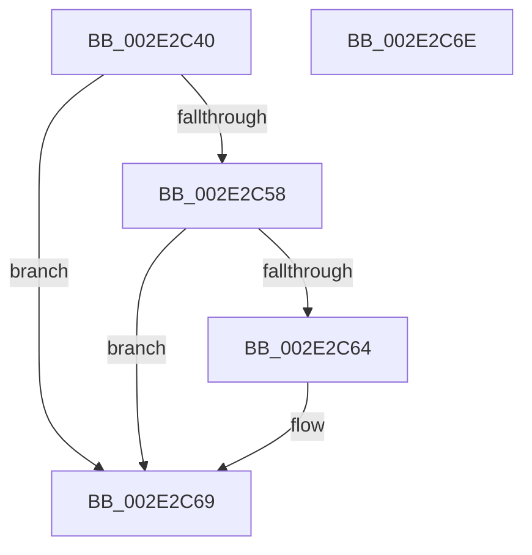

# KeLeaveGuardedRegion

- RVA: `0x002E2C40`–`0x002E2C6F` (길이 `47` bytes)
- VA: `0x00000001402E2C40`
- 실행 섹션: `.text`
- PDB 이름 있음: `예`; PDB Function 태그: `아니요`
- unwind 정보 RVA: `0x0005C788`
- 디코드: `13`개 명령, `47/47` bytes 표시
- 미해석 바이트: `0` (있으면 어셈블리에 `.byte`로 보존)

> 이 문서는 커널 이미지의 기계어와 PDB 기호를 분석해 생성했습니다. 4번과 5번은 함수 원형과 자료형을 바이너리 사용 방식에서 추정한 C 해석이며 원본 소스 복구 결과는 아닙니다.

## 1. Dependencies

- 직접 호출 지점: **1**; 고유 호출 대상: **1**
- 직접 호출자로 확인된 함수: **70**
- RIP 상대 이미지 참조: **0**

### Outgoing calls
- `0x002E2C64` → [KiCheckForKernelApcDelivery](KiCheckForKernelApcDelivery_function_002E2C80.md) (function, `0x002E2C80`)

### Direct callers
- [KiReleaseDpcCorralLock](../2C/KiReleaseDpcCorralLock_function_002C9D20.md) at `0x002C9D4F`
- [PopFxActivateComponent](../2D/PopFxActivateComponent_function_002D9DBC.md) at `0x002D9E5A`
- [ExpCleanupAutoExpandPushLock](ExpCleanupAutoExpandPushLock_function_002E2D80.md) at `0x002E2DED`
- [RtlpHpTryAcquireQueuedLockExclusive](RtlpHpTryAcquireQueuedLockExclusive_function_002EB23C.md) at `0x002EB30E`
- [RtlpCSparseBitmapPageDecommit](RtlpCSparseBitmapPageDecommit_function_002EFAD4.md) at `0x002EFDDA`
- [RtlSparseArrayElementAllocate](../2F/RtlSparseArrayElementAllocate_function_002F09C8.md) at `0x002F0A7A`
- [RtlCSparseBitmapBitmaskWrite](../2F/RtlCSparseBitmapBitmaskWrite_function_002F0A8C.md) at `0x002F0B73`
- [RtlpHpReleaseLockShared](../32/RtlpHpReleaseLockShared_function_003245B0.md) at `0x003245D9`
- [RtlpHpSegPageRangeCoalesce](../32/RtlpHpSegPageRangeCoalesce_function_00325860.md) at `0x003259F3`
- [MmWaitForCacheManagerPrefetch](../36/MmWaitForCacheManagerPrefetch_function_0036D644.md) at `0x0036D6B0`
- [ExSaAllocate](../3B/ExSaAllocate_function_003B3FB0.md) at `0x003B3FFD`
- [ExSaFree](../43/ExSaFree_function_0043FACC.md) at `0x0043FB2A`
- [MiProcessWsInSwapRanges](../45/MiProcessWsInSwapRanges_function_0045BA4C.md) at `0x0045BAC2`
- [RtlCSparseBitmapLeaveLockingRegion](../48/RtlCSparseBitmapLeaveLockingRegion_function_00482DD0.md) at `0x00482E02`
- [PopFxProcessWorkPool](../49/PopFxProcessWorkPool_function_0049E8A0.md) at `0x0049EA1F`
- [RtlpHpAcquireReleaseLockExclusive](../4B/RtlpHpAcquireReleaseLockExclusive_function_004B208C.md) at `0x004B20F8`
- [PopFxDeviceCriticalRegionLeave](../4F/PopFxDeviceCriticalRegionLeave_function_004F1330.md) at `0x004F1348`
- [EtwpCoverageSamplerPageFault](../4F/EtwpCoverageSamplerPageFault_function_004FBEF0.md) at `0x004FC074`
- [EtwpCoverageSamplerPageFault](../4F/EtwpCoverageSamplerPageFault_function_004FBEF0.md) at `0x004FC095`
- [KiExecuteDpc](../5C/KiExecuteDpc_function_005C84F0.md) at `0x005C860B`
- [DifKeLeaveGuardedRegionWrapper](../63/DifKeLeaveGuardedRegionWrapper_function_006306C0.md) at `0x00630775`
- [DifKeLeaveGuardedRegionWrapper](../63/DifKeLeaveGuardedRegionWrapper_function_006306C0.md) at `0x0063077C`
- [sub_006DEED6](../6D/Unknown_function_006DEED6.md) at `0x006DEEF2`
- [ObIsDosDeviceLocallyMapped](../../page/74/ObIsDosDeviceLocallyMapped_function_0074EAB0.md) at `0x0074EB52`
- [ObpCreateSymbolicLinkName](../../page/74/ObpCreateSymbolicLinkName_function_0074EB80.md) at `0x0074EF2E`
- [ObDisableEtwReferenceTrace](../../page/74/ObDisableEtwReferenceTrace_function_0074F394.md) at `0x0074F416`
- [ObEnableEtwReferenceTrace](../../page/74/ObEnableEtwReferenceTrace_function_0074F434.md) at `0x0074F4B6`
- [ObQueryRefTraceInformation](../../page/74/ObQueryRefTraceInformation_function_0074F4D4.md) at `0x0074F762`
- [ObpFreeWorkItemBlock](../../page/74/ObpFreeWorkItemBlock_function_0074F940.md) at `0x0074F9FA`
- [ObpPushRefDerefInfo](../../page/74/ObpPushRefDerefInfo_function_0074FEC4.md) at `0x0075007B`
- [ObpStartRuntimeStackTrace](../../page/75/ObpStartRuntimeStackTrace_function_00750134.md) at `0x007504E9`
- [ObpStartRuntimeStackTrace](../../page/75/ObpStartRuntimeStackTrace_function_00750134.md) at `0x00750521`
- [ObpStopRuntimeStackTrace](../../page/75/ObpStopRuntimeStackTrace_function_00750574.md) at `0x00750606`
- [ObpStopRuntimeStackTrace](../../page/75/ObpStopRuntimeStackTrace_function_00750574.md) at `0x007506BC`
- [ObpStopRuntimeStackTrace](../../page/75/ObpStopRuntimeStackTrace_function_00750574.md) at `0x0075073A`
- [PsTlsFree](../../page/78/PsTlsFree_function_00787BA0.md) at `0x00787BC7`
- [PspTlsAlloc](../../page/78/PspTlsAlloc_function_00787BD8.md) at `0x00787C14`
- [MiRemovePhysicalMemory](../../page/7F/MiRemovePhysicalMemory_function_007FAD3C.md) at `0x007FAEC9`
- [ObpLookupObjectName](../../page/89/ObpLookupObjectName_function_0089BE90.md) at `0x0089C34C`
- [ObpLookupObjectName](../../page/89/ObpLookupObjectName_function_0089BE90.md) at `0x0089D57F`
- [ObpLookupObjectName](../../page/89/ObpLookupObjectName_function_0089BE90.md) at `0x0089D6B6`
- [sub_008D0600](../../page/8D/Unknown_function_008D0600.md) at `0x008D06D4`
- [sub_008D0720](../../page/8D/Unknown_function_008D0720.md) at `0x008D07C2`
- [sub_008D18D4](../../page/8D/Unknown_function_008D18D4.md) at `0x008D19C6`
- [sub_008D2420](../../page/8D/Unknown_function_008D2420.md) at `0x008D24D7`
- [sub_008D2508](../../page/8D/Unknown_function_008D2508.md) at `0x008D2626`
- [sub_008D292D](../../page/8D/Unknown_function_008D292D.md) at `0x008D2A8E`
- [sub_008D2F2C](../../page/8D/Unknown_function_008D2F2C.md) at `0x008D3080`
- [sub_008D2F2C](../../page/8D/Unknown_function_008D2F2C.md) at `0x008D317F`
- [sub_008D379C](../../page/8D/Unknown_function_008D379C.md) at `0x008D3A3A`
- [sub_008D3CC4](../../page/8D/Unknown_function_008D3CC4.md) at `0x008D3D9B`
- [sub_008D3F58](../../page/8D/Unknown_function_008D3F58.md) at `0x008D4086`
- [WbSetWowTrapFrame](../../page/8D/WbSetWowTrapFrame_function_008D57EC.md) at `0x008D5900`
- [PspExitThread](../../page/90/PspExitThread_function_00905F60.md) at `0x0090629B`
- [PspExitThread](../../page/90/PspExitThread_function_00905F60.md) at `0x0090656F`
- [ObClearProcessDeviceMap](../../page/90/ObClearProcessDeviceMap_function_00907688.md) at `0x00907722`
- [sub_00907768](../../page/90/Unknown_function_00907768.md) at `0x00907803`
- [sub_00907768](../../page/90/Unknown_function_00907768.md) at `0x009078EA`
- [ObQueryDeviceMapInformation](../../page/96/ObQueryDeviceMapInformation_function_0096C5C0.md) at `0x0096CAC7`
- [ObpReferenceCurrentDeviceMap](../../page/96/ObpReferenceCurrentDeviceMap_function_0096CBD0.md) at `0x0096CDA8`
- [ObpSetCurrentProcessDeviceMap](../../page/96/ObpSetCurrentProcessDeviceMap_function_0096CF6C.md) at `0x0096D083`
- [sub_0096D265](../../page/96/Unknown_function_0096D265.md) at `0x0096D275`
- [sub_0099FC70](../../page/99/Unknown_function_0099FC70.md) at `0x0099FE43`
- [sub_009A01EC](../../page/9A/Unknown_function_009A01EC.md) at `0x009A02A5`
- [sub_009A02CC](../../page/9A/Unknown_function_009A02CC.md) at `0x009A0385`
- [sub_009A03AC](../../page/9A/Unknown_function_009A03AC.md) at `0x009A0486`
- [sub_009A051C](../../page/9A/Unknown_function_009A051C.md) at `0x009A066A`
- [sub_009A09B8](../../page/9A/Unknown_function_009A09B8.md) at `0x009A0AAE`
- [sub_009A09B8](../../page/9A/Unknown_function_009A09B8.md) at `0x009A0BC0`
- [sub_009A17F0](../../page/9A/Unknown_function_009A17F0.md) at `0x009A18AE`
- [sub_009A17F0](../../page/9A/Unknown_function_009A17F0.md) at `0x009A1956`
- [ObpDeregisterObject](../../page/9D/ObpDeregisterObject_function_009D7F78.md) at `0x009D8074`
- [ObpDeregisterObject](../../page/9D/ObpDeregisterObject_function_009D7F78.md) at `0x009D80C9`
- [PsTlsSetValue](../../page/A2/PsTlsSetValue_function_00A259F0.md) at `0x00A25A81`
- [WbHeapExecutionUnloadModule](../../page/A6/WbHeapExecutionUnloadModule_function_00A67D74.md) at `0x00A67E1D`
- [sub_00A67E80](../../page/A6/Unknown_function_00A67E80.md) at `0x00A67F10`
- [ObpDeleteSymbolicLinkName](../../page/A7/ObpDeleteSymbolicLinkName_function_00A7BC80.md) at `0x00A7BDA5`
- [PsPicoWalkUserStack](../../page/AB/PsPicoWalkUserStack_function_00ABF288.md) at `0x00ABF34F`
- [ObpRegisterObject](../../page/AC/ObpRegisterObject_function_00ACF3EC.md) at `0x00ACF5C4`
- [sub_00B257D0](../../page/B2/Unknown_function_00B257D0.md) at `0x00B258A5`
- [sub_00B28A26](../../page/B2/Unknown_function_00B28A26.md) at `0x00B28A7B`
- [sub_00B47284](../../page/B4/Unknown_function_00B47284.md) at `0x00B473D3`
- [CreateMiniNtBootKey](../../init/C1/CreateMiniNtBootKey_function_00C1A840.md) at `0x00C1A9C3`

### Static image references
- 디코드된 RIP-relative 메모리 참조가 없습니다.

## 2. Other-region calls and transfers

- 다른 실행 섹션으로 향하는 call: **0**
- 별도 외부 분기/꼬리 이동을 확인하지 못했습니다.

## 3. Assembly (complete function range)

```asm
002E2C40  48 83 EC 28                     sub rsp, 0x28
002E2C44  65 48 8B 04 25 88 01 00 00      mov rax, qword ptr gs:[0x188]
002E2C4D  90                              nop
002E2C4E  66 83 80 E6 01 00 00 01         add word ptr [rax + 0x1e6], 1
002E2C56  75 11                           jne 0x1402e2c69
002E2C58  48 05 98 00 00 00               add rax, 0x98
002E2C5E  90                              nop
002E2C5F  48 39 00                        cmp qword ptr [rax], rax
002E2C62  74 05                           je 0x1402e2c69
002E2C64  E8 17 00 00 00                  call 0x1402e2c80
002E2C69  48 83 C4 28                     add rsp, 0x28
002E2C6D  C3                              ret
002E2C6E  CC                              int3
```

## 4. C-style interpretation (structured pseudocode)

```c
__int64 __fastcall KeLeaveGuardedRegion(void)
{
    __int64 result;
    __int64 v_rsp;

    v_rsp = (v_rsp) - (40);
    if (condition_is_not_equal) goto loc_002E2C69;
    result = (*(unsigned __int64 *)(gs_base + (0 + 392))) + (152);
    if ((*(unsigned __int64 *)(result)) != result) {
        result = KiCheckForKernelApcDelivery(a1, a2, a3, a4);
    }
    v_rsp = (v_rsp) + (40);
    return result;
}
```

## 5. (Beta) C Style

```c
void KeLeaveGuardedRegion(void)
{
    int64_t result;
    int64_t local_rsp;

    local_rsp = (local_rsp) - (40);
    if (condition_is_not_equal) goto loc_002E2C69;
    result = (*(uint64_t *)(gs_base + (0 + 0x188))) + (152);
    if ((*(uint64_t *)(result)) != result) {
        result = KiCheckForKernelApcDelivery(a1, a2, a3, a4);
    }
    local_rsp = (local_rsp) + (40);
    return result;
}
```

## 6. Execution-region graph

[열기: 2D/3D 그래프와 함수 탐색 컨트롤 패널](../../../control-panel.html?section=text&rva=0x002E2C40&view=graph)

- 2D 그래프는 위에서 아래로 흐르고, 3D 그래프는 빈 공간을 드래그해 회전합니다. Shift+드래그는 이동, 휠은 확대·축소, 함수 노드 선택은 대상 보고서 이동입니다.

### Static fallback


