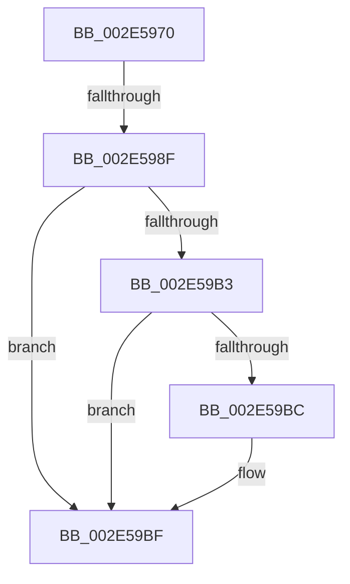

# KiAbEntryUpdateOwnerTreePosition

- RVA: `0x002E5970`–`0x002E59C5` (길이 `85` bytes)
- VA: `0x00000001402E5970`
- 실행 섹션: `.text`
- PDB 이름 있음: `예`; PDB Function 태그: `아니요`
- unwind 정보 RVA: `0x00071178`
- 디코드: `23`개 명령, `85/85` bytes 표시
- 미해석 바이트: `0` (있으면 어셈블리에 `.byte`로 보존)

> 이 문서는 커널 이미지의 기계어와 PDB 기호를 분석해 생성했습니다. 4번과 5번은 함수 원형과 자료형을 바이너리 사용 방식에서 추정한 C 해석이며 원본 소스 복구 결과는 아닙니다.

## 1. Dependencies

- 직접 호출 지점: **0**; 고유 호출 대상: **0**
- 직접 호출자로 확인된 함수: **2**
- RIP 상대 이미지 참조: **0**

### Outgoing calls
- 직접 디코드된 call 명령이 없습니다.

### Direct callers
- [KiAbConvertWaiterToOwnerEntry](../21/KiAbConvertWaiterToOwnerEntry_function_00219430.md) at `0x0021964F`
- [KiAbConvertWaiterToOwnerEntry](../21/KiAbConvertWaiterToOwnerEntry_function_00219430.md) at `0x0021993C`
- [KiAbDeferredProcessingWorker](../30/KiAbDeferredProcessingWorker_function_0030DEB0.md) at `0x0030E63C`
- [KiAbDeferredProcessingWorker](../30/KiAbDeferredProcessingWorker_function_0030DEB0.md) at `0x0030E681`

### Static image references
- 디코드된 RIP-relative 메모리 참조가 없습니다.

## 2. Other-region calls and transfers

- 다른 실행 섹션으로 향하는 call: **0**
- call이 아닌 외부 분기/꼬리 이동: **2**
  - `0x002E5989` → [sub_002E5A55](Unknown_function_002E5A55.md) (`tail-transfer`)
  - `0x002E59C3` → [sub_002E5A44](Unknown_function_002E5A44.md) (`tail-transfer`)

## 3. Assembly (complete function range)

```asm
002E5970  40 53                           push rbx
002E5972  48 83 EC 20                     sub rsp, 0x20
002E5976  8B 41 50                        mov eax, dword ptr [rcx + 0x50]
002E5979  48 8B D9                        mov rbx, rcx
002E597C  C7 44 24 30 00 00 00 00         mov dword ptr [rsp + 0x30], 0
002E5984  25 FF FF FF 3F                  and eax, 0x3fffffff
002E5989  0F 87 C6 00 00 00               ja 0x1402e5a55
002E598F  45 32 C0                        xor r8b, r8b
002E5992  0F B6 41 08                     movzx eax, byte ptr [rcx + 8]
002E5996  83 E0 3F                        and eax, 0x3f
002E5999  48 6B C8 58                     imul rcx, rax, 0x58
002E599D  48 8B C3                        mov rax, rbx
002E59A0  48 2B C1                        sub rax, rcx
002E59A3  48 8B 40 F0                     mov rax, qword ptr [rax - 0x10]
002E59A7  0F B6 88 33 02 00 00            movzx ecx, byte ptr [rax + 0x233]
002E59AE  41 3A C8                        cmp cl, r8b
002E59B1  7E 0C                           jle 0x1402e59bf
002E59B3  44 0F B6 C1                     movzx r8d, cl
002E59B7  80 F9 1E                        cmp cl, 0x1e
002E59BA  7E 03                           jle 0x1402e59bf
002E59BC  41 B0 1E                        mov r8b, 0x1e
002E59BF  44 38 43 28                     cmp byte ptr [rbx + 0x28], r8b
002E59C3  74 7F                           je 0x1402e5a44
```

## 4. C-style interpretation (structured pseudocode)

```c
__int64 __fastcall KiAbEntryUpdateOwnerTreePosition(__int64 a1, __int64 a2, unsigned __int8 a3)
{
    __int64 result;
    __int64 v_rsp;
    unsigned int v_stack_p8;

    v_rsp = (v_rsp) - (32);
    v_stack_p8 = 0;
    result = (unsigned int)(((unsigned int)(*(unsigned int *)(a1 + 80))) & (0x3FFFFFFFULL));
    a3 = 0;
    result = (unsigned int)((*(unsigned __int8 *)(a1 + 8)) & (63));
    a1 = (a1) * (result);
    result = (a1) - (a1);
    if (((unsigned __int8)(*(unsigned __int8 *)(*(unsigned __int64 *)(result - 16) + 563))) <= 0) goto loc_002E59BF;
    if (((unsigned __int8)(*(unsigned __int8 *)(*(unsigned __int64 *)(result - 16) + 563))) >= = 30) {
        a3 = 30;
    }
}
```

## 5. (Beta) C Style

```c
int64_t KiAbEntryUpdateOwnerTreePosition(void *Arg1, int64_t Arg2, uint8_t Arg3)
{
    uint8_t *arg1 = (uint8_t *)Arg1;

    int64_t result;
    int64_t local_rsp;
    uint32_t v_stack_p8;

    local_rsp = (local_rsp) - (32);
    v_stack_p8 = 0;
    result = (uint32_t)(((uint32_t)(*(uint32_t *)(arg1 + 0x50))) & (0x3FFFFFFFULL));
    Arg3 = 0;
    result = (uint32_t)((*(uint8_t *)(arg1 + 0x8)) & (63));
    Arg1 = (Arg1) * (result);
    result = (Arg1) - (Arg1);
    if (((uint8_t)(*(uint8_t *)(*(uint64_t *)(result - 0x10) + 0x233))) <= 0) goto loc_002E59BF;
    if (((uint8_t)(*(uint8_t *)(*(uint64_t *)(result - 0x10) + 0x233))) >= = 30) {
        Arg3 = 30;
    }
}
```

### 관측된 메모리 오프셋

구조체 형식이 확인되지 않은 접근은 인자 기준의 오프셋으로만 기록했습니다.

| 기준 인자 | 오프셋 표현 | 폭 (bit) | 접근 |
|---|---:|---:|---|
| `Arg1` | `- 0x10` | `64` | `R` |
| `Arg1` | `+ 0x8` | `8` | `R` |
| `Arg1` | `+ 0x28` | `8` | `R` |
| `Arg1` | `+ 0x50` | `32` | `R` |

## 6. Execution-region graph

[열기: 2D/3D 그래프와 함수 탐색 컨트롤 패널](../../../control-panel.html?section=text&rva=0x002E5970&view=graph)

- 2D 그래프는 위에서 아래로 흐르고, 3D 그래프는 빈 공간을 드래그해 회전합니다. Shift+드래그는 이동, 휠은 확대·축소, 함수 노드 선택은 대상 보고서 이동입니다.

### Static fallback


