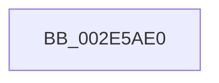

# KiAbEntryUpdateWaiterTreePosition

- RVA: `0x002E5AE0`–`0x002E5B19` (길이 `57` bytes)
- VA: `0x00000001402E5AE0`
- 실행 섹션: `.text`
- PDB 이름 있음: `예`; PDB Function 태그: `아니요`
- unwind 정보 RVA: `0x000711E0`
- 디코드: `16`개 명령, `57/57` bytes 표시
- 미해석 바이트: `0` (있으면 어셈블리에 `.byte`로 보존)

> 이 문서는 커널 이미지의 기계어와 PDB 기호를 분석해 생성했습니다. 4번과 5번은 함수 원형과 자료형을 바이너리 사용 방식에서 추정한 C 해석이며 원본 소스 복구 결과는 아닙니다.

## 1. Dependencies

- 직접 호출 지점: **0**; 고유 호출 대상: **0**
- 직접 호출자로 확인된 함수: **2**
- RIP 상대 이미지 참조: **0**

### Outgoing calls
- 직접 디코드된 call 명령이 없습니다.

### Direct callers
- [KiAbConvertWaiterToOwnerEntry](../21/KiAbConvertWaiterToOwnerEntry_function_00219430.md) at `0x0021975B`
- [KiAbForceProcessLockEntry](../41/KiAbForceProcessLockEntry_function_00419078.md) at `0x00419135`

### Static image references
- 디코드된 RIP-relative 메모리 참조가 없습니다.

## 2. Other-region calls and transfers

- 다른 실행 섹션으로 향하는 call: **0**
- call이 아닌 외부 분기/꼬리 이동: **1**
  - `0x002E5B17` → [sub_002E5B94](Unknown_function_002E5B94.md) (`tail-transfer`)

## 3. Assembly (complete function range)

```asm
002E5AE0  40 53                           push rbx
002E5AE2  48 83 EC 20                     sub rsp, 0x20
002E5AE6  0F B6 41 08                     movzx eax, byte ptr [rcx + 8]
002E5AEA  48 8B D9                        mov rbx, rcx
002E5AED  83 E0 3F                        and eax, 0x3f
002E5AF0  4C 6B C0 58                     imul r8, rax, 0x58
002E5AF4  48 8B C1                        mov rax, rcx
002E5AF7  B9 1E 00 00 00                  mov ecx, 0x1e
002E5AFC  49 2B C0                        sub rax, r8
002E5AFF  48 8B 40 F0                     mov rax, qword ptr [rax - 0x10]
002E5B03  44 0F B6 80 C3 00 00 00         movzx r8d, byte ptr [rax + 0xc3]
002E5B0B  44 3A C1                        cmp r8b, cl
002E5B0E  41 8B C0                        mov eax, r8d
002E5B11  0F 4F C1                        cmovg eax, ecx
002E5B14  38 43 28                        cmp byte ptr [rbx + 0x28], al
002E5B17  74 7B                           je 0x1402e5b94
```

## 4. C-style interpretation (structured pseudocode)

```c
__int64 __fastcall KiAbEntryUpdateWaiterTreePosition(__int64 a1)
{
    __int64 result;
    __int64 v_rsp;

    v_rsp = (v_rsp) - (32);
    result = (unsigned int)((*(unsigned __int8 *)(a1 + 8)) & (63));
    a3 = (a3) * (result);
    result = (a1) - (a3);
    result = (unsigned int)((unsigned int)(*(unsigned __int8 *)(*(unsigned __int64 *)(result - 16) + 195)));
    if (((unsigned __int8)(*(unsigned __int8 *)(*(unsigned __int64 *)(result - 16) + 195))) > 30) { result = 30; }
}
```

## 5. (Beta) C Style

```c
int64_t KiAbEntryUpdateWaiterTreePosition(void *Arg1)
{
    uint8_t *arg1 = (uint8_t *)Arg1;

    int64_t result;
    int64_t local_rsp;

    local_rsp = (local_rsp) - (32);
    result = (uint32_t)((*(uint8_t *)(arg1 + 0x8)) & (63));
    a3 = (a3) * (result);
    result = (Arg1) - (a3);
    result = (uint32_t)((uint32_t)(*(uint8_t *)(*(uint64_t *)(result - 0x10) + 0xC3)));
    if (((uint8_t)(*(uint8_t *)(*(uint64_t *)(result - 0x10) + 0xC3))) > 30) { result = 30; }
}
```

### 관측된 메모리 오프셋

구조체 형식이 확인되지 않은 접근은 인자 기준의 오프셋으로만 기록했습니다.

| 기준 인자 | 오프셋 표현 | 폭 (bit) | 접근 |
|---|---:|---:|---|
| `Arg1` | `- 0x10` | `64` | `R` |
| `Arg1` | `+ 0x8` | `8` | `R` |
| `Arg1` | `+ 0x28` | `8` | `R` |

## 6. Execution-region graph

[열기: 2D/3D 그래프와 함수 탐색 컨트롤 패널](../../../control-panel.html?section=text&rva=0x002E5AE0&view=graph)

- 2D 그래프는 위에서 아래로 흐르고, 3D 그래프는 빈 공간을 드래그해 회전합니다. Shift+드래그는 이동, 휠은 확대·축소, 함수 노드 선택은 대상 보고서 이동입니다.

### Static fallback


