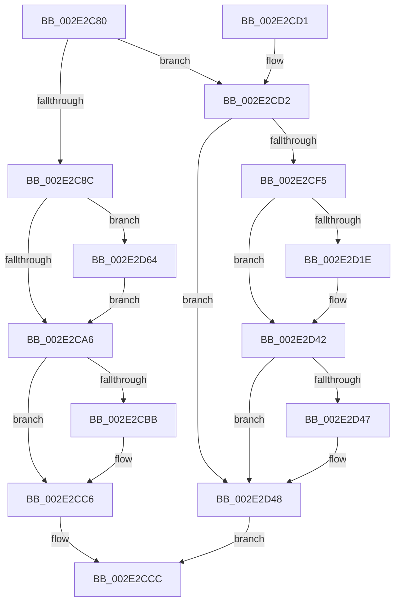

# KiCheckForKernelApcDelivery

- RVA: `0x002E2C80`–`0x002E2D71` (길이 `241` bytes)
- VA: `0x00000001402E2C80`
- 실행 섹션: `.text`
- PDB 이름 있음: `예`; PDB Function 태그: `아니요`
- unwind 정보 RVA: `0x00070D8C`
- 디코드: `59`개 명령, `241/241` bytes 표시
- 미해석 바이트: `0` (있으면 어셈블리에 `.byte`로 보존)

> 이 문서는 커널 이미지의 기계어와 PDB 기호를 분석해 생성했습니다. 4번과 5번은 함수 원형과 자료형을 바이너리 사용 방식에서 추정한 C 해석이며 원본 소스 복구 결과는 아닙니다.

## 1. Dependencies

- 직접 호출 지점: **5**; 고유 호출 대상: **5**
- 직접 호출자로 확인된 함수: **225**
- RIP 상대 이미지 참조: **2**

### Outgoing calls
- `0x002E2CAD` → [KiDeliverApc](../25/KiDeliverApc_function_00250F20.md) (function, `0x00250F20`)
- `0x002E2CC1` → [KiLowerIrqlProcessIrqlFlags](../4F/KiLowerIrqlProcessIrqlFlags_function_004F5698.md) (function, `0x004F5698`)
- `0x002E2CFE` → [HalpDisableInterrupts](../25/HalpDisableInterrupts_function_002521A0.md) (function, `0x002521A0`)
- `0x002E2D5A` → [HalpInterruptSendIpi](../25/HalpInterruptSendIpi_function_00252310.md) (function, `0x00252310`)
- `0x002E2D67` → [KiRaiseIrqlProcessIrqlFlags](../4F/KiRaiseIrqlProcessIrqlFlags_function_004F56FC.md) (function, `0x004F56FC`)

### Direct callers
- [KiSchedulerApc](../20/KiSchedulerApc_function_00202BC0.md) at `0x00202D0D`
- [sub_002067E0](../20/Unknown_function_002067E0.md) at `0x0020682D`
- [sub_00206865](../20/Unknown_function_00206865.md) at `0x00206AD3`
- [sub_00206D89](../20/Unknown_function_00206D89.md) at `0x00206D89`
- [KiLeaveCriticalRegionUnsafe](../25/KiLeaveCriticalRegionUnsafe_function_0025F010.md) at `0x0025F03C`
- [MiPostInsertVad](../26/MiPostInsertVad_function_002643C0.md) at `0x00264565`
- [sub_00264587](../26/Unknown_function_00264587.md) at `0x0026478D`
- [StLockReleaseExclusive](../26/StLockReleaseExclusive_function_00267050.md) at `0x0026714A`
- [MiCreatePrototypePtes](../29/MiCreatePrototypePtes_function_002950FC.md) at `0x00295471`
- [MiObtainReferencedSecureVad](../29/MiObtainReferencedSecureVad_function_00295688.md) at `0x0029572C`
- [MiObtainReferencedSecureVad](../29/MiObtainReferencedSecureVad_function_00295688.md) at `0x002957B4`
- [MiRemoveFromSystemSpace](../29/MiRemoveFromSystemSpace_function_002962FC.md) at `0x002964D3`
- [MiSetVadDeleted](../29/MiSetVadDeleted_function_00296E00.md) at `0x00296FC6`
- [EtwTracePageFault](../2A/EtwTracePageFault_function_002A2E74.md) at `0x002A2F6F`
- [MiAcquireLoadLock](../2A/MiAcquireLoadLock_function_002A3950.md) at `0x002A39A8`
- [MiReleaseLoadLock](../2A/MiReleaseLoadLock_function_002A3CD0.md) at `0x002A3D0F`
- [MiUnlockLoaderEntry](../2A/MiUnlockLoaderEntry_function_002A3E28.md) at `0x002A3EA4`
- [UNLOCK_ADDRESS_SPACE](../2A/UNLOCK_ADDRESS_SPACE_function_002A4844.md) at `0x002A489E`
- [MiLockAddressSpaceToo](../2A/MiLockAddressSpaceToo_function_002A5670.md) at `0x002A578B`
- [MiUnlockVad](../2A/MiUnlockVad_function_002A59C8.md) at `0x002A5A20`
- [MiUnlockWsSwapExclusive](../2A/MiUnlockWsSwapExclusive_function_002A74A8.md) at `0x002A74F3`
- [UNLOCK_ADDRESS_SPACE_SHARED](../2A/UNLOCK_ADDRESS_SPACE_SHARED_function_002A8ACC.md) at `0x002A8B23`
- [MiTrimUnusedPageFileRegionsWorker](../2A/MiTrimUnusedPageFileRegionsWorker_function_002AA320.md) at `0x002AA3D6`
- [MiStoreWriteModifiedPages](../2B/MiStoreWriteModifiedPages_function_002B46C4.md) at `0x002B47EA`
- [MiStoreWriteModifiedPages](../2B/MiStoreWriteModifiedPages_function_002B46C4.md) at `0x002B510C`
- [MiStoreWriteModifiedPages](../2B/MiStoreWriteModifiedPages_function_002B46C4.md) at `0x002B537F`
- [MiFinishHardFault](../2B/MiFinishHardFault_function_002B6F10.md) at `0x002B7579`
- [sub_002DFB26](../2D/Unknown_function_002DFB26.md) at `0x002DFB32`
- [MiUnlockControlAreaFileObjectShared](../2D/MiUnlockControlAreaFileObjectShared_function_002DFCB4.md) at `0x002DFCFF`
- [PspUnlockProcessListExclusive](../2D/PspUnlockProcessListExclusive_function_002DFD18.md) at `0x002DFD64`
- [SMKM_STORE&lt;SM_TRAITS&gt;::SmStReleaseStoreLockExclusive](../2D/SMKM_STORE_SM_TRAITS_SmStReleaseStoreLockExclusive_function_002DFE68.md) at `0x002DFEB5`
- [SMKM_STORE_MGR&lt;SM_TRAITS&gt;::SmFeAddComplete](../2D/SMKM_STORE_MGR_SM_TRAITS_SmFeAddComplete_function_002DFEE0.md) at `0x002E01C3`
- [StLockReleaseShared](StLockReleaseShared_function_002E0320.md) at `0x002E0365`
- [sub_002E062C](Unknown_function_002E062C.md) at `0x002E0658`
- [sub_002E087E](Unknown_function_002E087E.md) at `0x002E0ABC`
- [MiTrimSharedPageFromViews](MiTrimSharedPageFromViews_function_002E16F8.md) at `0x002E1953`
- [MiTrimSharedPageFromViews](MiTrimSharedPageFromViews_function_002E16F8.md) at `0x002E220E`
- [MiUnlockControlAreaFileObjectExclusive](MiUnlockControlAreaFileObjectExclusive_function_002E22D0.md) at `0x002E23D1`
- [MiUnlockVadShared](MiUnlockVadShared_function_002E2420.md) at `0x002E2525`
- [MiManageSubsectionView](MiManageSubsectionView_function_002E2570.md) at `0x002E272D`
- [UNLOCK_PAGE_TABLE_COMMITMENT](UNLOCK_PAGE_TABLE_COMMITMENT_function_002E27D0.md) at `0x002E28D1`
- [PspUnlockProcessListShared](PspUnlockProcessListShared_function_002E2920.md) at `0x002E2A21`
- [RtlpHpReleaseQueuedLockExclusive](RtlpHpReleaseQueuedLockExclusive_function_002E2A70.md) at `0x002E2B87`
- [KeLeaveGuardedRegion](KeLeaveGuardedRegion_function_002E2C40.md) at `0x002E2C64`
- [sub_002E3191](Unknown_function_002E3191.md) at `0x002E329E`
- [RtlpLookupDynamicUserFunctionTable](../2F/RtlpLookupDynamicUserFunctionTable_function_002F333C.md) at `0x002F34AF`
- [RtlpLookupDynamicUserFunctionTable](../2F/RtlpLookupDynamicUserFunctionTable_function_002F333C.md) at `0x002F359C`
- [MiObtainReferencedVadEx](../31/MiObtainReferencedVadEx_function_00316690.md) at `0x0031677D`
- [sub_00316832](../31/Unknown_function_00316832.md) at `0x0031685E`
- [MiReturnLockedVadOrNextVa](../31/MiReturnLockedVadOrNextVa_function_00316980.md) at `0x00316B2D`
- [MiReturnLockedVadOrNextVa](../31/MiReturnLockedVadOrNextVa_function_00316980.md) at `0x00316BCD`
- [MiReturnLockedVadOrNextVa](../31/MiReturnLockedVadOrNextVa_function_00316980.md) at `0x00316C92`
- [MiReturnLockedVadOrNextVa](../31/MiReturnLockedVadOrNextVa_function_00316980.md) at `0x00316D18`
- [MiReturnLockedVadOrNextVa](../31/MiReturnLockedVadOrNextVa_function_00316980.md) at `0x00316D62`
- [sub_00324310](../32/Unknown_function_00324310.md) at `0x0032434B`
- [MiAddViewsForSection](../32/MiAddViewsForSection_function_00324990.md) at `0x00324C8D`
- [MiAddViewsForSection](../32/MiAddViewsForSection_function_00324990.md) at `0x00324F03`
- [sub_0034CEDD](../34/Unknown_function_0034CEDD.md) at `0x0034CF25`
- [sub_0034D8EA](../34/Unknown_function_0034D8EA.md) at `0x0034D92F`
- [MiWalkEntireImage](../36/MiWalkEntireImage_function_00365D70.md) at `0x00366DDE`
- [MiWalkEntireImage](../36/MiWalkEntireImage_function_00365D70.md) at `0x00366ED1`
- [MiPrivateFixup](../36/MiPrivateFixup_function_003693E8.md) at `0x0036979C`
- [MiGatherPagefilePages](../37/MiGatherPagefilePages_function_00372B08.md) at `0x00372EBA`
- [MiGatherPagefilePages](../37/MiGatherPagefilePages_function_00372B08.md) at `0x00373326`
- [MiReplenishSlabAllocator](../37/MiReplenishSlabAllocator_function_003788E4.md) at `0x003789AB`
- [MiIssueHardFault](../38/MiIssueHardFault_function_00380074.md) at `0x00380785`
- [PspUnlockQuotaExpansion](../39/PspUnlockQuotaExpansion_function_00390E68.md) at `0x00390EC7`
- [MiUpControlAreaRefs](../3B/MiUpControlAreaRefs_function_003B2BF0.md) at `0x003B2F15`
- [MiInsertInSystemSpace](../3B/MiInsertInSystemSpace_function_003B2F5C.md) at `0x003B3449`
- [MiUnlockDynamicMemoryShared](../3B/MiUnlockDynamicMemoryShared_function_003B8A48.md) at `0x003B8A90`
- [MiFlushAllStoreSwapPages](../3B/MiFlushAllStoreSwapPages_function_003BC890.md) at `0x003BC99B`
- [PspUnlockThreadSecurityShared](../3C/PspUnlockThreadSecurityShared_function_003C2E40.md) at `0x003C2E93`
- [KeRestoreExtendedAndSupervisorState](../3D/KeRestoreExtendedAndSupervisorState_function_003D60D0.md) at `0x003D618C`
- [KiDispatchException](../3D/KiDispatchException_function_003D7650.md) at `0x003D7C1A`
- [KiDispatchException](../3D/KiDispatchException_function_003D7650.md) at `0x003D7CCF`
- [KiSaveExtendedAndSupervisorState](../3D/KiSaveExtendedAndSupervisorState_function_003D9A1C.md) at `0x003D9B3A`
- [MiUnlockPartitionMappedWriter](../40/MiUnlockPartitionMappedWriter_function_004030EC.md) at `0x00403137`
- [ST_STORE&lt;SM_TRAITS&gt;::StDmPageRetrieve](../41/ST_STORE_SM_TRAITS_StDmPageRetrieve_function_0041FE20.md) at `0x0041FF09`
- [ST_STORE&lt;SM_TRAITS&gt;::StDmPageRetrieve](../41/ST_STORE_SM_TRAITS_StDmPageRetrieve_function_0041FE20.md) at `0x00420067`
- [sub_004201AA](../42/Unknown_function_004201AA.md) at `0x00420289`
- [sub_00420595](../42/Unknown_function_00420595.md) at `0x004205E4`
- [sub_00420595](../42/Unknown_function_00420595.md) at `0x0042063F`
- [sub_0042067D](../42/Unknown_function_0042067D.md) at `0x004206E7`
- [sub_0042067D](../42/Unknown_function_0042067D.md) at `0x00420743`
- [MiFinishVadDeletion](../43/MiFinishVadDeletion_function_00430ED0.md) at `0x00430FEA`
- [MiIssuePageHeatList](../44/MiIssuePageHeatList_function_0044615C.md) at `0x0044630A`
- [MI_UNLOCK_RELOCATIONS_SHARED](../44/MI_UNLOCK_RELOCATIONS_SHARED_function_0044A7EC.md) at `0x0044A831`
- [MiUnlockControlAreaSectionExtend](../44/MiUnlockControlAreaSectionExtend_function_0044BDC4.md) at `0x0044BE54`
- [RtlInsertDynamicUserFunctionTable](../45/RtlInsertDynamicUserFunctionTable_function_004513C4.md) at `0x0045152A`
- [PsSetSystemPagePriorityThread](../45/PsSetSystemPagePriorityThread_function_00459084.md) at `0x004590D3`
- [PsRevertToUserPagePriorityThread](../46/PsRevertToUserPagePriorityThread_function_00462D40.md) at `0x00462D7E`
- [RtlRemoveDynamicUserFunctionTable](../46/RtlRemoveDynamicUserFunctionTable_function_00466514.md) at `0x0046662A`
- [MI_UNLOCK_RELOCATIONS_EXCLUSIVE](../46/MI_UNLOCK_RELOCATIONS_EXCLUSIVE_function_0046965C.md) at `0x004696B7`
- [MiModifiedPageWriter](../47/MiModifiedPageWriter_function_0047E5F0.md) at `0x0047E8C2`
- [MiModifiedPageWriter](../47/MiModifiedPageWriter_function_0047E5F0.md) at `0x0047E920`
- [MiModifiedPageWriter](../47/MiModifiedPageWriter_function_0047E5F0.md) at `0x0047E9D9`
- [MiModifiedPageWriter](../47/MiModifiedPageWriter_function_0047E5F0.md) at `0x0047EB2B`
- [MiModifiedPageWriter](../47/MiModifiedPageWriter_function_0047E5F0.md) at `0x0047EBEE`
- [MiModifiedPageWriter](../47/MiModifiedPageWriter_function_0047E5F0.md) at `0x0047EC34`
- [MiFinishResume](../47/MiFinishResume_function_0047F9C0.md) at `0x0047FA74`
- [MiSendParkedCoreUpdateToAllChildPartitions](../47/MiSendParkedCoreUpdateToAllChildPartitions_function_0047FAC0.md) at `0x0047FB77`
- [MiDereferenceExtendInfo](../48/MiDereferenceExtendInfo_function_0048EFA4.md) at `0x0048F04F`
- [MmCheckProcessShadow](../49/MmCheckProcessShadow_function_004931C0.md) at `0x00493293`
- [ExpUnlockCallbackListShared](../4A/ExpUnlockCallbackListShared_function_004ABC3C.md) at `0x004ABC9B`
- [MiUnlockDriverMappings](../4B/MiUnlockDriverMappings_function_004B4E54.md) at `0x004B4EA0`
- [MiUnlockAweVadsExclusive](../4B/MiUnlockAweVadsExclusive_function_004BDF1C.md) at `0x004BDF59`
- [MiUnlockAwePagesShared](../4C/MiUnlockAwePagesShared_function_004C66C4.md) at `0x004C66F2`
- [MiUnlockSystemCacheInit](../4C/MiUnlockSystemCacheInit_function_004C81C8.md) at `0x004C8213`
- [ExpUnlockCallbackListExclusive](../4D/ExpUnlockCallbackListExclusive_function_004D643C.md) at `0x004D64A7`
- [PspUnlockThreadSecurityExclusive](../4E/PspUnlockThreadSecurityExclusive_function_004E97C0.md) at `0x004E9817`
- [PspLockUnlockTebAccessExclusive](../4E/PspLockUnlockTebAccessExclusive_function_004E9A2C.md) at `0x004E9A7F`
- [UNLOCK_ADDRESS_SPACE_SHARED_UNORDERED](../4F/UNLOCK_ADDRESS_SPACE_SHARED_UNORDERED_function_004F8924.md) at `0x004F8980`
- [IopProcessIoTracking](../59/IopProcessIoTracking_function_005986C0.md) at `0x005987DC`
- [PspApplyTimerDelayProcess](../5E/PspApplyTimerDelayProcess_function_005E3784.md) at `0x005E3953`
- [ExSvmBeginDeviceReset](../65/ExSvmBeginDeviceReset_function_0065ACE0.md) at `0x0065ADD1`
- [ExSvmFinalizeDeviceReset](../65/ExSvmFinalizeDeviceReset_function_0065AE00.md) at `0x0065AEE7`
- [ExpSvmDereferenceDevice](../65/ExpSvmDereferenceDevice_function_0065BBCC.md) at `0x0065BD36`
- [MiUnlockDynamicMemoryExclusive](../67/MiUnlockDynamicMemoryExclusive_function_00673C5C.md) at `0x00673CA7`
- [MiMarkHugePfnBad](../67/MiMarkHugePfnBad_function_00676744.md) at `0x00676B11`
- [MiMarkHugePfnBad](../67/MiMarkHugePfnBad_function_00676744.md) at `0x00676B8E`
- [MiTrimAllSystemPagableMemory](../67/MiTrimAllSystemPagableMemory_function_0067EDF0.md) at `0x0067EEFE`
- [MiFinishHoldingDirtyFaults](../68/MiFinishHoldingDirtyFaults_function_006835F8.md) at `0x00683697`
- [MiUnlockAwePagesExclusive](../68/MiUnlockAwePagesExclusive_function_006898FC.md) at `0x00689928`
- [MiCreateSlabIdentity](../68/MiCreateSlabIdentity_function_0068D2D4.md) at `0x0068D3CE`
- [MiDeletePendingSlabIdentities](../68/MiDeletePendingSlabIdentities_function_0068DA3C.md) at `0x0068DD92`
- [MiStoreDiscardPoisonedPage](../69/MiStoreDiscardPoisonedPage_function_00692858.md) at `0x00692D27`
- [MiStoreRundownWritesApc](../69/MiStoreRundownWritesApc_function_006930A0.md) at `0x006930F5`
- [sub_006DA650](../6D/Unknown_function_006DA650.md) at `0x006DA688`
- [sub_006E19B0](../6E/Unknown_function_006E19B0.md) at `0x006E1B03`
- [sub_006E3418](../6E/Unknown_function_006E3418.md) at `0x006E352F`
- [sub_006E362E](../6E/Unknown_function_006E362E.md) at `0x006E3A54`
- [sub_006E3B0E](../6E/Unknown_function_006E3B0E.md) at `0x006E3B70`
- [sub_006EE2DA](../6E/Unknown_function_006EE2DA.md) at `0x006EE2FA`
- [sub_006EED3B](../6E/Unknown_function_006EED3B.md) at `0x006EED8B`
- [sub_006F2710](../6F/Unknown_function_006F2710.md) at `0x006F27B5`
- [sub_006F4C8C](../6F/Unknown_function_006F4C8C.md) at `0x006F4CB8`
- [sub_006F4C8C](../6F/Unknown_function_006F4C8C.md) at `0x006F4D34`
- [sub_006F4C8C](../6F/Unknown_function_006F4C8C.md) at `0x006F4D96`
- [sub_006F810A](../6F/Unknown_function_006F810A.md) at `0x006F815F`
- [IoRegisterIoTracking](../../page/71/IoRegisterIoTracking_function_0071F600.md) at `0x0071F712`
- [IoUnregisterIoTracking](../../page/71/IoUnregisterIoTracking_function_0071F750.md) at `0x0071F821`
- [MiAllocatePartitionId](../../page/7F/MiAllocatePartitionId_function_007FD040.md) at `0x007FD108`
- [MiAllocatePartitionId](../../page/7F/MiAllocatePartitionId_function_007FD040.md) at `0x007FD163`
- [MiFreePartitionId](../../page/7F/MiFreePartitionId_function_007FD300.md) at `0x007FD3C6`
- [MiInitializePartition](../../page/7F/MiInitializePartition_function_007FD3E8.md) at `0x007FDA50`
- [MmEnumerateBadPages](../../page/7F/MmEnumerateBadPages_function_007FDE28.md) at `0x007FDF19`
- [MiCreatePagingFile](../../page/7F/MiCreatePagingFile_function_007FEFF4.md) at `0x007FF9B8`
- [MiInsertPageFileInList](../../page/7F/MiInsertPageFileInList_function_007FFF80.md) at `0x00800077`
- [MiInsertPageFileInList](../../page/7F/MiInsertPageFileInList_function_007FFF80.md) at `0x008000E3`
- [MiInsertPageFileInList](../../page/7F/MiInsertPageFileInList_function_007FFF80.md) at `0x0080033B`
- [MiInsertPageFileInList](../../page/7F/MiInsertPageFileInList_function_007FFF80.md) at `0x00800393`
- [MiInsertPageFileInList](../../page/7F/MiInsertPageFileInList_function_007FFF80.md) at `0x008003FA`
- [MmGetPageFileForCrashDump](../../page/80/MmGetPageFileForCrashDump_function_00800770.md) at `0x00800871`
- [MiIsExtentDangling](../../page/80/MiIsExtentDangling_function_008010A0.md) at `0x00801269`
- [MiUnlockFileExtentsExclusive](../../page/80/MiUnlockFileExtentsExclusive_function_00801318.md) at `0x0080136A`
- [MiApplyImageHotPatchRequest](../../page/80/MiApplyImageHotPatchRequest_function_008025AC.md) at `0x00802F79`
- [MiDeleteHotPatchEntry](../../page/80/MiDeleteHotPatchEntry_function_008033C0.md) at `0x0080349F`
- [MiGetAllRegisteredPatches](../../page/80/MiGetAllRegisteredPatches_function_0080367C.md) at `0x0080384F`
- [MiInsertHotPatchRecord](../../page/80/MiInsertHotPatchRecord_function_008041D4.md) at `0x00804336`
- [MiLogHotPatchRundown](../../page/80/MiLogHotPatchRundown_function_008057A4.md) at `0x00805B4F`
- [MiLogHotPatchRundown](../../page/80/MiLogHotPatchRundown_function_008057A4.md) at `0x00806297`
- [MmCreateShadowMapping](../../page/80/MmCreateShadowMapping_function_00807AB0.md) at `0x00807CA5`
- [MmDeleteShadowMapping](../../page/80/MmDeleteShadowMapping_function_00807D00.md) at `0x00807E82`
- [MiCreateHardwareEnclave](../../page/80/MiCreateHardwareEnclave_function_00808500.md) at `0x00808666`
- [MmManagePartitionMoveMemory](../../page/80/MmManagePartitionMoveMemory_function_0080E1F4.md) at `0x0080E409`
- [MiFindSpecialPurposeMemoryTypeByPartition](../../page/80/MiFindSpecialPurposeMemoryTypeByPartition_function_0080F5D8.md) at `0x0080F6CD`
- [MiOpenSpecialPurposeMemory](../../page/80/MiOpenSpecialPurposeMemory_function_0080FA28.md) at `0x0080FB49`
- [MiQuerySpecialPurposeMemoryInformation](../../page/80/MiQuerySpecialPurposeMemoryInformation_function_0080FBC8.md) at `0x0080FE62`
- [MiSpecialPurposeMemoryChangePrepare](../../page/80/MiSpecialPurposeMemoryChangePrepare_function_0080FED0.md) at `0x0080FFA9`
- [MiSpecialPurposeMemoryRemoved](../../page/80/MiSpecialPurposeMemoryRemoved_function_0080FFD8.md) at `0x008100FE`
- [MiSpecialPurposeMemoryTypeDereference](../../page/81/MiSpecialPurposeMemoryTypeDereference_function_00810154.md) at `0x00810234`
- [MiUpdateSpecialPurposeMemoryCacheEligibility](../../page/81/MiUpdateSpecialPurposeMemoryCacheEligibility_function_00810270.md) at `0x0081033F`
- [sub_00864EE6](../../page/86/Unknown_function_00864EE6.md) at `0x00864F79`
- [sub_0086847A](../../page/86/Unknown_function_0086847A.md) at `0x00868487`
- [ObpCreateHandle](../../page/86/ObpCreateHandle_function_0086B950.md) at `0x0086C92C`
- [ObpCreateHandle](../../page/86/ObpCreateHandle_function_0086B950.md) at `0x0086CA62`
- [ObpIncrementHandleCountEx](../../page/86/ObpIncrementHandleCountEx_function_0086DA10.md) at `0x0086E366`
- [sub_0087D3C9](../../page/87/Unknown_function_0087D3C9.md) at `0x0087D3E6`
- [PspUnlockJobsAndProcessExclusive](../../page/87/PspUnlockJobsAndProcessExclusive_function_0087D750.md) at `0x0087D7B2`
- [PspGetMemoryPartitionFromJobList](../../page/87/PspGetMemoryPartitionFromJobList_function_0087D988.md) at `0x0087DA47`
- [PspUnlockJobAssignment](../../page/87/PspUnlockJobAssignment_function_0087DBB4.md) at `0x0087DC05`
- [PspUnlockJobChain](../../page/87/PspUnlockJobChain_function_0087DC78.md) at `0x0087DCFC`
- [PspApplyWorkingSetLimitsToProcess](../../page/87/PspApplyWorkingSetLimitsToProcess_function_0087DE9C.md) at `0x0087DFEF`
- [sub_0087F2EB](../../page/87/Unknown_function_0087F2EB.md) at `0x0087F302`
- [MiIsRangeFullyCommitted](../../page/88/MiIsRangeFullyCommitted_function_00881E24.md) at `0x00881F5C`
- [sub_008857C1](../../page/88/Unknown_function_008857C1.md) at `0x00885877`
- [sub_008859DF](../../page/88/Unknown_function_008859DF.md) at `0x00885A6D`
- [sub_00887272](../../page/88/Unknown_function_00887272.md) at `0x008873AB`
- [sub_00887465](../../page/88/Unknown_function_00887465.md) at `0x008874B8`
- [MmLinkJobProcess](../../page/88/MmLinkJobProcess_function_00887C48.md) at `0x00887E83`
- [sub_00888B41](../../page/88/Unknown_function_00888B41.md) at `0x00888C01`
- [sub_00888B41](../../page/88/Unknown_function_00888B41.md) at `0x00888C48`
- [sub_008A2BFD](../../page/8A/Unknown_function_008A2BFD.md) at `0x008A2C0A`
- [PsSetCurrentThreadPrefetching](../../page/8A/PsSetCurrentThreadPrefetching_function_008A9A40.md) at `0x008A9A8D`
- [ObpCallPreOperationCallbacks](../../page/8C/ObpCallPreOperationCallbacks_function_008C6570.md) at `0x008C66BF`
- [ObpCallPreOperationCallbacks](../../page/8C/ObpCallPreOperationCallbacks_function_008C6570.md) at `0x008C67D1`
- [sub_008CBB2B](../../page/8C/Unknown_function_008CBB2B.md) at `0x008CBB38`
- [MmCommitSessionMappedView](../../page/8C/MmCommitSessionMappedView_function_008CEA60.md) at `0x008CEBD1`
- [MmCommitSessionMappedView](../../page/8C/MmCommitSessionMappedView_function_008CEA60.md) at `0x008CEC55`
- [MiChargeSegmentCommit](../../page/8C/MiChargeSegmentCommit_function_008CEDE4.md) at `0x008CEFCB`
- [MiChargeSegmentCommit](../../page/8C/MiChargeSegmentCommit_function_008CEDE4.md) at `0x008CF05A`
- [sub_008D379C](../../page/8D/Unknown_function_008D379C.md) at `0x008D3907`
- [sub_008D3BF4](../../page/8D/Unknown_function_008D3BF4.md) at `0x008D3C20`
- [PspSetContextThreadInternal](../../page/8D/PspSetContextThreadInternal_function_008D4420.md) at `0x008D456F`
- [PspGetContextThreadInternal](../../page/8D/PspGetContextThreadInternal_function_008D4770.md) at `0x008D48AB`
- [PspInitializeThunkContext](../../page/8D/PspInitializeThunkContext_function_008D5418.md) at `0x008D570D`
- [PspClearProcessThreadCidRefs](../../page/90/PspClearProcessThreadCidRefs_function_009071D8.md) at `0x0090725D`
- [PspProcessDelete](../../page/90/PspProcessDelete_function_00907B90.md) at `0x00907DD6`
- [PspCallJobHierarchyCallbacks](../../page/91/PspCallJobHierarchyCallbacks_function_00918A34.md) at `0x00918B1C`
- [PspEnforceLimitsJobPostCallback](../../page/91/PspEnforceLimitsJobPostCallback_function_00919720.md) at `0x0091987D`
- [PspEnforceLimitsJobPostCallback](../../page/91/PspEnforceLimitsJobPostCallback_function_00919720.md) at `0x009199F6`
- [PspEnforceLimitsJobPostCallback](../../page/91/PspEnforceLimitsJobPostCallback_function_00919720.md) at `0x00919A28`
- [PspUnlockJob](../../page/91/PspUnlockJob_function_00919E00.md) at `0x00919E2F`
- [sub_0091A184](../../page/91/Unknown_function_0091A184.md) at `0x0091A1B4`
- [PspUnlockJobMemoryLimitsShared](../../page/91/PspUnlockJobMemoryLimitsShared_function_0091A420.md) at `0x0091A472`
- [PsGetNextProcess](../../page/91/PsGetNextProcess_function_0091C900.md) at `0x0091C9FD`
- [ExGetNextProcess](../../page/91/ExGetNextProcess_function_0091CAD0.md) at `0x0091CBD2`
- [MmPrefetchForCacheManager](../../page/93/MmPrefetchForCacheManager_function_0093D714.md) at `0x0093D883`
- [MiRelocateImagePfn](../../page/93/MiRelocateImagePfn_function_0093F2A8.md) at `0x0093F554`
- [ObQueryDeviceMapInformation](../../page/96/ObQueryDeviceMapInformation_function_0096C5C0.md) at `0x0096CB08`
- [MiAllocateFromSubAllocatedRegion](../../page/98/MiAllocateFromSubAllocatedRegion_function_00981C24.md) at `0x00981D67`
- [MiAllocateFromSubAllocatedRegion](../../page/98/MiAllocateFromSubAllocatedRegion_function_00981C24.md) at `0x00981E3C`
- [MiAllocateFromSubAllocatedRegion](../../page/98/MiAllocateFromSubAllocatedRegion_function_00981C24.md) at `0x00981E68`
- [MmExtendSection](../../page/98/MmExtendSection_function_00982C38.md) at `0x00982F15`
- [MiCreatePagingFileMap](../../page/98/MiCreatePagingFileMap_function_009852F8.md) at `0x009856DD`
- [sub_00988C11](../../page/98/Unknown_function_00988C11.md) at `0x00988C35`
- [MiObtainRelocationBits](../../page/98/MiObtainRelocationBits_function_0098997C.md) at `0x00989A51`
- [MiCreateFileOnlyImageFixupList](../../page/98/MiCreateFileOnlyImageFixupList_function_00989AD0.md) at `0x00989D05`
- [sub_009A78B5](../../page/9A/Unknown_function_009A78B5.md) at `0x009A78C2`
- [PspSetQuotaLimits](../../page/9B/PspSetQuotaLimits_function_009BA8A8.md) at `0x009BAC29`
- [PspChargeJobWakeCounter](../../page/9D/PspChargeJobWakeCounter_function_009D5D20.md) at `0x009D5F1F`
- [ObpUnlockObjectType](../../page/9D/ObpUnlockObjectType_function_009DB54C.md) at `0x009DB5A8`
- [PspGetNextChildJob](../../page/9F/PspGetNextChildJob_function_009F66A4.md) at `0x009F672A`
- [NtSetInformationJobObject](../../page/9F/NtSetInformationJobObject_function_009F84C0.md) at `0x009FB001`
- [NtCreateTimer](../../page/9F/NtCreateTimer_function_009FF010.md) at `0x009FF235`
- [PspUnlockJobListShared](../../page/9F/PspUnlockJobListShared_function_009FF588.md) at `0x009FF5D1`
- [PsCallEnclave](../../page/A0/PsCallEnclave_function_00A0CF50.md) at `0x00A0D0A2`
- [PsCallEnclave](../../page/A0/PsCallEnclave_function_00A0CF50.md) at `0x00A0D200`
- [PsCallEnclave](../../page/A0/PsCallEnclave_function_00A0CF50.md) at `0x00A0D2B1`
- [PsSynchronizeWithThreadInsertion](../../page/A1/PsSynchronizeWithThreadInsertion_function_00A111DC.md) at `0x00A1122F`
- [MiDereferencePerSessionProtos](../../page/A2/MiDereferencePerSessionProtos_function_00A2EDE8.md) at `0x00A2EE9C`
- [MiFindProcessImageHotPatchRecord](../../page/A4/MiFindProcessImageHotPatchRecord_function_00A4206C.md) at `0x00A421DB`
- [MiReleaseKernelCfgLock](../../page/A4/MiReleaseKernelCfgLock_function_00A4B8BC.md) at `0x00A4B90E`
- [MiCreatePerSessionProtos](../../page/A6/MiCreatePerSessionProtos_function_00A666D8.md) at `0x00A667A3`
- [PspUnlockJobListExclusive](../../page/A6/PspUnlockJobListExclusive_function_00A6E354.md) at `0x00A6E3A0`
- [MiSelectOverflowDllBase](../../page/A9/MiSelectOverflowDllBase_function_00A9E8E0.md) at `0x00A9EA0B`
- [MiLoadHotPatchForUserSid](../../page/AB/MiLoadHotPatchForUserSid_function_00AB4F08.md) at `0x00AB50D0`
- [MiLoadHotPatchForUserSid](../../page/AB/MiLoadHotPatchForUserSid_function_00AB4F08.md) at `0x00AB5184`
- [MiQueryLoadedPatches](../../page/AB/MiQueryLoadedPatches_function_00ABE538.md) at `0x00ABE7ED`
- [MiQueryProcessActivePatches](../../page/AC/MiQueryProcessActivePatches_function_00AC6164.md) at `0x00AC682A`
- [sub_00B18A2E](../../page/B1/Unknown_function_00B18A2E.md) at `0x00B18AA6`
- [sub_00B1B83E](../../page/B1/Unknown_function_00B1B83E.md) at `0x00B1B85E`
- [sub_00B29F0E](../../page/B2/Unknown_function_00B29F0E.md) at `0x00B29F73`
- [sub_00B2AB7A](../../page/B2/Unknown_function_00B2AB7A.md) at `0x00B2AC3A`
- [sub_00B2AB7A](../../page/B2/Unknown_function_00B2AB7A.md) at `0x00B2AD05`
- [sub_00B2B51A](../../page/B2/Unknown_function_00B2B51A.md) at `0x00B2B66E`
- [sub_00B3976A](../../page/B3/Unknown_function_00B3976A.md) at `0x00B397C5`
- [sub_00B3ADEC](../../page/B3/Unknown_function_00B3ADEC.md) at `0x00B3AEAD`
- [sub_00B3E706](../../page/B3/Unknown_function_00B3E706.md) at `0x00B3E756`
- [sub_00B3F7C0](../../page/B3/Unknown_function_00B3F7C0.md) at `0x00B3F836`
- [sub_00B49200](../../page/B4/Unknown_function_00B49200.md) at `0x00B49281`
- [MiShutdownSystem](../../pagelk/B7/MiShutdownSystem_function_00B73934.md) at `0x00B739FF`
- [MiZeroAllPageFiles](../../pagelk/B7/MiZeroAllPageFiles_function_00B73B2C.md) at `0x00B73C0E`
- [MmDuplicateMemory](../../pagelk/B7/MmDuplicateMemory_function_00B74158.md) at `0x00B7453D`
- [MiDeleteAllHardwareEnclaves](../../pagelk/B7/MiDeleteAllHardwareEnclaves_function_00B74CAC.md) at `0x00B74DB3`
- [MiDeleteAllHardwareEnclaves](../../pagelk/B7/MiDeleteAllHardwareEnclaves_function_00B74CAC.md) at `0x00B74E9D`
- [MiDeleteEnclavePages](../../pagelk/B7/MiDeleteEnclavePages_function_00B7E228.md) at `0x00B7E3BD`
- [MmVerifierTrimMemory](../../pagevrfy/BB/MmVerifierTrimMemory_function_00BB47E8.md) at `0x00BB49D7`
- [MiInitializePagedPoolEvents](../../init/C6/MiInitializePagedPoolEvents_function_00C64C44.md) at `0x00C64D24`

### Static image references
- `0x002E2C99` → RVA `0x00FC6D20` (`ALMOSTRO`; read)
- `0x002E2CED` → RVA `0x00FC6BC5` (`ALMOSTRO`; read)

## 2. Other-region calls and transfers

- 다른 실행 섹션으로 향하는 call: **0**
- 별도 외부 분기/꼬리 이동을 확인하지 못했습니다.

## 3. Assembly (complete function range)

```asm
002E2C80  48 83 EC 48                     sub rsp, 0x48
002E2C84  44 0F 20 C0                     mov rax, cr8
002E2C88  84 C0                           test al, al
002E2C8A  75 46                           jne 0x1402e2cd2
002E2C8C  44 0F 20 C1                     mov rcx, cr8
002E2C90  B8 01 00 00 00                  mov eax, 1
002E2C95  44 0F 22 C0                     mov cr8, rax
002E2C99  83 3D 80 40 CE 00 00            cmp dword ptr [rip + 0xce4080], 0
002E2CA0  0F 85 BE 00 00 00               jne 0x1402e2d64
002E2CA6  45 33 C0                        xor r8d, r8d
002E2CA9  33 D2                           xor edx, edx
002E2CAB  33 C9                           xor ecx, ecx
002E2CAD  E8 6E E2 F6 FF                  call 0x140250f20
002E2CB2  83 3D 67 40 CE 00 00            cmp dword ptr [rip + 0xce4067], 0
002E2CB9  74 0B                           je 0x1402e2cc6
002E2CBB  44 0F 20 C1                     mov rcx, cr8
002E2CBF  33 D2                           xor edx, edx
002E2CC1  E8 D2 29 21 00                  call 0x1404f5698
002E2CC6  33 C0                           xor eax, eax
002E2CC8  44 0F 22 C0                     mov cr8, rax
002E2CCC  48 83 C4 48                     add rsp, 0x48
002E2CD0  C3                              ret
002E2CD1  CC                              int3
002E2CD2  65 48 8B 04 25 88 01 00 00      mov rax, qword ptr gs:[0x188]
002E2CDB  0F 57 C0                        xorps xmm0, xmm0
002E2CDE  F3 0F 7F 44 24 24               movdqu xmmword ptr [rsp + 0x24], xmm0
002E2CE4  C6 80 C1 00 00 00 01            mov byte ptr [rax + 0xc1], 1
002E2CEB  33 C0                           xor eax, eax
002E2CED  38 05 D2 3E CE 00               cmp byte ptr [rip + 0xce3ed2], al
002E2CF3  74 53                           je 0x1402e2d48
002E2CF5  65 4C 8B 04 25 20 00 00 00      mov r8, qword ptr gs:[0x20]
002E2CFE  E8 9D F4 F6 FF                  call 0x1402521a0
002E2D03  41 8B 90 A8 00 00 00            mov edx, dword ptr [r8 + 0xa8]
002E2D0A  44 0F B6 C8                     movzx r9d, al
002E2D0E  8B CA                           mov ecx, edx
002E2D10  83 C9 02                        or ecx, 2
002E2D13  41 89 88 A8 00 00 00            mov dword ptr [r8 + 0xa8], ecx
002E2D1A  85 D2                           test edx, edx
002E2D1C  75 24                           jne 0x1402e2d42
002E2D1E  B9 15 00 01 C0                  mov ecx, 0xc0010015
002E2D23  0F 32                           rdmsr
002E2D25  48 C1 E2 20                     shl rdx, 0x20
002E2D29  48 0B C2                        or rax, rdx
002E2D2C  48 BA 00 00 00 00 01 00 00 00   movabs rdx, 0x100000000
002E2D36  48 0B C2                        or rax, rdx
002E2D39  48 8B D0                        mov rdx, rax
002E2D3C  48 C1 EA 20                     shr rdx, 0x20
002E2D40  0F 30                           wrmsr
002E2D42  45 84 C9                        test r9b, r9b
002E2D45  74 01                           je 0x1402e2d48
002E2D47  FB                              sti
002E2D48  BA 1F 00 00 00                  mov edx, 0x1f
002E2D4D  C7 44 24 20 05 00 00 00         mov dword ptr [rsp + 0x20], 5
002E2D55  48 8D 4C 24 20                  lea rcx, [rsp + 0x20]
002E2D5A  E8 B1 F5 F6 FF                  call 0x140252310
002E2D5F  E9 68 FF FF FF                  jmp 0x1402e2ccc
002E2D64  0F B6 D0                        movzx edx, al
002E2D67  E8 90 29 21 00                  call 0x1404f56fc
002E2D6C  E9 35 FF FF FF                  jmp 0x1402e2ca6
```

## 4. C-style interpretation (structured pseudocode)

```c
__int64 __fastcall KiCheckForKernelApcDelivery(__int64 a1, int a2, int a3)
{
    __int64 result;
    __int64 v_rsp;
    unsigned int v_stack_p20;
    unsigned __int64 v_stack_p24;

    v_rsp = (v_rsp) - (72);
    if ((unsigned __int8)(v_cr8) != 0) goto loc_002E2CD2;
    if ((*(unsigned int *)(v_rip + 13516928)) != 0) goto loc_002E2D64;
loc_002E2CA6:
    a3 = 0;
    a2 = 0;
    a1 = 0;
    result = KiDeliverApc(a1, a2, a3, a4);
    if ((*(unsigned int *)(v_rip + 13516903)) != 0) {
        a1 = 1;
        a2 = 0;
        result = KiLowerIrqlProcessIrqlFlags(a1, a2, a3, a4);
    }
    result = 0;
loc_002E2CCC:
    v_rsp = (v_rsp) + (72);
    return result;
loc_002E2CD2:
    v_stack_p24 = v_xmm0;
    *(unsigned __int8 *)(*(unsigned __int64 *)(gs_base + (0 + 392)) + 193) = 1;
    result = 0;
    if ((*(unsigned __int8 *)(v_rip + 13516498)) == 0) goto loc_002E2D48;
    result = HalpDisableInterrupts(a1, a2, *(unsigned __int64 *)(gs_base + (0 + 32)), a4);
    a1 = (unsigned int)(((unsigned int)((unsigned int)((unsigned int)(*(unsigned int *)(*(unsigned __int64 *)(gs_base + (0 + 32)) + 168))))) | (2));
    *(unsigned int *)(*(unsigned __int64 *)(gs_base + (0 + 32)) + 168) = (unsigned int)(a1);
    if ((unsigned int)((unsigned int)(*(unsigned int *)(*(unsigned __int64 *)(gs_base + (0 + 32)) + 168))) == 0) {
        a1 = 0xC0010015ULL;
        a2 = ((unsigned int)(*(unsigned int *)(*(unsigned __int64 *)(gs_base + (0 + 32)) + 168))) << (32);
        result = (result) | (a2);
        result = (result) | (a2);
        a2 = result;
        a2 = (a2) >> (32);
    }
    if ((unsigned __int8)((unsigned __int8)(result)) != 0) {
    }
    v_stack_p20 = 5;
    result = HalpInterruptSendIpi(v_stack_p20, 31, *(unsigned __int64 *)(gs_base + (0 + 32)), (unsigned __int8)(result));
    goto loc_002E2CCC;
loc_002E2D64:
    result = KiRaiseIrqlProcessIrqlFlags(v_stack_p20, (unsigned __int8)(result), *(unsigned __int64 *)(gs_base + (0 + 32)), (unsigned __int8)(result));
    goto loc_002E2CA6;
}
```

## 5. (Beta) C Style

```c
int64_t KiCheckForKernelApcDelivery(int64_t Arg1, int32_t Arg2, int32_t Arg3)
{
    int64_t result;
    int64_t local_rsp;
    uint32_t v_stack_p20;
    uint64_t v_stack_p24;

    local_rsp = (local_rsp) - (72);
    if ((uint8_t)(v_cr8) != 0) goto loc_002E2CD2;
    if ((*(uint32_t *)(v_rip + 0xCE4080)) != 0) goto loc_002E2D64;
loc_002E2CA6:
    Arg3 = 0;
    Arg2 = 0;
    Arg1 = 0;
    result = KiDeliverApc(Arg1, Arg2, Arg3, a4);
    if ((*(uint32_t *)(v_rip + 0xCE4067)) != 0) {
        Arg1 = 1;
        Arg2 = 0;
        result = KiLowerIrqlProcessIrqlFlags(Arg1, Arg2, Arg3, a4);
    }
    result = 0;
loc_002E2CCC:
    local_rsp = (local_rsp) + (72);
    return result;
loc_002E2CD2:
    v_stack_p24 = v_xmm0;
    *(uint8_t *)(*(uint64_t *)(gs_base + (0 + 0x188)) + 0xC1) = 1;
    result = 0;
    if ((*(uint8_t *)(v_rip + 0xCE3ED2)) == 0) goto loc_002E2D48;
    result = HalpDisableInterrupts(Arg1, Arg2, *(uint64_t *)(gs_base + (0 + 0x20)), a4);
    Arg1 = (uint32_t)(((uint32_t)((uint32_t)((uint32_t)(*(uint32_t *)(*(uint64_t *)(gs_base + (0 + 0x20)) + 0xA8))))) | (2));
    *(uint32_t *)(*(uint64_t *)(gs_base + (0 + 0x20)) + 0xA8) = (uint32_t)(Arg1);
    if ((uint32_t)((uint32_t)(*(uint32_t *)(*(uint64_t *)(gs_base + (0 + 0x20)) + 0xA8))) == 0) {
        Arg1 = 0xC0010015ULL;
        Arg2 = ((uint32_t)(*(uint32_t *)(*(uint64_t *)(gs_base + (0 + 0x20)) + 0xA8))) << (32);
        result = (result) | (Arg2);
        result = (result) | (Arg2);
        Arg2 = result;
        Arg2 = (Arg2) >> (32);
    }
    if ((uint8_t)((uint8_t)(result)) != 0) {
    }
    v_stack_p20 = 5;
    result = HalpInterruptSendIpi(v_stack_p20, 31, *(uint64_t *)(gs_base + (0 + 0x20)), (uint8_t)(result));
    goto loc_002E2CCC;
loc_002E2D64:
    result = KiRaiseIrqlProcessIrqlFlags(v_stack_p20, (uint8_t)(result), *(uint64_t *)(gs_base + (0 + 0x20)), (uint8_t)(result));
    goto loc_002E2CA6;
}
```

## 6. Execution-region graph

[열기: 2D/3D 그래프와 함수 탐색 컨트롤 패널](../../../control-panel.html?section=text&rva=0x002E2C80&view=graph)

- 2D 그래프는 위에서 아래로 흐르고, 3D 그래프는 빈 공간을 드래그해 회전합니다. Shift+드래그는 이동, 휠은 확대·축소, 함수 노드 선택은 대상 보고서 이동입니다.

### Static fallback


