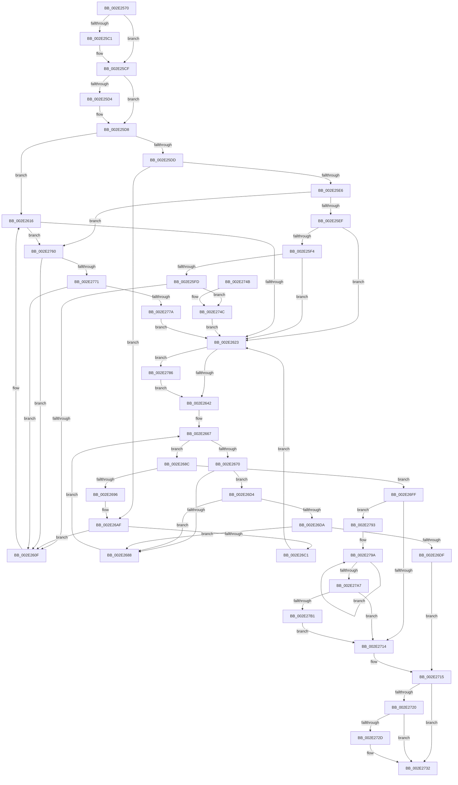

# MiManageSubsectionView

- RVA: `0x002E2570`–`0x002E27BB` (길이 `587` bytes)
- VA: `0x00000001402E2570`
- 실행 섹션: `.text`
- PDB 이름 있음: `예`; PDB Function 태그: `아니요`
- unwind 정보 RVA: `0x0006CE04`
- 디코드: `154`개 명령, `587/587` bytes 표시
- 미해석 바이트: `0` (있으면 어셈블리에 `.byte`로 보존)

> 이 문서는 커널 이미지의 기계어와 PDB 기호를 분석해 생성했습니다. 4번과 5번은 함수 원형과 자료형을 바이너리 사용 방식에서 추정한 C 해석이며 원본 소스 복구 결과는 아닙니다.

## 1. Dependencies

- 직접 호출 지점: **7**; 고유 호출 대상: **7**
- 직접 호출자로 확인된 함수: **5**
- RIP 상대 이미지 참조: **0**

### Outgoing calls
- `0x002E25B1` → [KeAbPreAcquire](../21/KeAbPreAcquire_function_00210230.md) (function, `0x00210230`)
- `0x002E25CA` → [ExfAcquirePushLockExclusiveEx](../20/ExfAcquirePushLockExclusiveEx_function_0020FC90.md) (function, `0x0020FC90`)
- `0x002E26A9` → [KeBugCheckEx](../4F/KeBugCheckEx_function_004FD660.md) (function, `0x004FD660`)
- `0x002E26F8` → [KiAbEntryFreeAndEnableInterrupts](../26/KiAbEntryFreeAndEnableInterrupts_function_002622D0.md) (function, `0x002622D0`)
- `0x002E272D` → [KiCheckForKernelApcDelivery](KiCheckForKernelApcDelivery_function_002E2C80.md) (function, `0x002E2C80`)
- `0x002E2789` → [ExfTryToWakePushLock](../26/ExfTryToWakePushLock_function_00265DD0.md) (function, `0x00265DD0`)
- `0x002E27B1` → [KiRemoveSystemWorkPriorityKick](../26/KiRemoveSystemWorkPriorityKick_function_002631D0.md) (function, `0x002631D0`)

### Direct callers
- [MmMapViewInSystemCache](../27/MmMapViewInSystemCache_function_00273094.md) at `0x002732AE`
- [sub_00293C9B](../29/Unknown_function_00293C9B.md) at `0x00293EC8`
- [MiDeleteVad](../../page/88/MiDeleteVad_function_00888C80.md) at `0x00888FC4`
- [MiUnloadSystemImage](../../page/AA/MiUnloadSystemImage_function_00AA2FD4.md) at `0x00AA3278`
- [MiConstructLoaderEntry](../../page/AA/MiConstructLoaderEntry_function_00AAA264.md) at `0x00AAA6A1`

### Static image references
- 디코드된 RIP-relative 메모리 참조가 없습니다.

## 2. Other-region calls and transfers

- 다른 실행 섹션으로 향하는 call: **0**
- 별도 외부 분기/꼬리 이동을 확인하지 못했습니다.

## 3. Assembly (complete function range)

```asm
002E2570  48 89 5C 24 08                  mov qword ptr [rsp + 8], rbx
002E2575  48 89 6C 24 10                  mov qword ptr [rsp + 0x10], rbp
002E257A  48 89 74 24 18                  mov qword ptr [rsp + 0x18], rsi
002E257F  57                              push rdi
002E2580  41 56                           push r14
002E2582  41 57                           push r15
002E2584  48 83 EC 30                     sub rsp, 0x30
002E2588  48 8B 29                        mov rbp, qword ptr [rcx]
002E258B  41 8B D8                        mov ebx, r8d
002E258E  65 48 8B 04 25 88 01 00 00      mov rax, qword ptr gs:[0x188]
002E2597  4C 8B FA                        mov r15, rdx
002E259A  4C 8B F1                        mov r14, rcx
002E259D  45 33 C0                        xor r8d, r8d
002E25A0  33 D2                           xor edx, edx
002E25A2  48 8D 75 68                     lea rsi, [rbp + 0x68]
002E25A6  66 FF 88 E6 01 00 00            dec word ptr [rax + 0x1e6]
002E25AD  48 8B CE                        mov rcx, rsi
002E25B0  90                              nop
002E25B1  E8 7A DC F2 FF                  call 0x140210230
002E25B6  F0 48 0F BA 2E 00               lock bts qword ptr [rsi], 0
002E25BC  48 8B F8                        mov rdi, rax
002E25BF  73 0E                           jae 0x1402e25cf
002E25C1  4C 8B C6                        mov r8, rsi
002E25C4  48 8B D0                        mov rdx, rax
002E25C7  48 8B CE                        mov rcx, rsi
002E25CA  E8 C1 D6 F2 FF                  call 0x14020fc90
002E25CF  48 85 FF                        test rdi, rdi
002E25D2  74 04                           je 0x1402e25d8
002E25D4  C6 47 0A 01                     mov byte ptr [rdi + 0xa], 1
002E25D8  83 FB 04                        cmp ebx, 4
002E25DB  74 39                           je 0x1402e2616
002E25DD  83 EB 01                        sub ebx, 1
002E25E0  0F 84 C9 00 00 00               je 0x1402e26af
002E25E6  83 EB 01                        sub ebx, 1
002E25E9  0F 84 71 01 00 00               je 0x1402e2760
002E25EF  83 FB 01                        cmp ebx, 1
002E25F2  75 2F                           jne 0x1402e2623
002E25F4  F7 45 38 00 04 00 00            test dword ptr [rbp + 0x38], 0x400
002E25FB  75 26                           jne 0x1402e2623
002E25FD  48 8B 45 08                     mov rax, qword ptr [rbp + 8]
002E2601  48 83 C5 08                     add rbp, 8
002E2605  48 39 68 08                     cmp qword ptr [rax + 8], rbp
002E2609  0F 84 3D 01 00 00               je 0x1402e274c
002E260F  B9 03 00 00 00                  mov ecx, 3
002E2614  CD 29                           int 0x29
002E2616  F7 45 38 00 04 00 00            test dword ptr [rbp + 0x38], 0x400
002E261D  0F 84 3D 01 00 00               je 0x1402e2760
002E2623  65 48 8B 1C 25 88 01 00 00      mov rbx, qword ptr gs:[0x188]
002E262C  48 C7 C0 FF FF FF FF            mov rax, 0xffffffffffffffff
002E2633  F0 48 0F C1 06                  lock xadd qword ptr [rsi], rax
002E2638  24 06                           and al, 6
002E263A  3C 02                           cmp al, 2
002E263C  0F 84 44 01 00 00               je 0x1402e2786
002E2642  65 4C 8B 1C 25 88 01 00 00      mov r11, qword ptr gs:[0x188]
002E264B  FA                              cli
002E264C  4D 8B 83 70 04 00 00            mov r8, qword ptr [r11 + 0x470]
002E2653  4C 8B CE                        mov r9, rsi
002E2656  48 BF FC FF FF FF FF FF FF 7F   movabs rdi, 0x7ffffffffffffffc
002E2660  4C 23 CF                        and r9, rdi
002E2663  33 ED                           xor ebp, ebp
002E2665  8B C5                           mov eax, ebp
002E2667  41 0F B6 48 0C                  movzx ecx, byte ptr [r8 + 0xc]
002E266C  3B C1                           cmp eax, ecx
002E266E  73 1C                           jae 0x1402e268c
002E2670  8B C8                           mov ecx, eax
002E2672  4C 6B D1 58                     imul r10, rcx, 0x58
002E2676  4D 03 D0                        add r10, r8
002E2679  49 8B 52 10                     mov rdx, qword ptr [r10 + 0x10]
002E267D  48 8B CA                        mov rcx, rdx
002E2680  48 23 CF                        and rcx, rdi
002E2683  49 3B C9                        cmp rcx, r9
002E2686  74 4C                           je 0x1402e26d4
002E2688  FF C0                           inc eax
002E268A  EB DB                           jmp 0x1402e2667
002E268C  41 8B 43 78                     mov eax, dword ptr [r11 + 0x78]
002E2690  0F BA E0 10                     bt eax, 0x10
002E2694  72 69                           jb 0x1402e26ff
002E2696  45 33 C9                        xor r9d, r9d
002E2699  48 89 6C 24 20                  mov qword ptr [rsp + 0x20], rbp
002E269E  4C 8B C6                        mov r8, rsi
002E26A1  49 8B D3                        mov rdx, r11
002E26A4  B9 62 01 00 00                  mov ecx, 0x162
002E26A9  E8 B2 AF 21 00                  call 0x1404fd660
002E26AE  CC                              int3
002E26AF  49 8B 4E 58                     mov rcx, qword ptr [r14 + 0x58]
002E26B3  49 8D 46 58                     lea rax, [r14 + 0x58]
002E26B7  48 39 41 08                     cmp qword ptr [rcx + 8], rax
002E26BB  0F 85 4E FF FF FF               jne 0x1402e260f
002E26C1  49 89 0F                        mov qword ptr [r15], rcx
002E26C4  49 89 47 08                     mov qword ptr [r15 + 8], rax
002E26C8  4C 89 79 08                     mov qword ptr [rcx + 8], r15
002E26CC  4C 89 38                        mov qword ptr [rax], r15
002E26CF  E9 4F FF FF FF                  jmp 0x1402e2623
002E26D4  41 38 6A 1A                     cmp byte ptr [r10 + 0x1a], bpl
002E26D8  74 AE                           je 0x1402e2688
002E26DA  F6 C2 01                        test dl, 1
002E26DD  75 A9                           jne 0x1402e2688
002E26DF  41 B9 01 00 00 00               mov r9d, 1
002E26E5  41 88 6A 1A                     mov byte ptr [r10 + 0x1a], bpl
002E26E9  4C 8B C6                        mov r8, rsi
002E26EC  48 89 6C 24 20                  mov qword ptr [rsp + 0x20], rbp
002E26F1  49 8B D3                        mov rdx, r11
002E26F4  49 8D 4A 10                     lea rcx, [r10 + 0x10]
002E26F8  E8 D3 FB F7 FF                  call 0x1402622d0
002E26FD  EB 16                           jmp 0x1402e2715
002E26FF  65 48 8B 0C 25 20 00 00 00      mov rcx, qword ptr gs:[0x20]
002E2708  4C 8B 81 B8 8E 00 00            mov r8, qword ptr [rcx + 0x8eb8]
002E270F  4D 85 C0                        test r8, r8
002E2712  75 7F                           jne 0x1402e2793
002E2714  FB                              sti
002E2715  90                              nop
002E2716  66 83 83 E6 01 00 00 01         add word ptr [rbx + 0x1e6], 1
002E271E  75 12                           jne 0x1402e2732
002E2720  48 8D 83 98 00 00 00            lea rax, [rbx + 0x98]
002E2727  90                              nop
002E2728  48 39 00                        cmp qword ptr [rax], rax
002E272B  74 05                           je 0x1402e2732
002E272D  E8 4E 05 00 00                  call 0x1402e2c80
002E2732  48 8B 5C 24 50                  mov rbx, qword ptr [rsp + 0x50]
002E2737  48 8B 6C 24 58                  mov rbp, qword ptr [rsp + 0x58]
002E273C  48 8B 74 24 60                  mov rsi, qword ptr [rsp + 0x60]
002E2741  48 83 C4 30                     add rsp, 0x30
002E2745  41 5F                           pop r15
002E2747  41 5E                           pop r14
002E2749  5F                              pop rdi
002E274A  C3                              ret
002E274B  CC                              int3
002E274C  49 89 07                        mov qword ptr [r15], rax
002E274F  49 89 6F 08                     mov qword ptr [r15 + 8], rbp
002E2753  4C 89 78 08                     mov qword ptr [rax + 8], r15
002E2757  4C 89 7D 00                     mov qword ptr [rbp], r15
002E275B  E9 C3 FE FF FF                  jmp 0x1402e2623
002E2760  49 8B 0F                        mov rcx, qword ptr [r15]
002E2763  49 8B 47 08                     mov rax, qword ptr [r15 + 8]
002E2767  4C 39 79 08                     cmp qword ptr [rcx + 8], r15
002E276B  0F 85 9E FE FF FF               jne 0x1402e260f
002E2771  4C 39 38                        cmp qword ptr [rax], r15
002E2774  0F 85 95 FE FF FF               jne 0x1402e260f
002E277A  48 89 08                        mov qword ptr [rax], rcx
002E277D  48 89 41 08                     mov qword ptr [rcx + 8], rax
002E2781  E9 9D FE FF FF                  jmp 0x1402e2623
002E2786  48 8B CE                        mov rcx, rsi
002E2789  E8 42 36 F8 FF                  call 0x140265dd0
002E278E  E9 AF FE FF FF                  jmp 0x1402e2642
002E2793  41 0F 0D 08                     prefetchw byte ptr [r8]
002E2797  41 8B 00                        mov eax, dword ptr [r8]
002E279A  8B D0                           mov edx, eax
002E279C  0F BA F2 15                     btr edx, 0x15
002E27A0  F0 41 0F B1 10                  lock cmpxchg dword ptr [r8], edx
002E27A5  75 F3                           jne 0x1402e279a
002E27A7  0F BA E0 15                     bt eax, 0x15
002E27AB  0F 83 63 FF FF FF               jae 0x1402e2714
002E27B1  E8 1A 0A F8 FF                  call 0x1402631d0
002E27B6  E9 59 FF FF FF                  jmp 0x1402e2714
```

## 4. C-style interpretation (structured pseudocode)

```c
__int64 __fastcall MiManageSubsectionView(__int64 a1, __int64 a2, int a3)
{
    __int64 result;
    __int64 v_r10;
    __int64 v_rbp;
    __int64 v_rbx;
    __int64 v_rsp;
    unsigned __int64 v_stack_m28;
    unsigned __int64 v_stack_p10;
    unsigned __int64 v_stack_p18;
    unsigned __int64 v_stack_p8;

    v_stack_p8 = v_rbx;
    v_stack_p10 = v_rbp;
    v_stack_p18 = v_rsi;
    v_rsp = (v_rsp) - (48);
    a3 = 0;
    a2 = 0;
    result = KeAbPreAcquire(*(unsigned __int64 *)(a1) + 104, a2, a3, a4);
    if (!(condition_is_above_or_equal)) {
        a3 = *(unsigned __int64 *)(a1) + 104;
        a2 = result;
        a1 = *(unsigned __int64 *)(a1) + 104;
        result = ExfAcquirePushLockExclusiveEx(a1, a2, a3, a4);
    }
    if (result != 0) {
        *(unsigned __int8 *)(result + 10) = 1;
    }
    if (((unsigned int)((unsigned int)(a3))) == 4) goto loc_002E2616;
    v_rbx = (unsigned int)(((unsigned int)(a3)) - (1));
    if (condition_is_equal) goto loc_002E26AF;
    v_rbx = (unsigned int)((v_rbx) - (1));
    if (condition_is_equal) goto loc_002E2760;
    if (((unsigned int)(v_rbx)) != 1) goto loc_002E2623;
    if (((*(unsigned int *)(*(unsigned __int64 *)(a1) + 56)) & (0x400ULL)) != 0) goto loc_002E2623;
    v_rbp = (*(unsigned __int64 *)(a1)) + (8);
    if ((*(unsigned __int64 *)(*(unsigned __int64 *)(*(unsigned __int64 *)(a1) + 8) + 8)) == v_rbp) goto loc_002E274C;
loc_002E260F:
loc_002E2616:
    if (((*(unsigned int *)(v_rbp + 56)) & (0x400ULL)) == 0) goto loc_002E2760;
loc_002E2623:
    result = (unsigned __int8)((-1) & (6));
    if (((unsigned __int8)(result)) == 2) goto loc_002E2786;
loc_002E2642:
    a4 = (*(unsigned __int64 *)(a1) + 104) & (result);
    v_rbp = 0;
loc_002E2667:
    if (0 >= ((unsigned int)(*(unsigned __int8 *)(*(unsigned __int64 *)(*(unsigned __int64 *)(gs_base + (0 + 392)) + 1136) + 12)))) goto loc_002E268C;
    v_r10 = (v_r10) * (0);
    v_r10 = (v_r10) + (*(unsigned __int64 *)(*(unsigned __int64 *)(gs_base + (0 + 392)) + 1136));
    a1 = (*(unsigned __int64 *)(v_r10 + 16)) & (result);
    if (a1 == a4) goto loc_002E26D4;
loc_002E2688:
    result = (unsigned int)((0) + 1);
    goto loc_002E2667;
loc_002E268C:
    if (a1 < a4) goto loc_002E26FF;
    a4 = 0;
    v_stack_m28 = 0;
    result = KeBugCheckEx(354, *(unsigned __int64 *)(gs_base + (0 + 392)), *(unsigned __int64 *)(a1) + 104, a4);
loc_002E26AF:
    if ((*(unsigned __int64 *)(*(unsigned __int64 *)(a1 + 88) + 8)) != (a1 + 88)) goto loc_002E260F;
    *(unsigned __int64 *)(a2) = *(unsigned __int64 *)(a1 + 88);
    *(unsigned __int64 *)(a2 + 8) = a1 + 88;
    *(unsigned __int64 *)(*(unsigned __int64 *)(a1 + 88) + 8) = a2;
    *(unsigned __int64 *)(a1 + 88) = a2;
    goto loc_002E2623;
loc_002E26D4:
    if ((*(unsigned __int8 *)(v_r10 + 26)) == 0) goto loc_002E2688;
    if ((((unsigned __int8)(*(unsigned __int64 *)(gs_base + (0 + 392)))) & (1)) != 0) goto loc_002E2688;
    *(unsigned __int8 *)(v_r10 + 26) = 0;
    v_stack_m28 = 0;
    result = KiAbEntryFreeAndEnableInterrupts(v_r10 + 16, *(unsigned __int64 *)(gs_base + (0 + 392)), *(unsigned __int64 *)(a1) + 104, 1);
    goto loc_002E2715;
loc_002E26FF:
    if (*(unsigned __int64 *)(*(unsigned __int64 *)(gs_base + (0 + 32)) + 36536) != 0) goto loc_002E2793;
loc_002E2714:
loc_002E2715:
    if (*(unsigned __int64 *)(*(unsigned __int64 *)(gs_base + (0 + 32)) + 36536) != 0) goto loc_002E2732;
    result = *(unsigned __int64 *)(gs_base + (0 + 392)) + 152;
    if ((*(unsigned __int64 *)(*(unsigned __int64 *)(gs_base + (0 + 392)) + 152)) != (*(unsigned __int64 *)(gs_base + (0 + 392)) + 152)) {
        result = KiCheckForKernelApcDelivery(*(unsigned __int64 *)(gs_base + (0 + 32)), *(unsigned __int64 *)(gs_base + (0 + 392)), *(unsigned __int64 *)(*(unsigned __int64 *)(gs_base + (0 + 32)) + 36536), 1);
    }
    v_rsp = (v_rsp) + (48);
    return result;
loc_002E274C:
    *(unsigned __int64 *)(a2) = result;
    *(unsigned __int64 *)(a2 + 8) = v_stack_p10;
    *(unsigned __int64 *)(result + 8) = a2;
    *(unsigned __int64 *)(v_stack_p10) = a2;
    goto loc_002E2623;
loc_002E2760:
    if ((*(unsigned __int64 *)(*(unsigned __int64 *)(a2) + 8)) != a2) goto loc_002E260F;
    if ((*(unsigned __int64 *)(*(unsigned __int64 *)(a2 + 8))) != a2) goto loc_002E260F;
    *(unsigned __int64 *)(*(unsigned __int64 *)(a2 + 8)) = *(unsigned __int64 *)(a2);
    *(unsigned __int64 *)(*(unsigned __int64 *)(a2) + 8) = *(unsigned __int64 *)(a2 + 8);
    goto loc_002E2623;
loc_002E2786:
    result = ExfTryToWakePushLock(v_stack_p18, *(unsigned __int64 *)(gs_base + (0 + 392)), *(unsigned __int64 *)(*(unsigned __int64 *)(gs_base + (0 + 32)) + 36536), 1);
    goto loc_002E2642;
loc_002E2793:
loc_002E279A:
    if ((*(unsigned __int64 *)(*(unsigned __int64 *)(a2 + 8))) != a2) goto loc_002E279A;
    if ((*(unsigned __int64 *)(*(unsigned __int64 *)(a2 + 8))) >= a2) goto loc_002E2714;
    result = KiRemoveSystemWorkPriorityKick(v_stack_p18, (unsigned int)((unsigned int)((unsigned int)(*(unsigned int *)(*(unsigned __int64 *)(*(unsigned __int64 *)(gs_base + (0 + 32)) + 36536))))), *(unsigned __int64 *)(*(unsigned __int64 *)(gs_base + (0 + 32)) + 36536), 1);
    goto loc_002E2714;
}
```

## 5. (Beta) C Style

```c
int64_t MiManageSubsectionView(void *Arg1, void *Arg2, int32_t Arg3)
{
    uint8_t *arg1 = (uint8_t *)Arg1;
    uint8_t *arg2 = (uint8_t *)Arg2;

    int64_t result;
    int64_t local_r10;
    int64_t local_rbp;
    int64_t local_rbx;
    int64_t local_rsp;
    uint64_t v_stack_m28;
    uint64_t v_stack_p10;
    uint64_t v_stack_p18;
    uint64_t v_stack_p8;

    v_stack_p8 = local_rbx;
    v_stack_p10 = local_rbp;
    v_stack_p18 = local_rsi;
    local_rsp = (local_rsp) - (48);
    Arg3 = 0;
    Arg2 = 0;
    result = KeAbPreAcquire(*(uint64_t *)(arg1) + 104, Arg2, Arg3, a4);
    if (!(condition_is_above_or_equal)) {
        Arg3 = *(uint64_t *)(arg1) + 104;
        Arg2 = result;
        Arg1 = *(uint64_t *)(arg1) + 104;
        result = ExfAcquirePushLockExclusiveEx(Arg1, Arg2, Arg3, a4);
    }
    if (result != 0) {
        *(uint8_t *)(result + 0xA) = 1;
    }
    if (((uint32_t)((uint32_t)(Arg3))) == 4) goto loc_002E2616;
    local_rbx = (uint32_t)(((uint32_t)(Arg3)) - (1));
    if (condition_is_equal) goto loc_002E26AF;
    local_rbx = (uint32_t)((local_rbx) - (1));
    if (condition_is_equal) goto loc_002E2760;
    if (((uint32_t)(local_rbx)) != 1) goto loc_002E2623;
    if (((*(uint32_t *)(*(uint64_t *)(arg1) + 0x38)) & (0x400ULL)) != 0) goto loc_002E2623;
    local_rbp = (*(uint64_t *)(arg1)) + (8);
    if ((*(uint64_t *)(*(uint64_t *)(*(uint64_t *)(arg1) + 0x8) + 0x8)) == local_rbp) goto loc_002E274C;
loc_002E260F:
loc_002E2616:
    if (((*(uint32_t *)(local_rbp + 0x38)) & (0x400ULL)) == 0) goto loc_002E2760;
loc_002E2623:
    result = (uint8_t)((-1) & (6));
    if (((uint8_t)(result)) == 2) goto loc_002E2786;
loc_002E2642:
    a4 = (*(uint64_t *)(arg1) + 104) & (result);
    local_rbp = 0;
loc_002E2667:
    if (0 >= ((uint32_t)(*(uint8_t *)(*(uint64_t *)(*(uint64_t *)(gs_base + (0 + 0x188)) + 0x470) + 0xC)))) goto loc_002E268C;
    local_r10 = (local_r10) * (0);
    local_r10 = (local_r10) + (*(uint64_t *)(*(uint64_t *)(gs_base + (0 + 0x188)) + 0x470));
    Arg1 = (*(uint64_t *)(local_r10 + 0x10)) & (result);
    if (Arg1 == a4) goto loc_002E26D4;
loc_002E2688:
    result = (uint32_t)((0) + 1);
    goto loc_002E2667;
loc_002E268C:
    if (Arg1 < a4) goto loc_002E26FF;
    a4 = 0;
    v_stack_m28 = 0;
    result = KeBugCheckEx(354, *(uint64_t *)(gs_base + (0 + 0x188)), *(uint64_t *)(arg1) + 104, a4);
loc_002E26AF:
    if ((*(uint64_t *)(*(uint64_t *)(arg1 + 0x58) + 0x8)) != (Arg1 + 88)) goto loc_002E260F;
    *(uint64_t *)(arg2) = *(uint64_t *)(arg1 + 0x58);
    *(void **)(arg2 + 0x8) = Arg1 + 88;
    *(void **)(*(uint64_t *)(arg1 + 0x58) + 0x8) = Arg2;
    *(void **)(arg1 + 0x58) = Arg2;
    goto loc_002E2623;
loc_002E26D4:
    if ((*(uint8_t *)(local_r10 + 0x1A)) == 0) goto loc_002E2688;
    if ((((uint8_t)(*(uint64_t *)(gs_base + (0 + 0x188)))) & (1)) != 0) goto loc_002E2688;
    *(uint8_t *)(local_r10 + 0x1A) = 0;
    v_stack_m28 = 0;
    result = KiAbEntryFreeAndEnableInterrupts(local_r10 + 16, *(uint64_t *)(gs_base + (0 + 0x188)), *(uint64_t *)(arg1) + 104, 1);
    goto loc_002E2715;
loc_002E26FF:
    if (*(uint64_t *)(*(uint64_t *)(gs_base + (0 + 0x20)) + 0x8EB8) != 0) goto loc_002E2793;
loc_002E2714:
loc_002E2715:
    if (*(uint64_t *)(*(uint64_t *)(gs_base + (0 + 0x20)) + 0x8EB8) != 0) goto loc_002E2732;
    result = *(uint64_t *)(gs_base + (0 + 0x188)) + 152;
    if ((*(uint64_t *)(*(uint64_t *)(gs_base + (0 + 0x188)) + 0x98)) != (*(uint64_t *)(gs_base + (0 + 0x188)) + 152)) {
        result = KiCheckForKernelApcDelivery(*(uint64_t *)(gs_base + (0 + 0x20)), *(uint64_t *)(gs_base + (0 + 0x188)), *(uint64_t *)(*(uint64_t *)(gs_base + (0 + 0x20)) + 0x8EB8), 1);
    }
    local_rsp = (local_rsp) + (48);
    return result;
loc_002E274C:
    *(uint64_t *)(arg2) = result;
    *(uint64_t *)(arg2 + 0x8) = v_stack_p10;
    *(void **)(result + 0x8) = Arg2;
    *(void **)(v_stack_p10) = Arg2;
    goto loc_002E2623;
loc_002E2760:
    if ((*(uint64_t *)(*(uint64_t *)(arg2) + 0x8)) != Arg2) goto loc_002E260F;
    if ((*(uint64_t *)(*(uint64_t *)(arg2 + 0x8))) != Arg2) goto loc_002E260F;
    *(uint64_t *)(*(uint64_t *)(arg2 + 0x8)) = *(uint64_t *)(arg2);
    *(uint64_t *)(*(uint64_t *)(arg2) + 0x8) = *(uint64_t *)(arg2 + 0x8);
    goto loc_002E2623;
loc_002E2786:
    result = ExfTryToWakePushLock(v_stack_p18, *(uint64_t *)(gs_base + (0 + 0x188)), *(uint64_t *)(*(uint64_t *)(gs_base + (0 + 0x20)) + 0x8EB8), 1);
    goto loc_002E2642;
loc_002E2793:
loc_002E279A:
    if ((*(uint64_t *)(*(uint64_t *)(arg2 + 0x8))) != Arg2) goto loc_002E279A;
    if ((*(uint64_t *)(*(uint64_t *)(arg2 + 0x8))) >= Arg2) goto loc_002E2714;
    result = KiRemoveSystemWorkPriorityKick(v_stack_p18, (uint32_t)((uint32_t)((uint32_t)(*(uint32_t *)(*(uint64_t *)(*(uint64_t *)(gs_base + (0 + 0x20)) + 0x8EB8))))), *(uint64_t *)(*(uint64_t *)(gs_base + (0 + 0x20)) + 0x8EB8), 1);
    goto loc_002E2714;
}
```

### 관측된 메모리 오프셋

구조체 형식이 확인되지 않은 접근은 인자 기준의 오프셋으로만 기록했습니다.

| 기준 인자 | 오프셋 표현 | 폭 (bit) | 접근 |
|---|---:|---:|---|
| `Arg1` | `+ 0x0` | `64` | `R` |
| `Arg1` | `+ 0x0` | `64` | `W` |
| `Arg1` | `+ 0x58` | `64` | `R` |
| `Arg2` | `+ 0x0` | `64` | `R` |
| `Arg2` | `+ 0x0` | `64` | `W` |
| `Arg2` | `+ 0x8` | `64` | `R` |
| `Arg2` | `+ 0x8` | `64` | `W` |

## 6. Execution-region graph

[열기: 2D/3D 그래프와 함수 탐색 컨트롤 패널](../../../control-panel.html?section=text&rva=0x002E2570&view=graph)

- 2D 그래프는 위에서 아래로 흐르고, 3D 그래프는 빈 공간을 드래그해 회전합니다. Shift+드래그는 이동, 휠은 확대·축소, 함수 노드 선택은 대상 보고서 이동입니다.

### Static fallback


