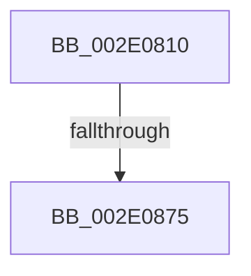

# MiTrimSection

- RVA: `0x002E0810`–`0x002E087E` (길이 `110` bytes)
- VA: `0x00000001402E0810`
- 실행 섹션: `.text`
- PDB 이름 있음: `예`; PDB Function 태그: `아니요`
- unwind 정보 RVA: `0x00070C50`
- 디코드: `30`개 명령, `110/110` bytes 표시
- 미해석 바이트: `0` (있으면 어셈블리에 `.byte`로 보존)

> 이 문서는 커널 이미지의 기계어와 PDB 기호를 분석해 생성했습니다. 4번과 5번은 함수 원형과 자료형을 바이너리 사용 방식에서 추정한 C 해석이며 원본 소스 복구 결과는 아닙니다.

## 1. Dependencies

- 직접 호출 지점: **0**; 고유 호출 대상: **0**
- 직접 호출자로 확인된 함수: **3**
- RIP 상대 이미지 참조: **0**

### Outgoing calls
- 직접 디코드된 call 명령이 없습니다.

### Direct callers
- [MiTrimSharedPage](../29/MiTrimSharedPage_function_00297D14.md) at `0x00297E45`
- [MiTrimSharedPage](../29/MiTrimSharedPage_function_00297D14.md) at `0x00297E66`
- [MmTrimSection](../38/MmTrimSection_function_0038A4EC.md) at `0x0038A55D`
- [MiLocateSharedPageViews](../67/MiLocateSharedPageViews_function_0067F1E4.md) at `0x0067F403`

### Static image references
- 디코드된 RIP-relative 메모리 참조가 없습니다.

## 2. Other-region calls and transfers

- 다른 실행 섹션으로 향하는 call: **0**
- call이 아닌 외부 분기/꼬리 이동: **1**
  - `0x002E086F` → [sub_002E10CE](Unknown_function_002E10CE.md) (`tail-transfer`)

## 3. Assembly (complete function range)

```asm
002E0810  48 8B C4                        mov rax, rsp
002E0813  44 89 40 18                     mov dword ptr [rax + 0x18], r8d
002E0817  48 89 50 10                     mov qword ptr [rax + 0x10], rdx
002E081B  48 89 48 08                     mov qword ptr [rax + 8], rcx
002E081F  53                              push rbx
002E0820  56                              push rsi
002E0821  57                              push rdi
002E0822  41 54                           push r12
002E0824  41 55                           push r13
002E0826  41 57                           push r15
002E0828  48 81 EC B8 00 00 00            sub rsp, 0xb8
002E082F  4C 8B 61 18                     mov r12, qword ptr [rcx + 0x18]
002E0833  45 33 C0                        xor r8d, r8d
002E0836  48 8B 79 08                     mov rdi, qword ptr [rcx + 8]
002E083A  0F 57 C0                        xorps xmm0, xmm0
002E083D  0F 11 40 A8                     movups xmmword ptr [rax - 0x58], xmm0
002E0841  41 8B C1                        mov eax, r9d
002E0844  4C 89 44 24 50                  mov qword ptr [rsp + 0x50], r8
002E0849  4D 8B 2C 24                     mov r13, qword ptr [r12]
002E084D  83 E0 01                        and eax, 1
002E0850  4C 89 6C 24 68                  mov qword ptr [rsp + 0x68], r13
002E0855  41 8B D9                        mov ebx, r9d
002E0858  89 44 24 58                     mov dword ptr [rsp + 0x58], eax
002E085C  4C 8B FA                        mov r15, rdx
002E085F  48 8B F1                        mov rsi, rcx
002E0862  48 89 BC 24 88 00 00 00         mov qword ptr [rsp + 0x88], rdi
002E086A  4C 89 64 24 40                  mov qword ptr [rsp + 0x40], r12
002E086F  0F 85 59 08 00 00               jne 0x1402e10ce
002E0875  41 8B 45 38                     mov eax, dword ptr [r13 + 0x38]
002E0879  49 8B 54 24 08                  mov rdx, qword ptr [r12 + 8]
```

## 4. C-style interpretation (structured pseudocode)

```c
__int64 __fastcall MiTrimSection(__int64 a1, __int64 a2, int a3, int a4)
{
    __int64 result;
    __int64 v_rsp;
    unsigned __int64 v_stack_m60;
    unsigned __int64 v_stack_m80;
    unsigned int v_stack_m90;
    unsigned __int64 v_stack_m98;
    unsigned __int64 v_stack_mA8;

    *(unsigned int *)(v_rsp + 24) = a3;
    *(unsigned __int64 *)(v_rsp + 16) = a2;
    *(unsigned __int64 *)(v_rsp + 8) = a1;
    v_rsp = (v_rsp) - (184);
    a3 = 0;
    *(unsigned __int64 *)(v_rsp - 88) = v_xmm0;
    v_stack_m98 = 0;
    result = (unsigned int)(((unsigned int)(a4)) & (1));
    v_stack_m80 = *(unsigned __int64 *)(*(unsigned __int64 *)(a1 + 24));
    v_stack_m90 = (unsigned int)(result);
    v_stack_m60 = *(unsigned __int64 *)(a1 + 8);
    v_stack_mA8 = *(unsigned __int64 *)(a1 + 24);
    return (unsigned int)(*(unsigned int *)(*(unsigned __int64 *)(*(unsigned __int64 *)(a1 + 24)) + 56));
}
```

## 5. (Beta) C Style

```c
int64_t MiTrimSection(void *Arg1, int64_t Arg2, int32_t Arg3, int32_t Arg4)
{
    uint8_t *arg1 = (uint8_t *)Arg1;

    int64_t result;
    int64_t local_rsp;
    uint64_t v_stack_m60;
    uint64_t v_stack_m80;
    uint32_t v_stack_m90;
    uint64_t v_stack_m98;
    uint64_t v_stack_mA8;

    *(uint32_t *)(local_rsp + 0x18) = Arg3;
    *(uint64_t *)(local_rsp + 0x10) = Arg2;
    *(void **)(local_rsp + 0x8) = Arg1;
    local_rsp = (local_rsp) - (184);
    Arg3 = 0;
    *(uint64_t *)(local_rsp - 0x58) = v_xmm0;
    v_stack_m98 = 0;
    result = (uint32_t)(((uint32_t)(Arg4)) & (1));
    v_stack_m80 = *(uint64_t *)(*(uint64_t *)(arg1 + 0x18));
    v_stack_m90 = (uint32_t)(result);
    v_stack_m60 = *(uint64_t *)(arg1 + 0x8);
    v_stack_mA8 = *(uint64_t *)(arg1 + 0x18);
    return (uint32_t)(*(uint32_t *)(*(uint64_t *)(*(uint64_t *)(arg1 + 0x18)) + 0x38));
}
```

### 관측된 메모리 오프셋

구조체 형식이 확인되지 않은 접근은 인자 기준의 오프셋으로만 기록했습니다.

| 기준 인자 | 오프셋 표현 | 폭 (bit) | 접근 |
|---|---:|---:|---|
| `Arg1` | `+ 0x8` | `64` | `R` |
| `Arg1` | `+ 0x18` | `64` | `R` |

## 6. Execution-region graph

[열기: 2D/3D 그래프와 함수 탐색 컨트롤 패널](../../../control-panel.html?section=text&rva=0x002E0810&view=graph)

- 2D 그래프는 위에서 아래로 흐르고, 3D 그래프는 빈 공간을 드래그해 회전합니다. Shift+드래그는 이동, 휠은 확대·축소, 함수 노드 선택은 대상 보고서 이동입니다.

### Static fallback


