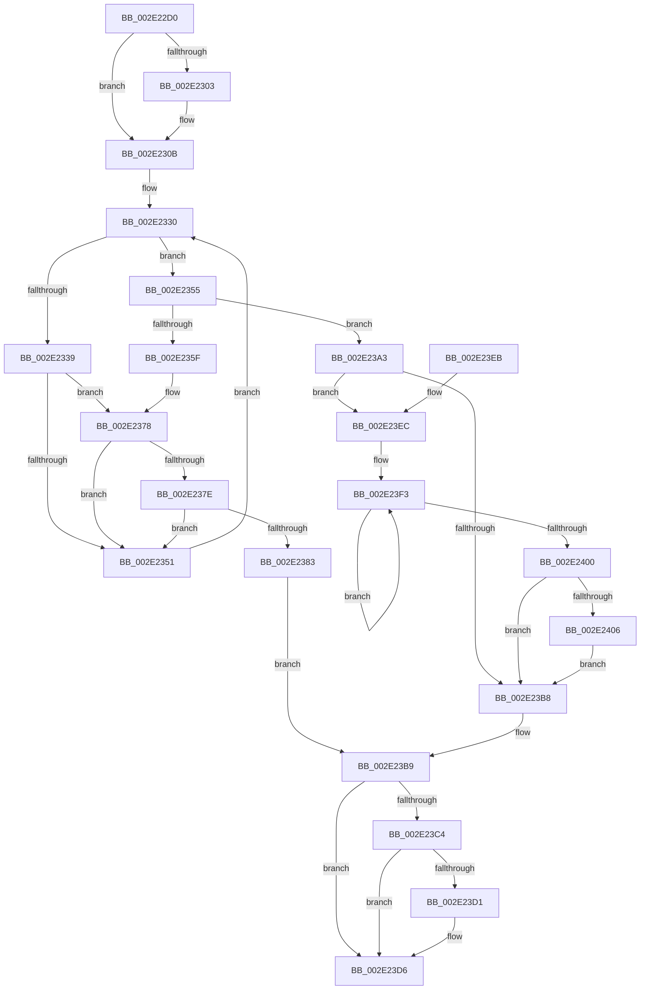

# MiUnlockControlAreaFileObjectExclusive

- RVA: `0x002E22D0`–`0x002E240D` (길이 `317` bytes)
- VA: `0x00000001402E22D0`
- 실행 섹션: `.text`
- PDB 이름 있음: `예`; PDB Function 태그: `아니요`
- unwind 정보 RVA: `0x00070D2C`
- 디코드: `87`개 명령, `317/317` bytes 표시
- 미해석 바이트: `0` (있으면 어셈블리에 `.byte`로 보존)

> 이 문서는 커널 이미지의 기계어와 PDB 기호를 분석해 생성했습니다. 4번과 5번은 함수 원형과 자료형을 바이너리 사용 방식에서 추정한 C 해석이며 원본 소스 복구 결과는 아닙니다.

## 1. Dependencies

- 직접 호출 지점: **5**; 고유 호출 대상: **5**
- 직접 호출자로 확인된 함수: **2**
- RIP 상대 이미지 참조: **0**

### Outgoing calls
- `0x002E2306` → [ExfTryToWakePushLock](../26/ExfTryToWakePushLock_function_00265DD0.md) (function, `0x00265DD0`)
- `0x002E2372` → [KeBugCheckEx](../4F/KeBugCheckEx_function_004FD660.md) (function, `0x004FD660`)
- `0x002E239C` → [KiAbEntryFreeAndEnableInterrupts](../26/KiAbEntryFreeAndEnableInterrupts_function_002622D0.md) (function, `0x002622D0`)
- `0x002E23D1` → [KiCheckForKernelApcDelivery](KiCheckForKernelApcDelivery_function_002E2C80.md) (function, `0x002E2C80`)
- `0x002E2406` → [KiRemoveSystemWorkPriorityKick](../26/KiRemoveSystemWorkPriorityKick_function_002631D0.md) (function, `0x002631D0`)

### Direct callers
- [MiRemoveFromSystemSpace](../29/MiRemoveFromSystemSpace_function_002962FC.md) at `0x0029648B`
- [MiInsertInSystemSpace](../3B/MiInsertInSystemSpace_function_003B2F5C.md) at `0x003B3404`

### Static image references
- 디코드된 RIP-relative 메모리 참조가 없습니다.

## 2. Other-region calls and transfers

- 다른 실행 섹션으로 향하는 call: **0**
- 별도 외부 분기/꼬리 이동을 확인하지 못했습니다.

## 3. Assembly (complete function range)

```asm
002E22D0  48 89 5C 24 08                  mov qword ptr [rsp + 8], rbx
002E22D5  48 89 6C 24 10                  mov qword ptr [rsp + 0x10], rbp
002E22DA  48 89 74 24 18                  mov qword ptr [rsp + 0x18], rsi
002E22DF  57                              push rdi
002E22E0  48 83 EC 30                     sub rsp, 0x30
002E22E4  65 48 8B 1C 25 88 01 00 00      mov rbx, qword ptr gs:[0x188]
002E22ED  48 8D 79 68                     lea rdi, [rcx + 0x68]
002E22F1  48 C7 C0 FF FF FF FF            mov rax, 0xffffffffffffffff
002E22F8  F0 48 0F C1 07                  lock xadd qword ptr [rdi], rax
002E22FD  24 06                           and al, 6
002E22FF  3C 02                           cmp al, 2
002E2301  75 08                           jne 0x1402e230b
002E2303  48 8B CF                        mov rcx, rdi
002E2306  E8 C5 3A F8 FF                  call 0x140265dd0
002E230B  65 4C 8B 1C 25 88 01 00 00      mov r11, qword ptr gs:[0x188]
002E2314  FA                              cli
002E2315  4D 8B 83 70 04 00 00            mov r8, qword ptr [r11 + 0x470]
002E231C  4C 8B CF                        mov r9, rdi
002E231F  48 BE FC FF FF FF FF FF FF 7F   movabs rsi, 0x7ffffffffffffffc
002E2329  4C 23 CE                        and r9, rsi
002E232C  33 ED                           xor ebp, ebp
002E232E  8B C5                           mov eax, ebp
002E2330  41 0F B6 48 0C                  movzx ecx, byte ptr [r8 + 0xc]
002E2335  3B C1                           cmp eax, ecx
002E2337  73 1C                           jae 0x1402e2355
002E2339  8B C8                           mov ecx, eax
002E233B  4C 6B D1 58                     imul r10, rcx, 0x58
002E233F  4D 03 D0                        add r10, r8
002E2342  49 8B 52 10                     mov rdx, qword ptr [r10 + 0x10]
002E2346  48 8B CA                        mov rcx, rdx
002E2349  48 23 CE                        and rcx, rsi
002E234C  49 3B C9                        cmp rcx, r9
002E234F  74 27                           je 0x1402e2378
002E2351  FF C0                           inc eax
002E2353  EB DB                           jmp 0x1402e2330
002E2355  41 8B 43 78                     mov eax, dword ptr [r11 + 0x78]
002E2359  0F BA E0 10                     bt eax, 0x10
002E235D  72 44                           jb 0x1402e23a3
002E235F  45 33 C9                        xor r9d, r9d
002E2362  48 89 6C 24 20                  mov qword ptr [rsp + 0x20], rbp
002E2367  4C 8B C7                        mov r8, rdi
002E236A  49 8B D3                        mov rdx, r11
002E236D  B9 62 01 00 00                  mov ecx, 0x162
002E2372  E8 E9 B2 21 00                  call 0x1404fd660
002E2377  CC                              int3
002E2378  41 38 6A 1A                     cmp byte ptr [r10 + 0x1a], bpl
002E237C  74 D3                           je 0x1402e2351
002E237E  F6 C2 01                        test dl, 1
002E2381  75 CE                           jne 0x1402e2351
002E2383  41 B9 01 00 00 00               mov r9d, 1
002E2389  41 88 6A 1A                     mov byte ptr [r10 + 0x1a], bpl
002E238D  4C 8B C7                        mov r8, rdi
002E2390  48 89 6C 24 20                  mov qword ptr [rsp + 0x20], rbp
002E2395  49 8B D3                        mov rdx, r11
002E2398  49 8D 4A 10                     lea rcx, [r10 + 0x10]
002E239C  E8 2F FF F7 FF                  call 0x1402622d0
002E23A1  EB 16                           jmp 0x1402e23b9
002E23A3  65 48 8B 0C 25 20 00 00 00      mov rcx, qword ptr gs:[0x20]
002E23AC  4C 8B 81 B8 8E 00 00            mov r8, qword ptr [rcx + 0x8eb8]
002E23B3  4D 85 C0                        test r8, r8
002E23B6  75 34                           jne 0x1402e23ec
002E23B8  FB                              sti
002E23B9  90                              nop
002E23BA  66 83 83 E6 01 00 00 01         add word ptr [rbx + 0x1e6], 1
002E23C2  75 12                           jne 0x1402e23d6
002E23C4  48 8D 83 98 00 00 00            lea rax, [rbx + 0x98]
002E23CB  90                              nop
002E23CC  48 39 00                        cmp qword ptr [rax], rax
002E23CF  74 05                           je 0x1402e23d6
002E23D1  E8 AA 08 00 00                  call 0x1402e2c80
002E23D6  48 8B 5C 24 40                  mov rbx, qword ptr [rsp + 0x40]
002E23DB  48 8B 6C 24 48                  mov rbp, qword ptr [rsp + 0x48]
002E23E0  48 8B 74 24 50                  mov rsi, qword ptr [rsp + 0x50]
002E23E5  48 83 C4 30                     add rsp, 0x30
002E23E9  5F                              pop rdi
002E23EA  C3                              ret
002E23EB  CC                              int3
002E23EC  41 0F 0D 08                     prefetchw byte ptr [r8]
002E23F0  41 8B 00                        mov eax, dword ptr [r8]
002E23F3  8B D0                           mov edx, eax
002E23F5  0F BA F2 15                     btr edx, 0x15
002E23F9  F0 41 0F B1 10                  lock cmpxchg dword ptr [r8], edx
002E23FE  75 F3                           jne 0x1402e23f3
002E2400  0F BA E0 15                     bt eax, 0x15
002E2404  73 B2                           jae 0x1402e23b8
002E2406  E8 C5 0D F8 FF                  call 0x1402631d0
002E240B  EB AB                           jmp 0x1402e23b8
```

## 4. C-style interpretation (structured pseudocode)

```c
__int64 __fastcall MiUnlockControlAreaFileObjectExclusive(__int64 a1)
{
    __int64 result;
    __int64 v_r10;
    __int64 v_rbp;
    __int64 v_rsp;
    unsigned __int64 v_stack_m18;
    unsigned __int64 v_stack_p10;
    unsigned __int64 v_stack_p18;
    unsigned __int64 v_stack_p8;

    v_stack_p8 = v_rbx;
    v_stack_p10 = v_rbp;
    v_stack_p18 = v_rsi;
    v_rsp = (v_rsp) - (48);
    result = (unsigned __int8)((-1) & (6));
    if (((unsigned __int8)(result)) == 2) {
        a1 = a1 + 104;
        result = ExfTryToWakePushLock(a1, a2, a3, a4);
    }
    a4 = (a1 + 104) & (v_rsi);
    v_rbp = 0;
loc_002E2330:
    if (0 >= ((unsigned int)(*(unsigned __int8 *)(*(unsigned __int64 *)(*(unsigned __int64 *)(gs_base + (0 + 392)) + 1136) + 12)))) goto loc_002E2355;
    v_r10 = (v_r10) * (0);
    v_r10 = (v_r10) + (*(unsigned __int64 *)(*(unsigned __int64 *)(gs_base + (0 + 392)) + 1136));
    a1 = (*(unsigned __int64 *)(v_r10 + 16)) & (v_rsi);
    if (a1 == a4) goto loc_002E2378;
loc_002E2351:
    result = (unsigned int)((0) + 1);
    goto loc_002E2330;
loc_002E2355:
    if (a1 < a4) goto loc_002E23A3;
    a4 = 0;
    v_stack_m18 = 0;
    result = KeBugCheckEx(354, *(unsigned __int64 *)(gs_base + (0 + 392)), a1 + 104, a4);
loc_002E2378:
    if ((*(unsigned __int8 *)(v_r10 + 26)) == 0) goto loc_002E2351;
    if ((((unsigned __int8)(*(unsigned __int64 *)(gs_base + (0 + 392)))) & (1)) != 0) goto loc_002E2351;
    *(unsigned __int8 *)(v_r10 + 26) = 0;
    v_stack_m18 = 0;
    result = KiAbEntryFreeAndEnableInterrupts(v_r10 + 16, *(unsigned __int64 *)(gs_base + (0 + 392)), a1 + 104, 1);
    goto loc_002E23B9;
loc_002E23A3:
    if (*(unsigned __int64 *)(*(unsigned __int64 *)(gs_base + (0 + 32)) + 36536) != 0) goto loc_002E23EC;
loc_002E23B8:
loc_002E23B9:
    if (*(unsigned __int64 *)(*(unsigned __int64 *)(gs_base + (0 + 32)) + 36536) != 0) goto loc_002E23D6;
    result = *(unsigned __int64 *)(gs_base + (0 + 392)) + 152;
    if ((*(unsigned __int64 *)(*(unsigned __int64 *)(gs_base + (0 + 392)) + 152)) != (*(unsigned __int64 *)(gs_base + (0 + 392)) + 152)) {
        result = KiCheckForKernelApcDelivery(*(unsigned __int64 *)(gs_base + (0 + 32)), *(unsigned __int64 *)(gs_base + (0 + 392)), *(unsigned __int64 *)(*(unsigned __int64 *)(gs_base + (0 + 32)) + 36536), 1);
    }
    v_rsp = (v_rsp) + (48);
    return result;
loc_002E23EC:
loc_002E23F3:
    if (condition_is_not_equal) goto loc_002E23F3;
    if (condition_is_above_or_equal) goto loc_002E23B8;
    result = KiRemoveSystemWorkPriorityKick(*(unsigned __int64 *)(gs_base + (0 + 32)), (unsigned int)((unsigned int)((unsigned int)(*(unsigned int *)(*(unsigned __int64 *)(*(unsigned __int64 *)(gs_base + (0 + 32)) + 36536))))), *(unsigned __int64 *)(*(unsigned __int64 *)(gs_base + (0 + 32)) + 36536), 1);
    goto loc_002E23B8;
}
```

## 5. (Beta) C Style

```c
int64_t MiUnlockControlAreaFileObjectExclusive(void *Arg1)
{
    uint8_t *arg1 = (uint8_t *)Arg1;

    int64_t result;
    int64_t local_r10;
    int64_t local_rbp;
    int64_t local_rsp;
    uint64_t v_stack_m18;
    uint64_t v_stack_p10;
    uint64_t v_stack_p18;
    uint64_t v_stack_p8;

    v_stack_p8 = local_rbx;
    v_stack_p10 = local_rbp;
    v_stack_p18 = local_rsi;
    local_rsp = (local_rsp) - (48);
    result = (uint8_t)((-1) & (6));
    if (((uint8_t)(result)) == 2) {
        Arg1 = Arg1 + 104;
        result = ExfTryToWakePushLock(Arg1, a2, a3, a4);
    }
    a4 = (Arg1 + 104) & (local_rsi);
    local_rbp = 0;
loc_002E2330:
    if (0 >= ((uint32_t)(*(uint8_t *)(*(uint64_t *)(*(uint64_t *)(gs_base + (0 + 0x188)) + 0x470) + 0xC)))) goto loc_002E2355;
    local_r10 = (local_r10) * (0);
    local_r10 = (local_r10) + (*(uint64_t *)(*(uint64_t *)(gs_base + (0 + 0x188)) + 0x470));
    Arg1 = (*(uint64_t *)(local_r10 + 0x10)) & (local_rsi);
    if (Arg1 == a4) goto loc_002E2378;
loc_002E2351:
    result = (uint32_t)((0) + 1);
    goto loc_002E2330;
loc_002E2355:
    if (Arg1 < a4) goto loc_002E23A3;
    a4 = 0;
    v_stack_m18 = 0;
    result = KeBugCheckEx(354, *(uint64_t *)(gs_base + (0 + 0x188)), Arg1 + 104, a4);
loc_002E2378:
    if ((*(uint8_t *)(local_r10 + 0x1A)) == 0) goto loc_002E2351;
    if ((((uint8_t)(*(uint64_t *)(gs_base + (0 + 0x188)))) & (1)) != 0) goto loc_002E2351;
    *(uint8_t *)(local_r10 + 0x1A) = 0;
    v_stack_m18 = 0;
    result = KiAbEntryFreeAndEnableInterrupts(local_r10 + 16, *(uint64_t *)(gs_base + (0 + 0x188)), Arg1 + 104, 1);
    goto loc_002E23B9;
loc_002E23A3:
    if (*(uint64_t *)(*(uint64_t *)(gs_base + (0 + 0x20)) + 0x8EB8) != 0) goto loc_002E23EC;
loc_002E23B8:
loc_002E23B9:
    if (*(uint64_t *)(*(uint64_t *)(gs_base + (0 + 0x20)) + 0x8EB8) != 0) goto loc_002E23D6;
    result = *(uint64_t *)(gs_base + (0 + 0x188)) + 152;
    if ((*(uint64_t *)(*(uint64_t *)(gs_base + (0 + 0x188)) + 0x98)) != (*(uint64_t *)(gs_base + (0 + 0x188)) + 152)) {
        result = KiCheckForKernelApcDelivery(*(uint64_t *)(gs_base + (0 + 0x20)), *(uint64_t *)(gs_base + (0 + 0x188)), *(uint64_t *)(*(uint64_t *)(gs_base + (0 + 0x20)) + 0x8EB8), 1);
    }
    local_rsp = (local_rsp) + (48);
    return result;
loc_002E23EC:
loc_002E23F3:
    if (condition_is_not_equal) goto loc_002E23F3;
    if (condition_is_above_or_equal) goto loc_002E23B8;
    result = KiRemoveSystemWorkPriorityKick(*(uint64_t *)(gs_base + (0 + 0x20)), (uint32_t)((uint32_t)((uint32_t)(*(uint32_t *)(*(uint64_t *)(*(uint64_t *)(gs_base + (0 + 0x20)) + 0x8EB8))))), *(uint64_t *)(*(uint64_t *)(gs_base + (0 + 0x20)) + 0x8EB8), 1);
    goto loc_002E23B8;
}
```

### 관측된 메모리 오프셋

구조체 형식이 확인되지 않은 접근은 인자 기준의 오프셋으로만 기록했습니다.

| 기준 인자 | 오프셋 표현 | 폭 (bit) | 접근 |
|---|---:|---:|---|
| `Arg1` | `+ 0x0` | `64` | `R/W` |
| `Arg1` | `+ 0x68` | `64` | `R` |

## 6. Execution-region graph

[열기: 2D/3D 그래프와 함수 탐색 컨트롤 패널](../../../control-panel.html?section=text&rva=0x002E22D0&view=graph)

- 2D 그래프는 위에서 아래로 흐르고, 3D 그래프는 빈 공간을 드래그해 회전합니다. Shift+드래그는 이동, 휠은 확대·축소, 함수 노드 선택은 대상 보고서 이동입니다.

### Static fallback


