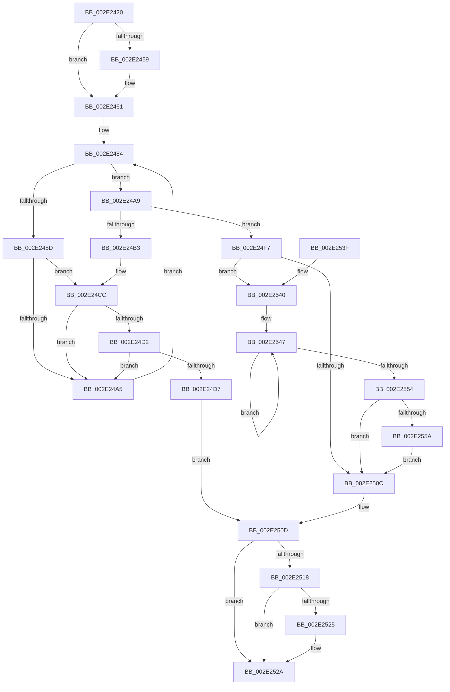

# MiUnlockVadShared

- RVA: `0x002E2420`–`0x002E2561` (길이 `321` bytes)
- VA: `0x00000001402E2420`
- 실행 섹션: `.text`
- PDB 이름 있음: `예`; PDB Function 태그: `아니요`
- unwind 정보 RVA: `0x00070D44`
- 디코드: `88`개 명령, `321/321` bytes 표시
- 미해석 바이트: `0` (있으면 어셈블리에 `.byte`로 보존)

> 이 문서는 커널 이미지의 기계어와 PDB 기호를 분석해 생성했습니다. 4번과 5번은 함수 원형과 자료형을 바이너리 사용 방식에서 추정한 C 해석이며 원본 소스 복구 결과는 아닙니다.

## 1. Dependencies

- 직접 호출 지점: **5**; 고유 호출 대상: **5**
- 직접 호출자로 확인된 함수: **7**
- RIP 상대 이미지 참조: **0**

### Outgoing calls
- `0x002E245C` → [ExfReleasePushLockShared](../26/ExfReleasePushLockShared_function_00263440.md) (function, `0x00263440`)
- `0x002E24C6` → [KeBugCheckEx](../4F/KeBugCheckEx_function_004FD660.md) (function, `0x004FD660`)
- `0x002E24F0` → [KiAbEntryFreeAndEnableInterrupts](../26/KiAbEntryFreeAndEnableInterrupts_function_002622D0.md) (function, `0x002622D0`)
- `0x002E2525` → [KiCheckForKernelApcDelivery](KiCheckForKernelApcDelivery_function_002E2C80.md) (function, `0x002E2C80`)
- `0x002E255A` → [KiRemoveSystemWorkPriorityKick](../26/KiRemoveSystemWorkPriorityKick_function_002631D0.md) (function, `0x002631D0`)

### Direct callers
- [MiUnlockAndDereferenceVadShared](../2A/MiUnlockAndDereferenceVadShared_function_002AEF10.md) at `0x002AEF43`
- [MiUnlockAndDereferenceVadShared](../2A/MiUnlockAndDereferenceVadShared_function_002AEF10.md) at `0x002AEF4A`
- [MiUnlockAndDereferenceVadShared](../2A/MiUnlockAndDereferenceVadShared_function_002AEF10.md) at `0x002AEF62`
- [sub_00316832](../31/Unknown_function_00316832.md) at `0x00316891`
- [MiHotPatchProcess](../../page/80/MiHotPatchProcess_function_00803B78.md) at `0x00803C92`
- [MiHotPatchProcess](../../page/80/MiHotPatchProcess_function_00803B78.md) at `0x00803CF7`
- [MiHotPatchProcess](../../page/80/MiHotPatchProcess_function_00803B78.md) at `0x00803D62`
- [NtAreMappedFilesTheSame](../../page/87/NtAreMappedFilesTheSame_function_0087EC70.md) at `0x0087ECB6`
- [NtAreMappedFilesTheSame](../../page/87/NtAreMappedFilesTheSame_function_0087EC70.md) at `0x0087EE29`
- [MmIsFileMapped](../../page/91/MmIsFileMapped_function_0091D8D4.md) at `0x0091D9F7`
- [MmEnumerateAddressSpaceAndReferenceImages](../../page/97/MmEnumerateAddressSpaceAndReferenceImages_function_0097DD50.md) at `0x0097DFD6`
- [MmEnumerateAddressSpaceAndReferenceImages](../../page/97/MmEnumerateAddressSpaceAndReferenceImages_function_0097DD50.md) at `0x0097E034`
- [MiReferenceCfgVad](../../page/AA/MiReferenceCfgVad_function_00AABD28.md) at `0x00AABD87`

### Static image references
- 디코드된 RIP-relative 메모리 참조가 없습니다.

## 2. Other-region calls and transfers

- 다른 실행 섹션으로 향하는 call: **0**
- 별도 외부 분기/꼬리 이동을 확인하지 못했습니다.

## 3. Assembly (complete function range)

```asm
002E2420  48 89 5C 24 10                  mov qword ptr [rsp + 0x10], rbx
002E2425  48 89 6C 24 18                  mov qword ptr [rsp + 0x18], rbp
002E242A  48 89 74 24 20                  mov qword ptr [rsp + 0x20], rsi
002E242F  57                              push rdi
002E2430  48 83 EC 30                     sub rsp, 0x30
002E2434  8B 81 A8 05 00 00               mov eax, dword ptr [rcx + 0x5a8]
002E243A  48 8D 7A 28                     lea rdi, [rdx + 0x28]
002E243E  0F BA F0 0E                     btr eax, 0xe
002E2442  48 8B D9                        mov rbx, rcx
002E2445  89 81 A8 05 00 00               mov dword ptr [rcx + 0x5a8], eax
002E244B  33 F6                           xor esi, esi
002E244D  B8 11 00 00 00                  mov eax, 0x11
002E2452  F0 48 0F B1 37                  lock cmpxchg qword ptr [rdi], rsi
002E2457  74 08                           je 0x1402e2461
002E2459  48 8B CF                        mov rcx, rdi
002E245C  E8 DF 0F F8 FF                  call 0x140263440
002E2461  65 4C 8B 1C 25 88 01 00 00      mov r11, qword ptr gs:[0x188]
002E246A  FA                              cli
002E246B  4D 8B 83 70 04 00 00            mov r8, qword ptr [r11 + 0x470]
002E2472  4C 8B CF                        mov r9, rdi
002E2475  48 BD FC FF FF FF FF FF FF 7F   movabs rbp, 0x7ffffffffffffffc
002E247F  8B C6                           mov eax, esi
002E2481  4C 23 CD                        and r9, rbp
002E2484  41 0F B6 48 0C                  movzx ecx, byte ptr [r8 + 0xc]
002E2489  3B C1                           cmp eax, ecx
002E248B  73 1C                           jae 0x1402e24a9
002E248D  8B C8                           mov ecx, eax
002E248F  4C 6B D1 58                     imul r10, rcx, 0x58
002E2493  4D 03 D0                        add r10, r8
002E2496  49 8B 52 10                     mov rdx, qword ptr [r10 + 0x10]
002E249A  48 8B CA                        mov rcx, rdx
002E249D  48 23 CD                        and rcx, rbp
002E24A0  49 3B C9                        cmp rcx, r9
002E24A3  74 27                           je 0x1402e24cc
002E24A5  FF C0                           inc eax
002E24A7  EB DB                           jmp 0x1402e2484
002E24A9  41 8B 43 78                     mov eax, dword ptr [r11 + 0x78]
002E24AD  0F BA E0 10                     bt eax, 0x10
002E24B1  72 44                           jb 0x1402e24f7
002E24B3  45 33 C9                        xor r9d, r9d
002E24B6  48 89 74 24 20                  mov qword ptr [rsp + 0x20], rsi
002E24BB  4C 8B C7                        mov r8, rdi
002E24BE  49 8B D3                        mov rdx, r11
002E24C1  B9 62 01 00 00                  mov ecx, 0x162
002E24C6  E8 95 B1 21 00                  call 0x1404fd660
002E24CB  CC                              int3
002E24CC  41 38 72 1A                     cmp byte ptr [r10 + 0x1a], sil
002E24D0  74 D3                           je 0x1402e24a5
002E24D2  F6 C2 01                        test dl, 1
002E24D5  75 CE                           jne 0x1402e24a5
002E24D7  41 B9 01 00 00 00               mov r9d, 1
002E24DD  41 88 72 1A                     mov byte ptr [r10 + 0x1a], sil
002E24E1  4C 8B C7                        mov r8, rdi
002E24E4  48 89 74 24 20                  mov qword ptr [rsp + 0x20], rsi
002E24E9  49 8B D3                        mov rdx, r11
002E24EC  49 8D 4A 10                     lea rcx, [r10 + 0x10]
002E24F0  E8 DB FD F7 FF                  call 0x1402622d0
002E24F5  EB 16                           jmp 0x1402e250d
002E24F7  65 48 8B 0C 25 20 00 00 00      mov rcx, qword ptr gs:[0x20]
002E2500  4C 8B 81 B8 8E 00 00            mov r8, qword ptr [rcx + 0x8eb8]
002E2507  4D 85 C0                        test r8, r8
002E250A  75 34                           jne 0x1402e2540
002E250C  FB                              sti
002E250D  90                              nop
002E250E  66 83 83 E6 01 00 00 01         add word ptr [rbx + 0x1e6], 1
002E2516  75 12                           jne 0x1402e252a
002E2518  48 8D 83 98 00 00 00            lea rax, [rbx + 0x98]
002E251F  90                              nop
002E2520  48 39 00                        cmp qword ptr [rax], rax
002E2523  74 05                           je 0x1402e252a
002E2525  E8 56 07 00 00                  call 0x1402e2c80
002E252A  48 8B 5C 24 48                  mov rbx, qword ptr [rsp + 0x48]
002E252F  48 8B 6C 24 50                  mov rbp, qword ptr [rsp + 0x50]
002E2534  48 8B 74 24 58                  mov rsi, qword ptr [rsp + 0x58]
002E2539  48 83 C4 30                     add rsp, 0x30
002E253D  5F                              pop rdi
002E253E  C3                              ret
002E253F  CC                              int3
002E2540  41 0F 0D 08                     prefetchw byte ptr [r8]
002E2544  41 8B 00                        mov eax, dword ptr [r8]
002E2547  8B D0                           mov edx, eax
002E2549  0F BA F2 15                     btr edx, 0x15
002E254D  F0 41 0F B1 10                  lock cmpxchg dword ptr [r8], edx
002E2552  75 F3                           jne 0x1402e2547
002E2554  0F BA E0 15                     bt eax, 0x15
002E2558  73 B2                           jae 0x1402e250c
002E255A  E8 71 0C F8 FF                  call 0x1402631d0
002E255F  EB AB                           jmp 0x1402e250c
```

## 4. C-style interpretation (structured pseudocode)

```c
__int64 __fastcall MiUnlockVadShared(__int64 a1, __int64 a2)
{
    __int64 result;
    __int64 v_r10;
    __int64 v_rsi;
    __int64 v_rsp;
    unsigned __int64 v_stack_m18;
    unsigned __int64 v_stack_p10;
    unsigned __int64 v_stack_p18;
    unsigned __int64 v_stack_p20;

    v_stack_p10 = v_rbx;
    v_stack_p18 = v_rbp;
    v_stack_p20 = v_rsi;
    v_rsp = (v_rsp) - (48);
    *(unsigned int *)(a1 + 1448) = (unsigned int)((unsigned int)(*(unsigned int *)(a1 + 1448)));
    v_rsi = 0;
    result = 17;
    if (!(condition_is_equal)) {
        a1 = a2 + 40;
        result = ExfReleasePushLockShared(a1, a2, a3, a4);
    }
    a4 = (a2 + 40) & (v_rbp);
loc_002E2484:
    if (0 >= ((unsigned int)(*(unsigned __int8 *)(*(unsigned __int64 *)(*(unsigned __int64 *)(gs_base + (0 + 392)) + 1136) + 12)))) goto loc_002E24A9;
    v_r10 = (v_r10) * (0);
    v_r10 = (v_r10) + (*(unsigned __int64 *)(*(unsigned __int64 *)(gs_base + (0 + 392)) + 1136));
    a1 = (*(unsigned __int64 *)(v_r10 + 16)) & (v_rbp);
    if (a1 == a4) goto loc_002E24CC;
loc_002E24A5:
    result = (unsigned int)((0) + 1);
    goto loc_002E2484;
loc_002E24A9:
    if (a1 < a4) goto loc_002E24F7;
    a4 = 0;
    v_stack_m18 = 0;
    result = KeBugCheckEx(354, *(unsigned __int64 *)(gs_base + (0 + 392)), a2 + 40, a4);
loc_002E24CC:
    if ((*(unsigned __int8 *)(v_r10 + 26)) == 0) goto loc_002E24A5;
    if ((((unsigned __int8)(*(unsigned __int64 *)(gs_base + (0 + 392)))) & (1)) != 0) goto loc_002E24A5;
    *(unsigned __int8 *)(v_r10 + 26) = 0;
    v_stack_m18 = 0;
    result = KiAbEntryFreeAndEnableInterrupts(v_r10 + 16, *(unsigned __int64 *)(gs_base + (0 + 392)), a2 + 40, 1);
    goto loc_002E250D;
loc_002E24F7:
    if (*(unsigned __int64 *)(*(unsigned __int64 *)(gs_base + (0 + 32)) + 36536) != 0) goto loc_002E2540;
loc_002E250C:
loc_002E250D:
    if (*(unsigned __int64 *)(*(unsigned __int64 *)(gs_base + (0 + 32)) + 36536) != 0) goto loc_002E252A;
    result = a1 + 152;
    if ((*(unsigned __int64 *)(a1 + 152)) != (a1 + 152)) {
        result = KiCheckForKernelApcDelivery(*(unsigned __int64 *)(gs_base + (0 + 32)), *(unsigned __int64 *)(gs_base + (0 + 392)), *(unsigned __int64 *)(*(unsigned __int64 *)(gs_base + (0 + 32)) + 36536), 1);
    }
    v_rsp = (v_rsp) + (48);
    return result;
loc_002E2540:
loc_002E2547:
    if (condition_is_not_equal) goto loc_002E2547;
    if (condition_is_above_or_equal) goto loc_002E250C;
    result = KiRemoveSystemWorkPriorityKick(*(unsigned __int64 *)(gs_base + (0 + 32)), (unsigned int)((unsigned int)((unsigned int)(*(unsigned int *)(*(unsigned __int64 *)(*(unsigned __int64 *)(gs_base + (0 + 32)) + 36536))))), *(unsigned __int64 *)(*(unsigned __int64 *)(gs_base + (0 + 32)) + 36536), 1);
    goto loc_002E250C;
}
```

## 5. (Beta) C Style

```c
int64_t MiUnlockVadShared(void *Arg1, void *Arg2)
{
    uint8_t *arg1 = (uint8_t *)Arg1;
    uint8_t *arg2 = (uint8_t *)Arg2;

    int64_t result;
    int64_t local_r10;
    int64_t local_rsi;
    int64_t local_rsp;
    uint64_t v_stack_m18;
    uint64_t v_stack_p10;
    uint64_t v_stack_p18;
    uint64_t v_stack_p20;

    v_stack_p10 = local_rbx;
    v_stack_p18 = local_rbp;
    v_stack_p20 = local_rsi;
    local_rsp = (local_rsp) - (48);
    *(uint32_t *)(arg1 + 0x5A8) = (uint32_t)((uint32_t)(*(uint32_t *)(arg1 + 0x5A8)));
    local_rsi = 0;
    result = 17;
    if (!(condition_is_equal)) {
        Arg1 = Arg2 + 40;
        result = ExfReleasePushLockShared(Arg1, Arg2, a3, a4);
    }
    a4 = (Arg2 + 40) & (local_rbp);
loc_002E2484:
    if (0 >= ((uint32_t)(*(uint8_t *)(*(uint64_t *)(*(uint64_t *)(gs_base + (0 + 0x188)) + 0x470) + 0xC)))) goto loc_002E24A9;
    local_r10 = (local_r10) * (0);
    local_r10 = (local_r10) + (*(uint64_t *)(*(uint64_t *)(gs_base + (0 + 0x188)) + 0x470));
    Arg1 = (*(uint64_t *)(local_r10 + 0x10)) & (local_rbp);
    if (Arg1 == a4) goto loc_002E24CC;
loc_002E24A5:
    result = (uint32_t)((0) + 1);
    goto loc_002E2484;
loc_002E24A9:
    if (Arg1 < a4) goto loc_002E24F7;
    a4 = 0;
    v_stack_m18 = 0;
    result = KeBugCheckEx(354, *(uint64_t *)(gs_base + (0 + 0x188)), Arg2 + 40, a4);
loc_002E24CC:
    if ((*(uint8_t *)(local_r10 + 0x1A)) == 0) goto loc_002E24A5;
    if ((((uint8_t)(*(uint64_t *)(gs_base + (0 + 0x188)))) & (1)) != 0) goto loc_002E24A5;
    *(uint8_t *)(local_r10 + 0x1A) = 0;
    v_stack_m18 = 0;
    result = KiAbEntryFreeAndEnableInterrupts(local_r10 + 16, *(uint64_t *)(gs_base + (0 + 0x188)), Arg2 + 40, 1);
    goto loc_002E250D;
loc_002E24F7:
    if (*(uint64_t *)(*(uint64_t *)(gs_base + (0 + 0x20)) + 0x8EB8) != 0) goto loc_002E2540;
loc_002E250C:
loc_002E250D:
    if (*(uint64_t *)(*(uint64_t *)(gs_base + (0 + 0x20)) + 0x8EB8) != 0) goto loc_002E252A;
    result = Arg1 + 152;
    if ((*(uint64_t *)(arg1 + 0x98)) != (Arg1 + 152)) {
        result = KiCheckForKernelApcDelivery(*(uint64_t *)(gs_base + (0 + 0x20)), *(uint64_t *)(gs_base + (0 + 0x188)), *(uint64_t *)(*(uint64_t *)(gs_base + (0 + 0x20)) + 0x8EB8), 1);
    }
    local_rsp = (local_rsp) + (48);
    return result;
loc_002E2540:
loc_002E2547:
    if (condition_is_not_equal) goto loc_002E2547;
    if (condition_is_above_or_equal) goto loc_002E250C;
    result = KiRemoveSystemWorkPriorityKick(*(uint64_t *)(gs_base + (0 + 0x20)), (uint32_t)((uint32_t)((uint32_t)(*(uint32_t *)(*(uint64_t *)(*(uint64_t *)(gs_base + (0 + 0x20)) + 0x8EB8))))), *(uint64_t *)(*(uint64_t *)(gs_base + (0 + 0x20)) + 0x8EB8), 1);
    goto loc_002E250C;
}
```

### 관측된 메모리 오프셋

구조체 형식이 확인되지 않은 접근은 인자 기준의 오프셋으로만 기록했습니다.

| 기준 인자 | 오프셋 표현 | 폭 (bit) | 접근 |
|---|---:|---:|---|
| `Arg1` | `+ 0x0` | `64` | `R` |
| `Arg1` | `+ 0x98` | `64` | `R` |
| `Arg1` | `+ 0x1E6` | `16` | `R/W` |
| `Arg1` | `+ 0x5A8` | `32` | `R` |
| `Arg1` | `+ 0x5A8` | `32` | `W` |
| `Arg2` | `+ 0x0` | `64` | `R` |
| `Arg2` | `+ 0x28` | `64` | `R` |

## 6. Execution-region graph

[열기: 2D/3D 그래프와 함수 탐색 컨트롤 패널](../../../control-panel.html?section=text&rva=0x002E2420&view=graph)

- 2D 그래프는 위에서 아래로 흐르고, 3D 그래프는 빈 공간을 드래그해 회전합니다. Shift+드래그는 이동, 휠은 확대·축소, 함수 노드 선택은 대상 보고서 이동입니다.

### Static fallback


