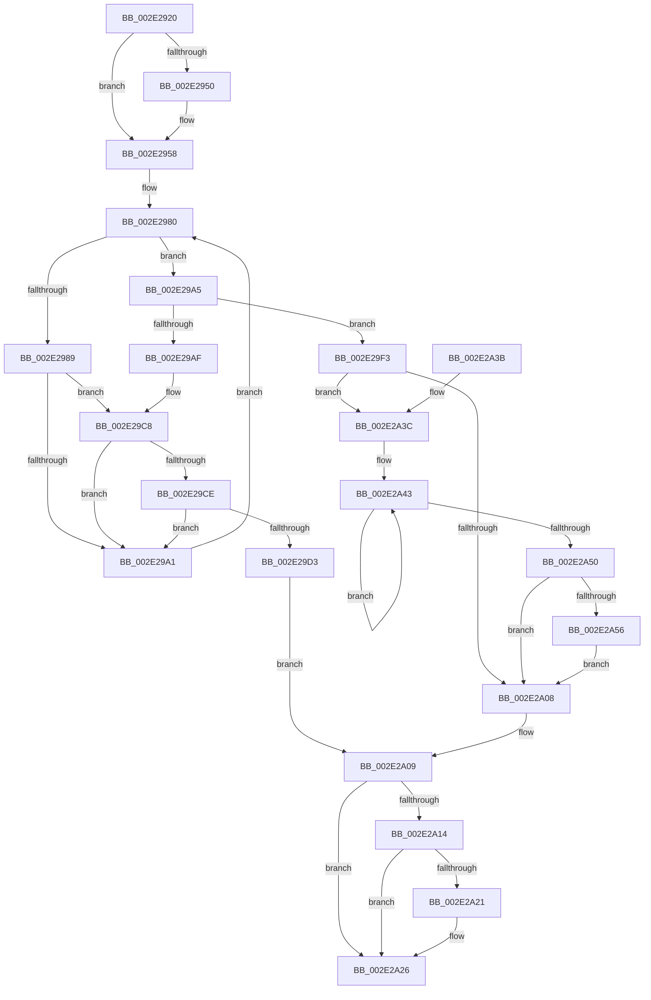

# PspUnlockProcessListShared

- RVA: `0x002E2920`–`0x002E2A5D` (길이 `317` bytes)
- VA: `0x00000001402E2920`
- 실행 섹션: `.text`
- PDB 이름 있음: `예`; PDB Function 태그: `아니요`
- unwind 정보 RVA: `0x00070D5C`
- 디코드: `86`개 명령, `317/317` bytes 표시
- 미해석 바이트: `0` (있으면 어셈블리에 `.byte`로 보존)

> 이 문서는 커널 이미지의 기계어와 PDB 기호를 분석해 생성했습니다. 4번과 5번은 함수 원형과 자료형을 바이너리 사용 방식에서 추정한 C 해석이며 원본 소스 복구 결과는 아닙니다.

## 1. Dependencies

- 직접 호출 지점: **5**; 고유 호출 대상: **5**
- 직접 호출자로 확인된 함수: **3**
- RIP 상대 이미지 참조: **1**

### Outgoing calls
- `0x002E2953` → [ExfReleasePushLockShared](../26/ExfReleasePushLockShared_function_00263440.md) (function, `0x00263440`)
- `0x002E29C2` → [KeBugCheckEx](../4F/KeBugCheckEx_function_004FD660.md) (function, `0x004FD660`)
- `0x002E29EC` → [KiAbEntryFreeAndEnableInterrupts](../26/KiAbEntryFreeAndEnableInterrupts_function_002622D0.md) (function, `0x002622D0`)
- `0x002E2A21` → [KiCheckForKernelApcDelivery](KiCheckForKernelApcDelivery_function_002E2C80.md) (function, `0x002E2C80`)
- `0x002E2A56` → [KiRemoveSystemWorkPriorityKick](../26/KiRemoveSystemWorkPriorityKick_function_002631D0.md) (function, `0x002631D0`)

### Direct callers
- [PsGetPreviousProcess](../../page/91/PsGetPreviousProcess_function_0091E24C.md) at `0x0091E2C2`
- [PsChangeQuantumTable](../../page/A3/PsChangeQuantumTable_function_00A3BE70.md) at `0x00A3BF6C`
- [PsGetNextProcessEx](../../page/A4/PsGetNextProcessEx_function_00A48CC0.md) at `0x00A48D30`

### Static image references
- `0x002E293E` → RVA `0x00FD9AF8` (`PAGEDATA`; read)

## 2. Other-region calls and transfers

- 다른 실행 섹션으로 향하는 call: **0**
- 별도 외부 분기/꼬리 이동을 확인하지 못했습니다.

## 3. Assembly (complete function range)

```asm
002E2920  48 89 5C 24 08                  mov qword ptr [rsp + 8], rbx
002E2925  48 89 6C 24 18                  mov qword ptr [rsp + 0x18], rbp
002E292A  48 89 74 24 20                  mov qword ptr [rsp + 0x20], rsi
002E292F  57                              push rdi
002E2930  48 83 EC 30                     sub rsp, 0x30
002E2934  48 8B D9                        mov rbx, rcx
002E2937  33 F6                           xor esi, esi
002E2939  B8 11 00 00 00                  mov eax, 0x11
002E293E  F0 48 0F B1 35 B1 71 CF 00      lock cmpxchg qword ptr [rip + 0xcf71b1], rsi
002E2947  48 8D 3D AA 71 CF 00            lea rdi, [rip + 0xcf71aa]
002E294E  74 08                           je 0x1402e2958
002E2950  48 8B CF                        mov rcx, rdi
002E2953  E8 E8 0A F8 FF                  call 0x140263440
002E2958  65 4C 8B 1C 25 88 01 00 00      mov r11, qword ptr gs:[0x188]
002E2961  FA                              cli
002E2962  4D 8B 83 70 04 00 00            mov r8, qword ptr [r11 + 0x470]
002E2969  4C 8B CF                        mov r9, rdi
002E296C  48 BD FC FF FF FF FF FF FF 7F   movabs rbp, 0x7ffffffffffffffc
002E2976  8B C6                           mov eax, esi
002E2978  4C 23 CD                        and r9, rbp
002E297B  0F 1F 44 00 00                  nop dword ptr [rax + rax]
002E2980  41 0F B6 48 0C                  movzx ecx, byte ptr [r8 + 0xc]
002E2985  3B C1                           cmp eax, ecx
002E2987  73 1C                           jae 0x1402e29a5
002E2989  8B C8                           mov ecx, eax
002E298B  4C 6B D1 58                     imul r10, rcx, 0x58
002E298F  4D 03 D0                        add r10, r8
002E2992  49 8B 52 10                     mov rdx, qword ptr [r10 + 0x10]
002E2996  48 8B CA                        mov rcx, rdx
002E2999  48 23 CD                        and rcx, rbp
002E299C  49 3B C9                        cmp rcx, r9
002E299F  74 27                           je 0x1402e29c8
002E29A1  FF C0                           inc eax
002E29A3  EB DB                           jmp 0x1402e2980
002E29A5  41 8B 43 78                     mov eax, dword ptr [r11 + 0x78]
002E29A9  0F BA E0 10                     bt eax, 0x10
002E29AD  72 44                           jb 0x1402e29f3
002E29AF  45 33 C9                        xor r9d, r9d
002E29B2  48 89 74 24 20                  mov qword ptr [rsp + 0x20], rsi
002E29B7  4C 8B C7                        mov r8, rdi
002E29BA  49 8B D3                        mov rdx, r11
002E29BD  B9 62 01 00 00                  mov ecx, 0x162
002E29C2  E8 99 AC 21 00                  call 0x1404fd660
002E29C7  CC                              int3
002E29C8  41 38 72 1A                     cmp byte ptr [r10 + 0x1a], sil
002E29CC  74 D3                           je 0x1402e29a1
002E29CE  F6 C2 01                        test dl, 1
002E29D1  75 CE                           jne 0x1402e29a1
002E29D3  41 B9 01 00 00 00               mov r9d, 1
002E29D9  41 88 72 1A                     mov byte ptr [r10 + 0x1a], sil
002E29DD  4C 8B C7                        mov r8, rdi
002E29E0  48 89 74 24 20                  mov qword ptr [rsp + 0x20], rsi
002E29E5  49 8B D3                        mov rdx, r11
002E29E8  49 8D 4A 10                     lea rcx, [r10 + 0x10]
002E29EC  E8 DF F8 F7 FF                  call 0x1402622d0
002E29F1  EB 16                           jmp 0x1402e2a09
002E29F3  65 48 8B 0C 25 20 00 00 00      mov rcx, qword ptr gs:[0x20]
002E29FC  4C 8B 81 B8 8E 00 00            mov r8, qword ptr [rcx + 0x8eb8]
002E2A03  4D 85 C0                        test r8, r8
002E2A06  75 34                           jne 0x1402e2a3c
002E2A08  FB                              sti
002E2A09  90                              nop
002E2A0A  66 83 83 E6 01 00 00 01         add word ptr [rbx + 0x1e6], 1
002E2A12  75 12                           jne 0x1402e2a26
002E2A14  48 8D 83 98 00 00 00            lea rax, [rbx + 0x98]
002E2A1B  90                              nop
002E2A1C  48 39 00                        cmp qword ptr [rax], rax
002E2A1F  74 05                           je 0x1402e2a26
002E2A21  E8 5A 02 00 00                  call 0x1402e2c80
002E2A26  48 8B 5C 24 40                  mov rbx, qword ptr [rsp + 0x40]
002E2A2B  48 8B 6C 24 50                  mov rbp, qword ptr [rsp + 0x50]
002E2A30  48 8B 74 24 58                  mov rsi, qword ptr [rsp + 0x58]
002E2A35  48 83 C4 30                     add rsp, 0x30
002E2A39  5F                              pop rdi
002E2A3A  C3                              ret
002E2A3B  CC                              int3
002E2A3C  41 0F 0D 08                     prefetchw byte ptr [r8]
002E2A40  41 8B 00                        mov eax, dword ptr [r8]
002E2A43  8B D0                           mov edx, eax
002E2A45  0F BA F2 15                     btr edx, 0x15
002E2A49  F0 41 0F B1 10                  lock cmpxchg dword ptr [r8], edx
002E2A4E  75 F3                           jne 0x1402e2a43
002E2A50  0F BA E0 15                     bt eax, 0x15
002E2A54  73 B2                           jae 0x1402e2a08
002E2A56  E8 75 07 F8 FF                  call 0x1402631d0
002E2A5B  EB AB                           jmp 0x1402e2a08
```

## 4. C-style interpretation (structured pseudocode)

```c
__int64 __fastcall PspUnlockProcessListShared(__int64 a1)
{
    __int64 result;
    __int64 v_r10;
    __int64 v_rsi;
    __int64 v_rsp;
    unsigned __int64 v_stack_m18;
    unsigned __int64 v_stack_p18;
    unsigned __int64 v_stack_p20;
    unsigned __int64 v_stack_p8;

    v_stack_p8 = v_rbx;
    v_stack_p18 = v_rbp;
    v_stack_p20 = v_rsi;
    v_rsp = (v_rsp) - (48);
    v_rsi = 0;
    result = 17;
    if (!(condition_is_equal)) {
        a1 = v_rip + 13595050;
        result = ExfReleasePushLockShared(a1, a2, a3, a4);
    }
    a4 = (v_rip + 13595050) & (v_rbp);
loc_002E2980:
    if (0 >= ((unsigned int)(*(unsigned __int8 *)(*(unsigned __int64 *)(*(unsigned __int64 *)(gs_base + (0 + 392)) + 1136) + 12)))) goto loc_002E29A5;
    v_r10 = (v_r10) * (0);
    v_r10 = (v_r10) + (*(unsigned __int64 *)(*(unsigned __int64 *)(gs_base + (0 + 392)) + 1136));
    a1 = (*(unsigned __int64 *)(v_r10 + 16)) & (v_rbp);
    if (a1 == a4) goto loc_002E29C8;
loc_002E29A1:
    result = (unsigned int)((0) + 1);
    goto loc_002E2980;
loc_002E29A5:
    if (a1 < a4) goto loc_002E29F3;
    a4 = 0;
    v_stack_m18 = 0;
    result = KeBugCheckEx(354, *(unsigned __int64 *)(gs_base + (0 + 392)), v_rip + 13595050, a4);
loc_002E29C8:
    if ((*(unsigned __int8 *)(v_r10 + 26)) == 0) goto loc_002E29A1;
    if ((((unsigned __int8)(*(unsigned __int64 *)(gs_base + (0 + 392)))) & (1)) != 0) goto loc_002E29A1;
    *(unsigned __int8 *)(v_r10 + 26) = 0;
    v_stack_m18 = 0;
    result = KiAbEntryFreeAndEnableInterrupts(v_r10 + 16, *(unsigned __int64 *)(gs_base + (0 + 392)), v_rip + 13595050, 1);
    goto loc_002E2A09;
loc_002E29F3:
    if (*(unsigned __int64 *)(*(unsigned __int64 *)(gs_base + (0 + 32)) + 36536) != 0) goto loc_002E2A3C;
loc_002E2A08:
loc_002E2A09:
    if (*(unsigned __int64 *)(*(unsigned __int64 *)(gs_base + (0 + 32)) + 36536) != 0) goto loc_002E2A26;
    result = a1 + 152;
    if ((*(unsigned __int64 *)(a1 + 152)) != (a1 + 152)) {
        result = KiCheckForKernelApcDelivery(*(unsigned __int64 *)(gs_base + (0 + 32)), *(unsigned __int64 *)(gs_base + (0 + 392)), *(unsigned __int64 *)(*(unsigned __int64 *)(gs_base + (0 + 32)) + 36536), 1);
    }
    v_rsp = (v_rsp) + (48);
    return result;
loc_002E2A3C:
loc_002E2A43:
    if (condition_is_not_equal) goto loc_002E2A43;
    if (condition_is_above_or_equal) goto loc_002E2A08;
    result = KiRemoveSystemWorkPriorityKick(*(unsigned __int64 *)(gs_base + (0 + 32)), (unsigned int)((unsigned int)((unsigned int)(*(unsigned int *)(*(unsigned __int64 *)(*(unsigned __int64 *)(gs_base + (0 + 32)) + 36536))))), *(unsigned __int64 *)(*(unsigned __int64 *)(gs_base + (0 + 32)) + 36536), 1);
    goto loc_002E2A08;
}
```

## 5. (Beta) C Style

```c
int64_t PspUnlockProcessListShared(void *Arg1)
{
    uint8_t *arg1 = (uint8_t *)Arg1;

    int64_t result;
    int64_t local_r10;
    int64_t local_rsi;
    int64_t local_rsp;
    uint64_t v_stack_m18;
    uint64_t v_stack_p18;
    uint64_t v_stack_p20;
    uint64_t v_stack_p8;

    v_stack_p8 = local_rbx;
    v_stack_p18 = local_rbp;
    v_stack_p20 = local_rsi;
    local_rsp = (local_rsp) - (48);
    local_rsi = 0;
    result = 17;
    if (!(condition_is_equal)) {
        Arg1 = v_rip + 13595050;
        result = ExfReleasePushLockShared(Arg1, a2, a3, a4);
    }
    a4 = (v_rip + 13595050) & (local_rbp);
loc_002E2980:
    if (0 >= ((uint32_t)(*(uint8_t *)(*(uint64_t *)(*(uint64_t *)(gs_base + (0 + 0x188)) + 0x470) + 0xC)))) goto loc_002E29A5;
    local_r10 = (local_r10) * (0);
    local_r10 = (local_r10) + (*(uint64_t *)(*(uint64_t *)(gs_base + (0 + 0x188)) + 0x470));
    Arg1 = (*(uint64_t *)(local_r10 + 0x10)) & (local_rbp);
    if (Arg1 == a4) goto loc_002E29C8;
loc_002E29A1:
    result = (uint32_t)((0) + 1);
    goto loc_002E2980;
loc_002E29A5:
    if (Arg1 < a4) goto loc_002E29F3;
    a4 = 0;
    v_stack_m18 = 0;
    result = KeBugCheckEx(354, *(uint64_t *)(gs_base + (0 + 0x188)), v_rip + 13595050, a4);
loc_002E29C8:
    if ((*(uint8_t *)(local_r10 + 0x1A)) == 0) goto loc_002E29A1;
    if ((((uint8_t)(*(uint64_t *)(gs_base + (0 + 0x188)))) & (1)) != 0) goto loc_002E29A1;
    *(uint8_t *)(local_r10 + 0x1A) = 0;
    v_stack_m18 = 0;
    result = KiAbEntryFreeAndEnableInterrupts(local_r10 + 16, *(uint64_t *)(gs_base + (0 + 0x188)), v_rip + 13595050, 1);
    goto loc_002E2A09;
loc_002E29F3:
    if (*(uint64_t *)(*(uint64_t *)(gs_base + (0 + 0x20)) + 0x8EB8) != 0) goto loc_002E2A3C;
loc_002E2A08:
loc_002E2A09:
    if (*(uint64_t *)(*(uint64_t *)(gs_base + (0 + 0x20)) + 0x8EB8) != 0) goto loc_002E2A26;
    result = Arg1 + 152;
    if ((*(uint64_t *)(arg1 + 0x98)) != (Arg1 + 152)) {
        result = KiCheckForKernelApcDelivery(*(uint64_t *)(gs_base + (0 + 0x20)), *(uint64_t *)(gs_base + (0 + 0x188)), *(uint64_t *)(*(uint64_t *)(gs_base + (0 + 0x20)) + 0x8EB8), 1);
    }
    local_rsp = (local_rsp) + (48);
    return result;
loc_002E2A3C:
loc_002E2A43:
    if (condition_is_not_equal) goto loc_002E2A43;
    if (condition_is_above_or_equal) goto loc_002E2A08;
    result = KiRemoveSystemWorkPriorityKick(*(uint64_t *)(gs_base + (0 + 0x20)), (uint32_t)((uint32_t)((uint32_t)(*(uint32_t *)(*(uint64_t *)(*(uint64_t *)(gs_base + (0 + 0x20)) + 0x8EB8))))), *(uint64_t *)(*(uint64_t *)(gs_base + (0 + 0x20)) + 0x8EB8), 1);
    goto loc_002E2A08;
}
```

### 관측된 메모리 오프셋

구조체 형식이 확인되지 않은 접근은 인자 기준의 오프셋으로만 기록했습니다.

| 기준 인자 | 오프셋 표현 | 폭 (bit) | 접근 |
|---|---:|---:|---|
| `Arg1` | `+ 0x0` | `64` | `R` |
| `Arg1` | `+ 0x98` | `64` | `R` |
| `Arg1` | `+ 0x1E6` | `16` | `R/W` |

## 6. Execution-region graph

[열기: 2D/3D 그래프와 함수 탐색 컨트롤 패널](../../../control-panel.html?section=text&rva=0x002E2920&view=graph)

- 2D 그래프는 위에서 아래로 흐르고, 3D 그래프는 빈 공간을 드래그해 회전합니다. Shift+드래그는 이동, 휠은 확대·축소, 함수 노드 선택은 대상 보고서 이동입니다.

### Static fallback


