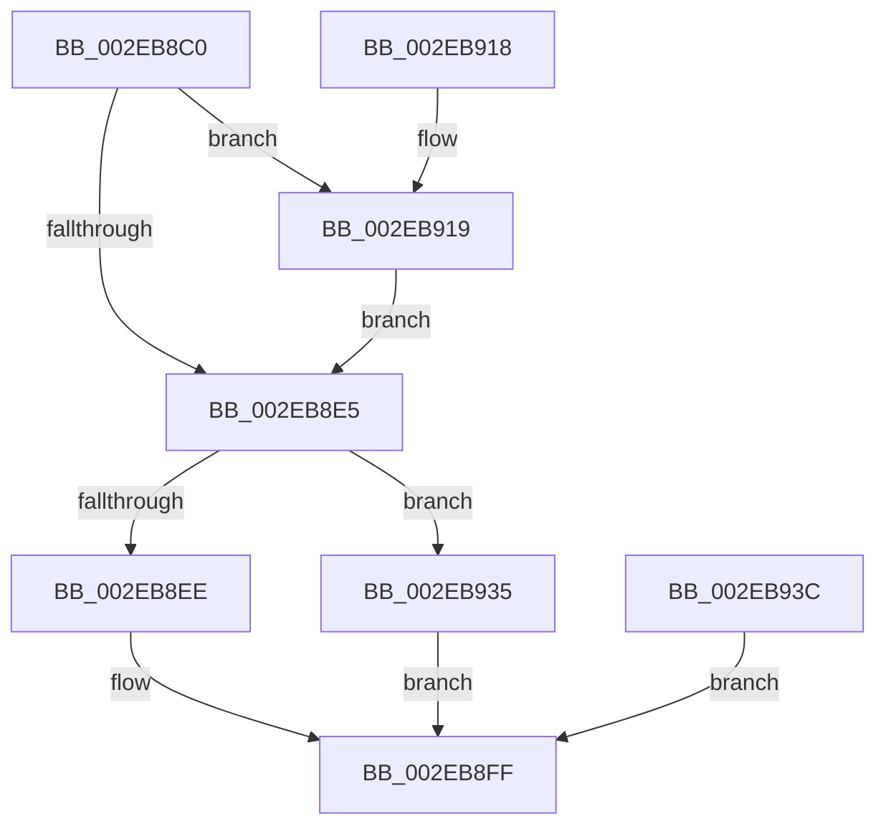

# RtlAllocateHeap

- RVA: `0x002EB8C0`–`0x002EB945` (길이 `133` bytes)
- VA: `0x00000001402EB8C0`
- 실행 섹션: `.text`
- PDB 이름 있음: `예`; PDB Function 태그: `아니요`
- unwind 정보 RVA: `0x000716B4`
- 디코드: `39`개 명령, `133/133` bytes 표시
- 미해석 바이트: `0` (있으면 어셈블리에 `.byte`로 보존)

> 이 문서는 커널 이미지의 기계어와 PDB 기호를 분석해 생성했습니다. 4번과 5번은 함수 원형과 자료형을 바이너리 사용 방식에서 추정한 C 해석이며 원본 소스 복구 결과는 아닙니다.

## 1. Dependencies

- 직접 호출 지점: **2**; 고유 호출 대상: **2**
- 직접 호출자로 확인된 함수: **0**
- RIP 상대 이미지 참조: **0**

### Outgoing calls
- `0x002EB8F7` → [RtlpAllocateNTHeapInternal](RtlpAllocateNTHeapInternal_function_002EB94C.md) (function, `0x002EB94C`)
- `0x002EB92E` → [RtlpLogHeapFailure](../35/RtlpLogHeapFailure_function_0035B7BC.md) (function, `0x0035B7BC`)

### Direct callers
- 이 함수 시작 RVA로 연결되는 직접 call은 확인되지 않았습니다. 간접 호출은 완전히 역산할 수 없습니다.

### Static image references
- 디코드된 RIP-relative 메모리 참조가 없습니다.

## 2. Other-region calls and transfers

- 다른 실행 섹션으로 향하는 call: **0**
- 별도 외부 분기/꼬리 이동을 확인하지 못했습니다.

## 3. Assembly (complete function range)

```asm
002EB8C0  48 89 5C 24 08                  mov qword ptr [rsp + 8], rbx
002EB8C5  48 89 74 24 10                  mov qword ptr [rsp + 0x10], rsi
002EB8CA  48 89 7C 24 18                  mov qword ptr [rsp + 0x18], rdi
002EB8CF  41 56                           push r14
002EB8D1  48 83 EC 40                     sub rsp, 0x40
002EB8D5  49 8B F0                        mov rsi, r8
002EB8D8  44 8B F2                        mov r14d, edx
002EB8DB  48 8B F9                        mov rdi, rcx
002EB8DE  33 DB                           xor ebx, ebx
002EB8E0  48 85 C9                        test rcx, rcx
002EB8E3  74 34                           je 0x1402eb919
002EB8E5  81 7F 10 EE DD EE DD            cmp dword ptr [rdi + 0x10], 0xddeeddee
002EB8EC  74 47                           je 0x1402eb935
002EB8EE  45 8B C6                        mov r8d, r14d
002EB8F1  48 8B D6                        mov rdx, rsi
002EB8F4  48 8B CF                        mov rcx, rdi
002EB8F7  E8 50 00 00 00                  call 0x1402eb94c
002EB8FC  48 8B D8                        mov rbx, rax
002EB8FF  48 8B C3                        mov rax, rbx
002EB902  48 8B 5C 24 50                  mov rbx, qword ptr [rsp + 0x50]
002EB907  48 8B 74 24 58                  mov rsi, qword ptr [rsp + 0x58]
002EB90C  48 8B 7C 24 60                  mov rdi, qword ptr [rsp + 0x60]
002EB911  48 83 C4 40                     add rsp, 0x40
002EB915  41 5E                           pop r14
002EB917  C3                              ret
002EB918  CC                              int3
002EB919  48 89 5C 24 28                  mov qword ptr [rsp + 0x28], rbx
002EB91E  48 89 5C 24 20                  mov qword ptr [rsp + 0x20], rbx
002EB923  45 33 C9                        xor r9d, r9d
002EB926  45 33 C0                        xor r8d, r8d
002EB929  33 D2                           xor edx, edx
002EB92B  8D 4A 13                        lea ecx, [rdx + 0x13]
002EB92E  E8 89 FE 06 00                  call 0x14035b7bc
002EB933  EB B0                           jmp 0x1402eb8e5
002EB935  48 89 5C 24 30                  mov qword ptr [rsp + 0x30], rbx
002EB93A  EB C3                           jmp 0x1402eb8ff
002EB93C  33 DB                           xor ebx, ebx
002EB93E  48 89 5C 24 30                  mov qword ptr [rsp + 0x30], rbx
002EB943  EB BA                           jmp 0x1402eb8ff
```

## 4. C-style interpretation (structured pseudocode)

```c
__int64 __fastcall RtlAllocateHeap(__int64 a1, int a2, __int64 a3, int a4)
{
    __int64 result;
    __int64 v_rbx;
    __int64 v_rsp;
    unsigned __int64 v_stack_p10;
    unsigned __int64 v_stack_p18;
    unsigned __int64 v_stack_p20;
    unsigned __int64 v_stack_p28;
    unsigned __int64 v_stack_p30;
    unsigned __int64 v_stack_p8;

    v_stack_p8 = v_rbx;
    v_stack_p10 = v_rsi;
    v_stack_p18 = v_rdi;
    v_rsp = (v_rsp) - (64);
    v_rbx = 0;
    if (a1 == 0) goto loc_002EB919;
loc_002EB8E5:
    if ((*(unsigned int *)(a1 + 16)) == 0xDDEEDDEEULL) goto loc_002EB935;
    result = RtlpAllocateNTHeapInternal(a1, a3, (unsigned int)((unsigned int)((unsigned int)(a2))), a4);
loc_002EB8FF:
    v_rsp = (v_rsp) + (64);
    return result;
loc_002EB919:
    v_stack_p28 = v_stack_p8;
    v_stack_p20 = v_stack_p8;
    a4 = 0;
    a3 = 0;
    a2 = 0;
    result = RtlpLogHeapFailure(a2 + 19, a2, a3, a4);
    goto loc_002EB8E5;
loc_002EB935:
    v_stack_p30 = v_stack_p8;
    goto loc_002EB8FF;
}
```

## 5. (Beta) C Style

```c
int64_t RtlAllocateHeap(void *Arg1, int32_t Arg2, int64_t Arg3, int32_t Arg4)
{
    uint8_t *arg1 = (uint8_t *)Arg1;

    int64_t result;
    int64_t local_rbx;
    int64_t local_rsp;
    uint64_t v_stack_p10;
    uint64_t v_stack_p18;
    uint64_t v_stack_p20;
    uint64_t v_stack_p28;
    uint64_t v_stack_p30;
    uint64_t v_stack_p8;

    v_stack_p8 = local_rbx;
    v_stack_p10 = local_rsi;
    v_stack_p18 = local_rdi;
    local_rsp = (local_rsp) - (64);
    local_rbx = 0;
    if (Arg1 == NULL) goto loc_002EB919;
loc_002EB8E5:
    if ((*(uint32_t *)(arg1 + 0x10)) == 0xDDEEDDEEULL) goto loc_002EB935;
    result = RtlpAllocateNTHeapInternal(Arg1, Arg3, (uint32_t)((uint32_t)((uint32_t)(Arg2))), Arg4);
loc_002EB8FF:
    local_rsp = (local_rsp) + (64);
    return result;
loc_002EB919:
    v_stack_p28 = v_stack_p8;
    v_stack_p20 = v_stack_p8;
    Arg4 = 0;
    Arg3 = 0;
    Arg2 = 0;
    result = RtlpLogHeapFailure(Arg2 + 19, Arg2, Arg3, Arg4);
    goto loc_002EB8E5;
loc_002EB935:
    v_stack_p30 = v_stack_p8;
    goto loc_002EB8FF;
}
```

### 관측된 메모리 오프셋

구조체 형식이 확인되지 않은 접근은 인자 기준의 오프셋으로만 기록했습니다.

| 기준 인자 | 오프셋 표현 | 폭 (bit) | 접근 |
|---|---:|---:|---|
| `Arg1` | `+ 0x10` | `32` | `R` |

## 6. Execution-region graph

[열기: 2D/3D 그래프와 함수 탐색 컨트롤 패널](../../../control-panel.html?section=text&rva=0x002EB8C0&view=graph)

- 2D 그래프는 위에서 아래로 흐르고, 3D 그래프는 빈 공간을 드래그해 회전합니다. Shift+드래그는 이동, 휠은 확대·축소, 함수 노드 선택은 대상 보고서 이동입니다.

### Static fallback


